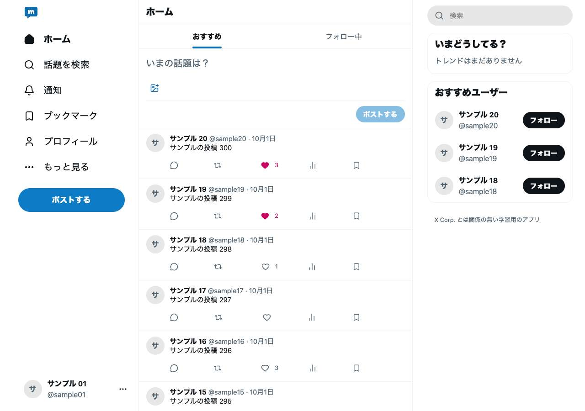

# x-modoki

X（x.com）の Web 版の見た目と操作をまねた、学習用の SNS です。Next.js の 1 つのアプリで、投稿・返信・引用・リポスト・いいね・ブックマーク・フォロー・検索・通知・プロフィールの編集が動きます。

**X Corp. とは関係がありません。** 名前・ロゴ・データは全部この学習のためのもので、X のサービスやデータには一切つながりません。



## 要るもの

- Node.js 24（`.nvmrc`）
- pnpm 12.19.0（`corepack enable`）
- Docker（PostgreSQL と、画像を置く Garage をコンテナで動かす）

## 動かす

```sh
pnpm install
sh scripts/setup-local.sh
pnpm db:migrate
pnpm db:seed
pnpm dev
```

`http://localhost:3000` を開き、ユーザー名 `sample01`、パスワード `sample-password`（開発用の架空の人）で入れます。


詳しい手順・テストの動かし方・よくある失敗は [ローカルで動かす](docs/guides/local-development.md)、うまくいかないときは [困ったときの手順](docs/guides/operations.md) にあります。

## 今の状態

| マイルストーン | 状態 | 中身 |
|---|---|---|
| 1. ローカルで全部が動く | 終わった（`0.1.0`、[CHANGELOG](CHANGELOG.md)） | [機能の範囲](docs/architecture/scope.md) の 1 節の全部。Docker の PostgreSQL と Garage で動く |
| 2. Cloudflare で動く | これから（[#91](https://github.com/ohta-rh/x-modoki-v2/issues/91)） | Workers・Hyperdrive・R2 への配備。機能は増えない |

## 確かめ方

- `PORT=3300 pnpm verify` が、CI と同じ 7 つの確認（ドキュメント・型・lint・整形・テストとカバレッジ 100%・ビルド・Chromium と Firefox と WebKit の画面のテスト）を流す。CI はこれに本番の依存の監査を足した 8 つと、まっさらな clone で手順書を流すジョブを動かす
- commit の前に、ステージした中身でドキュメントの確認が動く（`scripts/setup-local.sh` が有効にする）

## 進め方

このリポジトリは、エージェント（Claude Code）が人の手を借りずに要件から運用まで進められるように、決まり（ハーネス）を持っています。

- [CLAUDE.md](CLAUDE.md) が入口で、詳しい決まりは [.claude/rules/](.claude/rules/) にある: issue の書き方、Feature-Sliced Design、品質の確認、TDD、独立したコードレビュー、完了の定義、1 件ずつ閉じるまでのループ、バグの扱い、文書と ADR
- コードレビューは、差分の範囲だけを渡された別のエージェント（[.claude/agents/code-reviewer.md](.claude/agents/code-reviewer.md)）が行う
- 作業は EPIC と PBI の issue で計画し、PBI ごとに試験レポート（画面の写真つき）を [docs/test-reports/](docs/test-reports/index.md) に残す
- 決定は [ADR](docs/adr/README.md) に残す。マイルストーン 1 で分かったことは [振り返り](docs/research/retrospective-m1.md) にある

## 文書

設計・決定（ADR）・要件・試験の記録は [docs/index.md](docs/index.md) から辿れます。

## ライセンス

[MIT](LICENSE)
