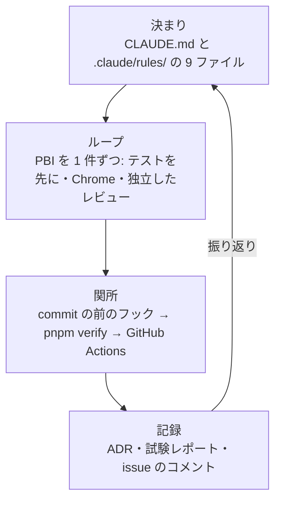

# ハーネスの全体像

- 図解（ブラウザで開く）: [harness.html](harness.html)
- 決定: [ADR-0023](../adr/0023-delivery-loop-one-pbi-at-a-time.md)（1 件ずつ閉じるまでのループ）、[ADR-0024](../adr/0024-definition-of-done-requires-browser-testing.md)〜[ADR-0027](../adr/0027-independent-code-review-in-the-loop.md)（完了の定義・試験レポート・TDD・独立したレビュー）、[ADR-0028](../adr/0028-bugs-are-fixed-to-completion-without-asking.md)・[ADR-0056](../adr/0056-bugs-fixed-inside-the-pbi-and-lighter-local-checks.md)（バグの扱い）、[ADR-0070](../adr/0070-ci-has-eight-gates-with-the-dependency-audit.md)（CI の 8 つの確認）、[ADR-0072](../adr/0072-docs-checked-on-the-staged-tree-before-commit.md)（commit の前のフック）
- 2026-11-20 の時点（ブランチ `m1/local-app`）

## 1. 4 つの層

| 層 | 中身 | 置き場所 |
|---|---|---|
| 決まり | issue の書き方、構造（FSD）、品質の関所、TDD、レビュー、バグ、完了の定義、ループ、文書と ADR | `CLAUDE.md`、`.claude/rules/` |
| ループ | PBI を EPIC の順に 1 件ずつ、閉じるまで。独立した code-reviewer（opus）と、探索的テストの打鍵役 | `.claude/rules/delivery-loop.md`、`.claude/agents/code-reviewer.md` |
| 関所 | commit の前のフック、`pnpm verify` の 7 つ、CI の 8 つとまっさらな clone、自前の lint とスクリプト | `.githooks/`、`package.json`、`.github/workflows/ci.yml`、`eslint-rules/`、`scripts/` |
| 記録 | 決定、試験レポート（写真つき）、issue を閉じるときの根拠 | `docs/adr/`、`docs/test-reports/`、GitHub の issue |

## 2. 関所の順番

| いつ | 関所 | 確かめること | かかる時間 |
|---|---|---|---|
| commit のとき | `.githooks/pre-commit` | ステージした木で、ドキュメントの形とリンク、要件とテストの結びつき、引いた ADR の番号 | 約 1 秒 |
| push の前 | `pnpm verify` | 型・ESLint・Steiger・整形・単体とデータアクセス層（カバレッジ 100%）・ビルド・3 ブラウザの e2e | 約 10 分 |
| push の前 | 人の代わりの目 | 本物の Chrome（3 つの幅と 640×400）、独立した code-reviewer | 数分〜 |
| push の後 | GitHub Actions | 依存の監査と上の 7 つ、`fresh-clone` で手順書をそのまま流す | 約 20 分 |

## 3. エージェントが決めないこと

アカウント・支払い・秘密の値、強制の push、作っていない物を消すこと、確認を弱めること、マージとリリースの公開は、ユーザーのもの。それ以外の判断はエージェントが決め、ADR に残す（[ADR-0028](../adr/0028-bugs-are-fixed-to-completion-without-asking.md)、[ADR-0029](../adr/0029-milestone-on-a-branch-when-a-pr-is-requested.md)）。

PBI ごとの 1 周の 12 の手順、完了の定義の 10 項目、間違いから生まれた決まりの表は、[図解](harness.html) にある。
