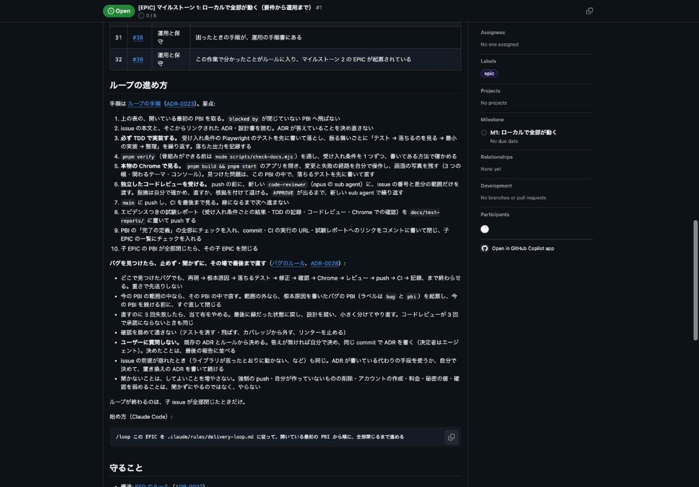
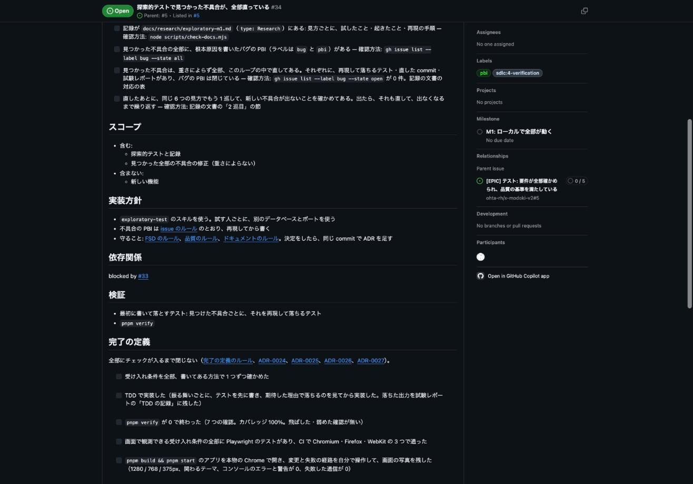
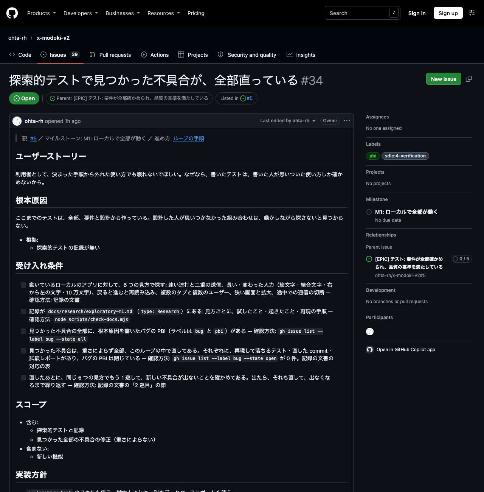
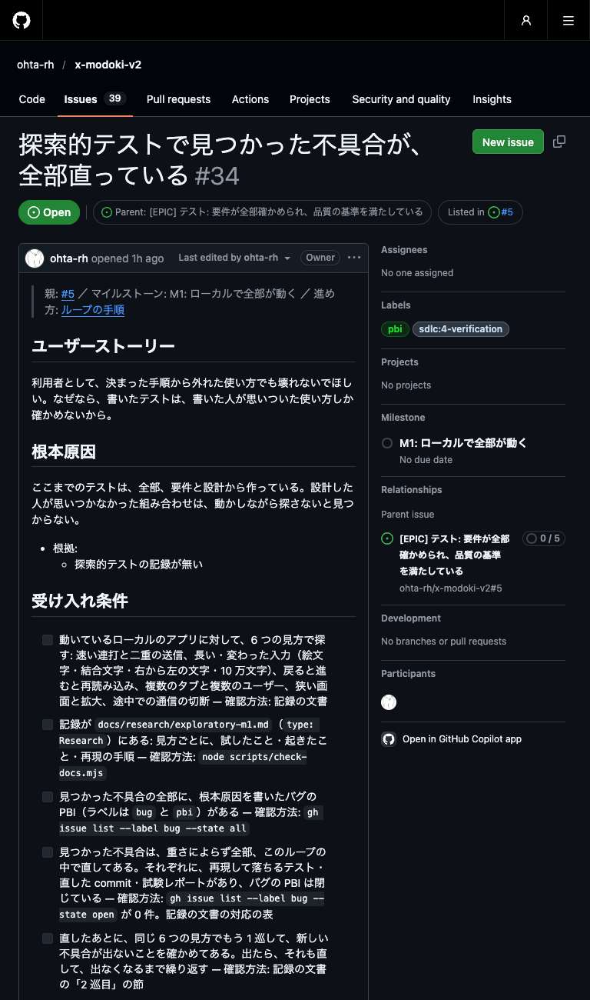
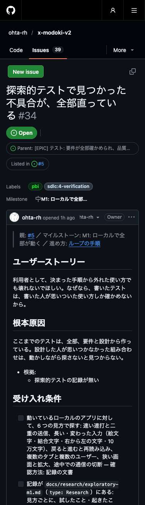

# 試験レポート: バグは止めず・聞かずに最後まで直すルール

## 対象

- issue: [#1](https://github.com/ohta-rh/x-modoki-v2/issues/1) と #8〜#39 の本文（PBI に結びつかない作業）
- commit: `ffaa670`
- CI: [実行 44219480282](https://github.com/ohta-rh/x-modoki-v2/actions/runs/44219480282)（成功）
- 日付: 2026-11-18

## 環境

- OS: macOS 26.2
- ブラウザ: Google Chrome 157.0.8103.79（手での操作は Claude in Chrome の拡張。幅ごとの写真は `scripts/chrome-evidence.mjs`）
- Node.js: 手元は 26.12.0、CI は 24（`.nvmrc`）
- 対象: GitHub の上で表示された issue。ログインしていない状態で見た

## 判定

合格 — 確かめた条件 6 件のうち 6 件を満たした。

## 受け入れ条件ごとの結果

| # | 条件 | 確かめ方 | 結果 | エビデンス |
|---|---|---|---|---|
| 1 | バグのルール（`.claude/rules/bug-handling.md`）と ADR-0028 があり、`CLAUDE.md` から読まれる | ファイルを読む。`node scripts/check-docs.mjs` | 合格 | 「自動のテスト」 |
| 2 | ループ・コードレビュー・完了の定義・issue のルールに、バグを先送りする・`blocked` にする・ユーザーに聞く、という記述が残っていない | `grep -n blocked .claude/rules/*.md CLAUDE.md` の結果を 1 行ずつ読む | 合格（残っているのは、依存関係の `blocked by` と、「バグには使わない」という記述だけ） | 「自動のテスト」 |
| 3 | 聞かないことが、してよいことを増やしていない（強制の push・削除・アカウント・料金・秘密の値・確認を弱めることは、やらない、と書いてある） | バグのルールの 3 節と、#1 の本文を読む | 合格 | [#1 のループの進め方](evidence/2026-11-18-bug-handling-rule/chrome-issue-1-loop.jpg) |
| 4 | #1 の「ループの進め方」に、止めず・聞かずに直す手順があり、`blocked` のラベルを付けて待つ記述が無い | Chrome で #1 を開いて読む | 合格 | 同上 |
| 5 | 全部の PBI の本文に、バグの注がある。「3 回まで」「中と低は開いたまま」の記述が、どの issue にも無い | `gh issue list` の本文を数える | 合格（32 / 32、残り 0 件） | 「自動のテスト」 |
| 6 | #34 が、重さによらず全部直すこと・直したあとにもう 1 巡することを求めている | Chrome で #34 を開いて読む | 合格 | [#34 の受け入れ条件](evidence/2026-11-18-bug-handling-rule/chrome-issue-34-criteria.jpg) |

## 自動のテスト

```
$ node scripts/check-docs.mjs
docs check passed: 49 file(s)

PBIs with bug note: 32/32
issues still saying 3 回まで / 中と低: 0
```

CI: 「Tests for the repository scripts: success」「Documentation check: success」。

### TDD の記録

コードの変更なし（ルール・ADR・issue の本文だけ）。

## コードレビュー

コードの変更なし。

## ブラウザでの確認

手での操作（Claude in Chrome。ウィンドウの中の幅は 1746 CSS px）:

| URL | した操作 | 見えた結果 | 画面の写真 |
|---|---|---|---|
| `/issues/1` | 開いて、「ループの進め方」まで進む | 手順 10 個のあとに「バグを見つけたら、止めず・聞かずに、その場で最後まで直す」と 7 つの項目。「ユーザーに質問しない」「聞かないことは、してよいことを増やさない」がある。`blocked` のラベルを付けて待つ記述は無い。リンクは「バグのルール」と ADR-0028 |  |
| `/issues/34` | 開いて、受け入れ条件と「検証」まで進む | タイトルが「探索的テストで見つかった不具合が、全部直っている」。受け入れ条件に「重さによらず全部」「もう 1 巡」。古い「中と低は開いたまま」は無い |  |

幅ごとの表示（`node scripts/chrome-evidence.mjs`）:

| URL | 幅 | `innerWidth` | 横のスクロール | 画面の写真 |
|---|---|---|---|---|
| `/issues/34` | 1280 | 1280 | 無し |  |
| `/issues/34` | 768 | 768 | 無し |  |
| `/issues/34` | 375 | 375 | 無し |  |

- コンソール: エラー 0、警告 0
- 通信: GitHub 自身の 2 つの URL が 404（ログインしていないときに GitHub が返すもの）

## 見つけた問題

| # | 見つけたもの | 見つけ方 | 対応 |
|---|---|---|---|
| 1 | issue を作るスクリプトの書き換えが、文言の違いで途中で止まり、`BUG_RULE` が未定義のまま本文を作ろうとして落ちた | 書き出しの段階で例外が出た | 実際の文言を確かめて当て直した。issue には、壊れた本文は 1 件も送っていない（書き出しが通ってから送った） |

ルールと issue の本文に、直したあとで見つかった食い違いは無い。
