# 試験レポート: ハーネスの整備と、マイルストーン 1 の EPIC・PBI の起票

## 対象

- issue: [#1](https://github.com/ohta-rh/x-modoki-v2/issues/1) から #39（PBI に結びつかない作業。起票そのものが対象）
- commit: `5f32f9f`（確かめた時点の `main`）
- CI: [実行 44212422156](https://github.com/ohta-rh/x-modoki-v2/actions/runs/44212422156)（成功）
- 日付: 2026-11-18

## 環境

- OS: macOS 26.2
- ブラウザ: Google Chrome 157.0.8103.79（手での操作は Claude in Chrome の拡張。幅ごとの写真は同じ Chrome をヘッドレスで、DevTools のプロトコルでビューポートを指定）
- Node.js: 26.12.0（`scripts/check-docs.mjs` と `scripts/chrome-evidence.mjs` を動かした）
- 対象: GitHub の上で表示された issue と文書（アプリのコードはまだ無い）。ログインしていない状態で見た

## 判定

合格 — 確かめた条件 9 件のうち 9 件を満たした。途中で 3 つの問題を見つけ、3 つとも直した（「見つけた問題」）。

## 受け入れ条件ごとの結果

| # | 条件 | 確かめ方 | 結果 | エビデンス |
|---|---|---|---|---|
| 1 | `docs/` が OKF の形で、リンクが切れていない | `node scripts/check-docs.mjs` | 合格（44 ファイル） | 「自動のテスト」の出力 |
| 2 | ドキュメントの確認が、壊れた文書で落ちる | `docs/` の写しに、frontmatter の無いファイルを足して流す | 合格（3 件を指摘して終了コード 1） | 「自動のテスト」の出力 |
| 3 | CI が push のたびに動き、緑 | `gh run watch` | 合格 | 上の CI の URL |
| 4 | マイルストーン 1 に、親の EPIC 1 件・工程の EPIC 6 件・PBI 32 件がある | `gh issue list`、`gh api …/sub_issues` | 合格（39 件。#1 の子が #2〜#7、その子が合わせて 32 件） | 「自動のテスト」の出力 |
| 5 | 全部の PBI の本文に「完了の定義」の 8 項目がある | `gh issue list --label pbi` の本文を数える | 合格（32 / 32） | [PBI #19 の完了の定義](evidence/2026-11-18-harness-and-m1-issues/chrome-issue-19-definition-of-done.jpg) |
| 6 | issue の本文が、GitHub の上で崩れずに出る（見出し・表・タスクの一覧・リンク） | Chrome で #1・#3・#19 を開いて読む | 合格（直したあと） | [#1 の上](evidence/2026-11-18-harness-and-m1-issues/chrome-issue-1-top.jpg)、[#1 の工程の一覧](evidence/2026-11-18-harness-and-m1-issues/chrome-issue-1-task-list.jpg) |
| 7 | 文書が、GitHub の上で崩れずに出る（frontmatter の表・ADR の一覧の 25 行・構成の図） | Chrome で ADR の一覧と全体像を開いて読む | 合格 | [全体像](evidence/2026-11-18-harness-and-m1-issues/chrome-overview-doc.jpg) |
| 8 | 1280・768・375px で、横にスクロールせず、切れない | `scripts/chrome-evidence.mjs` で幅を指定して撮り、写真を読む | 合格（9 枚とも `innerWidth` が指定の幅と一致、横のスクロール無し） | 「ブラウザでの確認」の表 |
| 9 | コンソールにエラーと警告が無い | 拡張の `read_console_messages` と、スクリプトの記録 | 合格（エラー 0、警告 0） | 「ブラウザでの確認」 |

## 自動のテスト

`pnpm verify` と Playwright は、骨組み（#15）ができる前なので、まだ無い。動かせる確認は次の 2 つ。

```
$ node scripts/check-docs.mjs
docs check passed: 44 file(s)

$ node <壊れた写し>/scripts/check-docs.mjs      # frontmatter の無い bad.md を足した写し
docs check failed: 3 problem(s) in 42 file(s)
  docs/architecture/bad.md: missing YAML frontmatter
  docs/architecture/bad.md: broken link "missing.md"
  docs/architecture/index.md: does not list bad.md
（終了コード 1）
```

```
open issues: 39　マイルストーン: 39 open
#1 の子: #2 #3 #4 #5 #6 #7
#2: 8,9　#3: 10〜14　#4: 15〜29　#5: 30〜34　#6: 35,36　#7: 37〜39
PBIs with 8-item DoD: 32/32
```

## ブラウザでの確認

手での操作（Claude in Chrome。ウィンドウの中の幅は 2238 CSS px）:

| URL | した操作 | 見えた結果 | 画面の写真 |
|---|---|---|---|
| `/issues/1` | 開いて上から読む。「工程」の一覧まで進む | 見出し 8 つ、PBI の表 32 行、サブ issue の欄あり。工程の一覧は 6 行で、タイトルは 1 回ずつ | 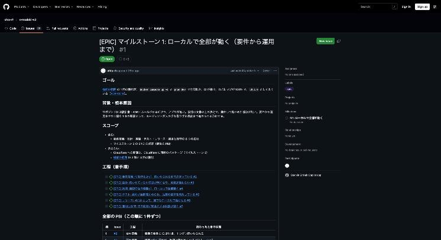 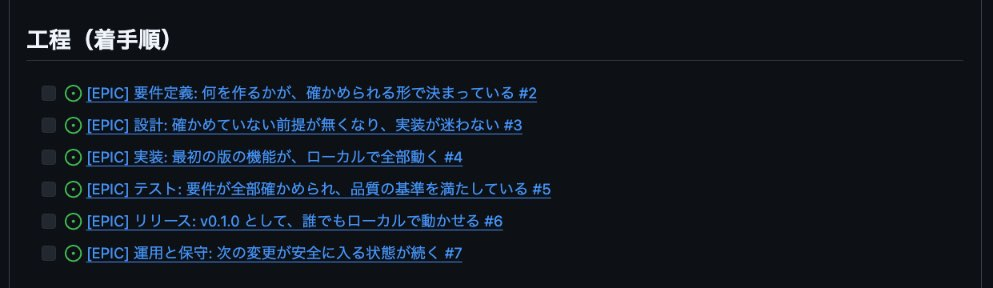 |
| `/issues/19` | 開いて、一番下の「完了の定義」まで進む | 見出し 8 つ。完了の定義はチェックボックス 8 つと注 2 行。親の issue（#4）とラベル 2 つとマイルストーンが右に出る | 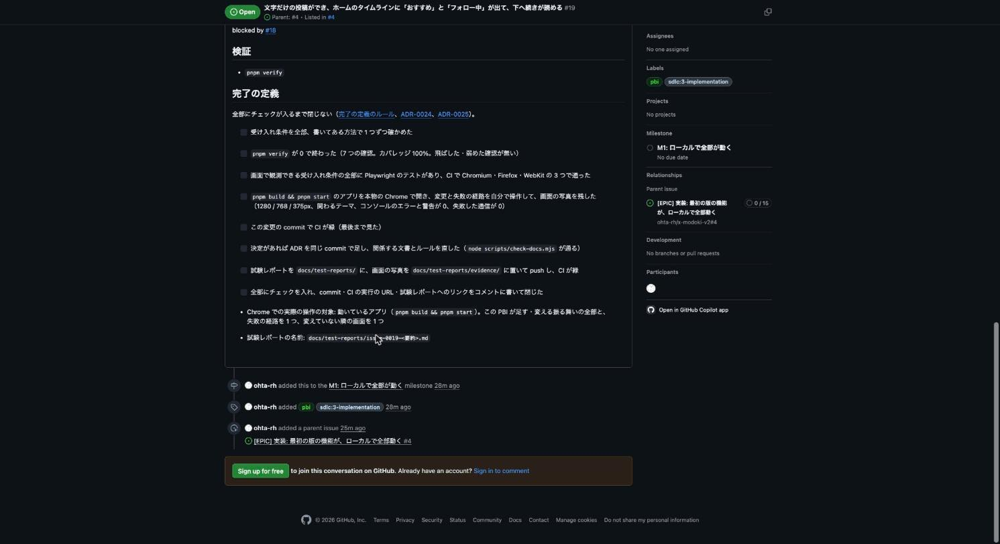 |
| `/issues/3` | 開いて PBI の一覧を読む | 5 行（#10〜#14）。タイトルは 1 回ずつ | — |
| `/blob/main/docs/adr/README.md` | 開いて表を読む | frontmatter が表で出る。ADR の表は 25 行で、最後が 0025 | — |
| `/blob/main/docs/architecture/overview.md` | 開いて構成の図まで進む | frontmatter の表、コードの枠 5 つ（どれも横にはみ出さない）、表 5 つ | 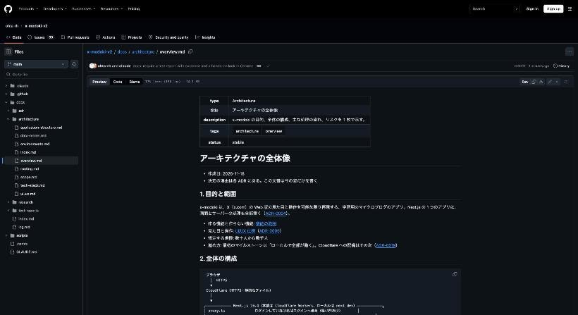 |

幅ごとの表示（`node scripts/chrome-evidence.mjs`。テーマは GitHub の暗い配色）:

| URL | 幅 | `innerWidth` | 横のスクロール | 画面の写真 |
|---|---|---|---|---|
| `/issues/1` | 1280 | 1280 | 無し | 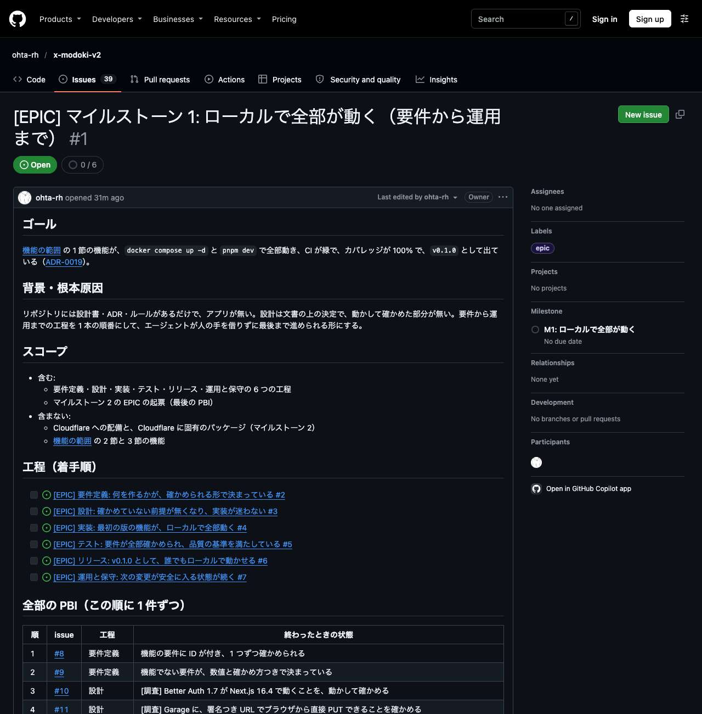 |
| `/issues/1` | 768 | 768 | 無し | 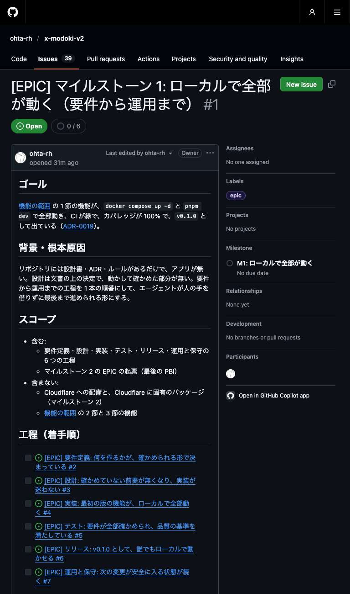 |
| `/issues/1` | 375 | 375 | 無し | 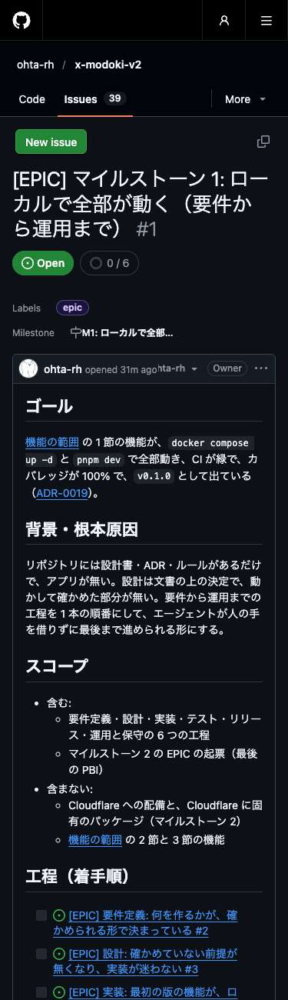 |
| `/issues/19` | 1280 | 1280 | 無し | 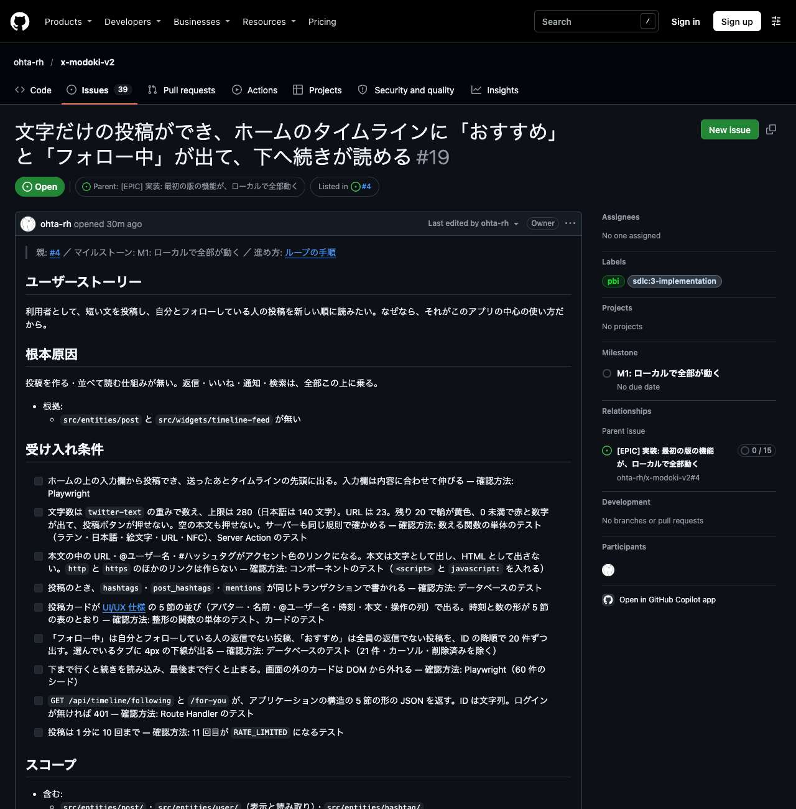 |
| `/issues/19` | 768 | 768 | 無し | 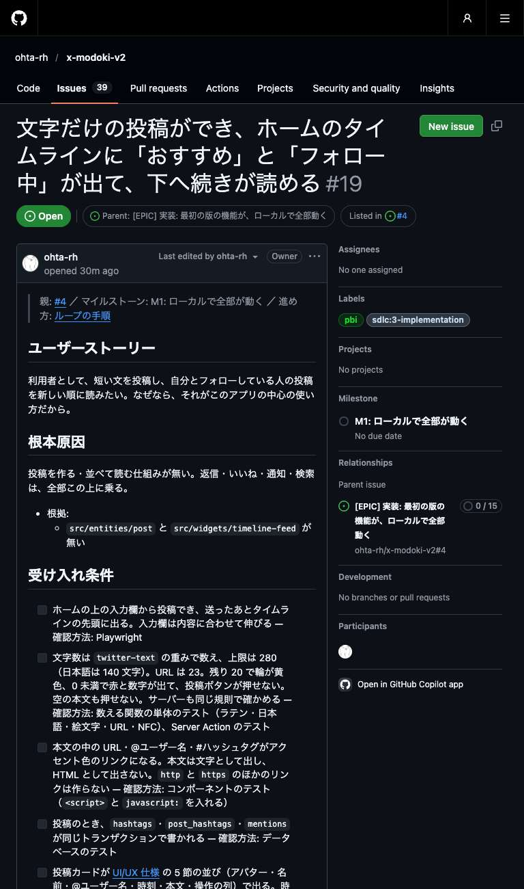 |
| `/issues/19` | 375 | 375 | 無し | 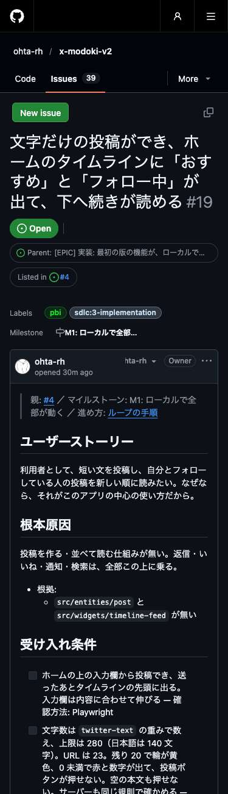 |
| ADR の一覧 | 768 | 768 | 無し | 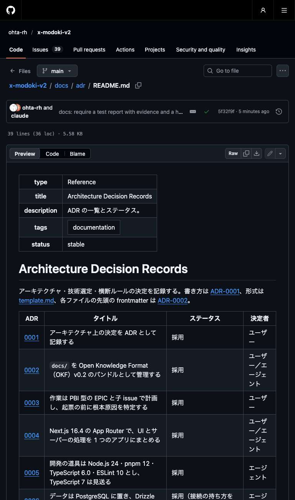 |
| ADR の一覧 | 375 | 375 | 無し | 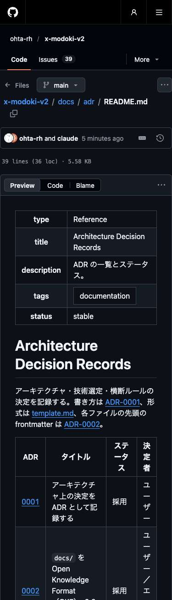 |

- コンソール: エラー 0、警告 0
- 通信: issue のページで、GitHub 自身の 2 つの URL（`…/agent_tasks` と `copilot/agent-sessions/…`）が 404。ログインしていないときに GitHub が返すもので、このリポジトリの内容とは関係が無い。ADR の一覧のページは失敗 0
- キーボードと 3 つのテーマ: 対象が GitHub の画面なので、確かめていない

## 見つけた問題

| # | 見つけたもの | 見つけ方 | 対応 |
|---|---|---|---|
| 1 | #1 と工程の EPIC のタスクの一覧で、issue のタイトルが 2 回出ていた（GitHub が `#2` をタイトルに広げるのに、本文にもタイトルを書いていた） | Chrome で #1 を開いて読んだ。`check-docs.mjs` と `gh` での確認は通っていた | タスクの一覧は番号だけにして、39 件の本文を書き直した。issue のルールに「タスクの一覧では番号だけを書く」「起票したら Chrome で開いて読む」を足した（commit `5f32f9f`）。直したあとの表示は上の写真 |
| 2 | 拡張の `resize_window` が「成功」を返すのに、ウィンドウの幅が変わらなかった（`outerWidth` が 1492 のまま） | 幅を変えたあとに `innerWidth` を読んだ | 幅ごとの確認を、ビューポートを直接指定する `scripts/chrome-evidence.mjs` に替えた。スクリプトは `innerWidth` が指定の幅と違うと落ちる |
| 3 | ヘッドレスの Chrome を `--window-size=375,…` で撮ると、約 500px で組んだ画面の左 375px を切り取った写真になり、右で文字が切れて見えた | 撮った写真を読んだ | その写真を捨て、DevTools のプロトコルで幅を指定して撮り直した。完了の定義のルールに、この落とし穴を書いた |
| 4 | ADR の一覧の表は、375px では「決定者」の列が 1 文字ずつ折り返す | 375px の写真を読んだ | 直さない。内容は読め、横のスクロールも無い。表の列を減らすと 1280px での読みやすさが落ちる |

問題 1 の「直す前」の写真は、保存せずに見ただけなので残っていない。次からは、見つけた時点で写真を保存する。
