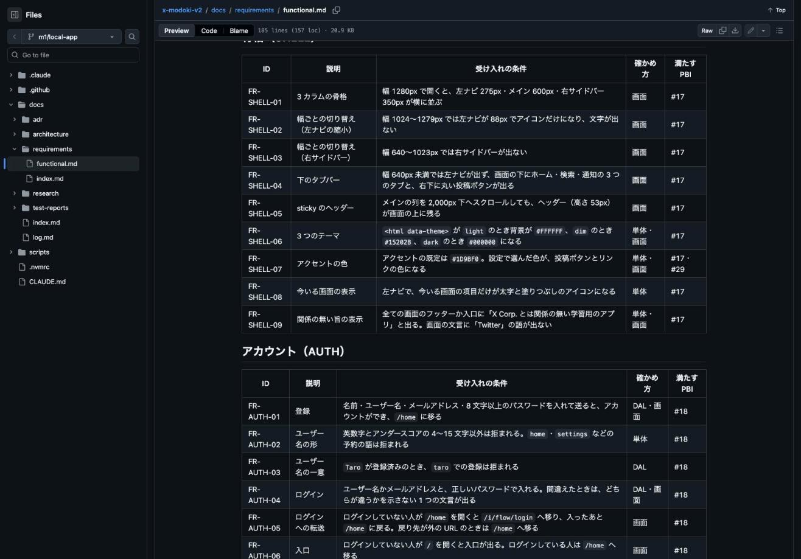
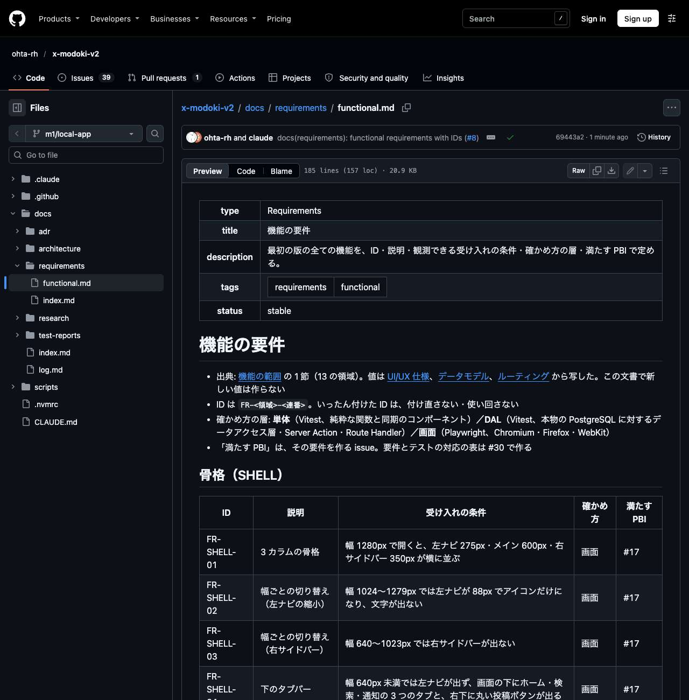
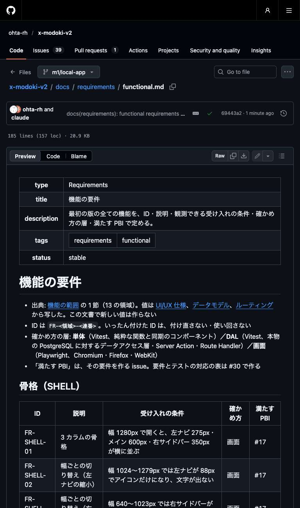
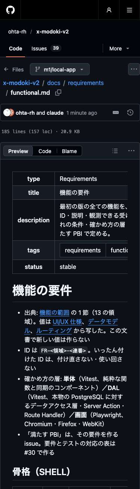

# 試験レポート: 機能の要件に ID が付き、1 つずつ確かめられる

## 対象

- issue: [#8](https://github.com/ohta-rh/x-modoki-v2/issues/8)
- commit: `69443a2`（ブランチ `m1/local-app`、PR #40）
- CI: [実行 44220885902](https://github.com/ohta-rh/x-modoki-v2/actions/runs/44220885902)（成功）
- 日付: 2026-11-18

## 環境

- OS: macOS 26.2
- ブラウザ: Google Chrome 157.0.8103.79（Claude in Chrome の拡張と `scripts/chrome-evidence.mjs`）
- Node.js: 手元 26.12.0、CI 24
- 対象: GitHub の上で表示された `docs/requirements/functional.md`

## 判定

合格 — 受け入れ条件 4 件のうち 4 件を満たした。

## 受け入れ条件ごとの結果

| # | 条件 | 確かめ方 | 結果 | エビデンス |
|---|---|---|---|---|
| 1 | 機能の範囲の 1 節の全ての機能が、ID・説明・受け入れの条件・確かめ方を持つ | 機能の範囲の 13 行に並ぶ機能を 1 つずつ、要件の ID と突き合わせた | 合格（13 の領域、106 件。範囲の全ての機能に 1 件以上の要件がある。ID の重複 0） | 「自動のテスト」 |
| 2 | `docs/requirements/index.md` があり、`docs/index.md` に `requirements/` と `Requirements` がある | `node scripts/check-docs.mjs` | 合格 | 「自動のテスト」 |
| 3 | 条件が入力と結果で書かれ、あいまいな語が無い | `grep -nE "正しく\|適切に\|うまく\|ちゃんと"` | 合格（0 件） | 「自動のテスト」 |
| 4 | `docs/log.md` に 1 行ある | 差分 | 合格 | `docs/log.md` |

機能の範囲との突き合わせ:

| 範囲の領域 | 範囲に並ぶ機能 | 要件 |
|---|---|---|
| 骨格 | 3 カラム・幅ごとの切り替え・下のタブバー・テーマ・アクセント | FR-SHELL-01〜09 |
| アカウント | 登録・ログイン・ログアウト | FR-AUTH-01・04・07（ほか 5 件） |
| 投稿 | 文字だけ・画像 4 枚・代替テキスト・削除・文字数の輪・モーダル・下書き | FR-POST-01・05・07・08・04・10・11（ほか 7 件） |
| 会話 | 返信・スレッド・引用・リポストと取り消し | FR-CONV-01・03・08・05・07 |
| 反応 | いいね・ブックマーク・表示の回数 | FR-REACT-01・05・06 |
| タイムライン | 2 つのタブ・無限スクロール・「N 件」・位置の復元 | FR-TL-01〜04・06・07 |
| プロフィール | 表示と編集・各タブ・固定・一覧 | FR-PROF-01・04・06・03・07・08 |
| フォロー | フォロー・解除 | FR-FOLLOW-01・02 |
| 通知 | 6 種類・未読の数・2 つのタブ | FR-NOTIF-01・05・03・04 |
| 検索 | 本文・ユーザー・ハッシュタグ・タブ・トレンド・おすすめ | FR-SEARCH-01・04・03・02・06・07 |
| 表示 | 詳細・ビューア・自動のリンク・相対の時刻・数の省略 | FR-VIEW-01・03・06・07・08 |
| 操作 | キーボード・ホバーのカード・トースト | FR-OPS-01〜05・06・07 |
| 設定 | テーマとアクセント・アカウントの情報 | FR-SET-01・03 |

## 自動のテスト

```
$ node scripts/check-docs.mjs
docs check passed: 53 file(s)

$ grep -cE "^\| FR-" docs/requirements/functional.md
106
SHELL=9 AUTH=8 POST=14 CONV=9 REACT=7 TL=9 PROF=9 FOLLOW=5 NOTIF=7 SEARCH=8 VIEW=9 OPS=8 SET=4
（ID の重複: なし）
```

`pnpm verify` と Playwright は、骨組み（#15）の前なので、まだ無い。

### TDD の記録

コードの変更なし。

## コードレビュー

コードの変更なし。

## ブラウザでの確認

| URL | 幅 | した操作 | 見えた結果 | 画面の写真 |
|---|---|---|---|---|
| `blob/m1/local-app/docs/requirements/functional.md` | 1746 | 開いて、骨格とアカウントの表まで進む | 見出し 13、表 15、`FR-` の行 106。全ての表が 5 列で崩れない。Markdown の記号のままの表示は無い |  |
| 同じ | 1280 | `chrome-evidence.mjs` | `innerWidth` 1280、横のスクロール無し |  |
| 同じ | 768 | 同上 | `innerWidth` 768、横のスクロール無し |  |
| 同じ | 375 | 同上 | `innerWidth` 375、ページは横にスクロールしない。frontmatter の表は枠の中で横にスクロールする（GitHub の表示） |  |

- コンソール: エラー 0、警告 0
- 通信: 失敗 0（GitHub のログインしていないときの 404 を除く）

## 見つけた問題

なし。
