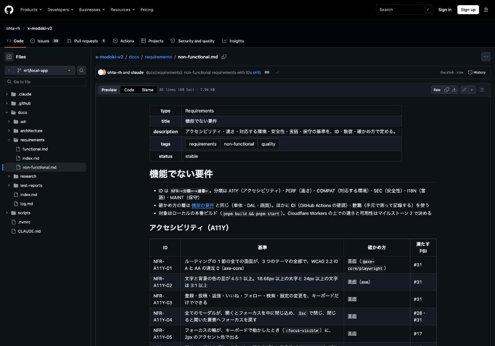
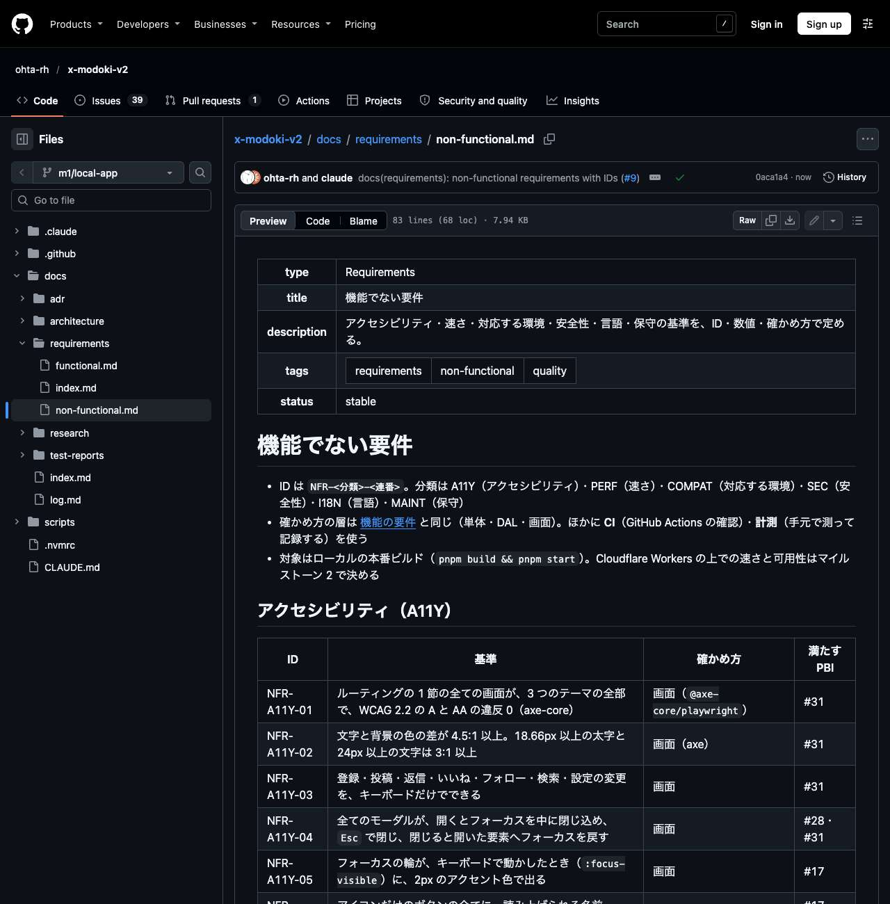
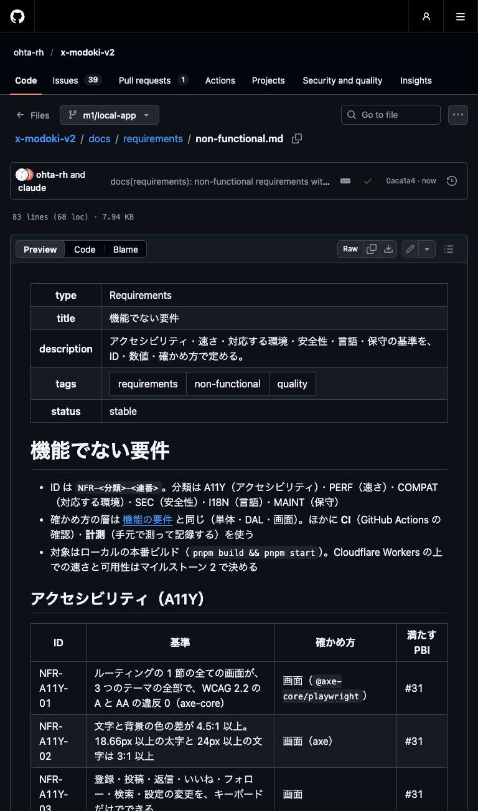
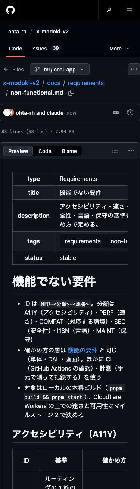

# 試験レポート: 機能でない要件が、数値と確かめ方つきで決まっている

## 対象

- issue: [#9](https://github.com/ohta-rh/x-modoki-v2/issues/9)
- commit: `0aca1a4`（ブランチ `m1/local-app`、PR #40）
- CI: [実行 44221286186](https://github.com/ohta-rh/x-modoki-v2/actions/runs/44221286186)（成功）
- 日付: 2026-11-18

## 環境

- OS: macOS 26.2
- ブラウザ: Google Chrome 157.0.8103.79（Claude in Chrome の拡張と `scripts/chrome-evidence.mjs`）
- Node.js: 手元 26.12.0、CI 24
- 対象: GitHub の上で表示された `docs/requirements/non-functional.md`

## 判定

合格 — 受け入れ条件 4 件のうち 4 件を満たした。

## 受け入れ条件ごとの結果

| # | 条件 | 確かめ方 | 結果 | エビデンス |
|---|---|---|---|---|
| 1 | `non-functional.md`（`type: Requirements`）が `NFR-<分類>-<連番>` の ID・基準・確かめ方を持つ | `node scripts/check-docs.mjs`、行を数える | 合格（6 分類、38 件） | 「自動のテスト」 |
| 2 | 指定の値（WCAG 2.2 AA・axe の違反 0、LCP 2.5 秒・CLS 0.1・INP 200 ミリ秒、Chrome/Edge/Firefox 111 と Safari 16.4、幅 360px、日本語）が入っている | 文書を読む | 合格（NFR-A11Y-01、NFR-PERF-01〜03、NFR-COMPAT-01・02、NFR-I18N-01） | [文書](evidence/issue-0009-non-functional-requirements/chrome-non-functional.jpg) |
| 3 | アプリケーションの構造の 6 節の 8 つの規則の全部に、確かめ方がある | 8 つの規則と突き合わせた | 合格（下の表） | — |
| 4 | 保守の要件に、カバレッジ 100%・CI の 7 つの確認・FSD の違反 0 がある | 文書を読む | 合格（NFR-MAINT-01・02・03） | — |

安全の規則との突き合わせ:

| 6 節の規則 | 要件 |
|---|---|
| 認証と認可は `api` セグメントで、`proxy.ts` だけに頼らない | NFR-SEC-01 |
| 入力は全部 Zod で確かめる | NFR-SEC-02 |
| クライアントへ渡すのは DTO だけ | NFR-SEC-03 |
| cookie は HttpOnly・Secure・SameSite=Lax | NFR-SEC-04 |
| 投稿・フォロー・署名・ログインに回数の制限 | NFR-SEC-05 |
| 本文は文字として出し、リンクは `http`・`https` だけ | NFR-SEC-06 |
| 画像は署名の前と置いたあとに確かめ、別のドメインから出す | NFR-SEC-07 |
| 秘密の値は環境変数だけ、`env.ts` で検証 | NFR-SEC-08 |

## 自動のテスト

```
$ node scripts/check-docs.mjs
docs check passed: 55 file(s)

$ grep -cE "^\| NFR-" docs/requirements/non-functional.md
38
```

`pnpm verify` と Playwright は、骨組み（#15）の前なので、まだ無い。

### TDD の記録

コードの変更なし。

## コードレビュー

コードの変更なし。

## ブラウザでの確認

| URL | 幅 | した操作 | 見えた結果 | 画面の写真 |
|---|---|---|---|---|
| `blob/m1/local-app/docs/requirements/non-functional.md` | 1746 | 開いて読む | 見出し 6、表 8、`NFR-` の行 38。表は 4 列で崩れない |  |
| 同じ | 1280 | `chrome-evidence.mjs` | `innerWidth` 1280、横のスクロール無し |  |
| 同じ | 768 | 同上 | `innerWidth` 768、横のスクロール無し |  |
| 同じ | 375 | 同上 | `innerWidth` 375、横のスクロール無し |  |

- コンソール: エラー 0、警告 0
- 通信: 失敗 0（GitHub のログインしていないときの 404 を除く）

## 見つけた問題

| # | 見つけたもの | 対応 |
|---|---|---|
| 1 | commit `0aca1a4` のメッセージに「44 requirements」とあるが、実際は 38 件 | push 済みの commit は書き換えない（強制の push をしない）。正しい数をこのレポートに書いた |
