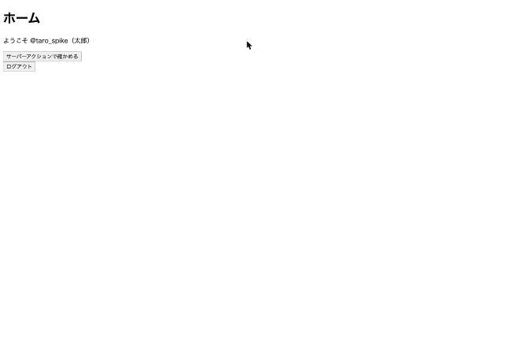
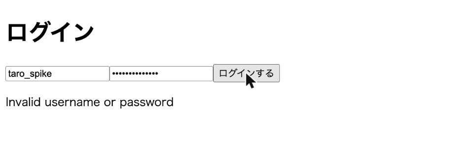
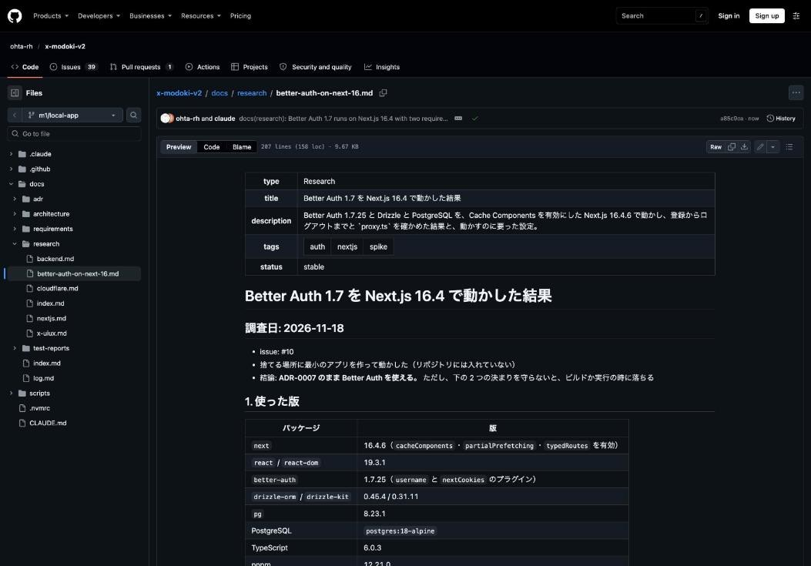
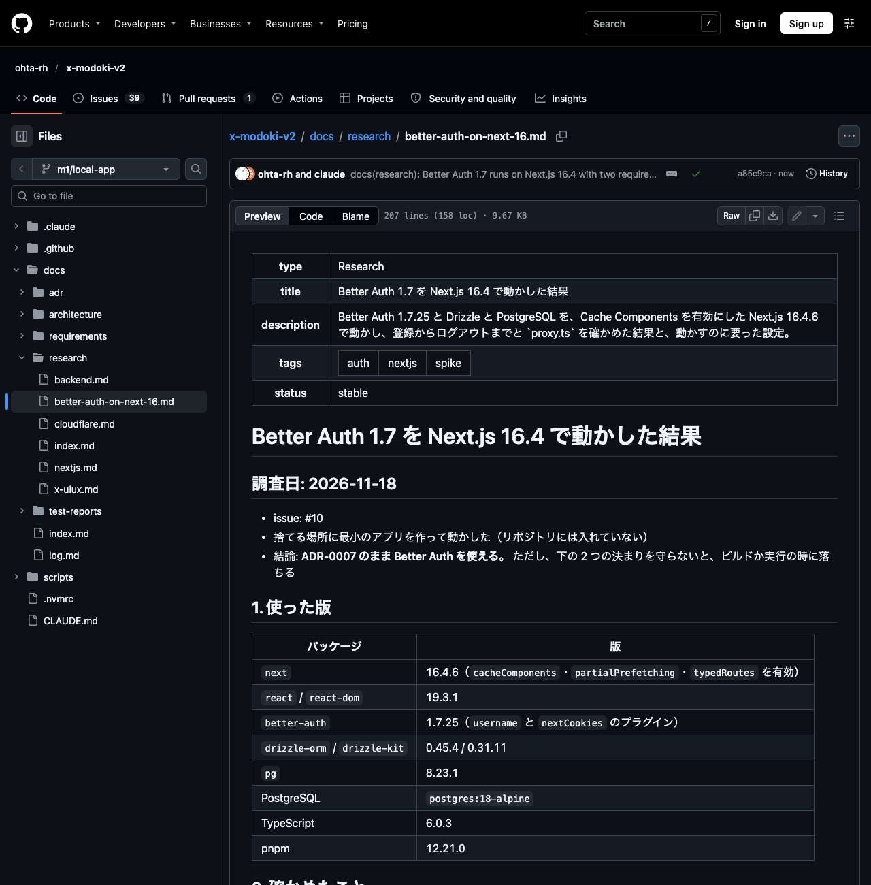
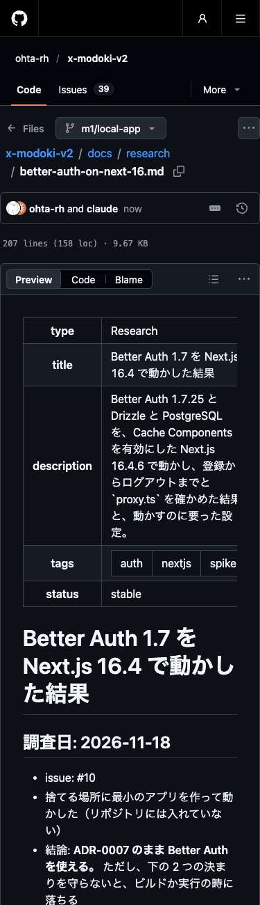

# 試験レポート: [調査] Better Auth 1.7 が Next.js 16.4 で動くことを、動かして確かめる

## 対象

- issue: [#10](https://github.com/ohta-rh/x-modoki-v2/issues/10)
- commit: `a85c9ca`（調査の文書。ブランチ `m1/local-app`、PR #40）
- CI: [実行 44222571918](https://github.com/ohta-rh/x-modoki-v2/actions/runs/44222571918)（成功）
- 日付: 2026-11-18

## 環境

- OS: macOS 26.2、Docker（OrbStack 29.4.0）
- ブラウザ: Google Chrome 157.0.8103.79（Claude in Chrome の拡張）
- Node.js 26.12.0、pnpm 12.21.0（`npx` で起動）
- 捨てる場所のアプリ: Next.js 16.4.6・React 19.3.1・Better Auth 1.7.25・Drizzle 0.45.4・PostgreSQL 18（`postgres:18-alpine`）。`next build` のあと `next start -p 3100`

## 判定

合格 — 受け入れ条件 4 件のうち 4 件を満たした。Better Auth は ADR-0007 のまま使える。置き換えの ADR は要らない。

## 受け入れ条件ごとの結果

| # | 条件 | 確かめ方 | 結果 | エビデンス |
|---|---|---|---|---|
| 1 | 登録・ログイン・ログアウト・Server Component と Server Action からのセッションの読み出し・`proxy.ts` での転送の 5 つが動く | Chrome で順に操作し、データベースの `session` の行を数えた | 合格（5 つとも動いた。ログアウトで行が消えた） | [登録のあと](evidence/issue-0010-better-auth-spike/spike-home-after-signup.jpg)、[間違ったパスワード](evidence/issue-0010-better-auth-spike/spike-login-wrong-password.jpg) |
| 2 | セッションを読む部分を `<Suspense>` で包んだ形で `next build` が通る | `next build` | 合格（2 回目から。1 回目は `Math.random()` で落ちた。「見つけた問題」の 1） | 「自動のテスト」 |
| 3 | 結果が `docs/research/better-auth-on-next-16.md` にある（版・設定のコード・当たった問題・`username` の列） | `node scripts/check-docs.mjs`、Chrome で表示 | 合格 | [調査の文書](evidence/issue-0010-better-auth-spike/chrome-research-doc.jpg) |
| 4 | 動かなかった項目があれば置き換えの ADR、全部動いたなら結論にその旨 | 文書を読む | 合格（全部動いた。結論に書いた） | 同上 |

## 自動のテスト

```
$ next build      # 捨てる場所のアプリ（2 回目）
Route (app)
┌ ○ /
├ ƒ /api/auth/[...all]
├ ◐ /home                 (Partial Prerender)
├ ○ /i/flow/login
└ ○ /i/flow/signup
ƒ Proxy (Middleware)

$ curl -D - -X POST /api/auth/sign-in/username …
set-cookie: better-auth.session_token=<redacted>; Max-Age=604800; Path=/; HttpOnly; SameSite=Lax

$ curl -X POST /api/auth/sign-up/email … "username":"TARO_SPIKE"
{"message":"Username is already taken. Please try another.","code":"USERNAME_IS_ALREADY_TAKEN"}

接続の数: 1（要求の前）→ 1（30 回の要求のあと）
サーバーのログのエラー: 0 件（connection() を足したあと）

$ node scripts/check-docs.mjs
docs check passed: 57 file(s)
```

### TDD の記録

リポジトリのコードの変更なし（調査のコードは捨てる場所に書いた。`.claude/rules/tdd.md` の「対象の外」）。

## コードレビュー

リポジトリのコードの変更なし。

## ブラウザでの確認

捨てる場所のアプリ（`http://localhost:3100`、本番のビルド）:

| URL | した操作 | 見えた結果 | 画面の写真 |
|---|---|---|---|
| `/i/flow/signup` | 名前・ユーザー名・メールアドレス・パスワードを入れて登録 | `/home` に移り「ようこそ @taro_spike（太郎）」 |  |
| `/home` | 「サーバーアクションで確かめる」 | `action sees taro_spike` | — |
| `/home` | ログアウト、もう一度 `/home` を開く | `/i/flow/login?next=%2Fhome` に送られた | — |
| `/i/flow/login` | 間違ったパスワード（失敗の経路） | `Invalid username or password`。どちらが違うかを示さない |  |
| `/i/flow/login` | 正しいパスワード | `/home` に移り、名前が出た | — |

- コンソール: エラー 0（拡張の `read_console_messages`）
- サーバーのログ: 直したあと、エラー 0

調査の文書（GitHub の上）:

| URL | 幅 | 見えた結果 | 画面の写真 |
|---|---|---|---|
| `blob/m1/local-app/docs/research/better-auth-on-next-16.md` | 1746 | 見出し 9、表 5、コードの枠 7。Markdown の記号のままの表示は無い |  |
| 同じ | 1280 | `innerWidth` 1280、横のスクロール無し |  |
| 同じ | 375 | `innerWidth` 375、横のスクロール無し。コードの枠は枠の中で横にスクロールする |  |

768px も `innerWidth` 768・横のスクロール無しを確かめた（写真の数を 12 枚以内に収めるため、写真は 1280 と 375 だけ残した）。

## 見つけた問題

| # | 見つけたもの | 見つけ方 | 根本原因 | 対応 |
|---|---|---|---|---|
| 1 | `next build` が `/home` で `Math.random()` のエラーで落ちた | ビルド | `betterAuth()` を作るときに `Math.random()` が呼ばれ、それが `headers()` を読むより先に動いていた | `headers()` を先に読む順にした。調査の文書の 3.1 と、実装への申し送りに書いた |
| 2 | ログインのあと `/home` へ移ると、サーバーのログに 2 つのエラー（`Math.random()` と、閉じたプールへの問い合わせ）が出た。画面は正しかった | サーバーのログを読んだ | `partialPrefetching` の実行時のプリレンダーでセッションを読んでいた | セッションを読む前に `await connection()` を呼ぶようにした。エラー 0 件を確かめた。文書の 3.2 |
| 3 | pnpm 10 が pnpm 12 へ自動で切り替わらない（`ENOEXEC`） | インストール | 手元の pnpm 10 の切り替えの仕組みと pnpm 12 の配り方が合わない | `npx -y pnpm@12.21.0` で動かす。手順書（#35）に書く |
| 4 | pnpm 12 が esbuild の build スクリプトで止まる | インストール | pnpm 12 は許していない依存のスクリプトを止める | `pnpm-workspace.yaml` の `allowBuilds` で esbuild を許す。骨組み（#15）で入れる |

どれも捨てる場所のアプリの中の問題で、リポジトリのコードには無い。直し方は、実装の PBI（#15・#18）が使う設定として調査の文書に残した。
