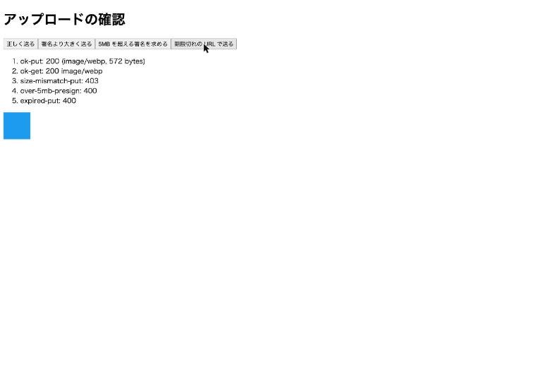
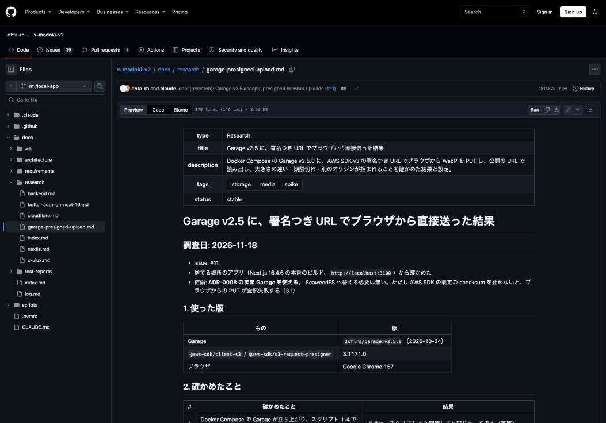
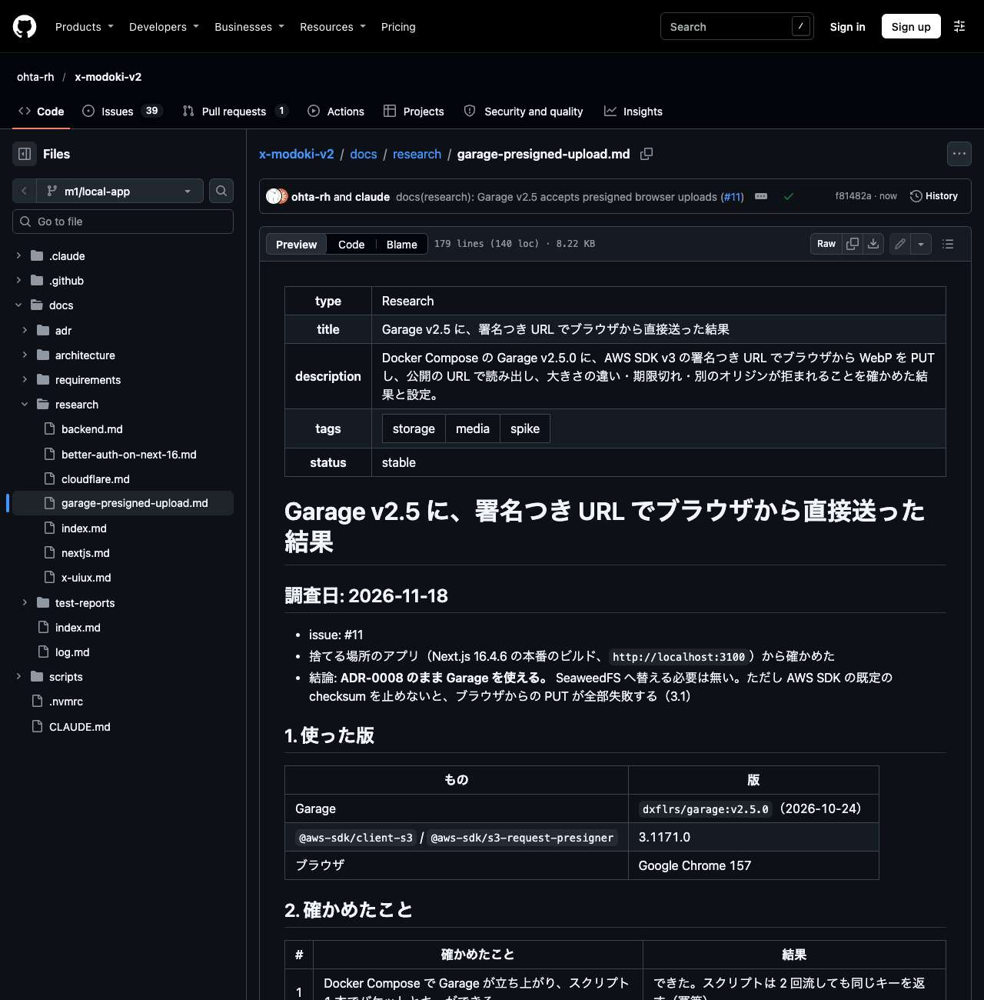
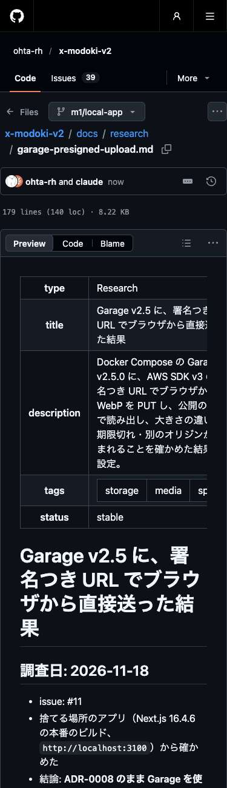

# 試験レポート: [調査] Garage に、署名つき URL でブラウザから直接 PUT できることを確かめる

## 対象

- issue: [#11](https://github.com/ohta-rh/x-modoki-v2/issues/11)
- commit: `f81482a`（調査の文書。ブランチ `m1/local-app`、PR #40）
- CI: [実行 44223209604](https://github.com/ohta-rh/x-modoki-v2/actions/runs/44223209604)（成功）
- 日付: 2026-11-18

## 環境

- OS: macOS 26.2、Docker（OrbStack 29.4.0）
- ブラウザ: Google Chrome 157.0.8103.79（Claude in Chrome の拡張）
- Garage `dxflrs/garage:v2.5.0`、`@aws-sdk/client-s3` 3.1171.0
- 捨てる場所のアプリ: Next.js 16.4.6 の本番のビルド（`http://localhost:3100`）

## 判定

合格 — 受け入れ条件 5 件のうち 5 件を満たした。Garage は ADR-0008 のまま使える。SeaweedFS に替える ADR は要らない。

## 受け入れ条件ごとの結果

| # | 条件 | 確かめ方 | 結果 | エビデンス |
|---|---|---|---|---|
| 1 | Docker Compose で Garage が立ち上がり、バケットとキーを作る手順がスクリプト 1 本 | `docker compose up -d storage`、`garage/init.sh` を 2 回流す | 合格（2 回とも成功し、同じキー） | 「自動のテスト」 |
| 2 | 署名つき URL にブラウザの `fetch` から `image/webp` を PUT でき、公開の URL から GET できる | Chrome で「正しく送る」 | 合格（PUT 200、GET 200 `image/webp`、`` に出た） | [送った結果](evidence/issue-0011-garage-spike/spike-upload-results.jpg) |
| 3 | 上限を超える PUT と、期限切れの URL への PUT が拒まれる | Chrome で 3 つのボタン | 合格（署名より大きい PUT は 403、5MB を超える署名は 400、期限切れは 400） | 同上 |
| 4 | 結果が `docs/research/garage-presigned-upload.md` にある（イメージ・Compose・CORS・`S3Client` の設定・当たった問題） | `node scripts/check-docs.mjs`、Chrome で表示 | 合格 | [調査の文書](evidence/issue-0011-garage-spike/chrome-research-doc.jpg) |
| 5 | Garage で通らなかった場合の SeaweedFS と ADR | — | 該当なし（Garage で通った） | — |

## 自動のテスト

```
$ ./garage/init.sh   # 1 回目と 2 回目
rc=0 / rc=0、同じ S3_ACCESS_KEY_ID

$ node range-check.mjs   # 置いた画像の先頭 32 バイト
{"objects":1,"length":32,"contentRange":"bytes 0-31/572","riff":"RIFF","webp":"WEBP","vp8":"VP8X"}

$ node checksum-check.mjs
WHEN_SUPPORTED 400 checksum-params: x-amz-checksum-crc32,x-amz-sdk-checksum-algorithm  InvalidDigest
WHEN_REQUIRED  200 checksum-params: none

CORS の preflight: 許していないオリジン 403、http://localhost:3100 は 200

$ node scripts/check-docs.mjs
docs check passed: 59 file(s)
```

### TDD の記録

リポジトリのコードの変更なし（調査のコードは捨てる場所に書いた）。

## コードレビュー

リポジトリのコードの変更なし。

## ブラウザでの確認

| URL | 幅 | した操作 | 見えた結果 | 画面の写真 |
|---|---|---|---|---|
| `http://localhost:3100/upload` | 1293 | 4 つのボタンを順に押す | `ok-put: 200`・`ok-get: 200 image/webp`・`size-mismatch-put: 403`・`over-5mb-presign: 400`・`expired-put: 400`。送った 64×64 の WebP が `*.web.garage.localhost:3902` から表示された |  |
| `blob/m1/local-app/docs/research/garage-presigned-upload.md` | 1746 | 開いて読む | 見出し 8、表 5、コードの枠 6。崩れは無い |  |
| 同じ | 1280 | `chrome-evidence.mjs` | `innerWidth` 1280、横のスクロール無し |  |
| 同じ | 375 | 同上 | `innerWidth` 375、横のスクロール無し |  |

768px も `innerWidth` 768・横のスクロール無しを確かめた。

- コンソール: エラー 0、警告 0

## 見つけた問題

| # | 見つけたもの | 見つけ方 | 根本原因 | 対応 |
|---|---|---|---|---|
| 1 | AWS SDK の既定のままだと、署名つき URL への PUT が `400 InvalidDigest` になる | 既定の設定と `WHEN_REQUIRED` を並べて試した | SDK が署名のときの空の本文の CRC32 を URL に入れる | `requestChecksumCalculation: 'WHEN_REQUIRED'` を付ける。調査の文書の 3.1 と、実装への申し送りに書いた |
