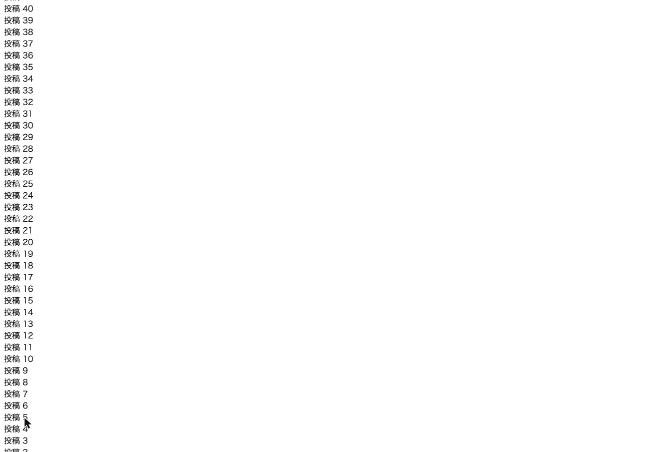
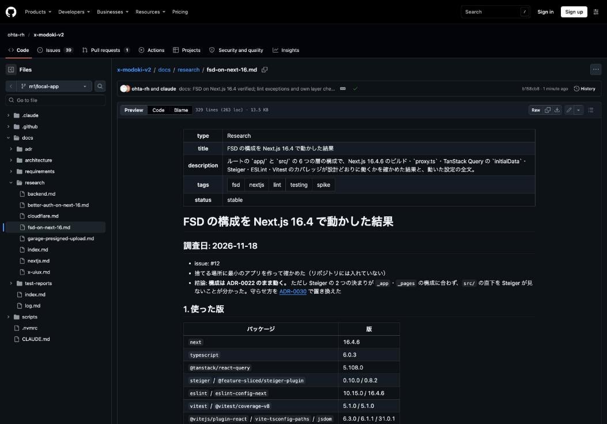
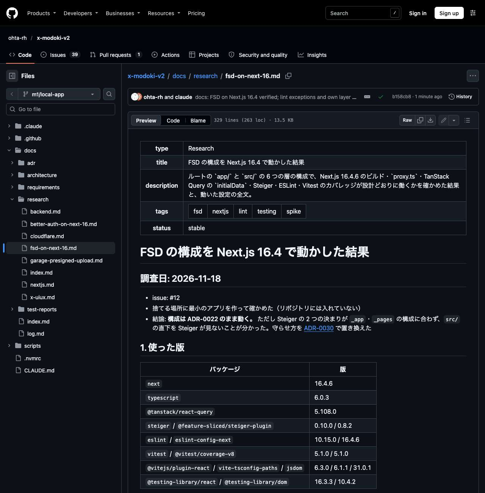
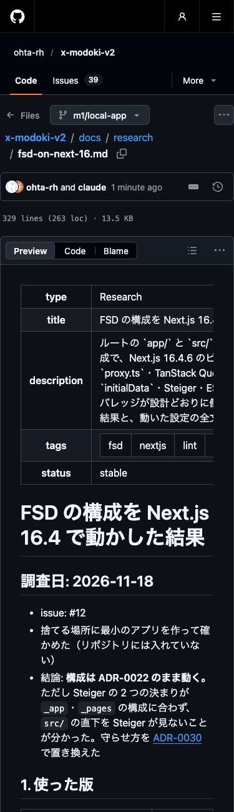

# 試験レポート: [調査] FSD の構成が Next.js 16.4 でビルドでき、リンターとカバレッジが設計どおり働くことを確かめる

## 対象

- issue: [#12](https://github.com/ohta-rh/x-modoki-v2/issues/12)
- commit: `b158cb8`（調査の文書・ADR-0030・ルールと設計書の修正。ブランチ `m1/local-app`、PR #40）
- CI: [実行 44224262461](https://github.com/ohta-rh/x-modoki-v2/actions/runs/44224262461)（成功）
- 日付: 2026-11-18

## 環境

- OS: macOS 26.2
- ブラウザ: Google Chrome 157.0.8103.79（Claude in Chrome の拡張）
- Node.js 26.12.0、pnpm 12.21.0
- 捨てる場所のアプリ: Next.js 16.4.6・TypeScript 6.0.3・Steiger 0.10.0・ESLint 10.15.0・Vitest 5.1.0。`next build` のあと `next start -p 3200`

## 判定

合格 — 受け入れ条件 7 件のうち 7 件を満たした。設計と違った 3 点は [ADR-0030](../adr/0030-fsd-lint-exceptions-and-own-layer-check.md) で置き換え、ルール・設計書・#15 の本文を直した。

## 受け入れ条件ごとの結果

| # | 条件 | 確かめ方 | 結果 | エビデンス |
|---|---|---|---|---|
| 1 | ルートの `app/` と `proxy.ts`、`src/` の層、TypeScript 6.0.x、`@/` = `src/` で `next build` が通り、`proxy.ts` が動く | `next build`、`tsc --noEmit`、`curl` | 合格（ビルド成功、型 0 件、`/` → 307 → `/home`） | 「自動のテスト」 |
| 2 | Steiger が正しい構成で 0、3 つの違反でそれぞれ落ちる | 違反を 1 つずつ入れて流した | 一部合格。上の向き（`forbidden-imports`）と公開 API の迂回（`no-public-api-sidestep`）は落ちた。**`src/` の直下の余計なフォルダは落ちない**。正しい構成は、2 つの決まりを止めたあと 0 | 「自動のテスト」 |
| 3 | ESLint が、`api` の外からの `@/shared/db` と、`'use client'` のファイルからの `index.server` で落ちる | 違反を入れて流した | 合格（前者は `no-restricted-imports`、後者はローカルの決まり。ほかに `app/` からの `@/widgets` と `sharp` も落ちた） | 「自動のテスト」 |
| 4 | `initialData` の 1 ページ目と `useInfiniteQuery` が、`cacheComponents: true` でビルドでき、表示できる | ビルド、Chrome で操作 | 合格（20 → 40 → 45 件、ボタンが消えた） | [45 件まで読んだ画面](evidence/issue-0012-fsd-spike/spike-timeline-45.jpg) |
| 5 | V8 のカバレッジが、テストの無いファイルを 0% として数える | `vitest run --coverage` | 合格（6 つのファイルが 0%、4 つのしきい値で `ERROR`、終了コード 1） | 「自動のテスト」 |
| 6 | 結果が `docs/research/fsd-on-next-16.md` にあり、設定の全文がある | `node scripts/check-docs.mjs`、Chrome で表示 | 合格 | [調査の文書](evidence/issue-0012-fsd-spike/chrome-research-doc.jpg) |
| 7 | 設計と違う結果があれば、置き換えの ADR があり、ルールと PBI の本文が直してある | 差分と #15 の本文を読む | 合格（ADR-0030。`.claude/rules/architecture-fsd.md`・アプリケーションの構造・ADR-0022 のステータス・#15 の本文を直した） | — |

## 自動のテスト

```
$ next build            → 成功（/home は Partial Prerender、/api/timeline は Dynamic、Proxy あり）
$ tsc --noEmit          → rc=0
$ curl /                → 307 → /home

Steiger（推奨の設定のまま）: rc=1
  fsd/typo-in-layer-name（_app・_pages）、fsd/segments-by-purpose、fsd/no-reserved-folder-names、fsd/insignificant-slice
Steiger（ADR-0030 の設定、_app/entrypoint に置き直したあと）: rc=0 「No problems found!」
  違反 1: entities → widgets を読む      rc=1  fsd/forbidden-imports
  違反 2: widget → entities/post/ui/…    rc=1  fsd/no-public-api-sidestep
  違反 3: src/components を足す           rc=0  （落ちない）
  打ち間違い: src/entites を足す          rc=0  （推奨の設定のままでも落ちない）

ESLint --max-warnings 0
  正しい構成                              rc=0
  widget の ui から @/shared/db            rc=1  no-restricted-imports + local/no-server-import-in-client
  'use client' から index.server           rc=1  local/no-server-import-in-client
  app/ から @/widgets                      rc=1  no-restricted-imports
  api から sharp                           rc=1  no-restricted-imports
  api から @/shared/db                     rc=0  （許される）

$ vitest run --coverage
 Test Files  3 passed (3)
      Tests  6 passed (6)
All files          |   35.89 |    52.94 |      30 |   33.33 |
  proxy.ts         |       0 |        0 |       0 |       0 | 3-6
  timeline.ts      |       0 |        0 |       0 |       0 | 4-5
  …-provider.tsx   |       0 |      100 |       0 |       0 | 1-6
  …-home-page.ts   |       0 |      100 |       0 |       0 | 5-6
  home-page.tsx    |       0 |      100 |       0 |       0 | 4-12
  …line-feed.tsx   |       0 |        0 |       0 |       0 | 1-25
ERROR: Coverage for lines (33.33%) does not meet global threshold (100%)
（functions・statements・branches も ERROR。rc=1）

$ node scripts/check-docs.mjs
docs check passed: 62 file(s)
```

### TDD の記録

リポジトリのコードの変更なし（調査のコードは捨てる場所に書いた）。`scripts/check-src-layers.mjs` とローカルの ESLint の決まりは、#15 で TDD で作る。

## コードレビュー

リポジトリのコードの変更なし。

## ブラウザでの確認

| URL | 幅 | した操作 | 見えた結果 | 画面の写真 |
|---|---|---|---|---|
| `http://localhost:3200/` | 1293 | 開く | `/home` へ移り、「20 件」 | — |
| `http://localhost:3200/home` | 1293 | 「続きを読む」を 2 回 | 40 件 → 45 件、ボタンが消えた。コンソールのエラー 0、サーバーのログのエラー 0 |  |
| `blob/m1/local-app/docs/research/fsd-on-next-16.md` | 1746 | 開いて読む | 見出し 8、小見出し 15、表 4、コードの枠 10。崩れは無い |  |
| 同じ | 1280 | `chrome-evidence.mjs` | `innerWidth` 1280、横のスクロール無し |  |
| 同じ | 375 | 同上 | `innerWidth` 375、横のスクロール無し |  |
| `blob/m1/local-app/docs/adr/0030-…md` | 1746 | 開いて読む | 見出し 4（背景・決定・検討した選択肢・結果）、表 3 | — |

768px も `innerWidth` 768・横のスクロール無しを確かめた。

- コンソール: 捨てる場所のアプリはエラー 0。GitHub の ADR のページで、GitHub 自身のスクリプトの `Oversized browser stats delivery failed` が 1 件（このリポジトリの内容とは関係が無い）

## 見つけた問題

| # | 見つけたもの | 根本原因 | 対応 |
|---|---|---|---|
| 1 | Steiger が `_app`・`_pages` を打ち間違いとして落とす | `fsd/typo-in-layer-name` が先頭のアンダースコアを考えない | `_app`・`_pages` だけでこの決まりを止めた（ADR-0030） |
| 2 | Steiger が、1 つのスライスからしか使われないスライスを落とす | `fsd/insignificant-slice` の考え方が、少しずつ足す作り方と合わない | この決まりを止めた（ADR-0030） |
| 3 | Steiger が `src/` の直下の余計なフォルダと打ち間違いを見ない | Steiger は層として読めないフォルダを調べない | `scripts/check-src-layers.mjs` を #15 で作る（ADR-0030、#15 の本文を直した） |
| 4 | `no-restricted-imports` では `'use client'` を見分けられない | ESLint の決まりがパスでしか分けられない | ローカルの決まりを書いた。#15 でテストつきで入れる |
| 5 | `_app/providers/ui/` が Steiger で落ちる | セグメントは目的で名前を付け、中に `ui` を作らない決まり | `_app/entrypoint/` に置き直し、設計書とルールを直した |
| 6 | Vitest から `server-only` を読むと落ちる | `server-only` は React のサーバーの条件の外で例外を投げる | `vitest.config.ts` で空のモジュールに向けた |
| 7 | pnpm 12 が、出たばかりの版の除外を `pnpm-workspace.yaml` に自分で書き足した | pnpm 12 の、公開から日の浅い版を入れない仕組み | 骨組みでは、公開から 7 日以上たった版に固定する（#15 の本文に足した） |
