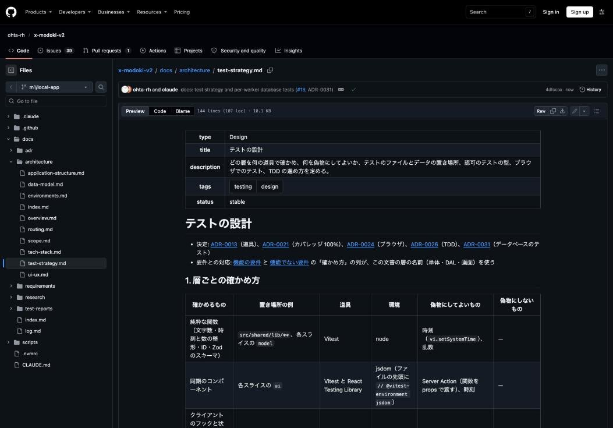
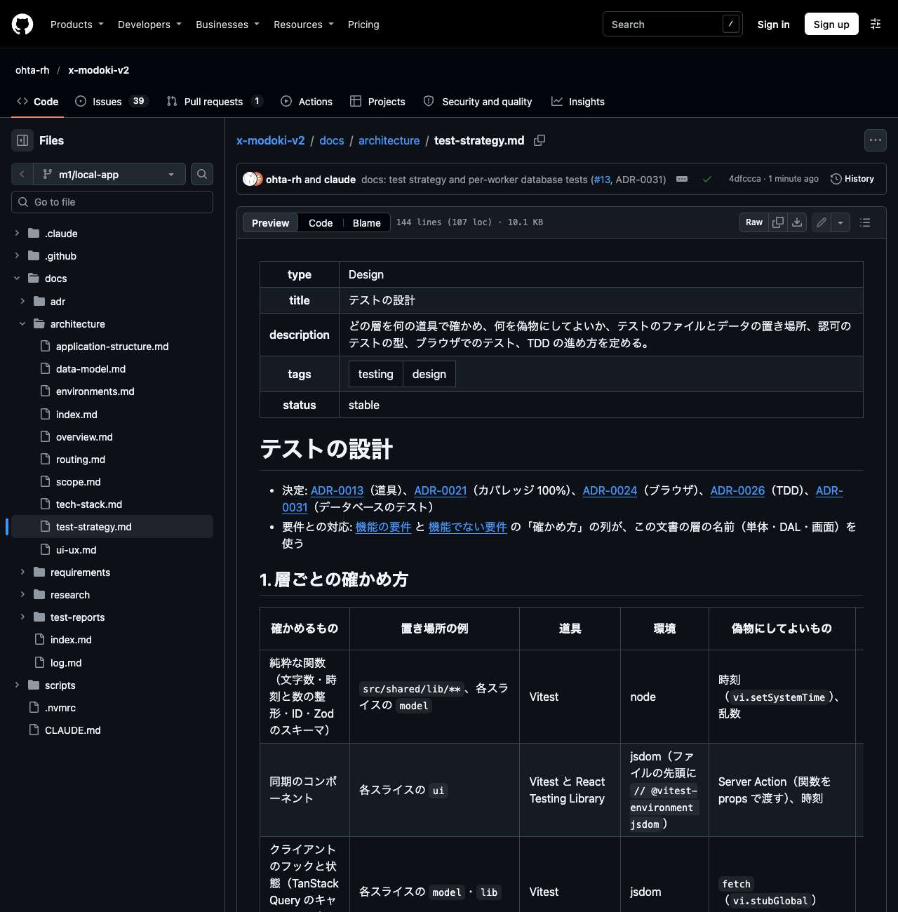
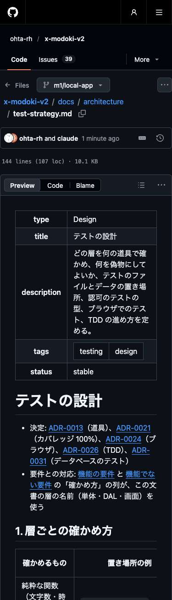

# 試験レポート: テストの設計が文書になり、どの層で何を確かめるかが決まっている

## 対象

- issue: [#13](https://github.com/ohta-rh/x-modoki-v2/issues/13)
- commit: `4dfccca`（ブランチ `m1/local-app`、PR #40）
- CI: [実行 44224782363](https://github.com/ohta-rh/x-modoki-v2/actions/runs/44224782363)（成功）
- 日付: 2026-11-18

## 環境

- OS: macOS 26.2
- ブラウザ: Google Chrome 157.0.8103.79（Claude in Chrome の拡張と `scripts/chrome-evidence.mjs`）
- 対象: GitHub の上で表示された `docs/architecture/test-strategy.md`

## 判定

合格 — 受け入れ条件 6 件のうち 6 件を満たした。設計の途中で、#13 と #16 の本文の 2 点（トランザクションで戻す・`src/shared/lib/testing/`）が、ほかの決定とぶつかることが分かり、[ADR-0031](../adr/0031-database-tests-per-worker-database-and-truncate.md) で決めて、2 つの issue の本文を直した。

## 受け入れ条件ごとの結果

| # | 条件 | 確かめ方 | 結果 | エビデンス |
|---|---|---|---|---|
| 1 | 置き場所（隣の `*.test.ts(x)`、`e2e/<ページ>.spec.ts`）、データベースのテストの切り離し方、データを作る関数、`storageState`、時刻と ID の差し替えが決まっている | 文書の 2・3・5 節を読む | 合格（切り離し方と補助の置き場所は ADR-0031 の形） | [文書](evidence/issue-0013-test-strategy/chrome-test-strategy.jpg) |
| 2 | 層ごとの表（何を・どの道具で・何を偽物にしてよいか） | 1 節 | 合格（9 行。データベースは偽物にしない） | 同上 |
| 3 | 認可のテストの型（本人・他人・ログイン無し） | 4 節 | 合格 | — |
| 4 | ブラウザでのテストの節（3 つのブラウザ、画面の受け入れ条件は全部テスト、Chrome で見るもの、記録の形） | 5 節 | 合格 | — |
| 5 | TDD の進め方の節（外側から内側、層ごとの最初の赤の例、記録） | 6 節 | 合格 | — |
| 6 | `docs/architecture/index.md` と `docs/log.md` | `node scripts/check-docs.mjs` | 合格 | 「自動のテスト」 |

## 自動のテスト

```
$ node scripts/check-docs.mjs
docs check passed: 65 file(s)
```

### TDD の記録

コードの変更なし。

## コードレビュー

コードの変更なし。

## ブラウザでの確認

| URL | 幅 | した操作 | 見えた結果 | 画面の写真 |
|---|---|---|---|---|
| `blob/m1/local-app/docs/architecture/test-strategy.md` | 1746 | 開いて読む | 見出し 7、表 7、コードの枠 1。崩れは無い |  |
| 同じ | 1280 | `chrome-evidence.mjs` | `innerWidth` 1280、横のスクロール無し |  |
| 同じ | 375 | 同上 | `innerWidth` 375、横のスクロール無し。表は枠の中で横にスクロールする |  |
| `/issues/16` | 1746 | 開いて、先頭の更新の注を読む | 「2026-11-18 更新（#13 の設計）」が引用の形で先頭に出る | — |

768px も `innerWidth` 768・横のスクロール無しを確かめた。

- コンソール: エラー 0、警告 0

## 見つけた問題

| # | 見つけたもの | 根本原因 | 対応 |
|---|---|---|---|
| 1 | #13・#16 の「テストごとにトランザクションを始めて戻す」は、データアクセス層の `db.transaction()` を入れ子にする | 変更の関数が自分でトランザクションを使う（ADR-0011・ADR-0015） | ワーカーごとのデータベースと、テストの前に表を空にする形にした（ADR-0031） |
| 2 | #13・#16 の「データを作る関数を `src/shared/lib/testing/` に置く」は、ESLint の決まりに反する | `src/shared/lib` から `@/shared/db` を読めない（ADR-0030）。`src/` の中はカバレッジの対象 | `test/` に置くことにした（ADR-0031）。2 つの issue の本文を直した |
