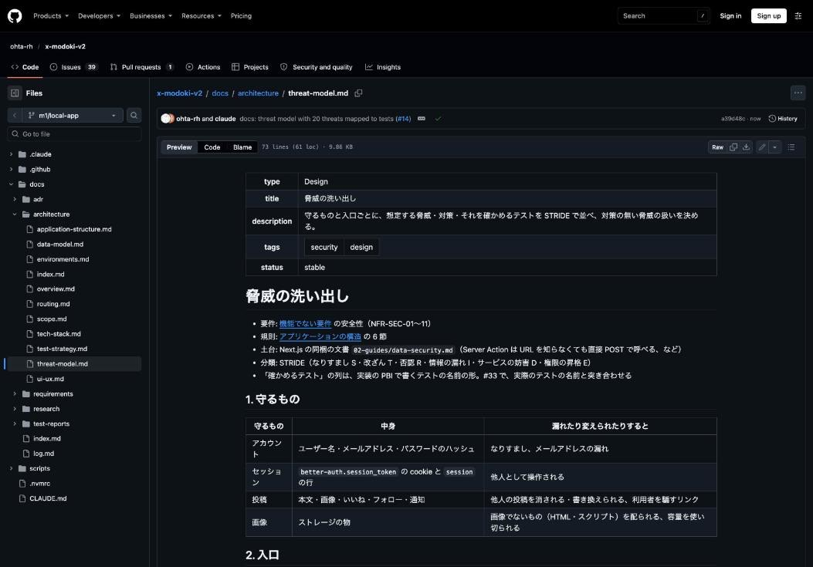
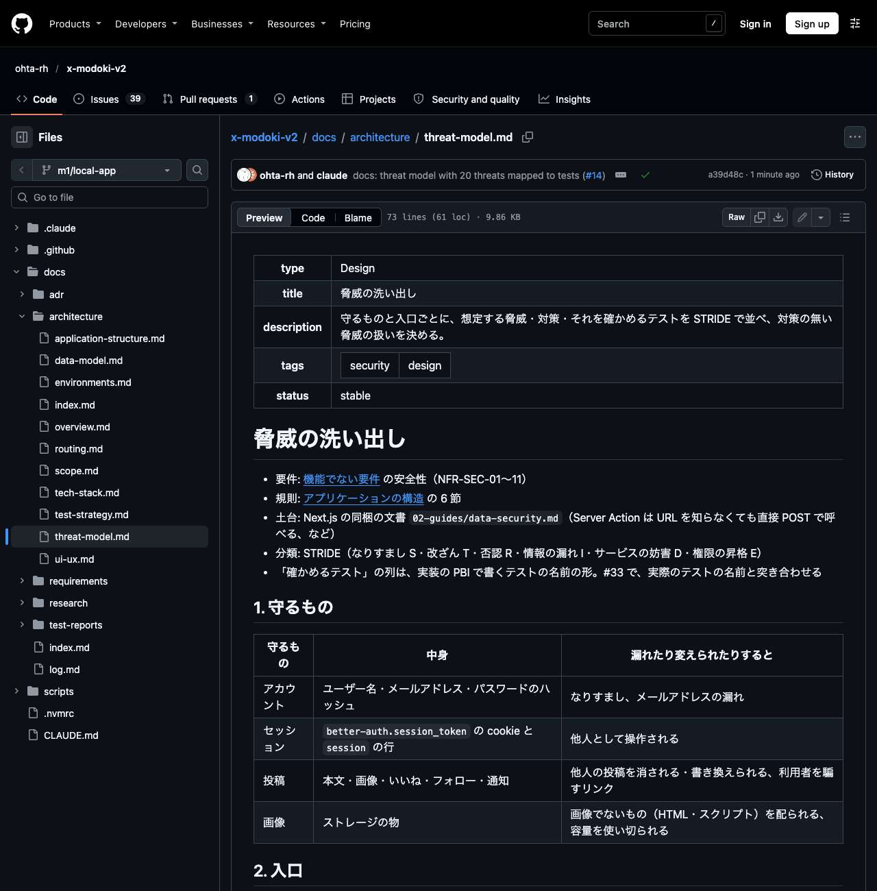
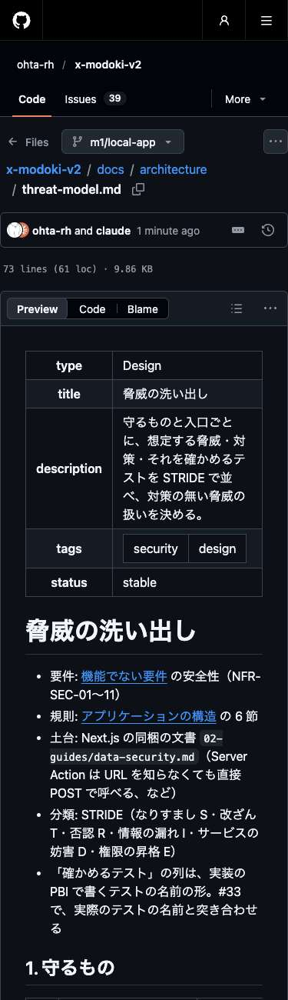

# 試験レポート: 脅威が洗い出され、対策ごとに確かめるテストが決まっている

## 対象

- issue: [#14](https://github.com/ohta-rh/x-modoki-v2/issues/14)
- commit: `a39d48c`（ブランチ `m1/local-app`、PR #40）
- CI: [実行 44225094800](https://github.com/ohta-rh/x-modoki-v2/actions/runs/44225094800)（成功）
- 日付: 2026-11-18

## 環境

- OS: macOS 26.2
- ブラウザ: Google Chrome 157.0.8103.79（Claude in Chrome の拡張と `scripts/chrome-evidence.mjs`）
- 対象: GitHub の上で表示された `docs/architecture/threat-model.md`

## 判定

合格 — 受け入れ条件 4 件のうち 4 件を満たした。

## 受け入れ条件ごとの結果

| # | 条件 | 確かめ方 | 結果 | エビデンス |
|---|---|---|---|---|
| 1 | 守るものと入口ごとに、脅威・対策・確かめるテストが表になっている | 文書の 1〜3 節を読む | 合格（守るもの 4、入口 5、脅威 20。脅威の表は全部 8 列） | [文書](evidence/issue-0014-threat-model/chrome-threat-model.jpg) |
| 2 | 11 の脅威（IDOR・Server Action への直接の POST・セッションの盗用と固定・XSS・`javascript:`・画像を装ったファイル・署名つき URL の使い回し・ユーザー名のなりすまし・回数の制限の回避・CSRF・開いた転送）を含む | 下の表で突き合わせた | 合格 | — |
| 3 | 対策の無い脅威は、受け入れる理由があるか PBI になっている | 4 節 | 合格（否認・ボット・DDoS の 3 つに理由と見直す時がある） | — |
| 4 | NFR-SEC からこの文書へのリンクがある | `node scripts/check-docs.mjs` と `non-functional.md` | 合格 | 「自動のテスト」 |

必須の 11 の脅威との突き合わせ:

| 必須の脅威 | 行 |
|---|---|
| 他人の投稿の削除や編集（IDOR） | T-01 |
| Server Action への直接の POST | T-02 |
| セッションの盗用と固定 | T-03・T-04 |
| 本文での XSS | T-05 |
| `javascript:` などのリンク | T-06 |
| 画像を装ったファイル | T-07 |
| 署名つき URL の使い回し | T-08 |
| ユーザー名の予約語と大文字小文字のなりすまし | T-09 |
| 回数の制限の回避 | T-10 |
| CSRF | T-11 |
| 開いた転送 | T-12 |

## 自動のテスト

```
$ node scripts/check-docs.mjs
docs check passed: 67 file(s)
```

### TDD の記録

コードの変更なし。

## コードレビュー

コードの変更なし。

## ブラウザでの確認

| URL | 幅 | した操作 | 見えた結果 | 画面の写真 |
|---|---|---|---|---|
| `blob/m1/local-app/docs/architecture/threat-model.md` | 1746 | 開いて読む | 見出し 5、脅威の行 20（全部 8 列）。崩れは無い |  |
| 同じ | 1280 | `chrome-evidence.mjs` | `innerWidth` 1280、横のスクロール無し |  |
| 同じ | 375 | 同上 | `innerWidth` 375、横のスクロール無し。8 列の表は枠の中で横にスクロールする |  |

768px も `innerWidth` 768・横のスクロール無しを確かめた。

- コンソール: このリポジトリの内容によるエラーは 0。GitHub 自身のスクリプトの `Oversized browser stats delivery failed` が出た（前のページから続くもの）

## 見つけた問題

なし。
