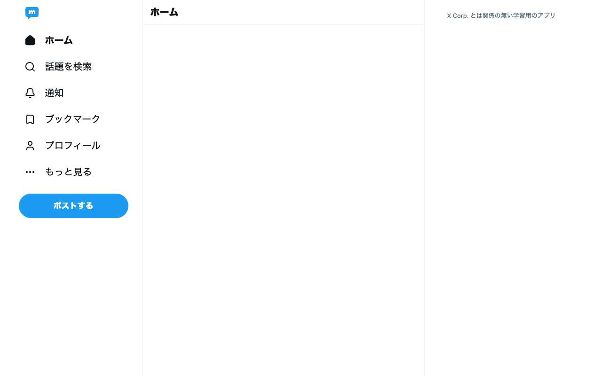
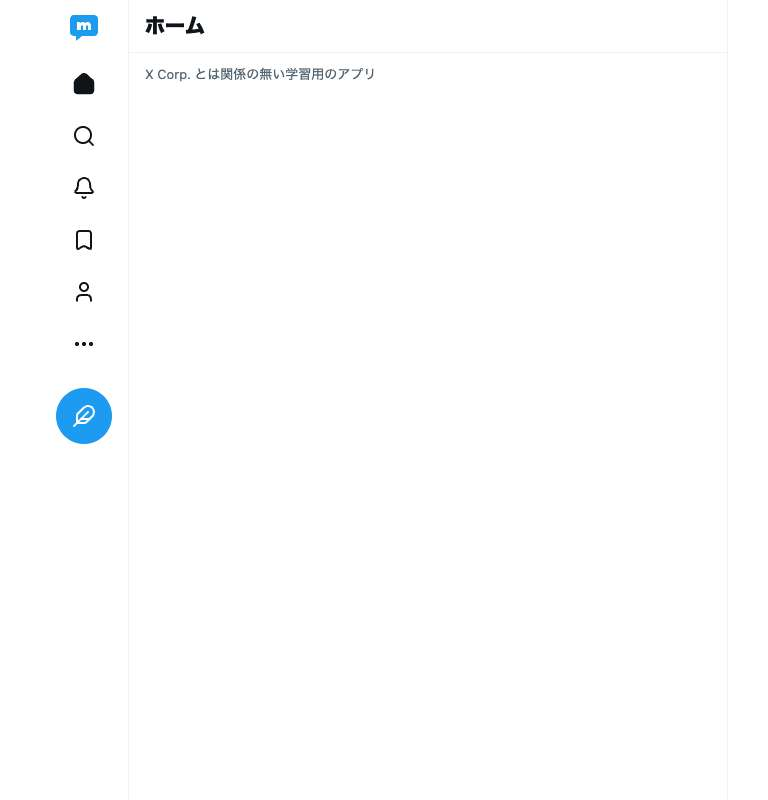
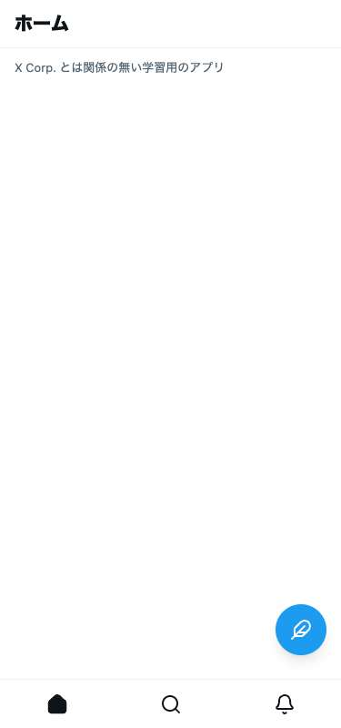
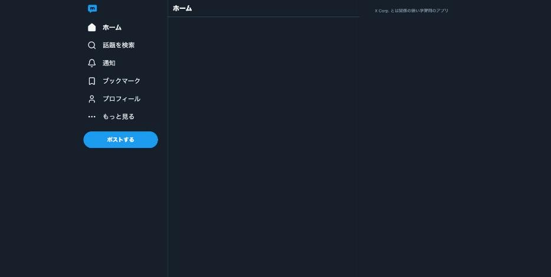
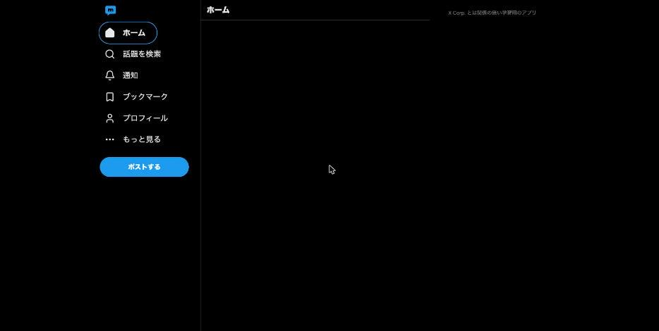
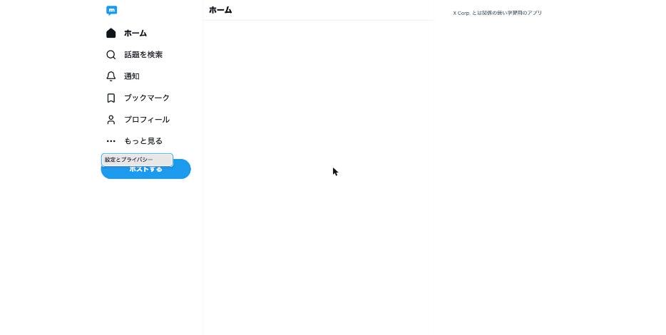
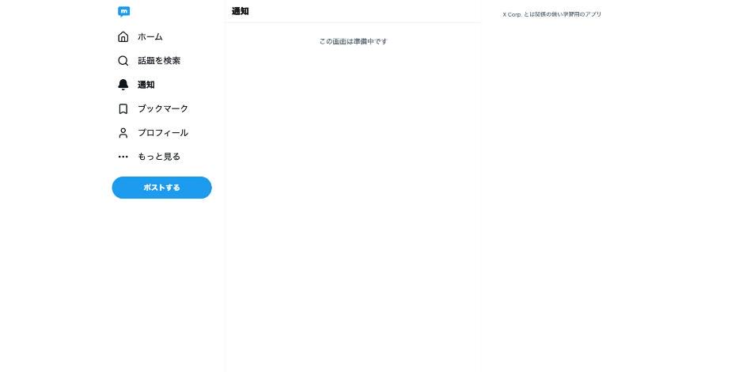

# 試験レポート: 3 カラムの骨格・幅ごとの切り替え・3 つのテーマが、X の Web 版と同じ形で出る

## 対象

- issue: [#17](https://github.com/ohta-rh/x-modoki-v2/issues/17)
- commit: `2e9c6fb`・`54868dc`（ブランチ `m1/local-app`、PR #40）
- CI: [実行 44238402788](https://github.com/ohta-rh/x-modoki-v2/actions/runs/44238402788)（成功）
- 日付: 2026-11-18

## 環境

- OS: macOS 26.2、Google Chrome 157.0.8103.79（Claude in Chrome と `scripts/chrome-evidence.mjs`）、Playwright 1.65.0 の Chromium・Firefox・WebKit
- Node.js: 手元は 26.12.0（`.nvmrc` は 24。CI の結果を本当の結果とする）、pnpm 12.19.0
- 動かし方: `pnpm build && pnpm start -p 3300`

## 判定

合格 — 受け入れ条件 7 件のうち 7 件を満たした。部品の取り込み方とトーストの選び方を [ADR-0035](../adr/0035-vendor-shadcn-from-registry-and-base-ui-toast.md) に記録した。

## 受け入れ条件ごとの結果

| # | 条件 | 確かめ方 | 結果 | エビデンス |
|---|---|---|---|---|
| 1 | 色・角・文字の大きさが CSS の変数にあり、UI/UX 仕様の 4 節と一致し、`data-theme` で切り替わる | `tokens.test.ts`（仕様から書いた値と比べる）、e2e の背景の色 | 合格（3 つのテーマの 5 色、共通の色・角・幅、文字の大きさ 15/20・17・20px。light `#FFFFFF`・dim `#15202B`・dark `#000000`） | 下の dim・dark の写真 |
| 2 | 1280px 以上で 275/600/350、1024〜1279px で 88px のアイコン、640〜1023px で右なし、640px 未満でタブバーと投稿ボタン | e2e で 1280・1100・800・375px の要素の幅と表示 | 合格 | 下の 3 つの幅の写真 |
| 3 | ヘッダーが sticky・半透明・53px、左ナビと右サイドバーが sticky | e2e で 2,000px スクロールして位置を見る | 合格（`backdrop-filter: blur(12px)`） | 「自動のテスト」 |
| 4 | 左ナビが 3 節の順（メッセージなし）、今いる項目が太字と塗りつぶし | `left-nav.test.tsx`・`routes.test.ts` | 合格 | [通知の画面](evidence/issue-0017-app-shell/chrome-notifications-placeholder.jpg) |
| 5 | 名前は x-modoki、ロゴは自前、アイコンは Lucide、フッターの文言、`grep -ri twitter src app` が 0 | テストと grep | 合格（grep 0 件。どの幅でもフッターが 1 つ見える） | 「自動のテスト」 |
| 6 | `kit/` に dialog・dropdown-menu・tooltip・tabs・toast、`src/shared/ui/` にボタン・アバター・スピナー・アイコンのボタン | `ls` と部品のテスト | 合格（kit に button も置いた。dialog と toast が使う） | 「自動のテスト」 |
| 7 | フォーカスの輪が `:focus-visible` のときだけ 2px のアクセント色 | e2e でクリックとキーボード | 合格（クリックでは `none`、Tab では `2px` `rgb(29, 155, 240)`） | [dark とフォーカス](evidence/issue-0017-app-shell/chrome-theme-dark-focus.jpg) |

## 自動のテスト

```
docs check passed: 74 file(s)
src layers check passed
All matched files use Prettier code style!
 Test Files  28 passed (28)
      Tests  237 passed (237)
Statements   : 100% ( 462/462 )
Branches     : 100% ( 293/293 )
Functions    : 100% ( 91/91 )
Lines        : 100% ( 401/401 )
  51 passed (8.7s)
VERIFY_RC=0
```

- Playwright: Chromium 17・Firefox 17・WebKit 17（骨格 15、着地のページ 2）

### TDD の記録

| # | 振る舞い | 先に書いたテスト | 赤（落ちた理由） | 緑にした実装 |
|---|---|---|---|---|
| 1 | 4 つの幅の骨格・sticky・フォーカスの輪・フッター（外側のテスト） | `e2e/app-shell.spec.ts`（7 本） | `locator.boundingBox: Test timeout of 30000ms exceeded`（`/home` も骨格も無い） | 下の 2〜10 のあと、最後に緑 |
| 2 | クラスをつなぎ、ぶつかる Tailwind のクラスはあとを残す | `cn.test.ts` | `expected '' to be 'a c'` | `src/shared/lib/cn/cn.ts` |
| 3 | 3 つのテーマの色・共通の値・フォント・フォーカスの輪 | `tokens.test.ts` | `expected {} to match object { '--bg': '#ffffff', …(4) }` | `src/_app/styles/global.css` |
| 4 | 左ナビの項目と下のタブの項目 | `routes.test.ts` | `TypeError: navItems is not a function` | `src/shared/config/routes.ts` |
| 5 | 今いる項目が太字と塗りつぶし、順、ロゴと投稿ボタン | `left-nav.test.tsx` | `Unable to find an accessible element with the role "navigation" and name "メインのメニュー"` | `src/widgets/app-shell/ui/left-nav.tsx` |
| 6 | ボタン・アバター・スピナー・アイコンのボタン | 各 `*.test.tsx`（10 件） | `Unable to find an accessible element with the role "button"` ほか | `src/shared/ui/*` |
| 7 | 骨格・下のタブ・ヘッダー・右サイドバー | `app-shell.test.tsx`・`right-sidebar.test.tsx` | `Unable to find an element by: [data-testid="left-column"]` ほか 5 件 | `src/widgets/app-shell`・`src/widgets/right-sidebar` |
| 8 | `/home` のヘッダーと、(main) のレイアウト | `home-page.test.tsx`・`main-layout.test.tsx` | `Unable to find an accessible element with the role "heading" and name "ホーム"`、`… role "main"` | `src/_pages/home`・`src/_pages/main-layout` |
| 9 | ナビの先読みで 404 が出ない（Chrome で見つけた） | e2e › /home を開くと、コンソールのエラーと失敗した通信が 0 | `+ "404 http://localhost:3300/explore?_rsc=…"` ほか 18 件 | `src/_pages/coming-soon` と準備中のページ 6 つ |
| 10 | 文字の大きさの変数と、24px のアイコン（レビュー 1 回目） | `tokens.test.ts`・`left-nav.test.tsx`・`button.test.tsx` | `expected {} to match object { '--text-body': '15px', …(3) }`、`toHaveClass("size-6")` | `global.css`・`left-nav.tsx`・`button.tsx` |
| 11 | 自前の文字の大きさが、文字の色のクラスとぶつからない | `cn.test.ts` | `expected 'text-white' to be 'text-body text-white'` | `cn.ts`（`extendTailwindMerge`） |

- 先に書いて最初から通ったテストは無い。トークンのテストは、値を 1 つ変えて落ちるのを確かめた（`--bg: #fefefe`）
- テストを直したもの: e2e の `getByRole('link', { name: 'ホーム' })`（「x-modoki のホーム」にも当たった → `exact: true`）、隠れた要素を探していたロゴの確認（→ `<title>`）、輪の色を変わる途中で読んでいた確認（`transition-colors` が `outline-color` も動かす → 待って読む）、2 つある「投稿する」のリンク。いずれもテストの側の誤りで、緑になる前に直した

## コードレビュー

- 判定: APPROVE（2 回目）　範囲: `origin/m1/local-app...HEAD`　レビューした sub agent: code-reviewer（opus）

| # | 回 | 重さ | 指摘 | 確かめた結果 | 対応 |
|---|---|---|---|---|---|
| 1 | 1 | major | 受け入れ条件 1 の「文字の大きさ」が CSS の変数に無い。部品が `text-[15px]` などを直に書いている | 再現した | 直した `54868dc`。テスト: `tokens.test.ts` › 文字の大きさ |
| 2 | 1 | minor | 左ナビのアイコンが 28px（`size-7`）。仕様は 24px | 再現した | 直した `54868dc`。テスト: `left-nav.test.tsx` › アイコンは 24px |
| 3 | 2 | minor | 準備中のページ（`/i/flow/login` ほか）はスコープの外。#18 が置き換えるとき、準備中のページと e2e が残るおそれ | その通り。先読みの 404 を無くすために足した（「見つけた問題」の 1） | 直し方のとおり、この理由をここに書き、#18 の本文の先頭に「置き換えるときに e2e も消すか書き換える」と書いた |

## ブラウザでの確認

| URL | 幅 | テーマ | した操作 | 見えた結果 | 画面の写真 |
|---|---|---|---|---|---|
| `/home` | 1280・768・375 | light | 開いた | 3 カラム／88px のアイコン／下のタブと右下の投稿ボタン。`innerWidth` が幅のとおり、横のスクロールなし | 下の 3 枚 |
| `/home` | 1280 | dim・dark | `data-theme` を替えた | 背景 `#15202B`・`#000000`、線と文字の色が替わる | 下の 2 枚 |
| `/home` | 1280 | dark | Tab を 2 回 | 「ホーム」に青い 2px の輪 | 下の dark の写真 |
| `/home` | 1280 | light | 「もっと見る」を開いた | 「設定とプライバシー」（`/settings`）が出る | 下の写真 |
| `/notifications`・`/settings` | 1280 | light | 開いた（まだ無い画面への経路） | 準備中の画面が骨格の中に出て、通知の項目が太字 | 下の写真 |
| `/` | 1280・768・375 | light | 開いた（変えていない隣の画面） | 前と同じ。エラー 0 | [1280](evidence/issue-0017-app-shell/landing-1280.jpg)・[768](evidence/issue-0017-app-shell/landing-768.jpg)・[375](evidence/issue-0017-app-shell/landing-375.jpg) |















- コンソール: エラー 0、警告 0（直したあと。直す前は `/home` で 404 のエラーが 5 つ）　通信: 失敗 0
- Claude in Chrome の `resize_window` は成功と返したが `innerWidth` は 1723 のままだった（ルールにある落とし穴）。幅ごとの写真は `chrome-evidence.mjs` のもの（`innerWidth` が幅のとおり）
- 「もっと見る」と dim・dark・フォーカスの写真は、レビューで左ナビのアイコンを 24px に直す前のもの。3 つの幅の写真は直したあとに撮り直した

## 見つけた問題

1. **ナビの行き先の先読みが 404 になり、コンソールにエラーが出た（Chrome で見つけた）。** 根本原因: Next.js の `Link` は見えているリンクの先を先読みするが、`/explore` など 5 つの行き先のページがまだ無い。先読みは X と同じ速さのために残し、行き先に準備中の画面（`ComingSoonPage`）を置いた。それぞれの PBI が本物の画面に置き換える。e2e で 0 件を確かめる。「もっと見る」の `/settings` も、押すと 404 だったので同じにした
2. **`?raw` で読んだ CSS が空だった。** 根本原因: Vitest は既定で CSS のファイルを空にする。`vitest.config.ts` の `css.include` に `global.css` だけを入れた（`src/` の中のテストは `node:fs` を使えない。ADR-0017 の ESLint の決まり）
3. **Steiger が `widgets/app-shell` から `widgets/right-sidebar` への読み込みを拒んだ。** 骨格は右サイドバーを差し込み口（`sidebar`）で受け取り、`_pages/main-layout` が組み合わせる形にした。フッターは `shared/ui/site-footer` に移した
4. **`tailwind-merge` が自前の `text-body` を文字の色と読んで消した（レビューの対応の途中で見つけた）。** `extendTailwindMerge` で 3 つの大きさを教えた。テスト: `cn.test.ts`
5. **typed routes が、まだ無いページへのリンクを型の誤りにした。** 行き先を `src/shared/config/routes.ts` に集め、そこの 1 か所で `Route` の型を付けた
