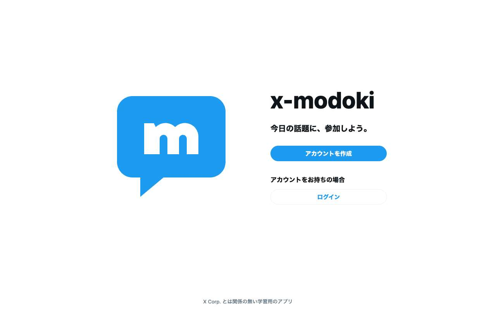
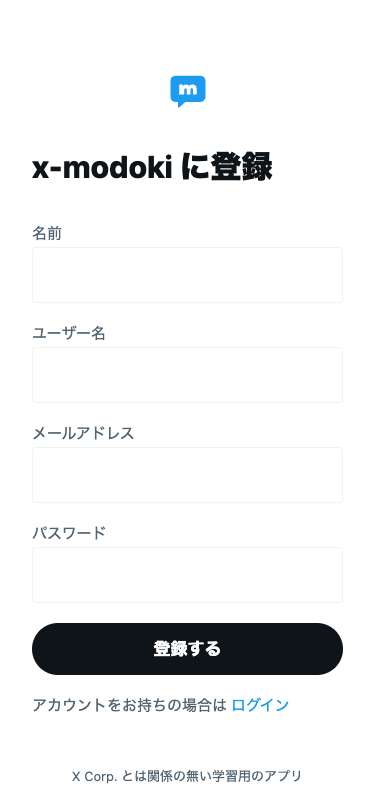
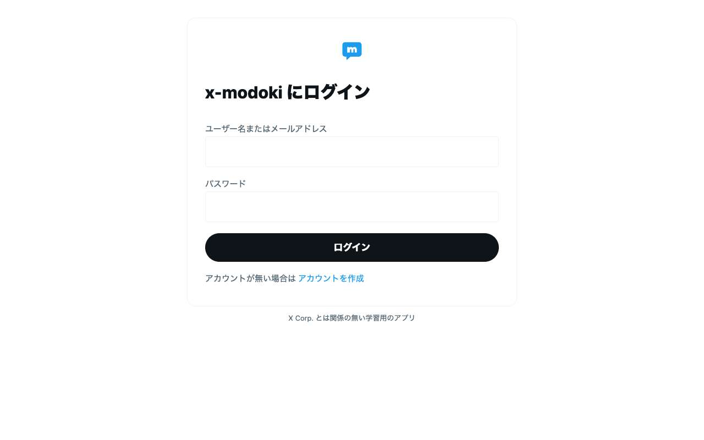
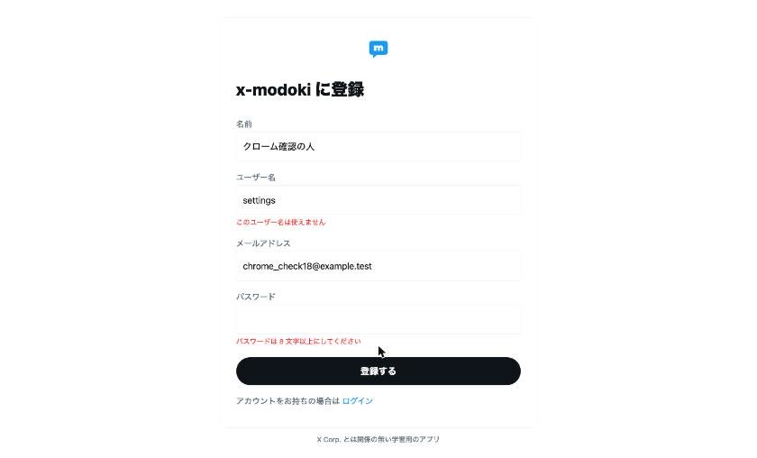
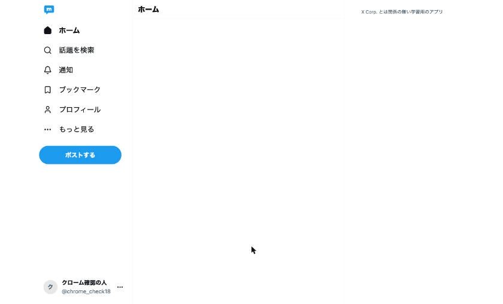
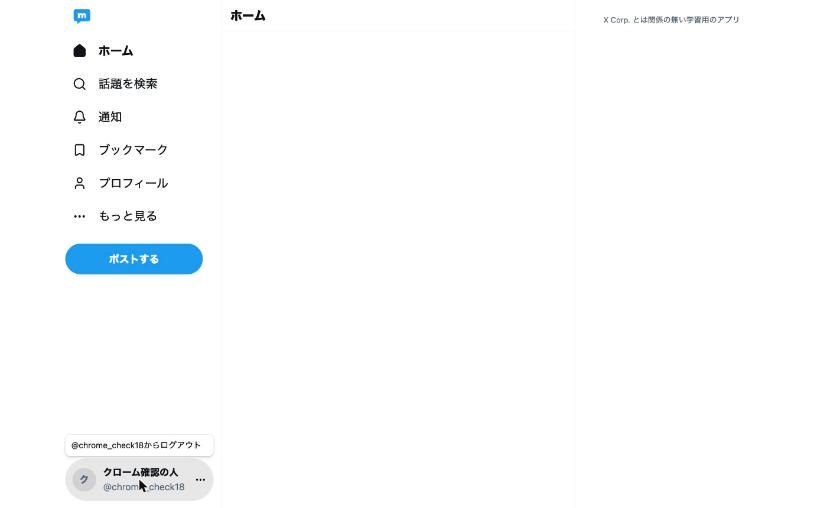
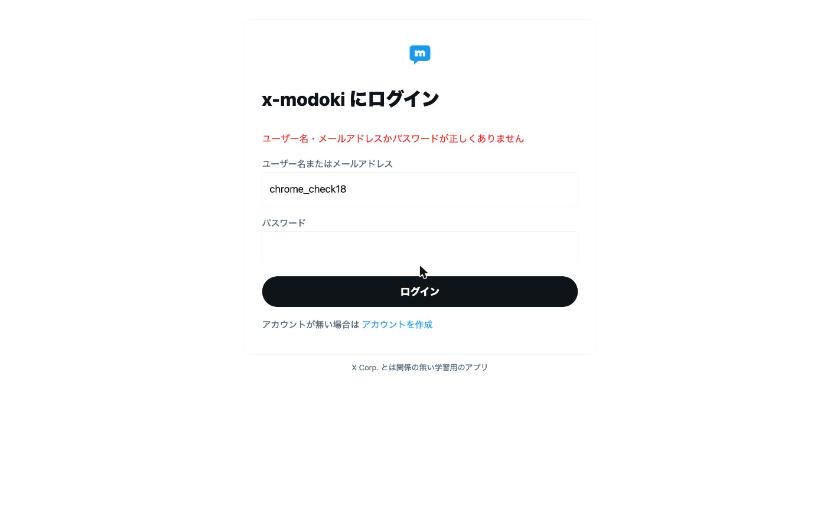
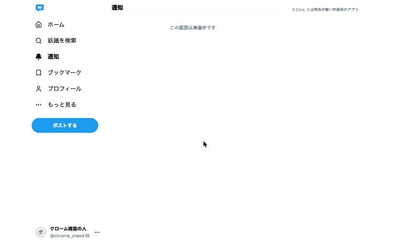

# 試験レポート: ユーザー名・メールアドレス・パスワードで登録・ログイン・ログアウトができる

## 対象

- issue: [#18](https://github.com/ohta-rh/x-modoki-v2/issues/18)
- commit: `e1d290d`・`5eded0a`・`3599370`・`e135f27`（ブランチ `m1/local-app`、PR #40）
- CI: [実行 44247617093](https://github.com/ohta-rh/x-modoki-v2/actions/runs/44247617093)（成功。`f06903f`。#18 の全ての commit と、CI のマイグレーションの段、#44 の直しを含む）。その前の `3599370` の実行は画面のテストで落ち（「見つけた問題」の 3）、`e135f27` の実行は apt の段で止まった（#44 で直した）
- 日付: 2026-11-18

## 環境

- OS: macOS 26.2、Google Chrome 157.0.8103.79（Claude in Chrome と `scripts/chrome-evidence.mjs`）、Playwright 1.65.0 の Chromium・Firefox・WebKit
- Node.js: 手元は 26.12.0（`.nvmrc` は 24。CI の結果を本当の結果とする）、pnpm 12.19.0
- データベース: PostgreSQL 18.7（Docker Compose）
- Better Auth 1.7.20（#10 の調査で確かめたのは 1.7.25。1.7.25 は公開から 4 日で ADR-0032 を通らないので、7 日以上たった中でいちばん新しい 1.7.20 にした）
- 動かし方: `pnpm build && pnpm start -p 3300`（回数の制限は既定の 10）

## 判定

合格 — 受け入れ条件 8 件のうち 8 件を満たした。決定は [ADR-0036](../adr/0036-auth-rate-limit-configurable-for-e2e.md)（回数の制限と画面のテスト）と [ADR-0037](../adr/0037-pool-closes-when-idle-not-after-response.md)（接続の pool の閉じ方）。機能のスライスの名前は、Steiger が `shared/auth` と紛らわしいとして拒んだので、issue の `features/auth` ではなく `features/account-access` にした。

## 受け入れ条件ごとの結果

| # | 条件 | 確かめ方 | 結果 | エビデンス |
|---|---|---|---|---|
| 1 | `/i/flow/signup` で登録でき、`/home` へ進む | Playwright、Chrome で操作 | 合格 | 下の写真 |
| 2 | ユーザー名は英数字と `_` の 4〜15 文字、大文字と小文字を区別せず一意、予約の語は不可。パスワードは 8 文字以上 | Zod のスキーマのテスト、一意のテスト、Better Auth のプラグインのテスト | 合格（パスワードは 128 文字までも足した。レビュー 2 回目） | [登録の誤り](evidence/issue-0018-auth/chrome-signup-errors.jpg) |
| 3 | ユーザー名かメールアドレスで入れ、間違えたときはどちらが違うかを言わない 1 つの文言 | Playwright、Chrome で操作 | 合格（「ユーザー名・メールアドレスかパスワードが正しくありません」） | [ログインの誤り](evidence/issue-0018-auth/chrome-login-error.jpg) |
| 4 | ログインが要る画面からログインへ送られ、入ったあと元の画面へ戻る。戻り先は同じサイトのパスだけ | Playwright（外の URL 3 種）、`safe-next.test.ts`、`proxy.test.ts`、Chrome | 合格 | [元の画面へ戻った](evidence/issue-0018-auth/chrome-back-to-notifications.jpg) |
| 5 | `/` は入っていなければ入口、入っていれば `/home` へ | Playwright、`redirect-if-signed-in.test.ts` | 合格 | 下の写真 |
| 6 | アカウントのメニューからログアウトでき、セッションの行が消え、`/` へ戻る | Playwright、データベースのテスト、Chrome | 合格 | [アカウントのメニュー](evidence/issue-0018-auth/chrome-account-menu.jpg) |
| 7 | `getSession()`・`requireSession()` が 1 回だけ読み、cookie は HttpOnly・SameSite=Lax | `auth.test.ts`（読む回数を数える、`set-cookie` を読む）、Chrome で `document.cookie` に出ないこと | 合格 | 「自動のテスト」 |
| 8 | 登録とログインは同じ IP から 1 分に 10 回まで | `auth-flows.test.ts`・`actions.test.ts`（11 回目が `RATE_LIMITED`）、Better Auth の入口が閉じていること（curl で 404） | 合格 | 「見つけた問題」の 1 |

## 自動のテスト

```
docs check passed: 78 file(s)
src layers check passed
All matched files use Prettier code style!
 Test Files  43 passed (43)
      Tests  319 passed (319)
Statements   : 100% ( 569/569 )
Branches     : 100% ( 369/369 )
Functions    : 100% ( 120/120 )
Lines        : 100% ( 497/497 )
  69 passed (25.4s)
VERIFY_RC=0
```

- Playwright: Chromium 23・Firefox 23・WebKit 23。auth の 7 本は `--repeat-each=3` で 63 回とも通った

### TDD の記録

| # | 振る舞い | 先に書いたテスト | 赤（落ちた理由） | 緑にした実装 |
|---|---|---|---|---|
| 1 | 登録・ログイン・ログアウト・転送・入口（外側のテスト） | `e2e/auth.spec.ts`（7 本） | `Test timeout of 30000ms exceeded`（`/i/flow/signup` が無い） | 下の 2〜13 のあと、最後に緑 |
| 2 | 登録とログインの入力の決まり | `schema.test.ts`（15 件） | `TypeError: signInSchema.parse is not a function` ほか | `features/account-access/model/schema.ts`・`shared/config/reserved-usernames.ts` |
| 3 | 回数の制限（区切り・キー・同時） | `rate-limit.test.ts` | `expected true to be false`、`Cannot read properties of undefined (reading 'count')` | `shared/api/rate-limit.ts` |
| 4 | 戻り先は同じサイトのパスだけ | `safe-next.test.ts`（11 件） | 11 件とも落ちた（空の文字列を返すスタブ） | `shared/lib/safe-next` |
| 5 | 回数の制限の数を環境変数で | `env.test.ts` | `expected undefined to be 10` | `shared/config/env.ts` |
| 6 | cookie・ハッシュ・1 回だけ読む・ログインへ送る | `auth.test.ts`（5 件） | `TypeError: getAuth(...).api.signUpEmail is not a function` | `shared/auth/auth.ts` |
| 7 | 登録・ログイン・ログアウトの流れ | `auth-flows.test.ts`（8 件） | `expected undefined to deeply equal { ok: false, error: 'RATE_LIMITED' }` ほか | `features/account-access/api/auth-flows.ts` |
| 8 | Server Action | `actions.test.ts`（9 件） | `expected undefined to be 'ユーザー名・メールアドレスかパスワードが正しくありません'` ほか | `features/account-access/api/actions.ts` |
| 9 | 登録とログインのフォーム | `auth-forms.test.tsx`（5 件） | `Unable to find a label with the text of: 名前` | `features/account-access/ui/*` |
| 10 | アカウントのメニュー、骨格への配線 | `account-menu.test.tsx`・`left-nav`・`app-shell`・`main-layout` | `Unable to find … role "button" and name "アカウントのメニュー"` | `widgets/app-shell`・`_pages/main-layout` |
| 11 | 入口・登録・ログインの画面と、入っていれば `/home` | `landing-page`・`sign-up-page`・`sign-in-page`・`redirect-if-signed-in`・`centered-card` | `Unable to find … role "heading" and name "x-modoki に登録"` ほか | `_pages/*`・`shared/ui/centered-card` |
| 12 | 入っていなければログインへ（`proxy.ts`） | `proxy.test.ts` | `expected 200 to be 307` | `proxy.ts` |
| 13 | `/api/auth/*` を Better Auth へ | `auth.test.ts`（`_app/api-routes`） | `expected 404 to be 200` | `_app/api-routes/auth.ts` |
| 14 | 接続の pool を閉じたあとに使わない（Chrome とサーバーのログで見つけた） | `client.test.ts` › 使わなくなった接続は 1 秒ほどで閉じ… | `` Error: `after` was called outside a request scope `` | `shared/db/client.ts`（ADR-0037） |
| 15 | Better Auth 自身の登録とログインの入口を外から呼べない（レビュー 1 回目） | `_app/api-routes/auth.test.ts`（3 件）、`auth.test.ts` › username のプラグインの検証 | `expected 200 to be 404`、`expected 401 to be 404` | `shared/auth/auth.ts`（`disabledPaths`・`usernameValidator`） |
| 16 | レイアウトは今の人をいなければ null で読む（レビュー 1 回目） | `load-viewer.test.ts` | `promise rejected "Error: NEXT_REDIRECT /i/flow/login" instead of resolving` | `_pages/main-layout/api/load-viewer.ts` |
| 17 | パスワードは 128 文字まで（レビュー 2 回目） | `schema.test.ts` | `expected undefined to deeply equal [ 'パスワードは 128 文字までにしてください' ]` | `schema.ts`・`auth.ts` |

- 実装を壊して確かめたもの: 回数の制限（キーと区切りを無視すると 3 件が落ちる）、登録が制限に当たった枝（文言を替えると落ちる）
- テストの側を直したもの: e2e の `getByRole('alert')` が Next.js の route announcer にも当たった（→ フォームの中に限る）、`<Suspense>` で流れてくる骨格を待たずに大きさを測っていた（→ メインが見えるのを待つ）、Firefox でログアウトのあとの描画の途中に次へ進んでいた（→ 入口の画面を待つ）
- `getDb` のテストは、`next/server` の `after` と React の `cache` を差し替えない形に変えた（`after` を使わなくなった）

## コードレビュー

- 判定: APPROVE（2 回目）　範囲: `origin/m1/local-app...HEAD`　レビューした sub agent: code-reviewer（opus）

| # | 回 | 重さ | 指摘 | 確かめた結果 | 対応 |
|---|---|---|---|---|---|
| 1 | 1 | blocker | `/api/auth/*` が Better Auth 自身の `sign-up/email`・`sign-in/email`・`sign-in/username` を出していて、予約の語・Zod・回数の制限を通らない | 再現した（curl で予約の語 `home` の人ができ、間違ったパスワードを 12 回送っても全部 401） | 直した `5eded0a`。3 つの入口を `disabledPaths` で閉じ、プラグインにも同じ決まり（`isAllowedUsername`）を渡した。curl で 404 を確かめた。再現で作った `home` の人は消した |
| 2 | 1 | minor | `(main)` のレイアウトがいつも `requireSession()` を呼び、ログインの要らない `/{username}` でもログインへ送る | 再現した（`(main)/[username]` は私が足した準備中のページ） | 直した `5eded0a`。今の人は `getSession()` で、いなければ null。#23 の本文に申し送った |
| 3 | 2 | minor | パスワードの長さに上限が無く、129 文字で Better Auth の `PASSWORD_TOO_LONG` が誤りの画面になる | その通り（Better Auth の既定の上限は 128） | 直した `3599370`（示された直し方のとおり） |

## ブラウザでの確認

| URL | 幅 | テーマ | した操作 | 見えた結果 | 画面の写真 |
|---|---|---|---|---|---|
| `/` | 1280・768・375 | light | 開いた | 左にロゴ、右に登録とログイン。横のスクロールなし | 下の 3 枚 |
| `/i/flow/signup` | 375 | light | 開いた | 中央のカード、4 つの欄 | 下の写真 |
| `/i/flow/login?next=/notifications` | 1280 | light | 開いた | 中央のカード | 下の写真 |
| `/i/flow/signup` | 1280 | light | 予約の語 `settings` と短いパスワードで送った（失敗の経路） | 欄の下に「このユーザー名は使えません」「パスワードは 8 文字以上にしてください」。名前とメールは残る | 下の写真 |
| `/i/flow/signup` → `/home` | 1280 | light | 正しく入れて登録 | `/home`。左ナビの下に名前と @ユーザー名 | 下の写真 |
| `/home` | 1280 | light | アカウントのメニューを開いてログアウト | 「@chrome_check18からログアウト」→ `/` | 下の写真 |
| `/notifications` | 1280 | light | 入っていない状態で開いた | `/i/flow/login?next=%2Fnotifications` へ | — |
| `/i/flow/login` | 1280 | light | 間違ったパスワード（失敗の経路）→ 正しいパスワード | 1 つの文言の誤り → `/notifications` に戻った。`document.cookie` にセッションの cookie が出ない（HttpOnly） | 下の 2 枚 |


















- コンソール: エラー 0、警告 0　通信: 失敗 0（`chrome-evidence.mjs` の 9 つと、Claude in Chrome の操作のあいだ）
- Chrome で入れたパスワードは、リポジトリの `e2e/support/auth.ts` のテスト用の値

## 見つけた問題

1. **Better Auth 自身の登録とログインの入口が外に出ていた（レビュー 1 回目、blocker）。** 根本原因: `/api/auth/*` を全部 Better Auth に渡したので、Better Auth の `sign-up/email`・`sign-in/*` が、アプリの検証と回数の制限を通らずに呼べた。curl で再現し、`disabledPaths` で閉じた
2. **閉じた接続の pool を使って、セッションの読み取りとログアウトが失敗した（Chrome とサーバーのログで見つけた）。** 根本原因: pool を `after()` で閉じていたが、`after()` は応答「かプリレンダー」が終わったときに動くので、1 つのリクエストの中で閉じたあとの pool がまだ使われた。一時的なログで再現してから、使わなくなった接続を 1 秒で閉じる形にした（ADR-0037）
3. **CI の画面のテストで `relation "rate_limits" does not exist`。** 根本原因: CI は、`pnpm start` が使うデータベースにマイグレーションを流していなかった（アプリがデータベースを使うのは #18 から）。CI に `pnpm db:migrate` の段を足した（`e135f27`）
4. **左ナビの「プロフィール」の先読みが 404 だった。** `/{username}` に準備中の画面を置き、#23 に申し送った
5. **`<Suspense>` の外でセッションを読み、ビルドが失敗した。** ルートのファイルで、セッションを読む部品を `<Suspense>` で包んだ
