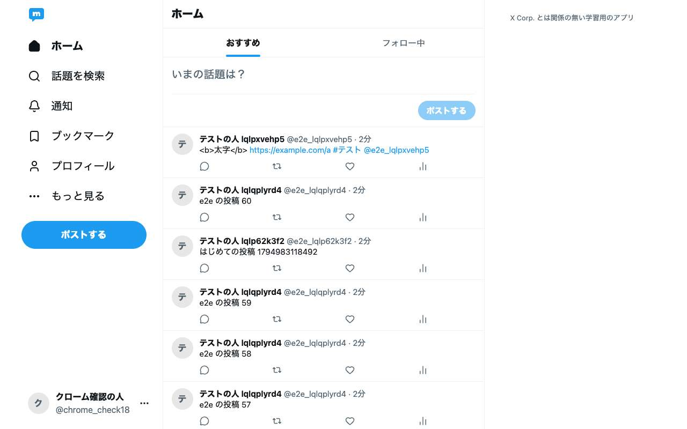
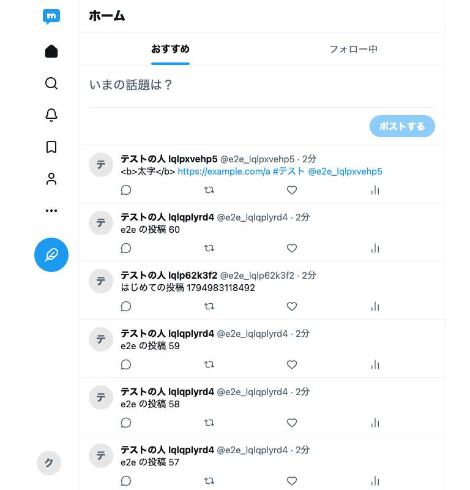
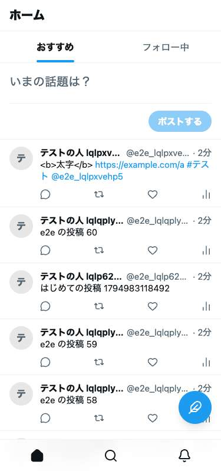
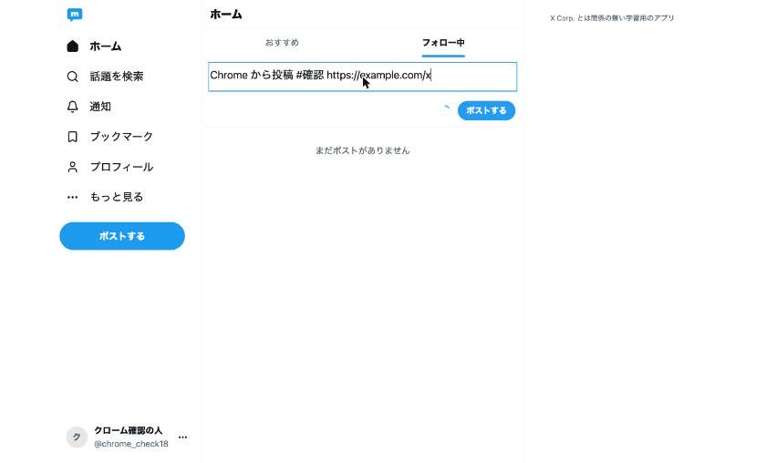
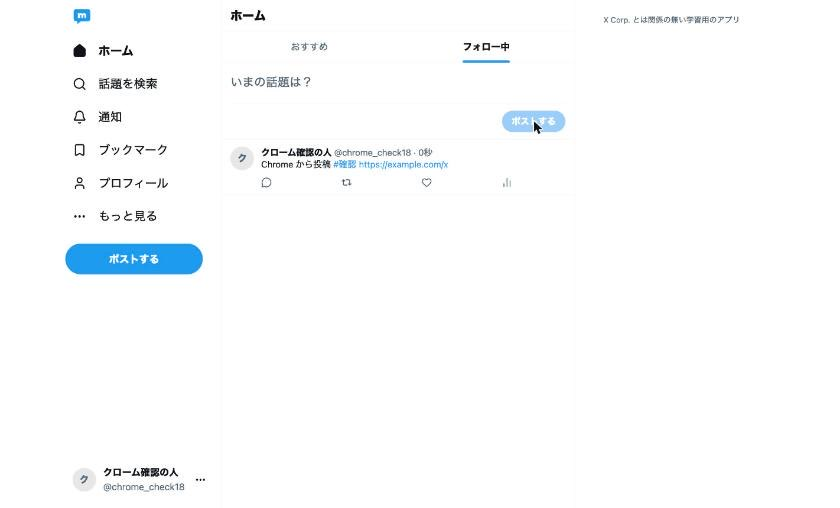
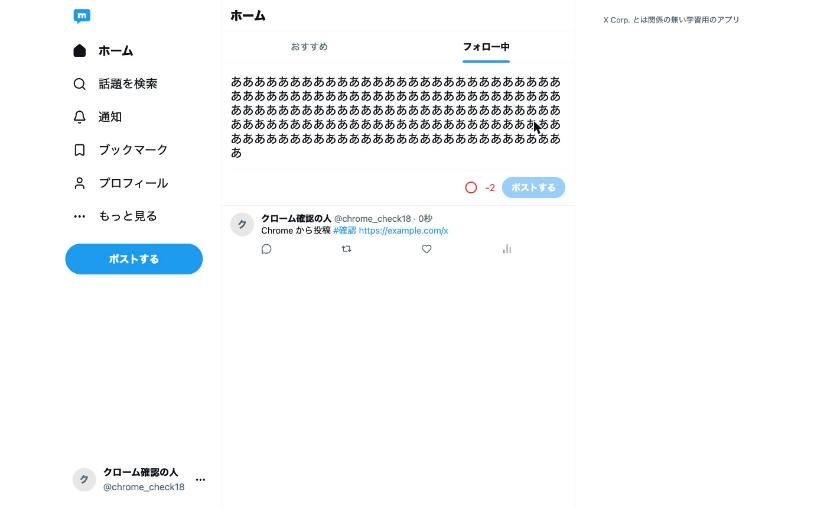
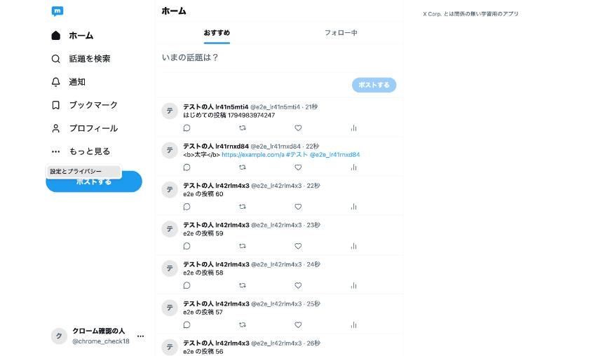

# 試験レポート: 文字だけの投稿ができ、ホームのタイムラインに「おすすめ」と「フォロー中」が出て、下へ続きが読める

## 対象

- issue: [#19](https://github.com/ohta-rh/x-modoki-v2/issues/19)
- commit: `8c979b5`・`7688d6f`・`15881f1`（ブランチ `m1/local-app`、PR #40）
- CI: [実行 44252973482](https://github.com/ohta-rh/x-modoki-v2/actions/runs/44252973482)（成功。`15881f1`）
- 日付: 2026-11-18

## 環境

- OS: macOS 26.2、Google Chrome 157.0.8103.79（Claude in Chrome と `scripts/chrome-evidence.mjs --storage-state`）、Playwright 1.65.0 の Chromium・Firefox・WebKit
- Node.js: 手元は 26.12.0（`.nvmrc` は 24。CI の結果を本当の結果とする）、pnpm 12.19.0
- データベース: PostgreSQL 18.7。開発のデータベースにはシードの 300 件と、画面のテストの投稿がある
- 新しい依存: `twitter-text` 3.1.0、`@tanstack/react-virtual` 3.14.26、`@types/twitter-text` 3.1.10（どれも公開から 7 日以上。`twitter-text` が連れてくる `core-js@2` の build のスクリプトは宣伝の表示だけなので、`allowBuilds` で `false`）

## 判定

合格 — 受け入れ条件 9 件のうち 9 件を満たした。画面のテストの登録と前提のデータの作り方を [ADR-0038](../adr/0038-e2e-sign-up-per-test-and-direct-bulk-fixtures.md) に記録した。

## 受け入れ条件ごとの結果

| # | 条件 | 確かめ方 | 結果 | エビデンス |
|---|---|---|---|---|
| 1 | 入力欄から投稿でき、タイムラインの先頭に出る。入力欄は内容に合わせて伸びる | Playwright（投稿、伸びて縮む）、Chrome | 合格 | [先頭に出た](evidence/issue-0019-home-timeline/chrome-posted-on-top.jpg) |
| 2 | `twitter-text` の重みで 280、URL は 23、残り 20 で黄色、0 未満で赤と数字、押せない。空も押せない。サーバーも同じ規則 | `measure-post.test.ts`（ラテン・日本語・絵文字・URL・NFC・空）、`compose-box.test.tsx`、`create-post.test.ts`、Playwright、Chrome | 合格（残りは重みの単位で出す。日本語 141 文字は `-2`） | [超えたとき](evidence/issue-0019-home-timeline/chrome-over-limit.jpg) |
| 3 | URL・@ユーザー名・#ハッシュタグがアクセント色のリンク。本文は文字のまま。`http`・`https` のほかはリンクにしない | `tokenize-post.test.ts`、`post-card.test.tsx`（`<script>`・`javascript:`）、Playwright | 合格 | 下の写真 |
| 4 | `hashtags`・`post_hashtags`・`mentions` を同じトランザクションで書く | `create-post.test.ts`（途中で失敗させると何も残らない） | 合格 | 「自動のテスト」 |
| 5 | 投稿カードが 5 節の並び、時刻と数が 5 節の形 | `format.test.ts`、`post-card.test.tsx` | 合格 | 下の写真 |
| 6 | 「フォロー中」と「おすすめ」を ID の降順で 20 件ずつ、選んだタブに 4px の下線 | `get-timeline.test.ts`（25 件・カーソル・削除済み・返信）、`home-page.test.tsx`、Playwright | 合格 | 下の写真 |
| 7 | 下まで行くと続きを読み、最後で止まる。画面の外のカードは DOM から外れる | Playwright（60 件を入れて最後まで。`article` が 60 より少ない） | 合格 | 「自動のテスト」 |
| 8 | `GET /api/timeline/following`・`/for-you` が 5 節の JSON、ID は文字列、ログインが無ければ 401 | `timeline.test.ts` | 合格 | 「自動のテスト」 |
| 9 | 投稿は 1 分に 10 回まで | `create-post.test.ts`・`actions.test.ts`（時計を止めて 11 回目） | 合格 | 「自動のテスト」 |

## 自動のテスト

```
docs check passed: 81 file(s)
src layers check passed
All matched files use Prettier code style!
 Test Files  55 passed (55)
      Tests  397 passed (397)
Statements   : 100% ( 771/771 )
Branches     : 100% ( 489/489 )
Functions    : 100% ( 167/167 )
Lines        : 100% ( 673/673 )
  90 passed (23.0s)
VERIFY_RC=0
```

- Playwright: Chromium 30・Firefox 30・WebKit 30

### TDD の記録

| # | 振る舞い | 先に書いたテスト | 赤（落ちた理由） | 緑にした実装 |
|---|---|---|---|---|
| 1 | 投稿・リンク・残りの数・続き・タブ（外側のテスト） | `e2e/home-timeline.spec.ts`（5 本） | `Test timeout of 30000ms exceeded`（入力欄が無い） | 下の 2〜12 のあと、最後に緑 |
| 2 | 文字数の重み | `measure-post.test.ts` | 4 件が落ちた（重み 0 を返すスタブ。空の本文の 3 件はスタブでも通った） | `shared/lib/text/measure-post.ts` |
| 3 | 時刻と数の形 | `format.test.ts`（17 件） | 17 件とも落ちた（空の文字列を返すスタブ） | `shared/lib/format` |
| 4 | 本文をリンクと文字に分ける | `tokenize-post.test.ts` | 4 件とも落ちた | `shared/lib/text/tokenize-post.ts` |
| 5 | 画像の公開の URL | `media-url.test.ts` | 空の文字列を返すスタブで落ちた | `shared/lib/media-url` |
| 6 | タイムラインの問い合わせ | `get-timeline.test.ts`（6 件） | `TypeError: Cannot read properties of undefined (reading 'ok')` | `entities/post/api/get-timeline.ts` |
| 7 | 投稿とハッシュタグとメンションのトランザクション、回数の制限、ID のぶつかり | `create-post.test.ts`（10 件） | `expected undefined to deeply equal { ok: false, error: 'UNAUTHORIZED' }` ほか | `features/post-compose/api/create-post.ts` |
| 8 | Server Action と Route Handler | `actions.test.ts`・`timeline.test.ts` | `expected 200 to be 401`、`expected undefined to deeply equal { ok: false, message: 'ログインしてください' }` ほか | `actions.ts`・`_app/api-routes/timeline.ts` |
| 9 | 本文と投稿カード | `post-card.test.tsx` | `Unable to find … role "article"` ほか | `entities/post/ui/*` |
| 10 | 入力欄 | `compose-box.test.tsx` | `Unable to find … role "textbox" and name "投稿の本文"` | `features/post-compose/ui/compose-box.tsx` |
| 11 | タイムラインと投稿のあとの読み直し | `timeline-feed.test.tsx` | `Unable to find … role "article"` ほか。続いて `expected "vi.fn()" to not be called`（1 ページ目を取り直していた → `staleTime`） | `widgets/timeline-feed/*` |
| 12 | ホームの画面と 1 ページ目の読み込み | `home-page.test.tsx`・`load-home-page.test.ts` | `Unable to find … role "tablist"`、`promise resolved "{}" instead of rejecting` | `_pages/home/*`・`app/(main)/home/page.tsx` |
| 13 | 空のカーソル（`cursor=`）は 1 ページ目（e2e で見つけた） | `timeline.test.ts` › 空のカーソル | `expected 400 to be 200` | `timeline.ts` |
| 14 | 入力欄のクリックで四角い輪を出さない（Chrome で見つけた） | e2e › 入力欄をクリックしても… | `Expected: "none"` / `Received: "solid"` | `global.css`（輪の決まりを `@layer base` へ） |
| 15 | 続きを読めないときに知らせる、実在しない人だけへのメンション | `timeline-feed.test.tsx`・`create-post.test.ts` | `Unable to find role="alert"` | `timeline-feed.tsx` |
| 16 | 写真の道具が、ログインした状態で開ける | `chrome-evidence.test.mjs` › storageState | `expected '' to be 'session=abc'` | `scripts/lib/chrome-evidence.mjs`（`--storage-state`） |
| 17 | 入力欄が伸び、消すと縮む（レビュー 1 回目） | e2e › 入力欄は内容に合わせて伸び、消すと縮む | `Expected: <= 49` / `Received: 136` | `compose-box.tsx`（高さを `auto` に戻してから測る） |
| 18 | 操作の数を「返信 2」と読み上げる（レビュー 2 回目） | `post-card.test.tsx` | `Unable to find an element with the text: 返信 2` | `post-card.tsx`（`sr-only` の文） |

- テストの側を直したもの: e2e の残りの数（日本語 141 文字は重み 282 で `-2`。最初に `-1` と書いたのは私の誤り）、`おすすめ` で自分の投稿の位置を確かめていた e2e（並列のテストの投稿が混ざる → `フォロー中` で確かめる）、Firefox でログアウトのあとの `goto` が打ち切られた e2e（リンクを押して進む）、アバターと名前のリンクが同じ読み上げの名前だった（アバターは「… のプロフィール」）
- `twitter-text` を読むので、`grep -ri twitter src app` は import に当たる。FR-SHELL-09 は画面の文言の決まりで、画面には出ない（e2e の骨格のテストで確かめる）

## コードレビュー

- 判定: APPROVE（2 回目）　範囲: `origin/m1/local-app...HEAD`　レビューした sub agent: code-reviewer（opus）

| # | 回 | 重さ | 指摘 | 確かめた結果 | 対応 |
|---|---|---|---|---|---|
| 1 | 1 | major | 受け入れ条件 1 の「入力欄が伸びる」に Playwright のテストが無い | その通り（jsdom の偽の高さだけ） | 直した `7688d6f`。e2e › 入力欄は内容に合わせて伸び、消すと縮む |
| 2 | 1 | minor | 入力欄が伸びるだけで縮まない | 再現した（e2e で 136px のまま） | 直した `7688d6f` |
| 3 | 1 | minor | 11 回目の回数の制限のテストが本物の時計を使い、分の境目でたまに落ちる | その通り（区切りは分にそろう） | 直した `7688d6f`。2 つのテストで `Date` を止めた |
| 4 | 1 | minor | 入力欄に輪が出ないことが、UI/UX 仕様の 10 節と食い違う | その通り | 直した `7688d6f`。10 節に枠の無いテキストの入力欄の例外を書いた |
| 5 | 2 | minor | 操作の数の `aria-label` が役割の無い `span` にあり、読み上げられない | その通り（ARIA 1.2） | 直した `15881f1`（示された直し方のとおり、`sr-only` の文） |

## ブラウザでの確認

| URL | 幅 | テーマ | した操作 | 見えた結果 | 画面の写真 |
|---|---|---|---|---|---|
| `/home` | 1280・768・375 | light | ログインした状態で開いた | タブ・入力欄・投稿カード。`innerWidth` が幅のとおり、横のスクロールなし | 下の 3 枚 |
| `/home?tab=following` | 1280 | light | 入力欄に入れた | 四角いフォーカスの輪が出た（見つけた問題の 2。直す前） | 下の写真 |
| `/home?tab=following` | 1280 | light | 投稿した | 先頭に出て、入力欄が空。`#確認` と URL がリンク | 下の写真 |
| `/home?tab=following` | 1280 | light | 日本語 141 文字（失敗の経路） | 赤い輪と `-2`、投稿ボタンが押せない、入力欄が伸びた | 下の写真 |
| `/home` | 1280 | light | Tab で「もっと見る」、Enter でメニュー | ボタンにアクセント色の輪、メニューの項目は背景の色で示す | 下の写真 |















- コンソール: エラー 0、警告 0　通信: 失敗 0
- 写真の道具は `--storage-state` で、e2e のテスト用のアカウント（`chrome_check18`、パスワードは `e2e/support/auth.ts` の値）で入った状態を使った

## 見つけた問題

1. **投稿のあと、タイムラインが空になった（e2e で見つけた）。** 根本原因: 1 ページ目を取り直すとき `cursor=`（空）を送り、Route Handler がそれを不正なカーソルとして 400 を返した。部品のテストは `fetch` を差し替えていたので見えなかった。空は「カーソル無し」にした
2. **入力欄をクリックすると四角い輪が出た（Chrome で見つけた）。** 根本原因: `:focus-visible` の決まりが Tailwind の層の外にあり、部品の `outline-none` に勝っていた。テキストの入力欄はクリックでも `:focus-visible` になる。決まりを `@layer base` に移し、UI/UX 仕様の 10 節に例外を書いた
3. **続きを読めないとき、何も知らせていなかった（カバレッジで見つけた）。** 「続きを読み込めませんでした」を出す
4. **ログインが要る画面を、幅を決めて撮れなかった。** `chrome-evidence.mjs` に `--storage-state` を足した（ルールの文書にも書いた）
5. **Firefox で、ログアウトのあとの `goto` が打ち切られることがあった。** リンクを押して進む形にし、3 回くり返して確かめた
