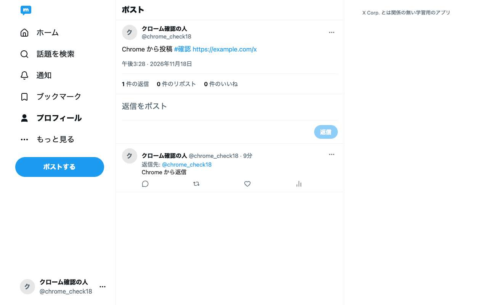
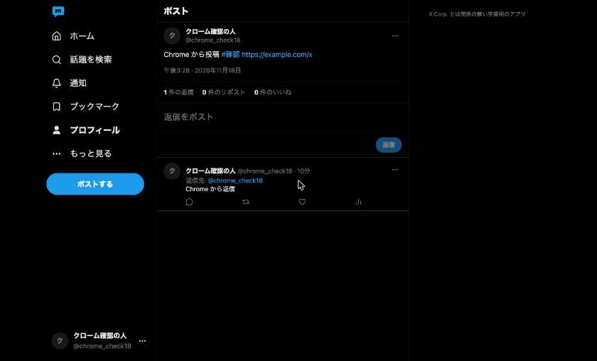
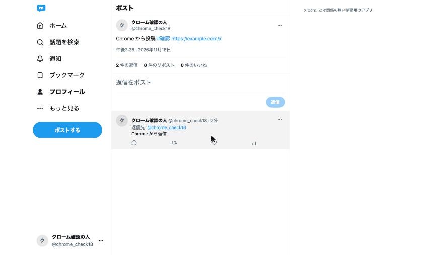
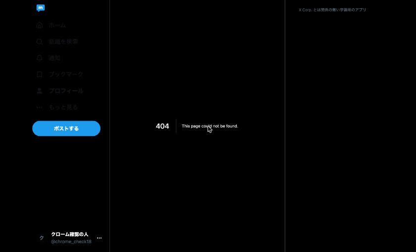
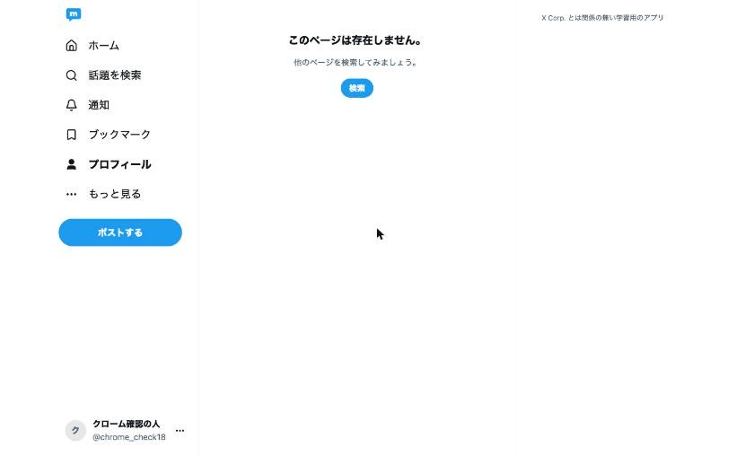
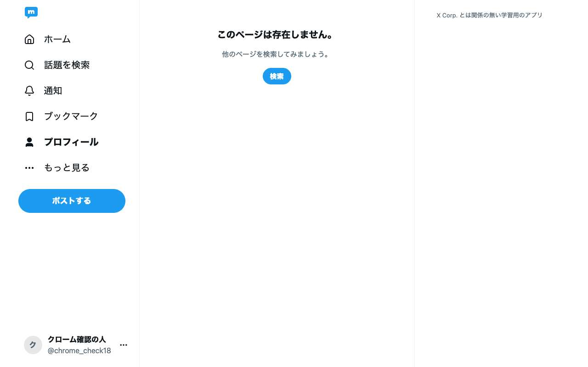
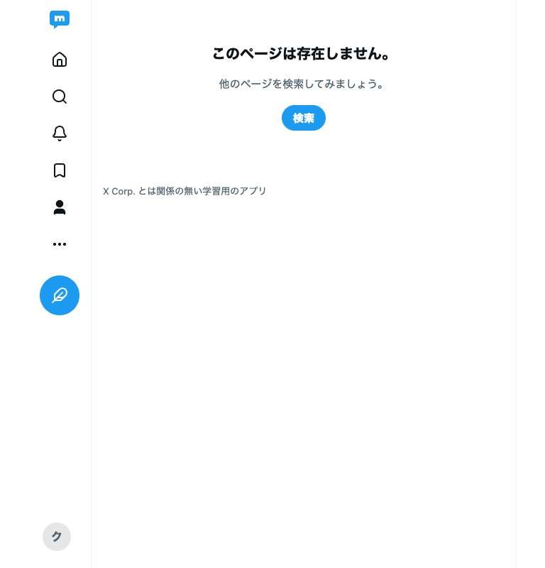
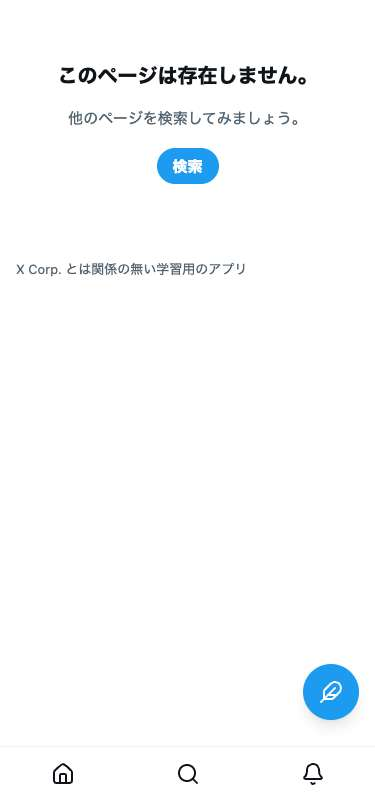

# 試験レポート: 投稿の詳細でスレッドと返信が読め、返信でき、自分の投稿を削除できる

## 対象

- issue: [#20](https://github.com/ohta-rh/x-modoki-v2/issues/20)
- commit: `b3d6764`、`0ecfe04`、`b03b5ec`（ブランチ `m1/local-app`、PR #40）
- CI: [実行 44262540579](https://github.com/ohta-rh/x-modoki-v2/actions/runs/44262540579)
- 日付: 2026-11-18

## 環境

- macOS 26.2、Node.js 26.12.0（`.nvmrc` は 24。CI の実行を本当の結果とする）、Docker Compose の PostgreSQL、Playwright 1.65.0
- 動かし方: `pnpm build && pnpm start -p 3300`、シードと Chrome の確認用のテストの人（`chrome_check18`）
- 画面の確認: Google Chrome（Claude in Chrome）と `scripts/chrome-evidence.mjs`（インストールした Google Chrome を Playwright で動かす）

## 判定

合格 — 受け入れ条件 8 件のうち 8 件を満たした。

## 受け入れ条件ごとの結果

| # | 条件 | 確かめ方 | 結果 | エビデンス |
|---|---|---|---|---|
| 1 | カードを押すと `/{username}/status/{id}` が開く。カードの中のリンクとボタンは、それぞれの動きをする | Playwright（`post-detail.spec.ts` › カードを押すと詳細が開き…、› カードの中のリンクは…）、`post-card-nav.test.tsx` | 合格 | Chrome でホームのカードから開いた |
| 2 | 親（線でつなぐ）、本体（17px・絶対の時刻・数）、返信の入力欄、返信の一覧の順 | `post-thread.test.tsx`、`main-post.test.tsx`、Playwright | 合格 | `detail-1280.jpg` |
| 3 | 返信で `reply_to_id`・`root_id` が入り、相手の `reply_count` が同じトランザクションで 1 増える。「返信先: @user」が出る | `create-post.test.ts` › 返信は reply_to_id と root_id を持ち…、› 確かめたあと、書く前に親が消されたら… | 合格 | Chrome で返信して、本体の数が 1→2 になった |
| 4 | 返信の一覧は 20 件ずつ、古い順（`GET /api/posts/{id}/replies`） | `get-post-detail.test.ts` › getReplies、`replies.test.ts` | 合格 | — |
| 5 | ユーザー名が作者と違う URL は正しい URL へ。無い ID と数字でない ID は 404 の画面 | Playwright（› URL のユーザー名が作者と違えば…）、`load-post-detail.test.ts` | 合格 | Chrome で `/someone_else/status/…` が `/chrome_check18/status/…` へ移った。`notfound-*.jpg` |
| 6 | 自分の投稿だけメニューから削除できる。確認のダイアログ。他人は `FORBIDDEN`、ログイン無しは `UNAUTHORIZED` | `delete-post.test.ts` の 3 つ、`actions.test.ts`、`delete-post-menu.test.tsx`、Playwright | 合格 | Chrome で確認のダイアログを出し、削除と、背景を押して閉じるのを試した |
| 7 | 削除は `deleted_at` を入れ、一覧から消え、親としては「このポストは削除されました」。返信なら相手の `reply_count` が 1 減る（0 より小さくしない） | `delete-post.test.ts` › 返信を消すと…、› 同時に何回消しても…、`get-post-detail.test.ts` › 削除された親は、印だけ、Playwright › 返信を消すと… | 合格 | Chrome で返信を消し、本体の数が 2→1 になった |
| 8 | 返信は「フォロー中」「おすすめ」に出ない | `get-timeline.test.ts` | 合格 | Chrome のホームに返信が出ていない（数は 1） |

## 自動のテスト

`pnpm verify`（7 つの確認）が 0 で終わった。

```
docs check passed: 85 file(s)
 Test Files  67 passed (67)
      Tests  450 passed (450)
Statements   : 100% ( 918/918 )
Branches     : 100% ( 601/601 )
Functions    : 100% ( 201/201 )
Lines        : 100% ( 800/800 )
  105 passed (28.1s)
VERIFY_RC=0
```

Playwright は Chromium・Firefox・WebKit で 35 本ずつ、合わせて 105 本が通った。

### TDD の記録

| # | 振る舞い | 先に書いたテスト | 赤（落ちた理由） | 緑にした実装 |
|---|---|---|---|---|
| 1 | カードから詳細へ、返信、正しい URL、404、削除（受け入れのテスト） | `e2e/post-detail.spec.ts` | `Received string: "http://localhost:3300/home?tab=following"`（詳細へ進まない） | 下の 2〜15 のあと、最後に緑 |
| 2 | 詳細は本体・親（古い順）・返信の 1 ページ目を返す。削除された親は印だけ。無い投稿は NOT_FOUND | `get-post-detail.test.ts` | `expected undefined to deeply equal { ok: false, error: 'NOT_FOUND' }`、`Cannot read properties of undefined (reading 'items')` | `src/entities/post/api/get-post-detail.ts`、`post-rows.ts` |
| 3 | 返信は `reply_to_id`・`root_id` を持ち、相手の数を同じトランザクションで 1 増やす。無い親と削除された親には返信できない | `create-post.test.ts` › createPost の返信 | `expected { id: …n, …(14) } to match object { Object (replyToId, rootId) }`、`expected { ok: true, … } to deeply equal { ok: false, error: 'NOT_FOUND' }` | `src/features/post-compose/api/create-post.ts` |
| 4 | 削除は本人だけ。返信を消すと相手の数を 1 減らし、0 より小さくしない | `delete-post.test.ts` | `expected 1 to be +0` | `src/features/post-delete/api/delete-post.ts` |
| 5 | 返信の Route Handler は古い順の JSON、数字でない ID は 404、不正なカーソルは 400。返信の Server Action | `replies.test.ts`、`actions.test.ts` › createReplyAction | `expected 200 to be 404`、`expected undefined to deeply equal { ok: true }` | `src/_app/api-routes/replies.ts`、`features/post-compose/api/actions.ts` |
| 6 | カードを押すと詳細へ。中のリンクとボタンでは進まない。「返信先: @user」。名前の付いた article | `post-card-nav.test.tsx` | `expected "vi.fn()" to be called with arguments: [ '/taro/status/123' ]` | `src/entities/post/ui/post-card.tsx` |
| 7 | 本体は 17px の本文・絶対の時刻・数・メニュー。スレッドの線 | `main-post.test.tsx` | `Unable to find an accessible element with the role "article" and name "投稿の本体"` | `main-post.tsx`、`format.ts` の `absoluteTime` |
| 8 | 削除のメニュー・確認のダイアログ・キャンセル・失敗の文言 | `delete-post-menu.test.tsx` | `Unable to find an accessible element with the role "button" and name "もっと見る"` | `src/features/post-delete/ui/delete-post-menu.tsx` |
| 9 | スレッドの並び、ログイン無しで入力欄を出さない、返信で一覧を読み直す、本体の削除でホームへ | `post-thread.test.tsx` | `Unable to find an accessible element with the role "textbox" and name "返信の本文"` | `src/widgets/post-thread/ui/post-thread.tsx` |
| 10 | 詳細の loader: 正しい URL へ送る、数字でない ID と無い ID は 404 | `load-post-detail.test.ts` | `promise resolved "{}" instead of rejecting` | `src/_pages/post-detail/api/load-post-detail.ts` |
| 11 | ホームの自分の投稿に削除のメニュー | `home-page.test.tsx` › 自分の投稿には… | `Unable to find an accessible element with the role "button" and name "もっと見る"` | `home-page.tsx` |
| 12 | 返信したら本体の返信の数がその場で増える（Chrome で見つけた） | `post-thread.test.tsx` › 返信すると…、Playwright | `expected "vi.fn()" to be called at least once`（`router.refresh` が呼ばれない） | `post-thread.tsx` |
| 13 | 返信を消したら本体の返信の数がその場で減る（Chrome で見つけた） | `post-feed.test.tsx` › 自分の投稿だけに…、Playwright › 返信を消すと… | `expected "vi.fn()" to be called at least once` | `post-feed.tsx` |
| 14 | 404 はアプリの画面（Chrome で見つけた） | Playwright › URL のユーザー名が…、`not-found-page.test.tsx` | `Locator: getByRole('heading', { name: 'このページは存在しません。' }) … element(s) not found` | `src/_pages/not-found`、`app/(main)/not-found.tsx` |
| 15 | 背景を押してダイアログを閉じても詳細へ進まない（レビュー 1） | `post-card-nav.test.tsx` › メニューが body に出した重ね… | `expected "vi.fn()" to not be called at all, but actually been called 1 times` | `post-card.tsx` |
| 16 | 同じ投稿を同時に消しても数は 1 だけ減る（レビュー 1） | `delete-post.test.ts` › 同時に何回消しても… | `expected [ { ok: true }, …(3) ] to have a length of 1 but got 5` | `delete-post.ts` |
| 17 | 確かめたあとで親が消されたら返信しない（レビュー 2） | `create-post.test.ts` › 確かめたあと、書く前に親が消されたら… | `expected { ok: true, id: '116445469439508297' } to deeply equal { ok: false, error: 'NOT_FOUND' }` | `create-post.ts` |

## コードレビュー

- 判定: APPROVE（2 回目）　範囲: `146e507..HEAD`　レビューした sub agent: code-reviewer（opus）

| # | 回 | 重さ | 指摘 | 確かめた結果 | 対応 |
|---|---|---|---|---|---|
| 1 | 1 | major | 削除の確認のダイアログを、背景を押して閉じると、投稿の詳細へも移る。React のイベントは portal からも React の木に沿ってカードまで上がり、背景（`role="presentation"`）は `ownAction` に当たらない | 再現した（portal の背景を押すテストで `push` が 1 回呼ばれた） | 直した `0ecfe04`。カードは自分の DOM の中の押下だけに反応する。テスト: `post-card-nav.test.tsx` › メニューが body に出した重ね… |
| 2 | 1 | major | 削除の確かめがトランザクションの外にあり、同時の削除で数が 2 回減る | 再現した（5 回同時に消すと 2〜5 回成功した） | 直した `0ecfe04`。`deleted_at IS NULL` を update に入れ、行が変わったときだけ数を減らす。テスト: `delete-post.test.ts` › 同時に何回消しても… |
| 3 | 2（APPROVE） | minor | 返信の親の確かめがトランザクションの外にあり、確かめたあとで消された親にも返信が入り、数が増える | 再現した（トランザクションの直前に親を消すテスト） | 直した `b03b5ec`。トランザクションの最初に `deleted_at IS NULL` 付きで数を増やし、行が無ければ何も書かず NOT_FOUND。レビュアーの案のとおりなので、もう 1 回は回さない |

## ブラウザでの確認

| URL | 幅 | テーマ | した操作 | 見えた結果 | 画面の写真 |
|---|---|---|---|---|---|
| `/chrome_check18/status/{id}` | 1280 / 768 / 375 | ライト | 開いた | 本体・入力欄・返信。横のはみ出しなし | `detail-*.jpg` |
| 同じ | 1400 | ライト | 返信した | 一覧に出たが、本体の数が 0 のまま（直す前） | `before-reply-count.jpg` |
| 同じ | 1400 | ライト | 返信した（直したあと） | 数が 1→2、古い順に並んだ | — |
| 同じ | 1400 | ライト | 返信を ⋯ → 削除 → 確認で消した | 一覧から消えたが、数が 2 のまま（直す前）。直したあと 2→1 | `before-delete-count.jpg` |
| `/chrome_check18/status/abc` | 1400 | ライト（OS は暗い設定） | 開いた | Next.js の既定の 404 が `body` を黒にし、左のナビゲーションが読めない（直す前） | `before-404-dark.jpg` |
| 同じ | 1280 / 768 / 375 | ライト（OS は暗い設定） | 開いた（直したあと） | 「このページは存在しません。」と検索のボタン。ナビゲーションが読める | `after-404-dark-os.jpg`、`notfound-*.jpg` |
| `/someone_else/status/{id}` | 1400 | ライト | 開いた | `/chrome_check18/status/{id}` へ移った | — |
| `/chrome_check18/status/{id}` | 1400 | ダーク・ダークブルー | テーマを変えた | 文字・線・ボタンが読める | `detail-dark.jpg` |
| ログイン無しで詳細 | 1280 / 768 / 375 | ライト | 開いた | 返信の入力欄が出ない | — |
| `/home?tab=following`（変えていない隣の画面） | 1280 / 768 / 375 | ライト | 開いた。⋯ → 削除 → 背景を押して閉じた | 返信は出ず、カードの数は 1。ホームのまま | — |

- Tab でフォーカスが移り、輪が出る（`outline-style: solid`）
- コンソール: エラー 0、警告 0　通信: 失敗 0（`chrome-evidence.mjs` の 18 回の読み込み）













## 見つけた問題

1. **返信しても、本体の返信の数が変わらない**（Chrome で見つけた）。根本原因: 本体はサーバーで描いた値で、返信のあとに読み直すのは返信の一覧だけだった。直した `b3d6764`（返信のあとに `router.refresh()`）。テスト: `post-thread.test.tsx`、Playwright
2. **返信を消しても、本体の返信の数が変わらない**（Chrome で見つけた）。根本原因は 1 と同じ。直した `b3d6764`（`PostFeed` は削除のあとに `router.refresh()`）。テスト: `post-feed.test.tsx`、Playwright › 返信を消すと…
3. **404 の画面で、OS が暗い設定だと左のナビゲーションが読めない**（Chrome で見つけた）。根本原因: Next.js の既定の 404 は自分の `<style>` で、暗い設定の `body` を黒にする。直した `b3d6764`（`app/(main)/not-found.tsx` からアプリの画面を出す。ADR-0039）
4. **登録とログインの回数の制限のテストが、分の境目でたまに落ちる**（この PBI の `pnpm verify` で見つけた。範囲の外）。バグの PBI [#46](https://github.com/ohta-rh/x-modoki-v2/issues/46) を起こし、先に直して閉じた（`146e507`、[#46 の試験レポート](issue-0046-rate-limit-test-clock.md)）
5. レビューで見つかった 3 つ（背景の押下・同時の削除・消された親への返信）は、上のコードレビューの表のとおり直した
6. 自動の操作で、読み込みの直後（ハイドレーションの前）に打った文字は消えた。人の速さでは起きず、もう一度打つと入った。不具合とはしない
