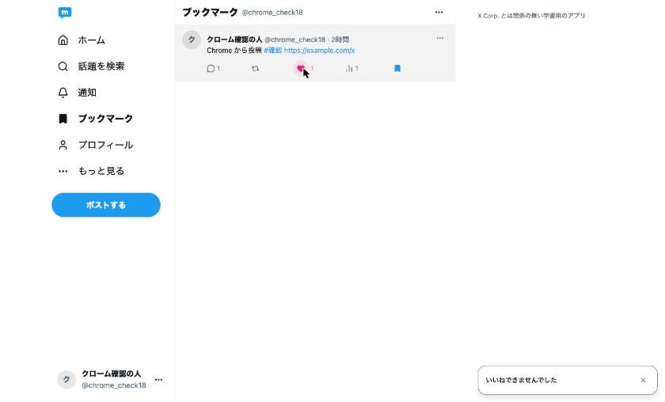
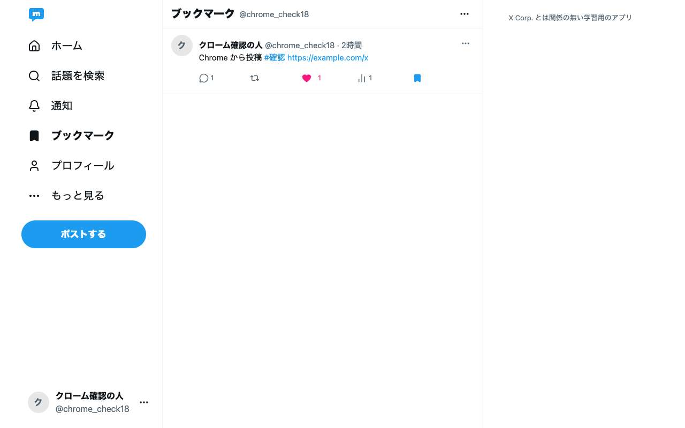
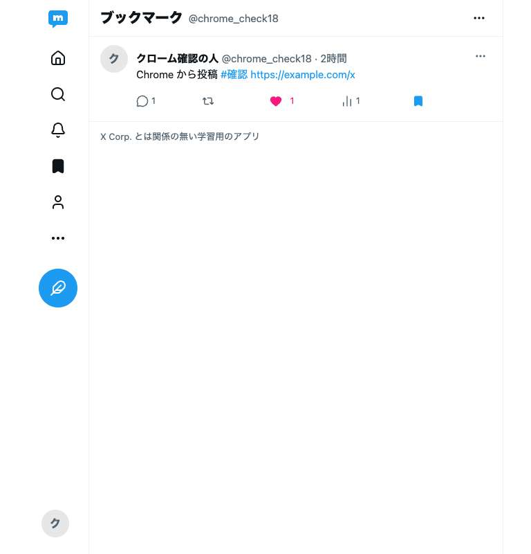
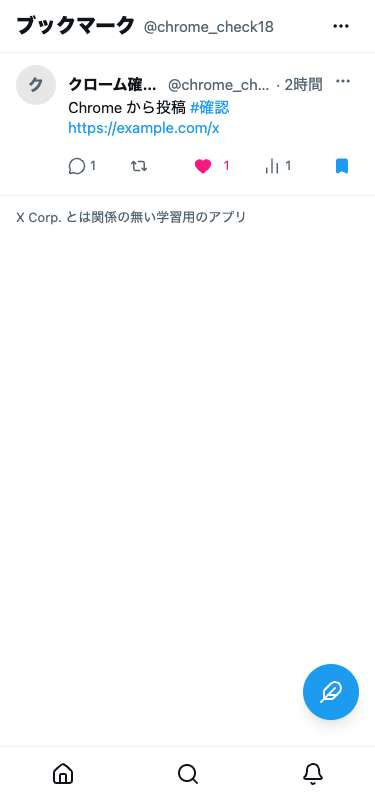
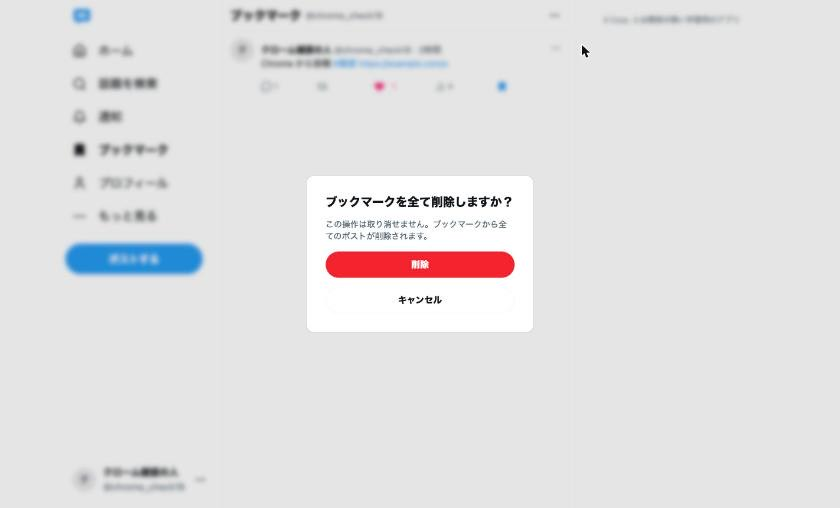
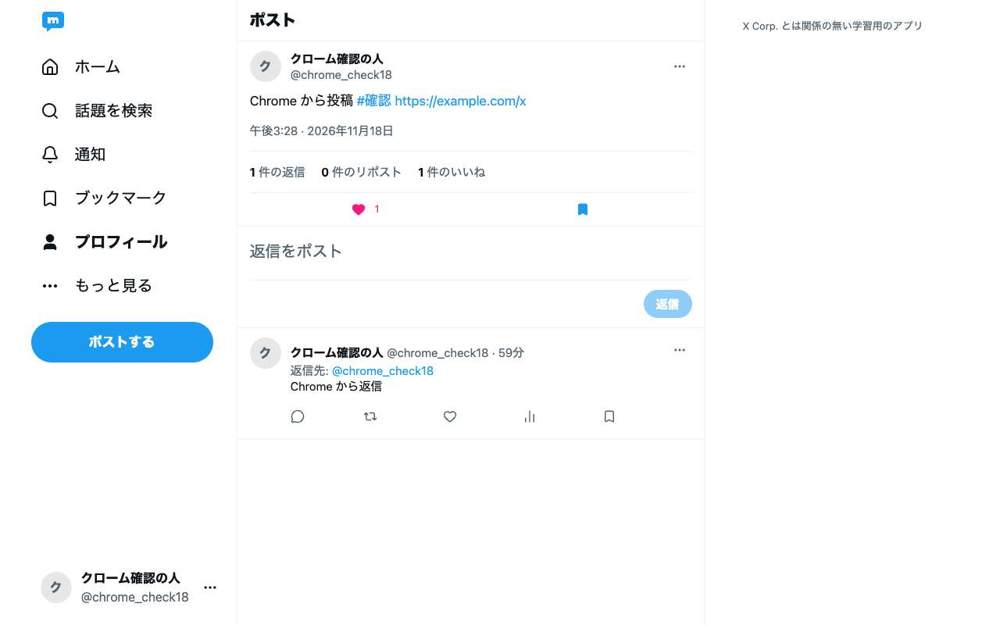
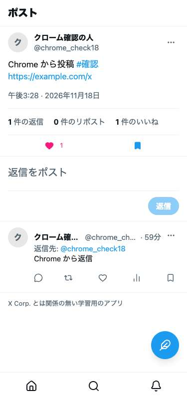
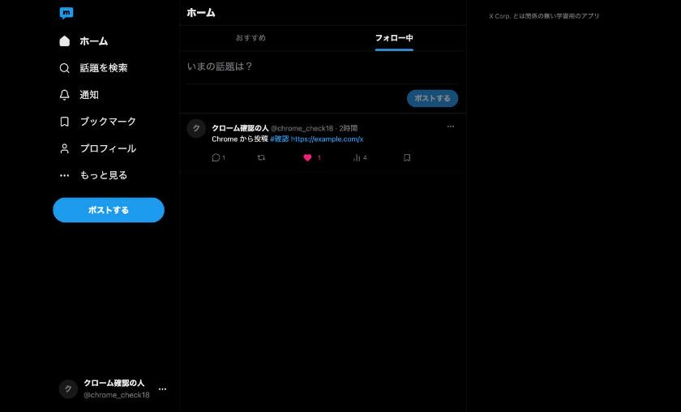

# 試験レポート: いいね・ブックマークができ、押した直後に色と数が変わり、表示の回数が数えられる

## 対象

- issue: [#21](https://github.com/ohta-rh/x-modoki-v2/issues/21)
- commit: `9be1500`、`5bc5963`、`0bd26f4`（ブランチ `m1/local-app`、PR #40）
- CI: [実行 44269573057](https://github.com/ohta-rh/x-modoki-v2/actions/runs/44269573057)（成功）
- 日付: 2026-11-18

## 環境

- macOS 26.2、Node.js 26.12.0（`.nvmrc` は 24。CI の実行を本当の結果とする）、Docker Compose の PostgreSQL、Playwright 1.65.0
- 動かし方: `pnpm build && pnpm start -p 3300`、Chrome の確認用のテストの人（`chrome_check18`）
- 画面の確認: Google Chrome（Claude in Chrome）と `scripts/chrome-evidence.mjs`

## 判定

合格 — 受け入れ条件 7 件のうち 7 件を満たした。

## 受け入れ条件ごとの結果

| # | 条件 | 確かめ方 | 結果 | エビデンス |
|---|---|---|---|---|
| 1 | いいねを押すと、すぐに `--like` の色になり数が 1 増える。もう一度押すと戻る。失敗したら元に戻り、トーストが出る | Playwright（`reactions.spec.ts` › いいねを押すと…、› いいねが失敗したら…。Server Action を失敗させる）、`post-feed.test.tsx` | 合格（色は `rgb(249, 24, 128)`） | `home-reacted.jpg`、`failure-toast.jpg` |
| 2 | 同じ投稿が複数の一覧に出ているとき、全部の表示が同時に変わる | `update-post-in-caches.test.ts`、`post-feed.test.tsx`（ほかの一覧も変わる）、`post-detail-page.test.tsx` › 本体をいいねすると、ホームの一覧… | 合格 | Chrome で詳細の本体のいいねを外し、アプリの中のリンクでホームへ戻ると、カードも外れていた |
| 3 | `likes` の追加と `like_count` の増加が同じトランザクション。2 回押しても 1 だけ増える。取り消しは 0 より小さくしない | `set-like.test.ts`（同じ人の同時の 3 回、別の 8 人の同時、取り消し） | 合格 | — |
| 4 | ブックマークも同じ振る舞い。`/i/bookmarks` に付けた順の新しい順で 20 件ずつ。メニューから「全て削除」 | `set-bookmark.test.ts`、`get-bookmarks.test.ts`、`bookmarks.test.ts`（Route Handler）、Playwright › ブックマークすると… | 合格 | `bookmarks-*.jpg`、`clear-confirm.jpg` |
| 5 | 詳細を開くと `view_count` が 1 増える。応答のあとに書き、失敗しても画面に影響しない。数はカードに出る | `post-view.test.ts`（Route Handler、`after()` の前は 0、失敗は投げない）、`view-counter.test.tsx`、Playwright › 詳細を開くと… | 合格 | `bookmarks-1280.jpg`（表示 1） |
| 6 | ログイン無しは `UNAUTHORIZED`、削除済みの投稿は `NOT_FOUND` | `post-like/api/actions.test.ts`、`post-bookmark/api/actions.test.ts`、`set-like.test.ts`、`set-bookmark.test.ts` | 合格 | ログイン無しの詳細では、ボタンを出さず数だけ |
| 7 | `prefers-reduced-motion` のとき、ハートは動かない | Playwright › prefers-reduced-motion のとき…（`animation-name: none`）、› 動きを減らさないとき…（`like-pop`） | 合格 | — |

## 自動のテスト

`pnpm verify`（7 つの確認）が 0 で終わった。

```
 Test Files  82 passed (82)
      Tests  498 passed (498)
Statements   : 100% ( 1089/1089 )
Branches     : 100% ( 707/707 )
Functions    : 100% ( 260/260 )
Lines        : 100% ( 949/949 )
  120 passed (27.0s)
VERIFY_RC=0
```

Playwright は Chromium・Firefox・WebKit で 40 本ずつ、合わせて 120 本が通った。

### TDD の記録

| # | 振る舞い | 先に書いたテスト | 赤（落ちた理由） | 緑にした実装 |
|---|---|---|---|---|
| 1 | いいね・失敗の戻し・ブックマークの一覧と全て削除・表示の回数・動きを減らす設定（受け入れのテスト） | `e2e/reactions.spec.ts` | `Locator: …getByRole('button', { name: 'いいね' }) … element(s) not found` | 下の 2〜19 のあと、最後に緑 |
| 2 | いいねの行と数が同じトランザクション、同時でも 1 回、0 より小さくしない、認可 | `set-like.test.ts` | `expected undefined to deeply equal { ok: true, liked: true, count: 1 }` | `src/features/post-like/api/set-like.ts` |
| 3 | ブックマークの付け外しと全て削除 | `set-bookmark.test.ts` | `expected [ undefined, undefined ] to deep equally contain { Object (ok, bookmarked, ...) }` | `src/features/post-bookmark/api/set-bookmark.ts` |
| 4 | ブックマークの一覧は付けた順の新しい順、20 件ずつ、同じ時刻でも欠けない | `get-bookmarks.test.ts` | `Error: expected ok` | `src/entities/post/api/get-bookmarks.ts`（ADR-0040） |
| 5 | 表示の回数を応答のあとで足し、失敗は投げない | `count-view.test.ts`、`post-view.test.ts` | `expected 500 to be 204` | `post-view-count/api/count-view.ts`、`_app/api-routes/post-view.ts` |
| 6 | `GET /api/bookmarks` と 3 つの Server Action | `bookmarks.test.ts`、`post-like/api/actions.test.ts`、`post-bookmark/api/actions.test.ts` | `expected 500 to be 200` | `_app/api-routes/bookmarks.ts`、`actions.ts` |
| 7 | 全ての一覧のキャッシュで、その ID の投稿だけを書き換える | `update-post-in-caches.test.ts` | `expected [ [ '1', +0, false ], …(1) ] to deeply equal [ Array(2) ]` | `src/widgets/timeline-feed/lib/update-post-in-caches.ts` |
| 8 | いいねとブックマークのボタン（色・塗り・弾む動き・数） | `like-button.test.tsx`、`bookmark-button.test.tsx` | `Unable to find an accessible element with the role "button" and name "いいね"` | `like-button.tsx`、`bookmark-button.tsx`、`global.css` の `like-pop` |
| 9 | カードの操作の列に、いいねとブックマークを差し込む | `post-card-nav.test.tsx` › like と bookmark を渡すと… | `expected [ '返信 0', 'リポスト 0', 'いいね 33', '表示 77' ] to deeply equal [ …, 'いいねの部品', … ]` | `post-card.tsx` |
| 10 | どこからでもトーストを出せる | `query-provider.test.tsx` | `Unable to find an element with the text: いいねできませんでした` | `query-provider.tsx`（`Toaster`） |
| 11 | 一覧で押した直後に変わり、サーバーの数で落ち着き、失敗で戻してトースト | `post-feed.test.tsx` › PostFeed のいいね・ブックマーク | `Unable to find an accessible element with the role "button" and name "いいね"` | `lib/use-reaction.ts`、`post-feed.tsx` |
| 12 | ホームと詳細にボタンを付ける（ログインしていなければ付けない） | `home-page.test.tsx`、`post-detail-page.test.tsx` | `Unable to find an accessible element with the role "button" and name "いいね"` | `home-page.tsx`、`post-detail-page.tsx`、`main-post-reactions.tsx` |
| 13 | 本体のいいねが投げても、戻してトースト | `post-detail-page.test.tsx` › …通信で失敗しても… | `expected "add" to be called with arguments: [ { title: 'いいねできませんでした' } ]` | `main-post-reactions.tsx` の `catch` |
| 14 | 詳細を開くと表示を数える | `view-counter.test.tsx`、`post-detail-page.test.tsx` › 開くと… | `expected "vi.fn()" to be called 1 times, but got 0 times` | `view-counter.tsx` |
| 15 | ブックマークの画面・loader・全て削除のメニュー | `bookmarks-page.test.tsx`、`load-bookmarks-page.test.ts`、`clear-bookmarks-menu.test.tsx` | `promise resolved "{}" instead of rejecting` | `src/_pages/bookmarks`、`clear-bookmarks-menu.tsx` |
| 16 | 全て削除のあとに一覧と画面を読み直す | `bookmarks-page.test.tsx` › 全て削除すると…（読み直しを外して確かめた） | `expected "vi.fn()" to be called at least once` | `bookmarks-feed.tsx` |
| 17 | いいね済みの本体を押すと取り消して 1 減らす | `post-detail-page.test.tsx` › いいね済みの…（減らす式を壊して確かめた） | `expect(element).toHaveTextContent()` | `main-post-reactions.tsx` |
| 18 | 別の人が同時に押しても行き詰まらない（レビュー 1） | `set-like.test.ts`・`set-bookmark.test.ts` › 同時の操作 | `Caused by: error: deadlock detected` | `.for('no key update')` |
| 19 | 詳細の本体の操作が、一覧のキャッシュにも入る（レビュー 1） | `post-detail-page.test.tsx` › 本体をいいねすると…／ブックマークすると… | `expected 2 to be 9`、`expected +0 to be 4` | `main-post-reactions.tsx` |
| 20 | 大きすぎるカーソルは BAD_CURSOR、Server Action は code を返す（レビュー 2） | `get-bookmarks.test.ts`、2 つの `actions.test.ts` | `Failed query: …::bigint…`、`expected { ok: false, message: 'ログインしてください' } to deeply equal { ok: false, …(2) }` | `get-bookmarks.ts`、`actions.ts` |

## コードレビュー

- 判定: APPROVE（2 回目）　範囲: `6a0654a..HEAD`　レビューした sub agent: code-reviewer（opus）

| # | 回 | 重さ | 指摘 | 確かめた結果 | 対応 |
|---|---|---|---|---|---|
| 1 | 1 | major | `FOR SHARE` で投稿の行を取ってから同じ行を `UPDATE` するので、2 人が同時に同じ投稿を押すと行き詰まる（40P01）。ブックマークも同じ | 再現した（8 人が同時にいいねすると `deadlock detected`） | 直した `5bc5963`。最初に `FOR NO KEY UPDATE` で取る。テスト: › 別の人が同じ投稿に同時に押しても… |
| 2 | 1 | minor | 詳細の本体のいいね・ブックマークが、ホームの一覧のキャッシュを書き換えない。戻ると 30 秒は古い表示 | 再現した（キャッシュの数が 2 のまま） | 直した `5bc5963`。成功したらサーバーの数を全ての一覧に入れる。テスト: › 本体をいいねすると、ホームの一覧… |
| 3 | 2（APPROVE） | minor | カーソルの正規表現が、bigint に入らない 19 桁を通し、`::bigint` で落ちて 500 になる（ADR-0040 は 400） | 再現した（`9999999999999999999_1` で `Failed query`） | 直した `0bd26f4`。両方を `parseId` で読み、`BAD_CURSOR`。テスト: `get-bookmarks.test.ts` › 形の違うカーソルは… |
| 4 | 2（APPROVE） | minor | Server Action の失敗が `code` を返さず、文言でしか見分けられない（application-structure.md の 4 節） | その通り | 直した `0bd26f4`。`code` を足し、2 つの `actions.test.ts` で確かめる。レビュアーの案のとおりなので、もう 1 回は回さない |

## ブラウザでの確認

| URL | 幅 | テーマ | した操作 | 見えた結果 | 画面の写真 |
|---|---|---|---|---|---|
| `/home?tab=following` | 1400 | ライト | いいねとブックマークを押した | ハートがピンクで塗られ 1、ブックマークが青で塗られた | `home-reacted.jpg` |
| `/i/bookmarks` | 1400 | ライト | Server Action だけを失敗させて、いいねを押した | 一度変わってから元に戻り、「いいねできませんでした」のトースト | `failure-toast.jpg` |
| `/i/bookmarks` | 1280 / 768 / 375 | ライト | 開いた | 見出し「ブックマーク」と @ユーザー名、⋯、付けた投稿。表示 1 | `bookmarks-*.jpg` |
| `/i/bookmarks` | 1400 | ライト | ⋯ → ブックマークを全て削除 → 確認 → 削除 | 確認のダイアログのあと「まだブックマークがありません」 | `clear-confirm.jpg` |
| `/chrome_check18/status/{id}` | 1280 / 768 / 375 | ライト | 開いた | 本体の下にいいねとブックマーク、返信のカードにも | `detail-*.jpg` |
| 同じ → `/home` | 1400 | ライト | 本体のいいねを外し、アプリの中のリンクでホームへ | ホームのカードも外れていた | — |
| ログイン無しで詳細 | 1280 / 768 / 375 | ライト | 開いた | ボタンを出さず、数だけ | — |
| `/home?tab=following`（変えていない隣の画面） | 1400 | ダーク | 開いた | ハートと数が読める | `home-dark.jpg` |

- コンソール: エラー 0、警告 0　通信: 失敗 0（`chrome-evidence.mjs` の 9 回の読み込み）












## 見つけた問題

1. **V8 のカバレッジが、`await` のあとの `if` の else を負の数で数えた**（同時に動く非同期の呼び出しのとき）。押した数が正しく増えるのに、分岐が 100% にならなかった。数を足す所を条件式に書き換え、理由をコメントに残した。不具合ではなく、計測の癖
2. **画面のテストが、楽観的な表示を見たあと Server Action の終わりを待たずにページを移っていた**（Firefox でブックマークが残らなかった）。テストで Server Action の応答を待つようにした。アプリの中のリンクでの移動では、送信は切れない
3. レビューで見つかった 2 つは、上のコードレビューの表のとおり直した
