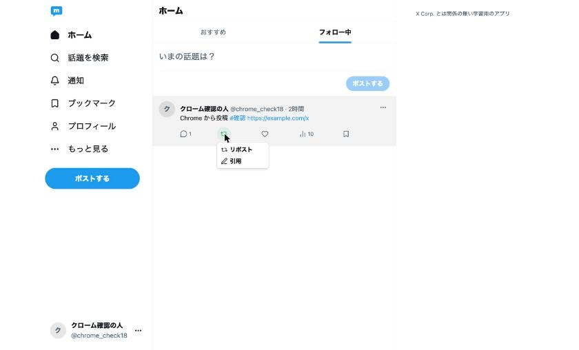
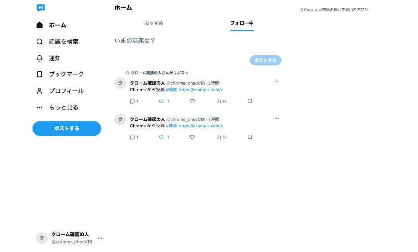
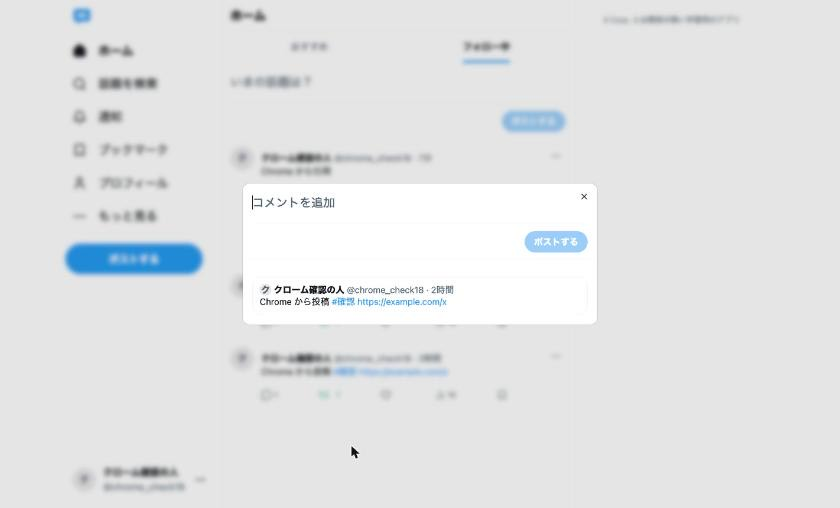
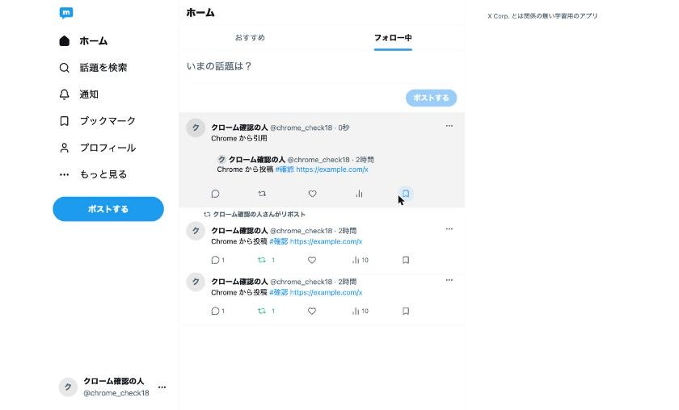
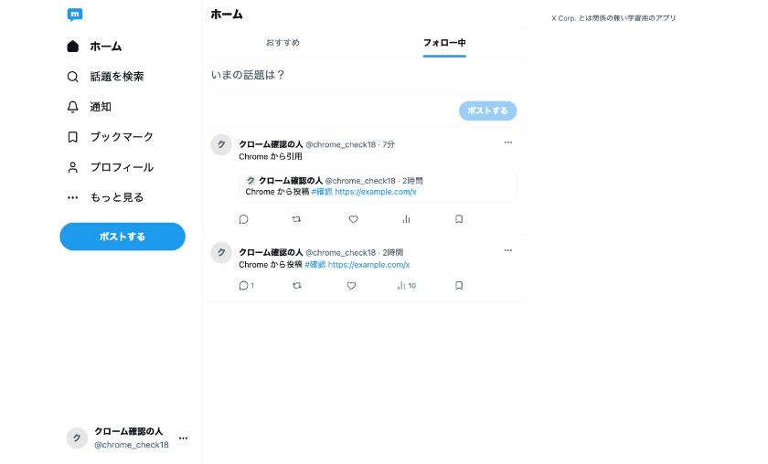
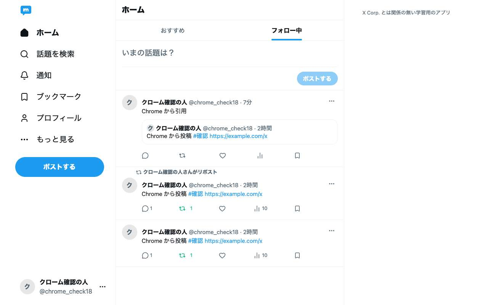
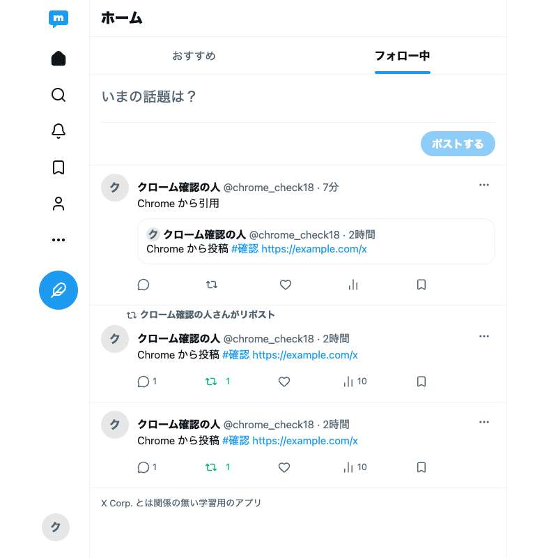
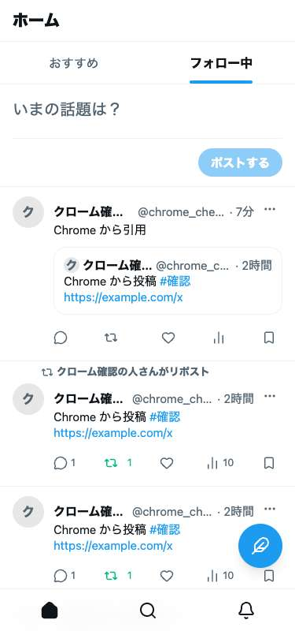

# 試験レポート: リポストと引用ができ、タイムラインに「〜さんがリポスト」と入れ子のカードで出る

## 対象

- issue: [#22](https://github.com/ohta-rh/x-modoki-v2/issues/22)
- commit: `60a6363`（ブランチ `m1/local-app`、PR #40）
- CI: [実行 44275307997](https://github.com/ohta-rh/x-modoki-v2/actions/runs/44275307997)（成功）
- 日付: 2026-11-18

## 環境

- macOS 26.2、Node.js 26.12.0（`.nvmrc` は 24。CI の実行を本当の結果とする）、Docker Compose の PostgreSQL、Playwright 1.65.0
- 動かし方: `pnpm build && pnpm start -p 3300`、Chrome の確認用のテストの人（`chrome_check18`）
- 画面の確認: Google Chrome（Claude in Chrome）と `scripts/chrome-evidence.mjs`

## 判定

合格 — 受け入れ条件 7 件のうち 7 件を満たした。

## 受け入れ条件ごとの結果

| # | 条件 | 確かめ方 | 結果 | エビデンス |
|---|---|---|---|---|
| 1 | リポストのボタンがメニュー（リポスト / 引用）を開く。リポストすると、すぐに `--repost` の色になり数が 1 増える | Playwright（`repost-quote.spec.ts` › リポストすると…。色は `rgb(0, 186, 124)`）、`post-feed.test.tsx` | 合格 | `repost-menu.jpg` |
| 2 | リポストは `posts` の 1 行（`repost_of_id`、本文が空）で、元の `repost_count` が同じトランザクションで 1 増える。2 回できない | `set-repost.test.ts`（同時の 2 回、別の 6 人の同時） | 合格 | — |
| 3 | リポストの行は元の投稿のカードで、上に「〜さんがリポスト」。操作は元に対して行う | `hydrate.test.ts`（項目の ID は元の ID）、`quoted-card.test.tsx` › PostCard のリポストと引用 | 合格 | `reposted-timeline.jpg` |
| 4 | 取り消すと、その行が消え、数が 1 減る | `set-repost.test.ts`、Playwright › …リポストを取り消す | 合格 | `repost-undone.jpg` |
| 5 | 引用は、入れ子のカード（1px の線と 16px の角）が付いた入力欄で開き、投稿すると `quote_of_id` が入り `quote_count` が 1 増える | Playwright › 引用すると…（線・角・幅）、`create-post.test.ts` › createPost の引用 | 合格 | `quote-dialog.jpg`、`quote-posted.jpg` |
| 6 | 引用された元が削除済みなら、入れ子は「このポストは削除されました」 | `quoted-card.test.tsx`、`hydrate.test.ts` | 合格 | — |
| 7 | リポストのリポスト、返信のリポストは、元の投稿へのリポストになる | `set-repost.test.ts` › リポストのリポストは元の投稿へ…（[ADR-0041](../adr/0041-repost-and-quote-target-the-original.md) の読み方: 返信はその返信自身） | 合格 | — |

## 自動のテスト

`pnpm verify`（7 つの確認）が 0 で終わった。

```
 Test Files  87 passed (87)
      Tests  522 passed (522)
Statements   : 100% ( 1183/1183 )
Branches     : 100% ( 795/795 )
Functions    : 100% ( 282/282 )
Lines        : 100% ( 1031/1031 )
  126 passed (28.2s)
VERIFY_RC=0
```

Playwright は Chromium・Firefox・WebKit で 42 本ずつ、合わせて 126 本が通った。

### TDD の記録

| # | 振る舞い | 先に書いたテスト | 赤（落ちた理由） | 緑にした実装 |
|---|---|---|---|---|
| 1 | リポストと引用（受け入れのテスト） | `e2e/repost-quote.spec.ts` | `locator.click: Test timeout of 30000ms exceeded.`（リポストのボタンが無い） | 下の 2〜13 のあと、最後に緑 |
| 2 | リポストの行と数、2 回できない、取り消し、元へたどる、同時、認可 | `set-repost.test.ts` | `expected [ undefined, undefined ] to deep equally contain { ok: true, reposted: true, count: 1 }` | `src/features/post-repost/api/set-repost.ts` |
| 3 | 引用は `quote_of_id` と `quote_count`、リポストの引用は元へ、消えた元は NOT_FOUND | `create-post.test.ts` › createPost の引用 | `expected [ null, null ] to deeply equal [ 116461753743265869n, …(1) ]` | `create-post.ts` |
| 4 | 一覧のリポストは元の投稿と `repostedBy`、引用は 1 段の `quoted` | `hydrate.test.ts` | `expected [ [ '', null ], [ '', null ], …(2) ] to deeply equal [ [ '元の投稿', '書いた人' ], …(2) ]` | `post-rows.ts` の `toPosts` |
| 5 | リポストと引用の Server Action | `post-repost/api/actions.test.ts`、`post-compose/api/actions.test.ts` | `expected { ok: false, message: '' } to deeply equal { ok: true }` | `actions.ts` |
| 6 | 入れ子のカード（線・角・押すと元へ・ポストを表示・削除の印）と、カードの「〜さんがリポスト」 | `quoted-card.test.tsx` | `Unable to find an accessible element with the role "article" and name "引用した投稿"` | `quoted-card.tsx`、`post-card.tsx` |
| 7 | リポストのメニュー | `repost-menu.test.tsx` | `Unable to find an accessible element with the role "button" and name "リポスト"` | `repost-menu.tsx` |
| 8 | 一覧でリポスト（楽観的な更新と戻し）、引用の入力欄 | `post-feed.test.tsx` › PostFeed のリポストと引用 | `Unable to find an accessible element with the role "button" and name "リポスト"` | `use-reaction.ts`、`post-feed.tsx`、`quote-dialog.tsx` |
| 9 | 元の投稿とそのリポストが同じ一覧でキーが重ならない | `post-feed.test.tsx` › …キーが重ならない | `expected "error" to not be called at all, but actually been called 2 times` | `post-feed.tsx` のキー |
| 10 | ホーム・詳細・ブックマークにリポストのボタン | `home-page.test.tsx`、`post-detail-page.test.tsx` | `Unable to find an accessible element with the role "button" and name "リポスト"` | 3 つの画面 |
| 11 | 入れ子の中のリンクは自分で移る／確かめたあと消された元はリポストしない／Esc で閉じる（実装を壊して落ちるのを確かめた） | `quoted-card.test.tsx`、`set-repost.test.ts`、`post-feed.test.tsx` | `expected "vi.fn()" to not be called at all`、`expected { ok: true, reposted: true, count: 1 } to deeply equal { ok: false, error: 'NOT_FOUND' }`、`expected <div data-open …> to be null` | 各ファイル |
| 12 | 詳細の本体の引用は、今からの時刻で出す | `main-post.test.tsx` › MainPost の引用 | 最初に書いたテストは、外の投稿の時刻と今が偶然同じ答えになり、赤にならなかった。区別できる時刻に書き直した | `main-post.tsx` の `now` |
| 13 | 引用の入力欄は 600px、入れ子は自分の背景で線が見える（Chrome で見つけた） | Playwright › 引用すると…（幅）、`quoted-card.test.tsx`（`bg-bg`） | `Received: 369.0366516113281`、`expect(element).toHaveClass("… bg-bg")` | `quote-dialog.tsx`、`quoted-card.tsx` |

## コードレビュー

- 判定: APPROVE（1 回目）　範囲: `HEAD~1..HEAD`（`60a6363`）　レビューした sub agent: code-reviewer（opus）

| # | 重さ | 指摘 | 確かめた結果 | 対応 |
|---|---|---|---|---|
| — | — | 指摘なし | — | — |

## ブラウザでの確認

| URL | 幅 | テーマ | した操作 | 見えた結果 | 画面の写真 |
|---|---|---|---|---|---|
| `/home?tab=following` | 1400 | ライト | リポストのボタンを押した | メニューにリポストと引用 | `repost-menu.jpg` |
| 同じ | 1400 | ライト | リポストして読み直した | 上に「クローム確認の人さんがリポスト」、緑の 1 | `reposted-timeline.jpg` |
| 同じ | 1400 | ライト | 引用を開き、打って投稿した | 入れ子付きの入力欄（直したあと 600px）、投稿すると入れ子のカードで出た | `quote-dialog.jpg`、`quote-posted.jpg` |
| 同じ | 1400 | ライト | リポストを取り消した（失敗の経路の代わりに、戻す操作） | リポストの行が消え、数が 0 | `repost-undone.jpg` |
| 同じ | 1280 / 768 / 375 | ライト | 開いた | 引用とリポストのカードが崩れない | `home-*.jpg` |

- コンソール: エラー 0、警告 0　通信: 失敗 0
- 失敗の経路（Server Action が失敗したときの戻しとトースト）は、#21 と同じ `useReaction` を通り、`post-feed.test.tsx` で確かめた










## 見つけた問題

1. **ページを開いてすぐ打った文字が投稿できない**（WebKit の画面のテストで見つけた。範囲の外）。バグの PBI [#47](https://github.com/ohta-rh/x-modoki-v2/issues/47) を起こし、先に直して閉じた（`b046ec5`、[#47 の試験レポート](issue-0047-prehydration-input.md)）
2. **引用の入力欄が狭い**（Chrome で見つけた）。部品の既定の `sm:max-w-sm` が勝っていた。`sm:max-w-[600px]` にし、画面のテストで幅を確かめる
3. **外のカードに重ねたとき、入れ子の線が消える**（Chrome で見つけた）。外の重ねたときの色と線の色が近い。入れ子に自分の背景を付けた
4. 受け入れ条件の「返信のリポスト」の読み方を [ADR-0041](../adr/0041-repost-and-quote-target-the-original.md) で決め、issue の本文の上に補足を書いた
