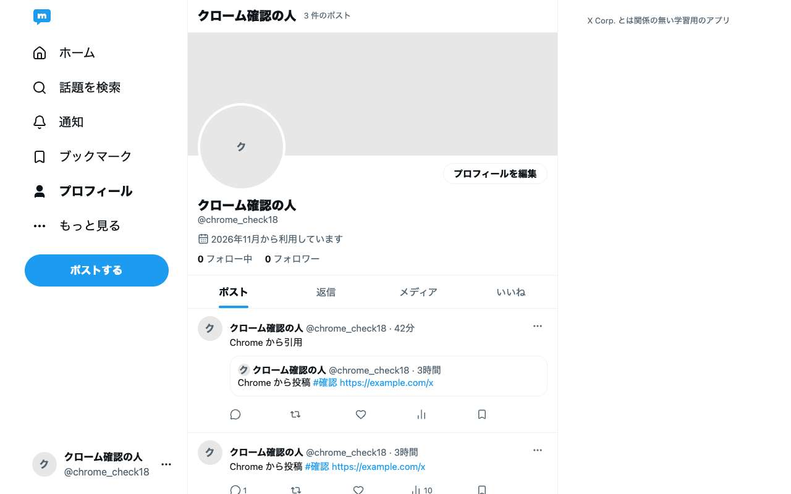
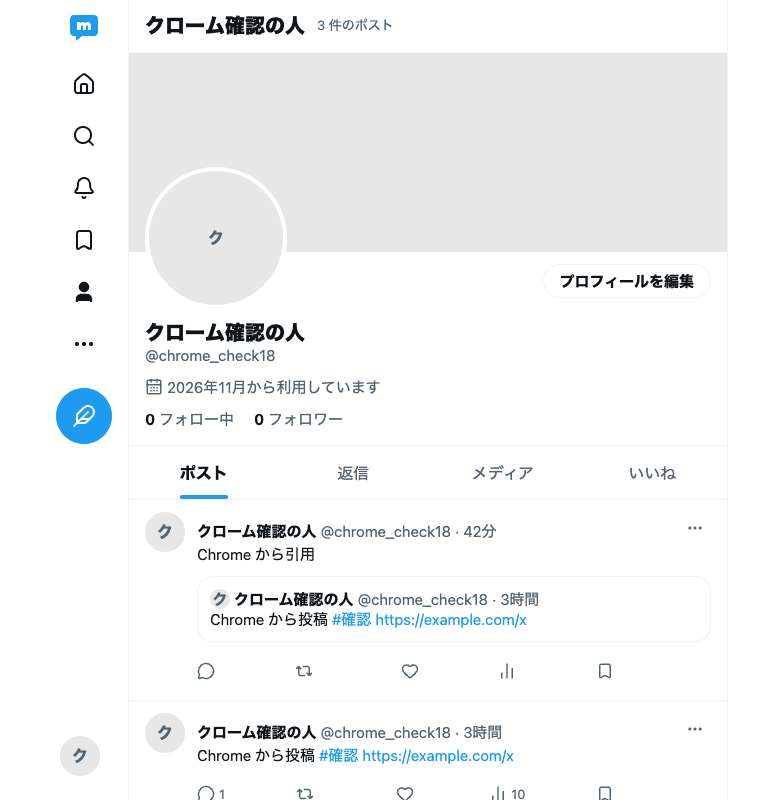
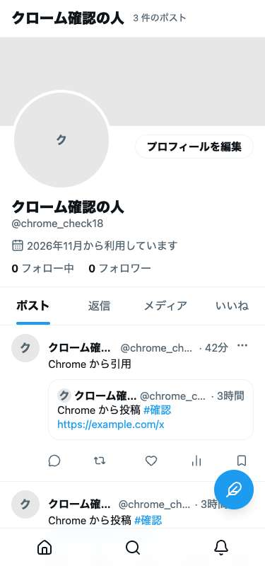
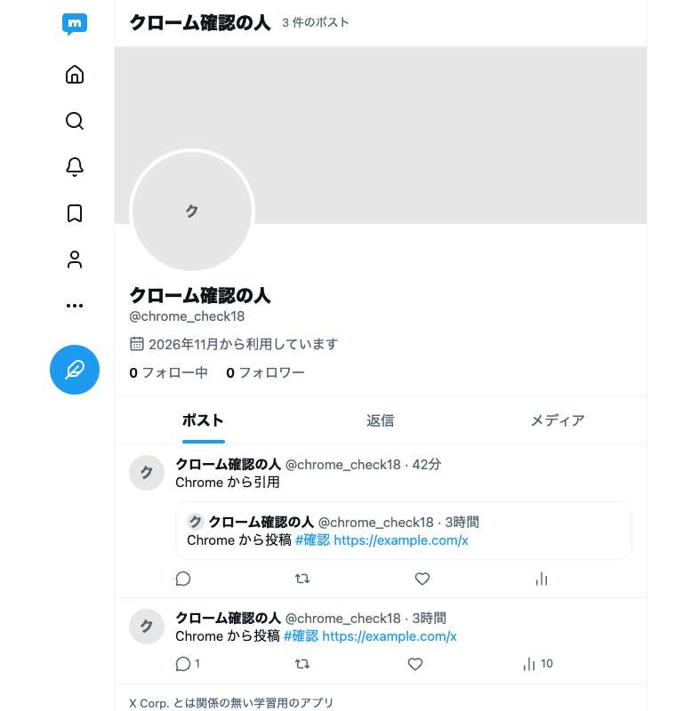
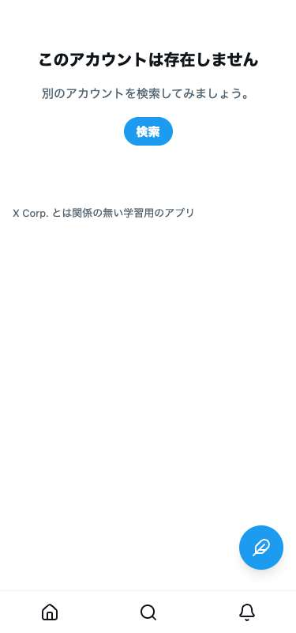
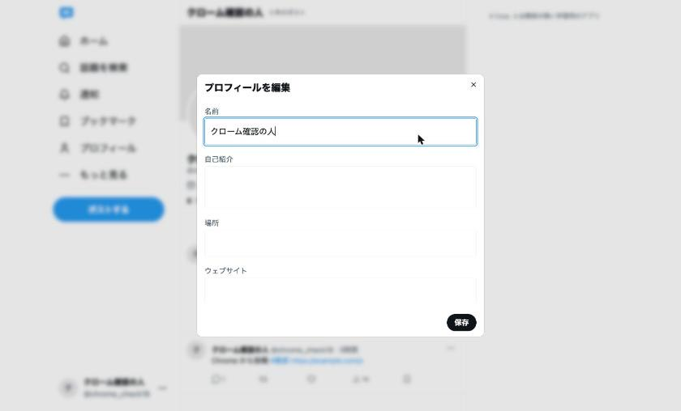
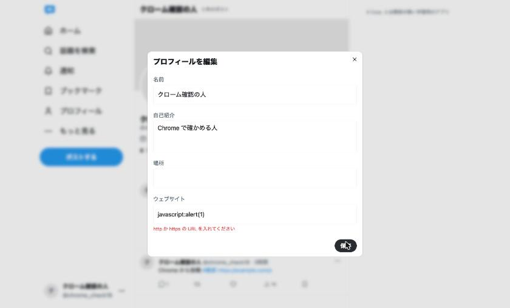
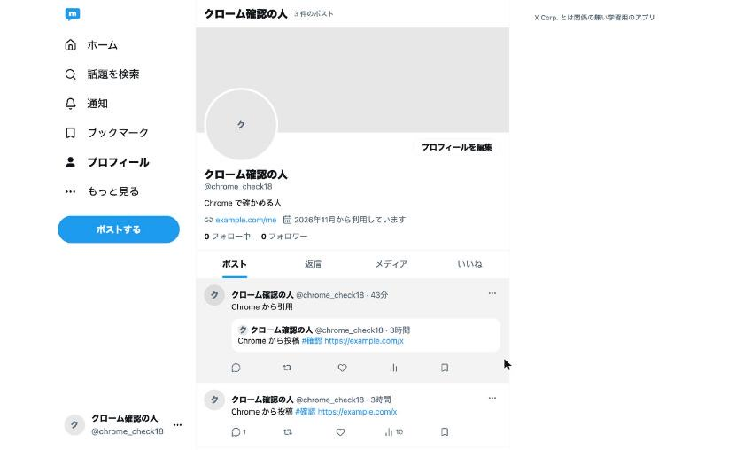
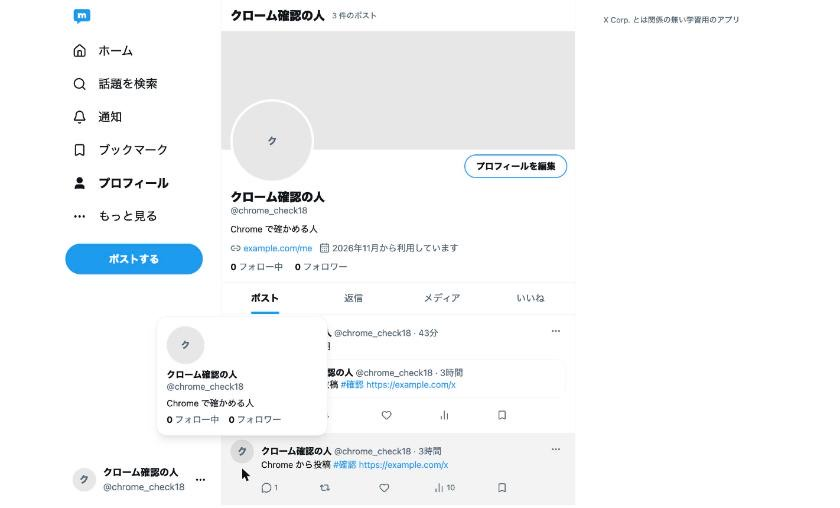
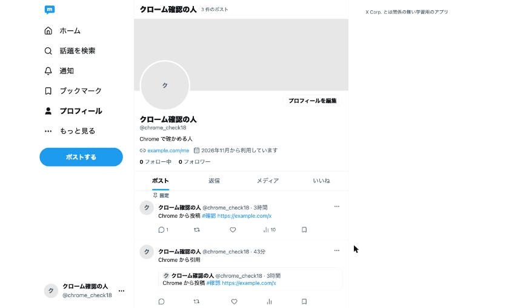

# 試験レポート: プロフィールが見られ、編集でき、タブごとに投稿が読め、投稿を固定できる

## 対象

- issue: [#23](https://github.com/ohta-rh/x-modoki-v2/issues/23)
- commit: `18406aa`、`08ac248`（ブランチ `m1/local-app`、PR #40）
- CI: [実行 44281549021](https://github.com/ohta-rh/x-modoki-v2/actions/runs/44281549021)（成功）
- 日付: 2026-11-18

## 環境

- macOS 26.2、Node.js 26.12.0（`.nvmrc` は 24。CI の実行を本当の結果とする）、Docker Compose の PostgreSQL、Playwright 1.65.0
- 動かし方: `pnpm build && pnpm start -p 3300`、Chrome の確認用のテストの人（`chrome_check18`）
- 画面の確認: Google Chrome（Claude in Chrome）と `scripts/chrome-evidence.mjs`

## 判定

合格 — 受け入れ条件 6 件のうち 6 件を満たした。

## 受け入れ条件ごとの結果

| # | 条件 | 確かめ方 | 結果 | エビデンス |
|---|---|---|---|---|
| 1 | `/{username}` がバナー（3:1）・重なるアバター・名前・@・自己紹介・場所・リンク・登録した月・数を出す。ログイン無しでも見られる。無いユーザー名は 404 の画面 | Playwright（`profile.spec.ts` › /{username} に名前と…）、`profile-header.test.tsx` | 合格 | `profile-*.jpg`、`signed-out-768.jpg`、`no-such-user-375.jpg` |
| 2 | タブ「ポスト」「返信」「メディア」が 20 件ずつ。「いいね」は本人だけに出て、本人だけが開ける | `get-user-posts.test.ts`（他人は `FORBIDDEN`）、`user-posts.test.ts`（403）、`profile-header.test.tsx` › ProfileTabs | 合格 | `profile-1280.jpg` |
| 3 | 「プロフィールを編集」がモーダルで開き、直接開くとページ。名前 50・自己紹介 160・場所 30・リンク 100（http と https だけ） | Playwright › プロフィールを編集は…、`schema.test.ts`、`update-profile.test.ts` | 合格 | `edit-modal.jpg`、`edit-invalid-link.jpg`、`edit-saved.jpg` |
| 4 | 自分の投稿をメニューから固定でき、ポストの先頭に「固定」と付く。固定は 1 つだけ。他人の投稿は固定できない | `set-pin.test.ts`（他人は `FORBIDDEN`、ログイン無しは `UNAUTHORIZED`）、Playwright › 自分の投稿を固定すると… | 合格 | `pinned.jpg` |
| 5 | `posts_count` が、投稿と削除で同じトランザクションの中で増減する | `create-post.test.ts`（1 になる）、`delete-post.test.ts`（0 になる、同時の削除でも 1 だけ減る）。#19・#20 で入っていた | 合格 | — |
| 6 | アバターと名前に約 0.5 秒ホバーすると、プロフィールの小さなカードが出る | Playwright › アバターに約 0.5 秒…、`user-hover-card.test.tsx`、`post-card-nav.test.tsx` | 合格 | `hover-card.jpg` |

## 自動のテスト

`pnpm verify`（7 つの確認）が 0 で終わった。

```
 Test Files  103 passed (103)
      Tests  566 passed (566)
Statements   : 100% ( 1352/1352 )
Branches     : 100% ( 926/926 )
Functions    : 100% ( 324/324 )
Lines        : 100% ( 1179/1179 )
  138 passed (38.8s)
VERIFY_RC=0
```

Playwright は Chromium・Firefox・WebKit で 46 本ずつ、合わせて 138 本が通った。

### TDD の記録

| # | 振る舞い | 先に書いたテスト | 赤（落ちた理由） | 緑にした実装 |
|---|---|---|---|---|
| 1 | プロフィール・編集・固定・ホバー（受け入れのテスト） | `e2e/profile.spec.ts` | `Locator: getByRole('region', { name: 'プロフィール' }).getByRole('heading', …)` が見つからない | 下の 2〜22 のあと、最後に緑 |
| 2 | プロフィールの DTO（大文字と小文字を区別しない、本人か、無いと NOT_FOUND） | `get-profile.test.ts` | `expected undefined to deeply equal { ok: true, profile: { …(12) } }` | `src/entities/user/api/get-profile.ts` |
| 3 | タブごとの投稿（固定は先頭に 1 回、いいねは本人だけ、カーソル） | `get-user-posts.test.ts` | `Error: expected ok, got STUB` | `get-user-posts.ts`、`time-cursor.ts`（ブックマークと共有） |
| 4 | `GET /api/users/{username}/posts` | `user-posts.test.ts` | `expected 500 to be 200` | `_app/api-routes/user-posts.ts` |
| 5 | 編集の入力の決まり（長さ、http と https だけ、空白の除去） | `schema.test.ts` | `expected undefined to deeply equal [ '名前を入れてください' ]` | `profile-edit/model/schema.ts` |
| 6 | 自分の 4 つの項目だけを保存し、失敗は項目ごとの文言 | `update-profile.test.ts` | `expected undefined to deeply equal { ok: true }` | `update-profile.ts`、`actions.ts` |
| 7 | 固定（1 つだけ、他人・削除済み・リポストは不可）と Server Action | `set-pin.test.ts` | `expected undefined to deeply equal { ok: true }` | `post-pin/api/set-pin.ts`、`actions.ts` |
| 8 | メニューの固定の項目（固定する／解除する、失敗はトースト） | `pin-menu-item.test.tsx` | `Unable to find role="menuitem" and name "プロフィールに固定する"` | `pin-menu-item.tsx` |
| 9 | メニューに項目を差し込む・カードの「固定」 | `delete-post-menu.test.tsx`、`quoted-card.test.tsx` › PostCard の固定 | `expect(element).toHaveTextContent()` | `delete-post-menu.tsx`、`post-card.tsx` |
| 10 | 一覧から固定し読み直す、endpoint の ? に & でカーソル | `post-feed.test.tsx` › 固定とプロフィールの一覧 | `Unable to find role="menuitem" and name "プロフィールに固定する"` | `post-feed.tsx` |
| 11 | 登録した月 | `format.test.ts` › joinedMonth | `TypeError: joinedMonth is not a function` | `format.ts` |
| 12 | プロフィールのヘッダーとタブ | `profile-header.test.tsx` | `Unable to find an accessible element with the role "region" and name "プロフィール"` | `widgets/profile-header` |
| 13 | プロフィールの loader（404、他人のいいねは送り返す） | `load-profile-page.test.ts` | `TypeError: Cannot read properties of undefined (reading 'username')` | `_pages/profile/api` |
| 14 | プロフィールの画面と、無いアカウントの画面 | `profile-page.test.tsx` | `Unable to find an accessible element with the role "heading" and name "花子"` | `_pages/profile/ui` |
| 15 | 入力欄を shared へ移し、複数行を足す | `field.test.tsx` | `expected 'INPUT' to be 'TEXTAREA'` | `shared/ui/field` |
| 16 | 編集のフォーム | `profile-edit-form.test.tsx` | `Unable to find an accessible element with the role "textbox" and name "名前"` | `profile-edit-form.tsx` |
| 17 | 編集の loader・モーダル・ページ | `load-profile-edit.test.ts`、`profile-edit.test.tsx` | `expected {} to deeply equal { username: 'hanako', …(1) }` | `_pages/profile-edit` |
| 18 | `GET /api/users/{username}` | `user-profile.test.ts` | `expected 500 to be 200` | `_app/api-routes/user-profile.ts` |
| 19 | ホバーのカード | `user-hover-card.test.tsx`、`post-card-nav.test.tsx` › ホバーのカード | `Unable to find role="dialog" and name "太郎 のプロフィールのカード"` | `entities/user/ui/user-hover-card.tsx`、`post-card.tsx` |
| 20 | 他人のプロフィールに固定を出さない／カードが読めなくても壊れない／バナーの画像（実装を壊して落ちるのを確かめた） | `profile-page.test.tsx`、`user-hover-card.test.tsx`、`profile-header.test.tsx` | `expected <div role="menuitem" …> to be null`、`Error: profile 404`、`toHaveClass("object-cover")` | 各ファイル |
| 21 | メニューの幅（Chrome で見つけた） | `delete-post-menu.test.tsx` | `expect(element).toHaveClass("min-w-56")` | `delete-post-menu.tsx` |
| 22 | ポストのタブ以外では固定を出さない（レビュー 1） | `profile-page.test.tsx` › 本人でも、ポストのタブ以外では… | `expected <div role="menuitem" …(5)>…(1)</div> to be null` | `profile-page.tsx` |

## コードレビュー

- 判定: APPROVE（1 回目）　範囲: `HEAD~1..HEAD`（`18406aa`）　レビューした sub agent: code-reviewer（opus）

| # | 重さ | 指摘 | 確かめた結果 | 対応 |
|---|---|---|---|---|
| 1 | minor | 本人のプロフィールで、固定の項目がどのタブにも出るが、`pinned` はポストのタブにしか付かない。返信のタブで固定した投稿のメニューが「プロフィールに固定する」になり、外せない | 再現した | 直した `08ac248`。ポストのタブだけで固定の項目を出す。レビュアーの案のとおりなので、もう 1 回は回さない |

## ブラウザでの確認

| URL | 幅 | テーマ | した操作 | 見えた結果 | 画面の写真 |
|---|---|---|---|---|---|
| `/chrome_check18` | 1280 / 768 / 375 | ライト | 開いた | バナー・重なるアバター・登録した月・数・タブ・一覧 | `profile-*.jpg` |
| 同じ（ログイン無し） | 768 | ライト | 開いた | 見られる。「プロフィールを編集」と「いいね」のタブは出ない | `signed-out-768.jpg` |
| `/no_such_user_zz` | 375 | ライト | 開いた | 「このアカウントは存在しません」 | `no-such-user-375.jpg` |
| `/chrome_check18` → 編集 | 1400 | ライト | 「プロフィールを編集」を押した | URL が `/settings/profile` になり、プロフィールの上にモーダル | `edit-modal.jpg` |
| 同じ | 1400 | ライト | リンクに `javascript:alert(1)` と入れて保存（失敗の経路） | 「http か https の URL を入れてください」 | `edit-invalid-link.jpg` |
| 同じ | 1400 | ライト | 正しいリンクで保存 | モーダルが閉じ、自己紹介とリンクが出た | `edit-saved.jpg` |
| 同じ | 1400 | ライト | もう一度開いて Esc で閉じた（2 回） | 毎回開いて閉じ、プロフィールへ戻る | — |
| 同じ | 1400 | ライト | アバターにホバーした | 小さなカード（名前・@・自己紹介・数） | `hover-card.jpg` |
| 同じ | 1400 | ライト | 古い投稿の ⋯ → プロフィールに固定する | 先頭に「固定」と付いて出た | `pinned.jpg` |

- コンソール: エラー 0、警告 0　通信: 失敗 0（`chrome-evidence.mjs` の 9 回の読み込み）












## 見つけた問題

1. **⋯ のメニューが狭く、「プロフィールに固定する」が 2 行に折れた**（Chrome で見つけた）。`min-w-56` にした
2. **画面のテストが、固定の Server Action の終わりを待たずに読み直していた**（Chromium で 1 回落ちた）。#21 と同じ。応答を待つようにした
3. 保存してモーダルを閉じたあと、モーダルの中身が隠れた形（`display: none`）で残る。Next.js 16 が戻る・進むのために画面を残すためで、ページは動き、スクロールも止まらず、もう一度開け閉めできることを確かめた。不具合ではない
4. 無いアカウントの 404 を出す場所を [ADR-0042](../adr/0042-profile-routes-in-a-group-with-their-own-not-found.md) で決め、ルーティングの 2 節を直した
