# 試験レポート: 投稿に画像を 4 枚まで付け、ビューアで見て、アバターとバナーを変えられる

## 対象

- issue: [#25](https://github.com/ohta-rh/x-modoki-v2/issues/25)
- commit: `3f8d6ba`・`9d6321a`・`9984eba`（1. 添付と投稿）、`39949cb`（2. ビューア）、`a5f0c63`・`5a88dde`・`763cc41`・`dc6685b`（3. アバターとバナー）、`bd8ec0b`・`fe38564`（4. 片付け）（ブランチ `m1/local-app`、PR #40）
- CI: [実行 44307921645](https://github.com/ohta-rh/x-modoki-v2/actions/runs/44307921645)（最後の commit）。途中の [44300583956](https://github.com/ohta-rh/x-modoki-v2/actions/runs/44300583956)（1.）と [44302253028](https://github.com/ohta-rh/x-modoki-v2/actions/runs/44302253028)（2.）も成功
- 日付: 2026-11-18

## 環境

- macOS 26.2、Node.js 26.12.0（`.nvmrc` は 24。CI の実行を本当の結果とする）、Docker Compose の PostgreSQL 18 と Garage、Playwright 1.65.0（Chromium・Firefox・WebKit）
- 動かし方: `pnpm build && pnpm start -p 3300`、Chrome の確認用のテストの人（`chrome_check18`）
- 画面の確認: Google Chrome（Claude in Chrome）、インストールした Chrome を Playwright で動かす `scripts/chrome-evidence.mjs` と、画像を選ぶ操作のための同じ形の台本

## 判定

合格 — 受け入れ条件 9 件のうち 9 件を満たした。

## 受け入れ条件ごとの結果

| # | 条件 | 確かめ方 | 結果 | エビデンス |
|---|---|---|---|---|
| 1 | 入力欄から 4 枚まで選べ、5 枚目は選べない。1 枚ごとに代替テキスト（1,000 文字まで）を付け外しできる | Playwright `media.spec.ts`、`image-attachments.test.tsx`、`create-post.test.ts` › 5 枚は拒み、代替テキストは 1,000 文字まで | 合格 | `compose-two-images-1280.jpg`、`compose-five-images-*.jpg` |
| 2 | 送る前にブラウザで長辺 2048px 以下の WebP（品質 0.85、書けないブラウザは JPEG: ADR-0043）。GIF はそのまま。アバター 400×400、バナー 1500×500 | `image.test.ts` › fitWithin / coverSize、`prepare-image.test.ts`、`profile-image-picker.test.tsx` | 合格 | — |
| 3 | `POST /api/uploads/presign` がログイン・種類・5MB・回数を確かめ、60 秒の署名つき URL と推測できないキーを返し、`pending` の行を作る | `uploads.test.ts`（Route Handler）、`request-upload.test.ts`、`storage.test.ts` | 合格 | — |
| 4 | 投稿のとき、置かれた画像の先頭のバイトで種類と縦横を確かめてから `ready` にして結びつける。偽り・他人・無いキーは拒む | `create-post.test.ts`（PNG を WebP と偽る、他人、無い、置かれていない、縦横の違い、同時の使用、2 枚のうち 1 枚、上書き） | 合格 | — |
| 5 | カードの並び（1 枚は元の比率で高さに上限、2 枚は左右、3 枚は大 1 と小 2、4 枚は 2×2、角 16px、すき間 2px）。`` に幅・高さ・代替テキスト | `post-media.test.tsx` | 合格 | `compose-two-images-1280.jpg` の下のカード |
| 6 | 画像を押すと `/{username}/status/{id}/photo/{n}` になり前の画面に重なる。戻るとスクロールの位置のまま。直接開くと詳細の上。左右のキーで前後、Esc で閉じる | Playwright `photo-viewer.spec.ts`（3 本）、`photo-viewer.test.tsx`、`post-detail-page.test.tsx`、`load-post-detail.test.ts`、本物の Chrome | 合格 | `viewer-modal-2-1400.jpg`、`viewer-direct-375.jpg`、`viewer-missing-768.jpg` |
| 7 | プロフィールの編集でアバターとバナーを変えられる | Playwright `profile-images.spec.ts`、`update-profile.test.ts`、`profile-image-picker.test.tsx`、本物の Chrome | 合格 | `profile-edit-images-*.jpg`、`profile-saved-*.jpg` |
| 8 | `POST /api/cron/cleanup-media` が 24 時間より古い `pending` の行と画像を消す。秘密の値が違えば 401 | `cleanup-media.test.ts`（PostgreSQL と Garage）、`cron.test.ts`、Chrome から呼んで 401 と 405 | 合格 | — |
| 9 | プロフィールの「メディア」のタブに画像のある投稿が出る | `get-user-posts.test.ts` › メディア: 画像のある投稿だけ（#23 で書いたテスト）、本物の Chrome | 合格 | `media-tab-375.jpg` |

## 自動のテスト

`pnpm verify`（7 つの確認）が 0 で終わった（最後の変更のあと）。

```
 Test Files  122 passed (122)
      Tests  680 passed (680)
Statements   : 100% ( 1838/1838 )
Branches     : 100% ( 1235/1235 )
Functions    : 100% ( 454/454 )
Lines        : 100% ( 1602/1602 )
  165 passed (44.6s)
VERIFY_RC=0
```

Playwright は Chromium・Firefox・WebKit で 55 本ずつ、合わせて 165 本が通った。

### TDD の記録

| # | 振る舞い | 先に書いたテスト | 赤（落ちた理由） | 緑にした実装 |
|---|---|---|---|---|
| 1 | 画像を付けて投稿するとカードに出る・5 枚目は選べない（受け入れのテスト） | `e2e/media.spec.ts` | 入力欄「画像を追加」が無く、30 秒で止まった | 下の 2〜8 のあと、最後に緑 |
| 2 | 縮める大きさ・切り抜く範囲・先頭のバイトの読み取り | `image.test.ts` | `fitWithin is not a function` のあと、関数ごとに期待した値と違う | `shared/lib/image/image.ts` |
| 3 | 署名つき URL・先頭のバイト・消す・写す | `storage.test.ts` | `promise resolved "false" instead of rejecting`（写せない失敗を投げない形で確かめた） | `shared/storage/storage.ts` |
| 4 | 署名の要求（ログイン・種類・大きさ・回数・`pending` の行） | `request-upload.test.ts`、`uploads.test.ts` | `expected 500 to be 200` | `features/media-upload/api/request-upload.ts`、`_app/api-routes/uploads.ts` |
| 5 | 投稿で確かめて結びつける | `create-post.test.ts` › 置かれた画像を確かめてから… ほか | `expected [] to deeply equal [b, a]` | `create-post.ts`、`entities/media` |
| 6 | 1 枚の画像の高さの上限（レビュー 1-1） | `post-media.test.tsx` › 1 枚の画像の高さには上限がある | `expect(element).toHaveClass("max-h-[510px]")` | `post-media.tsx` |
| 7 | 断るときは確保した画像も巻き戻す（レビュー 1-1） | `create-post.test.ts` › 2 枚のうち 1 枚だけが… / 画像つきの返信で… | `expected 'ready' to be 'pending'` | `create-post.ts`（`Refused` を投げる） |
| 8 | 投稿したあと元のキーを上書きしても画像は変わらない（レビュー 1-2） | `create-post.test.ts` › 投稿したあと、まだ有効な署名つき URL で… | `expected null to deeply equal { type: 'image/webp', … }` | `entities/media/api/seal-uploads.ts`（写してから確かめる） |
| 9 | ビューアを開き、前後へ、閉じると前の画面（受け入れのテスト） | `e2e/photo-viewer.spec.ts` | 「1 枚目の画像」のリンクが無い・ダイアログが無い | 下の 10〜13 のあと、最後に緑 |
| 10 | 画像はビューアの URL へのリンク | `post-media.test.tsx` › PostCard と MainPost の画像は… | `Unable to find an accessible element with the role "link" and name "1 枚目の画像"` | `post-media.tsx` |
| 11 | ビューア（n 枚目・左右のキーとボタン・URL の置き換え・閉じる） | `photo-viewer.test.tsx` | `Unable to find an accessible element with the role "dialog" and name "画像"` | `widgets/photo-viewer` |
| 12 | `/photo/{n}` の番号（1 から、無い番号は 404、正しい URL へ送る） | `load-post-detail.test.ts` | `expected undefined to be 2` | `load-post-detail.ts` |
| 13 | 詳細の上のビューア・モーダル | `post-detail-page.test.tsx` | `Unable to find … "dialog" and name "画像"` | `post-photo.tsx`、ルート 2 つ |
| 14 | アバターとバナーを変える（受け入れのテスト） | `e2e/profile-images.spec.ts` | 入力欄「アバターの画像を選ぶ」が無く止まった | 下の 15〜21 のあと、最後に緑 |
| 15 | 保存（写し・大きさ・前の画像を消す・同時の使用） | `update-profile.test.ts` | `expected { ok: true } to deeply equal { ok: false, code: 'VALIDATION', … }` ほか | `update-profile.ts` |
| 16 | 画像の ID の形 | `schema.test.ts` | `expected { name: '花子', … } to match object { avatarId: '123', … }` | `schema.ts` |
| 17 | 選ぶ欄（切り抜き・送る・失敗・取り消し・ハイドレーション前） | `profile-image-picker.test.tsx` | `Unable to find a label with the text of: アバターの画像を選ぶ`、ハイドレーション前は `expected last … to have been called with [ { id: '9', busy: false } ]` | `profile-image-picker.tsx` |
| 18 | 選び直したら最新だけ（レビュー 3-1）・失敗でプレビューを消す（3-2）・同じファイルを選び直せる（3-3） | `profile-image-picker.test.tsx` の 3 本 | `expected last … [ { id: 'B', busy: false } ]`、`expected  to be null`、`expected 'C:\fakepath\me.png' to be ''` | `profile-image-picker.tsx` |
| 19 | 前のアバターが他人の画像を指していても消さない（レビュー 3-2、blocker） | `update-profile.test.ts` › 前のアバターが他人の画像を… | `expected [] to have a length of 1 but got +0` | `update-profile.ts`（自分の行だけ消す） |
| 20 | 編集のダイアログは画面の高さを超えずスクロールする・ページで保存すると殻も読み直す・アカウントのメニューのアバターは配信元の URL | `profile-edit.test.tsx`、`load-viewer.test.ts` | `toHaveClass("max-h-[90dvh] overflow-y-auto")`、`expected "vi.fn()" to be called at least once`、`expected 'media/a.webp' to match /^https?:…/` | `profile-edit-screens.tsx`、`load-viewer.ts` |
| 21 | 使われなかった画像を消す・秘密の値（レビュー 4-1 で feature の中へ） | `cleanup-media.test.ts`、`cron.test.ts` | `expected { removed: +0 } to deeply equal { removed: 1 }`、`expected 500 to be 200` | `features/media-cleanup`、`_app/api-routes/cron.ts` |

- テストを通すために変えたテスト（どれもテストの誤り。振る舞いに合わせたものではない）: ビューアの画面のテストで、代替テキストの無い `` は役割を持たないので要素で数えた。404 は `<Suspense>` の下で流れるのでステータスでなく「このページは存在しません。」の画面で確かめた（#20 と同じ）。モーダルの後ろの詳細は支援技術から隠れるので `includeHidden` で探した。スクロールの位置は、Playwright がクリックの前にリンクを見える位置へ動かすので、ビューアが開いたときの後ろの位置を基準にし、1px の丸めを許した（基準が 0 より大きいことも確かめ、先頭に戻る不具合なら落ちる）
- 外して落ちるのを見たテスト: 「無い番号は 404」（番号の確認を外してビルド）、「photo が null ならビューアを出さない」、`copyObject` の投げ直し、保存の思いがけない失敗の投げ直し、選ぶ欄の取り消し

## コードレビュー

- 判定: 4 つの区切りとも APPROVE　レビューした sub agent: code-reviewer（opus）

| # | 区切りと回 | 重さ | 指摘 | 確かめた結果 | 対応 |
|---|---|---|---|---|---|
| 1 | 1. 添付 1 回目（CHANGES_REQUESTED） | major | 1 枚の画像に高さの上限が無く、縦長の画像がタイムラインを押し下げる（ui-ux.md 5 節「高さに上限」） | その通り | 直した `9d6321a`（510px まで） |
| 2 | 同じ | minor | 断るときに `return` するので、確保した画像の `ready` がコミットされる | その通り | 直した `9d6321a`（投げて巻き戻す） |
| 3 | 1. 添付 2 回目（APPROVE） | minor | 署名つき URL は 60 秒有効なので、確かめたあとで元のキーを上書きできる | その通り | 直した `9984eba`（ブラウザに渡していないキーへ写し、写しを確かめる） |
| — | 2. ビューア 1 回目（APPROVE） | — | 指摘なし | — | — |
| 4 | 3. アバター 1 回目（CHANGES_REQUESTED） | major | 送っている間に選び直すと、先の画像の ID が遅れて届き、画面と違う画像が保存される | その通り | 直した `5a88dde`（最新の選択だけ） |
| 5 | 3. アバター 2 回目（CHANGES_REQUESTED） | blocker | `/api/auth/update-user` でアバターの列に他人のキーを入れてから保存すると、他人の画像が消える | その通り | 直した `763cc41`（自分の行だけ消す）。道そのものは #51 で閉じた |
| 6 | 同じ | minor | 選び直しが失敗しても、前のプレビューが「新しいアバター」として残る | その通り | 直した `763cc41` |
| 7 | 3. アバター 3 回目（APPROVE） | minor | 入力欄を空にしないので、送れなかった同じファイルを選び直せない | その通り | 直した `dc6685b` |
| 8 | 4. 片付け 1 回目（APPROVE） | minor | 秘密の値の確認が Route Handler にあり、`api` セグメントに無い（application-structure.md 6 節） | その通り | 直した `fe38564` |

## ブラウザでの確認

| URL | 幅 | テーマ | した操作 | 見えた結果 | 画面の写真 |
|---|---|---|---|---|---|
| `/home?tab=following` | 1400 | ライト | 直す前に画像を 2 枚付けた | 「ポストする」が潰れて細くなった | `before-squeezed-button.jpg` |
| 同じ | 1280 | ライト | 直したあと 2 枚付けた | 画像の欄は本文の下、「ポストする」は 107×36 | `compose-two-images-1280.jpg` |
| 同じ | 768 / 375 | ライト | 2 枚のあと 3 枚を選んだ（失敗の経路） | 4 枚で止まり「画像は 4 枚までです」。送り終えるまで「ポストする」は押せない | `compose-five-images-*.jpg` |
| 同じ → 画像 | 1400 | ライト | 1 枚目を押し、→ キー、Esc | URL が `/photo/1`→`/photo/2`、Esc で `/home` に戻り位置は 300 のまま（JS から押して確かめた。道具のクリックは要素を見える位置へ 17px 動かす） | `viewer-modal-2-1400.jpg` |
| `/chrome_check18/status/…/photo/2` | 375 | ライト | 直接開いた | 詳細の上に 2 枚目、前へのボタンと閉じる | `viewer-direct-375.jpg` |
| `…/photo/3` | 768 | ライト | 無い番号を開いた（失敗の経路） | 「このページは存在しません。」 | `viewer-missing-768.jpg` |
| `/settings/profile` | 1280 / 375 | ライト | アバターとバナーを選んだ | バナーの角にアバター、切り抜いたプレビュー | `profile-edit-images-*.jpg` |
| `/chrome_check18` | 1280 / 768 | ライト | 保存した | プロフィール・カード・アカウントのメニューに新しいアバター | `profile-saved-*.jpg` |
| `/chrome_check18/media` | 375 | ライト | 開いた | 画像のある投稿だけ | `media-tab-375.jpg` |
| `/api/cron/cleanup-media` | — | — | Chrome から秘密の値なし・違う値で POST、GET | 401 `{"error":"UNAUTHORIZED"}` が 2 つ、GET は 405 | — |

- コンソール: エラー 0、警告 0　通信: 失敗 0（`chrome-evidence.mjs` と台本の読み込み。直す前に見つけた 404 は下の 6）
- キーボード: ビューアの前後・閉じるのボタン、選ぶ欄のラベルは Tab で届き、フォーカスの輪が出る

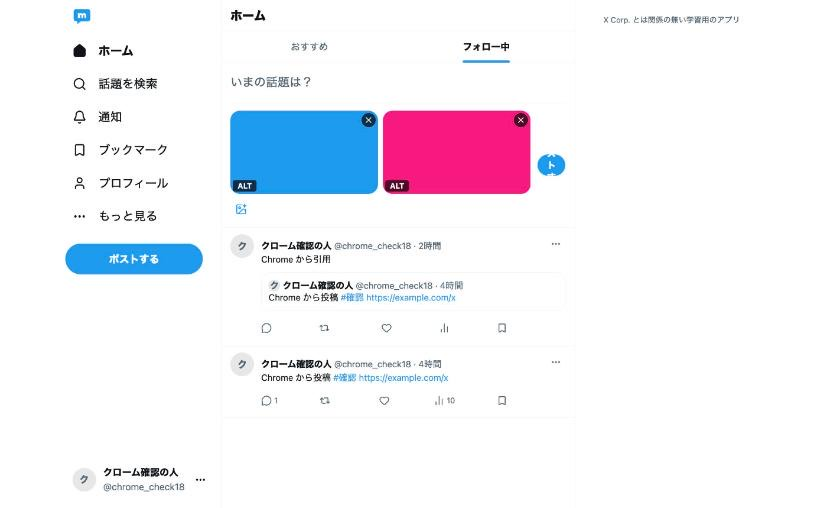
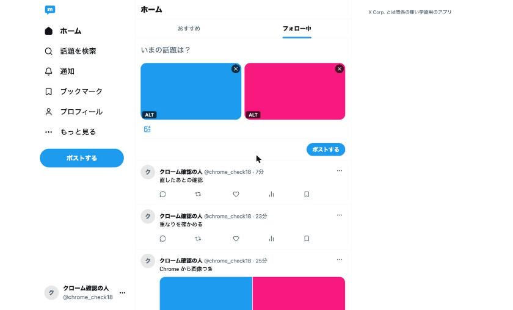
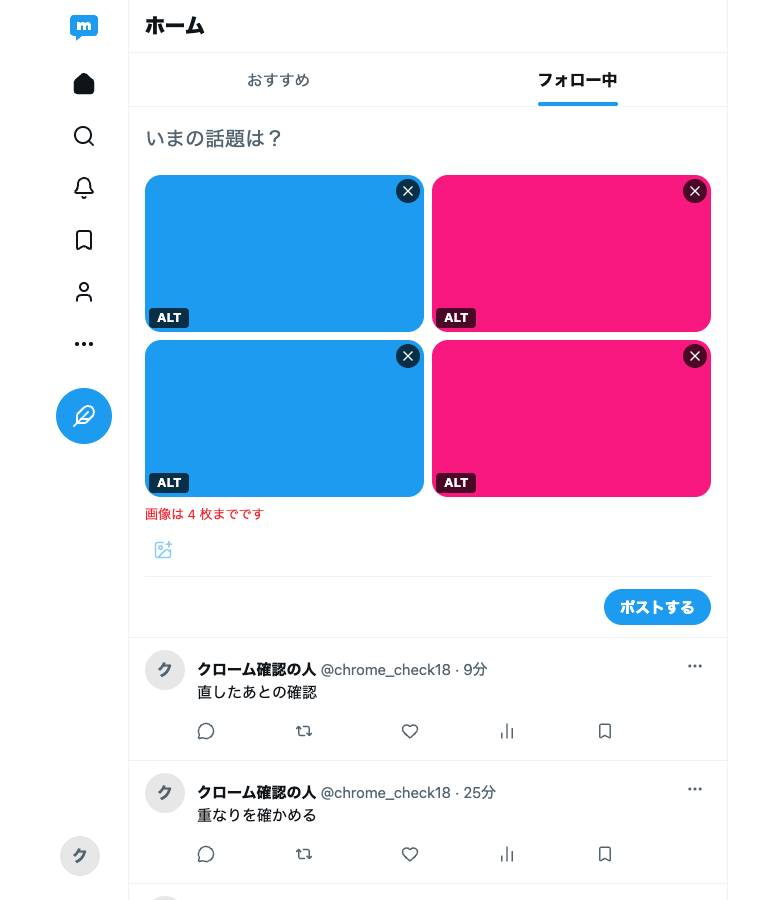
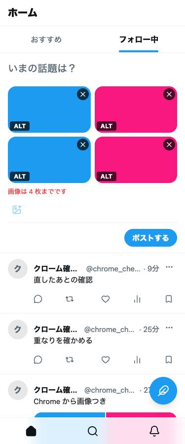
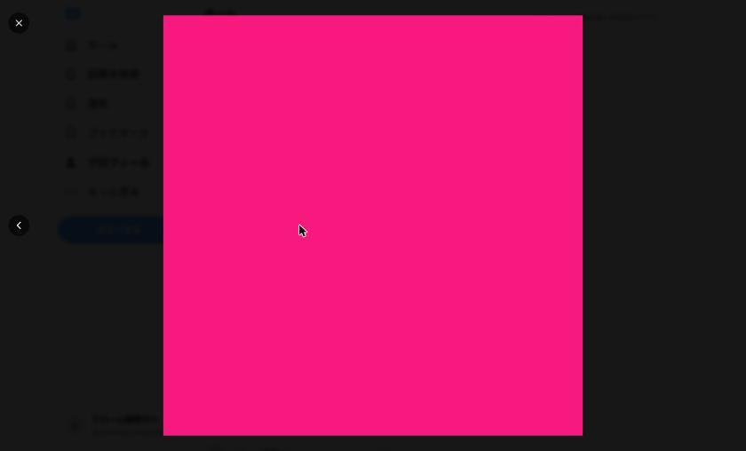
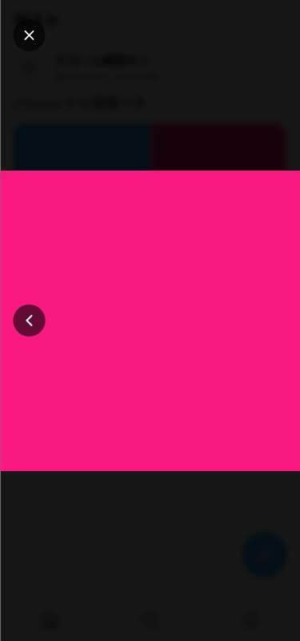
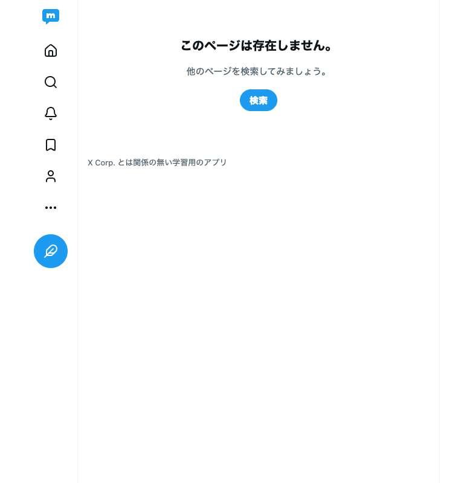
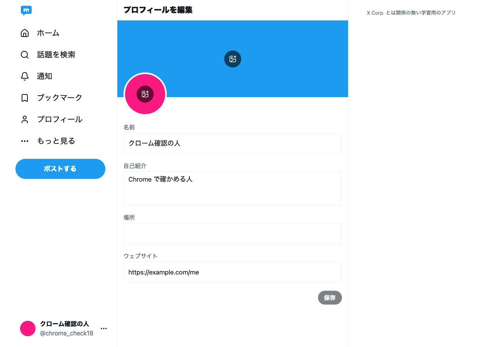
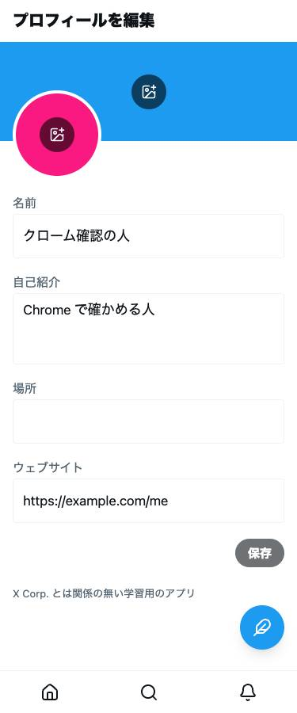
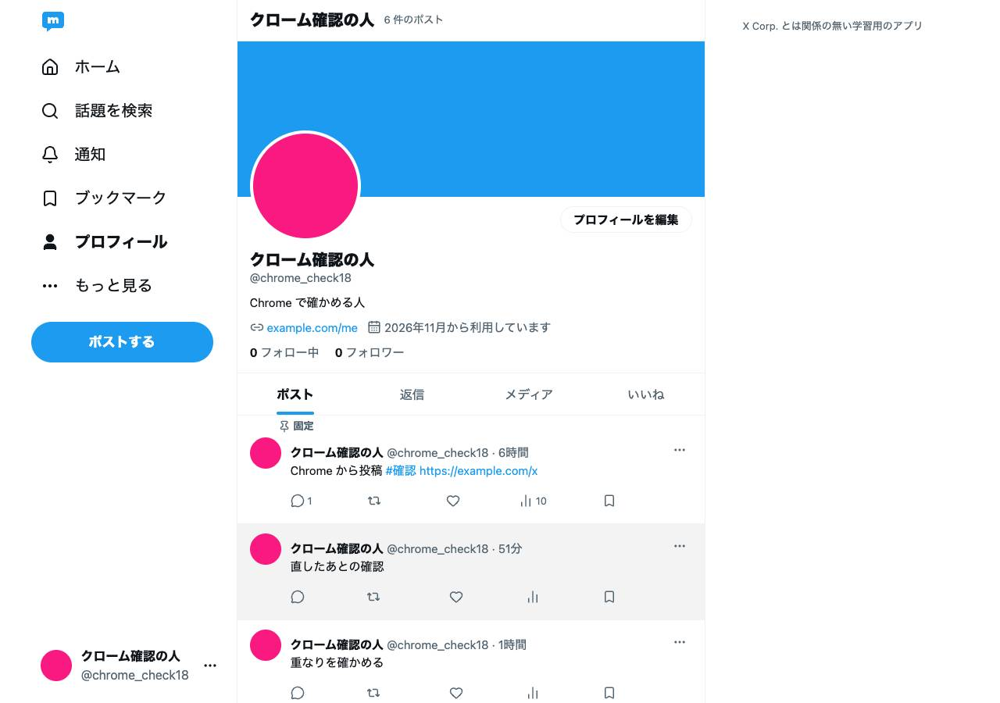
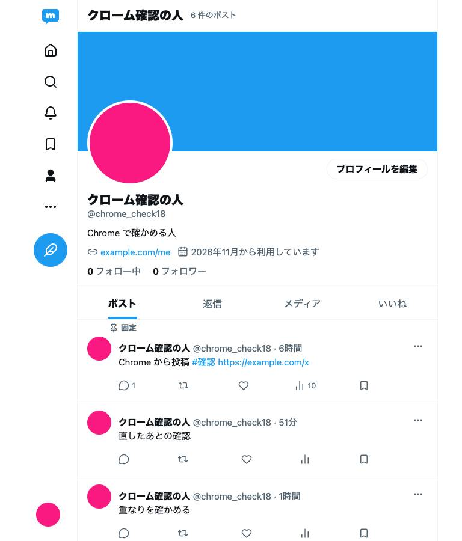
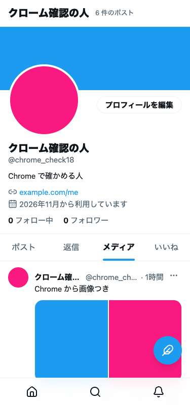

## 見つけた問題

1. **WebKit（Safari）は Canvas で WebP を書けず PNG を返す**（画面のテストの WebKit で見つけた）。同じ品質の JPEG で送り、サーバーも JPEG を受け付けるようにした（ADR-0043。ADR-0018 を一部置き換え）
2. **バケットに CORS が無く、ブラウザからの PUT の事前確認が 403**。`scripts/storage-cors.mjs` を足し、`setup-local.sh` から呼ぶ
3. **画像を付けると「ポストする」が潰れる**（Chrome で見つけた）。画像の欄を本文の下、ボタンの段の上へ移した
4. **投稿したあとタイムラインのカードが重なる**（Chrome で見つけた）。範囲の外なので #48 として起票し、先に直した（[#48 の試験レポート](issue-0048-feed-row-heights.md)）。その `pnpm verify` で #49・#50 も見つけて直した
5. **ページを開いてすぐ選んだアバターが取り込まれない**。#47 と同じ種類で 3 回目なので、ADR-0044 とルール（`architecture-fsd.md`・レビュアーの確かめる項目）に足した
6. **アカウントのメニューのアバターがキーのまま `src` に入り 404**（Chrome で見つけた）。`loadViewer` が配信元の URL を返すようにした。さらに、ページで保存したあとレイアウトが読み直されず古いアバターが残ることを画面のテストで見つけ、保存のあとに読み直すようにした。最初は「URL の直しを外すと画面のテストが落ちる」と考えたが、その赤の本当の理由はこの読み直しで、URL の直しを裏付けているのは単体のテストだけ
7. **画像の欄で編集のダイアログが画面より高くなり、「保存」を押せない**（既存の画面のテストで見つけた）。高さの上限と縦のスクロールを付けた
8. **Better Auth の `update-user` などが開いていて、検証を素通りできる**（レビューで見つけた）。範囲の外なので #51 として起票し、直した（[#51 の試験レポート](issue-0051-auth-write-endpoints.md)）
9. **ビューアのスクロールのテストが負荷の下で落ちた**。アプリでなくテストの基準の誤り（上の TDD の記録の下）。失敗のときに 2 つの値を出して確かめた
