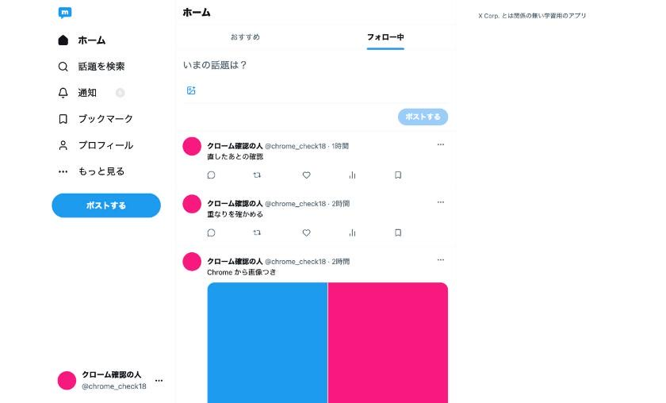
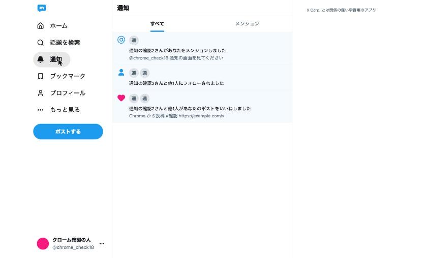
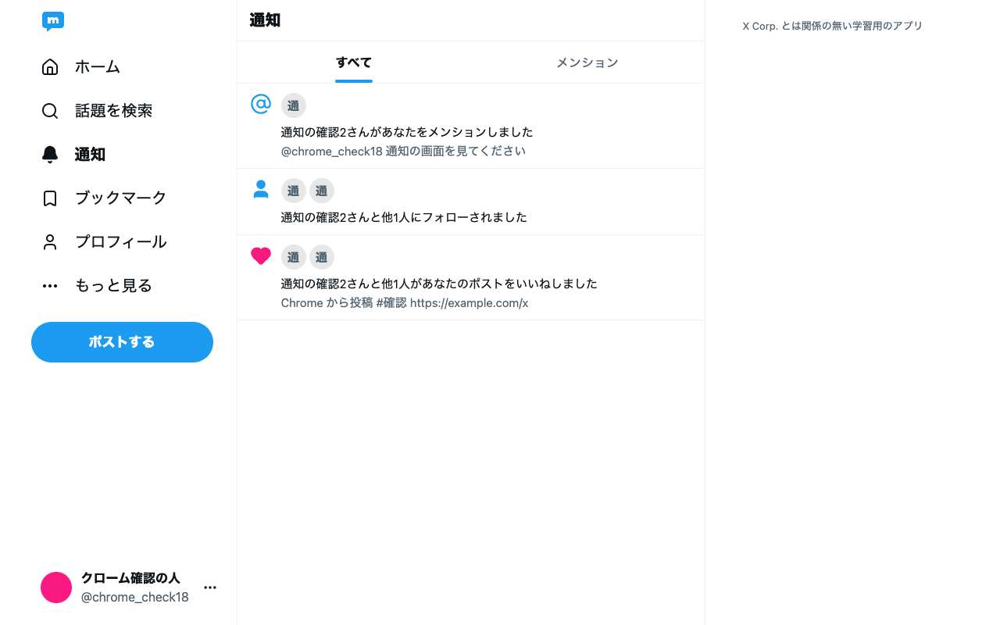
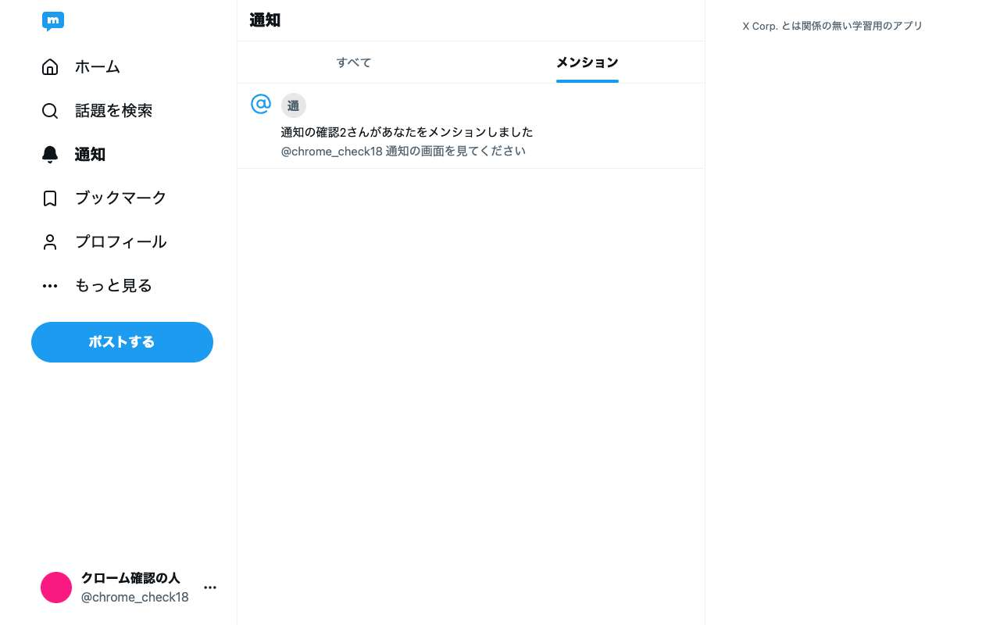
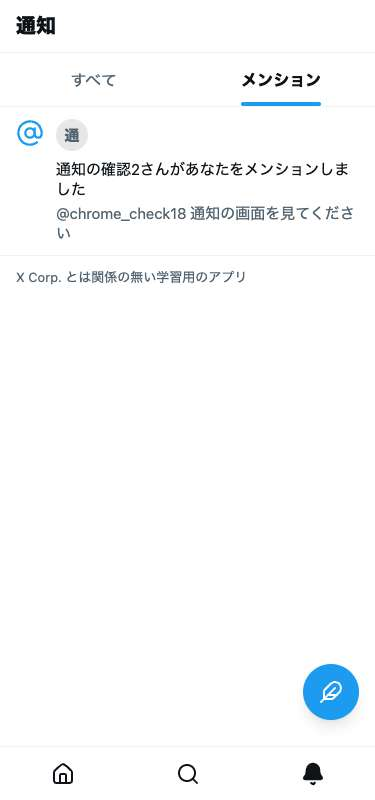

# 試験レポート: いいね・リポスト・返信・引用・メンション・フォローの通知が届き、未読の数が出る

## 対象

- issue: [#26](https://github.com/ohta-rh/x-modoki-v2/issues/26)
- commit: `d9bcdd0`、`5a2b561`、`124adeb`（ブランチ `m1/local-app`、PR #40）
- CI: [実行 44320197747](https://github.com/ohta-rh/x-modoki-v2/actions/runs/44320197747)
- 日付: 2026-11-18

## 環境

- macOS 26.2、Node.js 26.12.0（`.nvmrc` は 24。CI の実行を本当の結果とする）、Docker Compose の PostgreSQL、Playwright 1.65.0
- 動かし方: `pnpm build && pnpm start -p 3300`、Chrome の確認用のテストの人（`chrome_check18`）。通知を届けるために、手元のアプリに台本でテストの人を 2 人登録し、いいね・フォロー・メンションをさせた
- 手元の WebKit は、ディスプレイが眠っている間はクリックの判定に失敗するので、`caffeinate -d` で起こして `pnpm verify` を流した（#52 の試験レポートの 3）

## 判定

合格 — 受け入れ条件 6 件のうち 6 件を満たした。

## 受け入れ条件ごとの結果

| # | 条件 | 確かめ方 | 結果 | エビデンス |
|---|---|---|---|---|
| 1 | 6 種類の操作がそれぞれ、相手への通知の行を同じトランザクションで作る。自分には作らない。メンションは本文の中の実在する全員に | `set-like`・`set-repost`・`set-follow`・`create-post`（返信・引用・メンション）・`notify` のデータベースのテスト | 合格 | — |
| 2 | 繰り返しても 1 行。取り消す・削除すると消える | `notify.test.ts`、`set-like`・`set-repost`・`set-follow`（外す）、`delete-post.test.ts` | 合格 | — |
| 3 | すべて・メンションのタブ、20 件ずつ新しい順、種類のアイコン、「A さんと他 N 人が…」 | `group.test.ts`、`get-notifications.test.ts`、`notification-list.test.tsx`、Playwright（まとめ・メンションのタブ） | 合格 | `notifications-opened-1400.jpg`、`all-*.jpg`、`mentions-*.jpg` |
| 4 | 左ナビと下のタブバーに未読の数。30 秒ごとに確かめ、タブが見えていない間は止まる | `unread-badge.test.tsx`（時計を進める・見えていない間）、`app-shell.test.tsx`、Playwright（時計を進める・375px の下のタブ） | 合格 | — |
| 5 | 通知の画面を開くと、出ている通知が既読になり、バッジが消える | `mark-read.test.ts`（タブの分だけ・残りの数）、`notification-list.test.tsx`、Playwright（開くとバッジが消え、読み直しても消えたまま） | 合格 | `notifications-opened-1400.jpg` |
| 6 | 他人の通知は読めない | `get-notifications.test.ts`（PostgreSQL で、宛先が自分のものだけ）、`notifications.test.ts`（Route Handler の 401・400） | 合格 | — |

## 自動のテスト

`pnpm verify`（7 つの確認）が 0 で終わった。

```
 Test Files  132 passed (132)
      Tests  716 passed (716)
Statements   : 100% ( 1971/1971 )
Branches     : 100% ( 1331/1331 )
Functions    : 100% ( 484/484 )
Lines        : 100% ( 1718/1718 )
  177 passed (1.1m)
VERIFY_RC=0
```

### TDD の記録

| # | 振る舞い | 先に書いたテスト | 赤（落ちた理由） | 緑にした実装 |
|---|---|---|---|---|
| 1 | いいねされると未読の数が 1（受け入れのテスト） | `e2e/notifications.spec.ts` › いいねされると… | `Expected: "通知 未読 1 件"`、`Received: "通知"` | 下の 2〜7 のあと |
| 2 | 通知の行を作る・消す（自分には作らない、1 行） | `notify.test.ts` | `expected [] to deeply equal [ { recipientId: …, …(3) } ]` | `entities/notification/api/notify.ts` |
| 3 | いいね・リポスト・フォローの通知と取り消し | 各 `set-*.test.ts` › …の通知（#26） | `expected [] to deeply equal [ { … type: 'like' … } ]` ほか | `set-like.ts`・`set-repost.ts`・`set-follow.ts` |
| 4 | 返信・引用・メンションの通知 | `create-post.test.ts` › createPost の通知 | `expected [] to deeply equal [ …(4) ]` | `create-post.ts` |
| 5 | 削除で、その投稿の通知を消す | `delete-post.test.ts` › deletePost の通知 | `expected [ …(3) ] to deeply equal [ …, null ]` | `forgetPost` |
| 6 | 未読の数・その Route Handler | `count-unread.test.ts`、`notifications.test.ts` | `expected -1 to be +0`、`expected 500 to be 200` | `count-unread.ts`、`_app/api-routes/notifications.ts` |
| 7 | バッジ（数・読み上げ・30 秒・見えていない間は止める）とナビ | `unread-badge.test.tsx`、`app-shell.test.tsx`、`main-layout.test.tsx`、`load-viewer.test.ts` | `expect(element).toHaveAccessibleName()`、`expected "vi.fn()" to be called with arguments: [ '/api/notifications/unread-count' ]` | `unread-badge.tsx`、`left-nav.tsx`・`tab-bar.tsx`（名前を中の文字から作る）、`load-viewer.ts` |
| 8 | まとめと文言 | `group.test.ts` | `expected [] to deeply equal [ [ 'like', 'p1', …(2) ], …(3) ]` | `entities/notification/lib/group.ts` |
| 9 | 一覧を読む（自分宛て・20 件・カーソル・メンションのタブ） | `get-notifications.test.ts` | `expected { ok: true, … } to deeply equal { ok: false, error: 'UNAUTHORIZED' }` | `get-notifications.ts` |
| 10 | 一覧の Route Handler | `notifications.test.ts` › GET /api/notifications | `SyntaxError: Unexpected end of JSON input`、`expected 500 to be 401` | `_app/api-routes/notifications.ts` |
| 11 | 既読にする（その ID まで・形の違う ID） | `mark-read.test.ts` | `expected [ false, false, false ] to deeply equal [ true, false, false ]` | `features/notifications-read` |
| 12 | 一覧の画面（まとめ・アイコン・既読・空・続き） | `notification-list.test.tsx` | `Unable to find an accessible element with the role "article"` ほか | `widgets/notification-list` |
| 13 | 3 ページ目以降も読む | 同じ › 続きは… 3 ページ目以降も読む | `Unable to find role="alert"`（効果が 1 回しか動かない。ログで確かめた） | 読み込んだページの数を効果の依存に足した（同じ不具合のフォローの一覧は #53） |
| 14 | 画面と読み込み・ルート | `load-notifications-page.test.ts`、`notifications-page.test.tsx` | `got 'todo'`、`Unable to find … "heading" and name "通知"` | `_pages/notifications`、`app/(main)/notifications/{,mentions/}page.tsx` |
| 15 | バッジと未読の行は brand の青（Chrome で見つけた） | `unread-badge.test.tsx`、`notification-list.test.tsx` | `expect(element).toHaveClass("bg-brand")` | `bg-accent` → `bg-brand`（このテーマの `accent` はホバーの灰色） |
| 16 | 既読はタブの分だけ、バッジは残りの数（レビュー 1） | `mark-read.test.ts` › メンションのタブは…、`notification-list.test.tsx` | `expected { ok: true } to deeply equal { ok: true, unread: 2 }`、`expected "vi.fn()" to be called with arguments: [ '9', 'all' ]` | `mark-read.ts`、`actions.ts`、`notification-list.tsx` |
| 17 | 375px の下のタブにも未読の数（レビュー 2） | `e2e/notifications.spec.ts` › 375px では… | 下のタブに数を渡さないビルドで `Received: "通知"` | 既にあった（テストを足した） |

- 変えたテスト: 下のタブの名前を `aria-label` の値で確かめていたテストを、名前（中の文字）で確かめるように直した。左ナビの文字が `display: none` から `sr-only` になったので、1100px で文字が見えないことは幅（1px 以下）で確かめた。準備中の画面のテストから /notifications を外した（作ったので）。どれも振る舞いの変更に合わせたもの
- 落ちないテスト: 「既読にできなければバッジは変えない」は、条件を外しても通る（TanStack Query の `setQueryData` は `undefined` で何もしない）。分岐は通るが、画面に見える違いは出ない
- テストの誤り 2 つ: 同じミリ秒に作った ID の順番に頼っていた（`get-notifications.test.ts` の 2 本）。並べてから使うようにした

## コードレビュー

- 判定: APPROVE（2 回目）　範囲: `d9bcdd0~1..5a2b561`　レビューした sub agent: code-reviewer（opus）

| # | 回 | 重さ | 指摘 | 確かめた結果 | 対応 |
|---|---|---|---|---|---|
| 1 | 1（CHANGES_REQUESTED） | major | メンションのタブを開くと、出ていない古いいいねやフォローまで既読にし、バッジを 0 にする | その通り（既読にする処理が種類を見ていない） | 直した `5a2b561`（タブの分だけ既読にし、残りの未読の数を返す） |
| 2 | 2（APPROVE） | minor | 下のタブのバッジを確かめる画面のテストが無い | その通り | 直した `124adeb`（375px のテスト） |

## ブラウザでの確認

| URL | 幅 | テーマ | した操作 | 見えた結果 | 画面の写真 |
|---|---|---|---|---|---|
| `/home?tab=following` | 1400 | ライト | 2 人にいいね・フォロー・メンションさせたあと開いた（直す前） | 「通知 未読 5 件」だが、バッジがほとんど見えない灰色 | `before-grey-badge.jpg` |
| `/notifications` | 1400 | ライト | 直したあと、左ナビの通知を押した | 3 行にまとまる（@ メンション、人「…と他1人にフォローされました」、ハート「…と他1人があなたのポストをいいねしました」）。未読の行は薄い青。バッジが消えた | `notifications-opened-1400.jpg` |
| `/notifications` | 1280 / 768 / 375 | ライト | 開いた | 崩れない。375px では下のタブの通知が今の画面 | `all-*.jpg` |
| `/notifications/mentions` | 1280 / 768 / 375 | ライト | 開いた | メンションだけ | `mentions-*.jpg` |
| `/notifications`（ログイン無し） | — | — | `curl` で開いた（失敗の経路） | 307 で `/i/flow/login?next=%2Fnotifications` へ | — |

- コンソール: エラー 0、警告 0　通信: 失敗 0（`chrome-evidence.mjs` の 6 回の読み込みと、Claude in Chrome の操作）










## 見つけた問題

1. **バッジが灰色**（Chrome で見つけた）。このアプリの色の決まりでは `accent` は shadcn のホバーの灰色で、青は `brand`。バッジ・一覧のアイコン・未読の行を `brand` にした
2. **フォローの一覧も 41 人目から先を読まない**（同じ書き方から見つけた）。#53 として起票して直した（[#53 の試験レポート](issue-0053-follow-list-pages.md)）
3. **「4 枚まで」の知らせがファイルの無い選択で消える**（`pnpm verify` の Firefox で見つけた）。#54 として起票して直した（[#54 の試験レポート](issue-0054-four-image-message.md)）
4. **負荷の下で、投稿したあとのタイムラインの取り直しが 5 秒以上返らないことがある**（`pnpm verify` の chromium で見つけた。#50 の WebKit と同じ形）。原因をまだ 1 文で言えないので、調査の PBI #55 として起票した。トレースでは、投稿の Server Action は 41ms で返り、取り直しの `GET /api/timeline/following` がテストの終わりまで返らなかった
5. **私の誤り:** 一覧の部品のテストへの書き換えが、Prettier の改行の違いで当たっていなかったのに気づかず、一度「緑」と思った。実際の行を読んで直した
