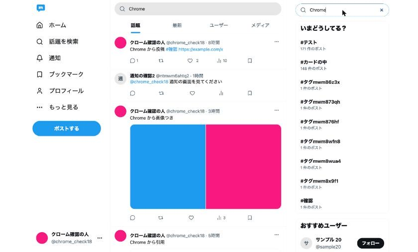
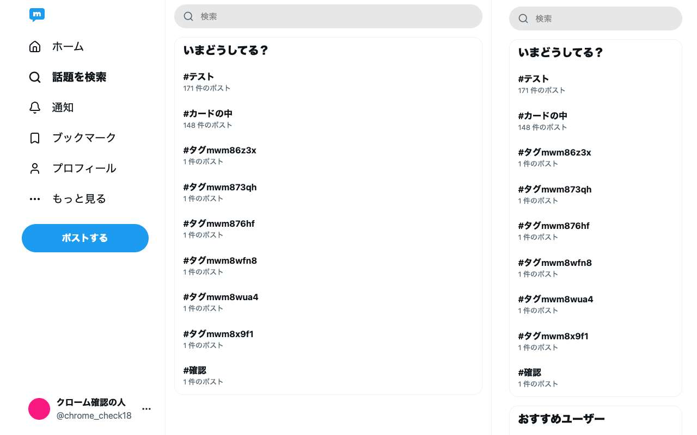
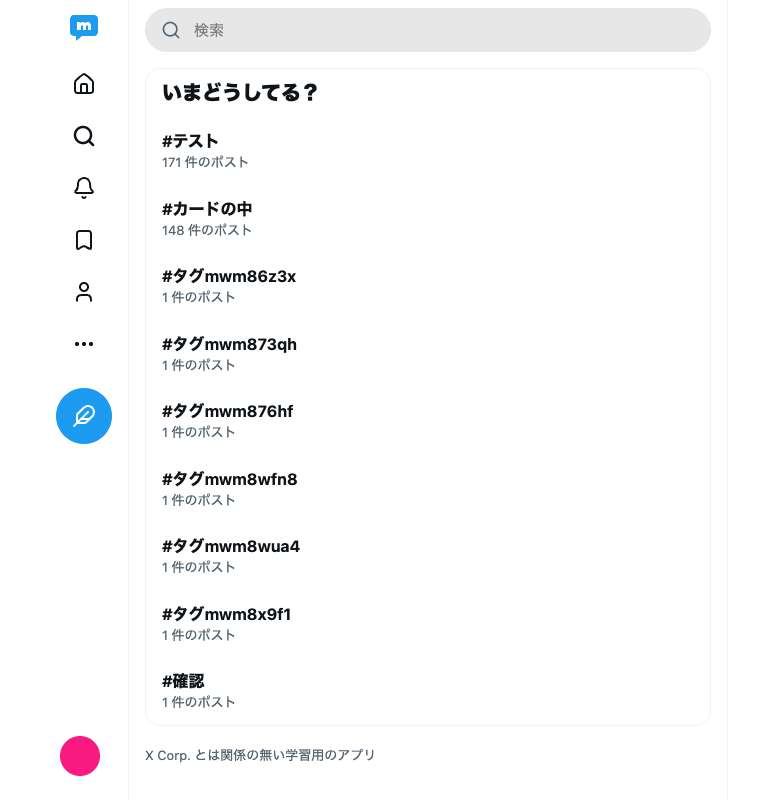
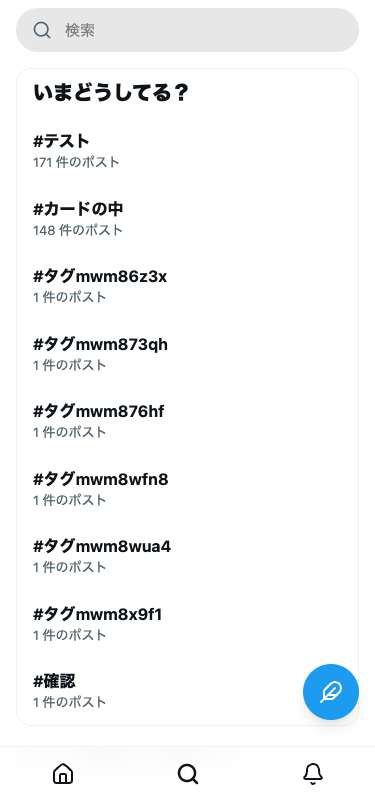
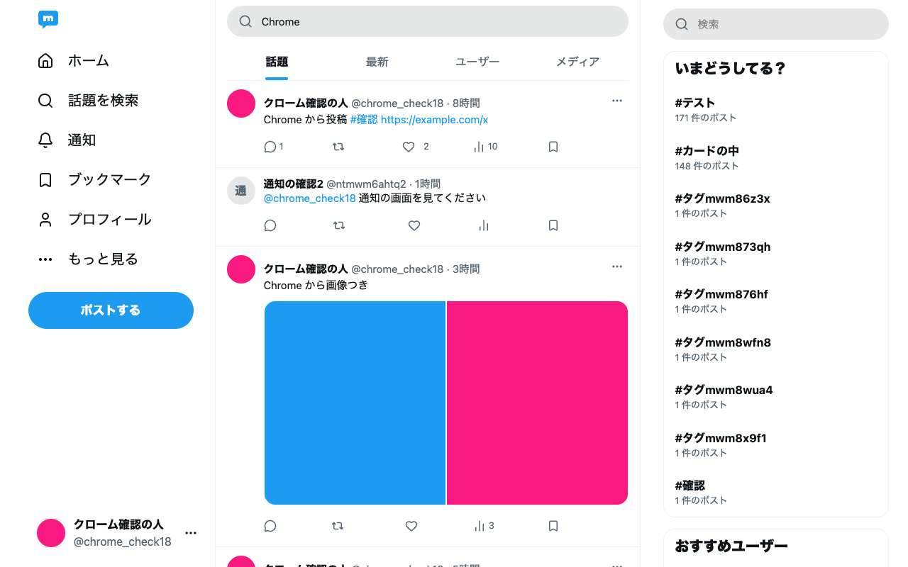
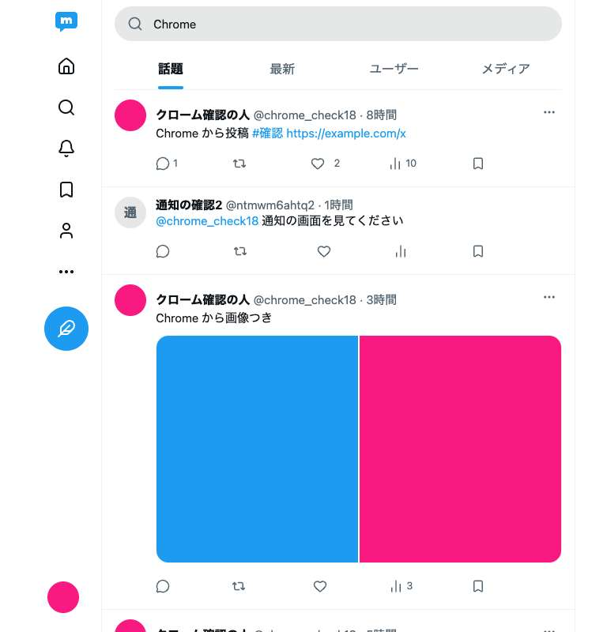
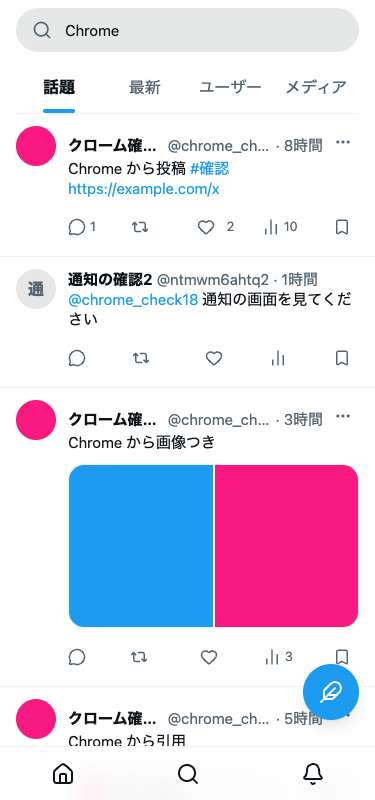
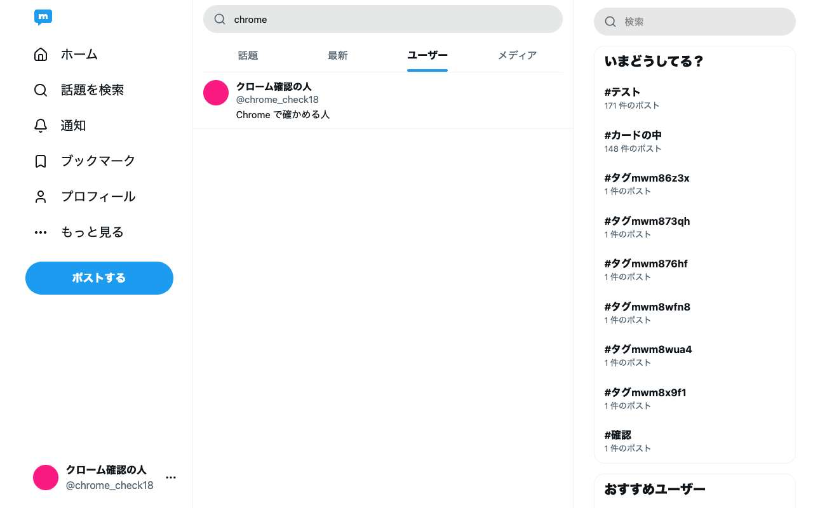
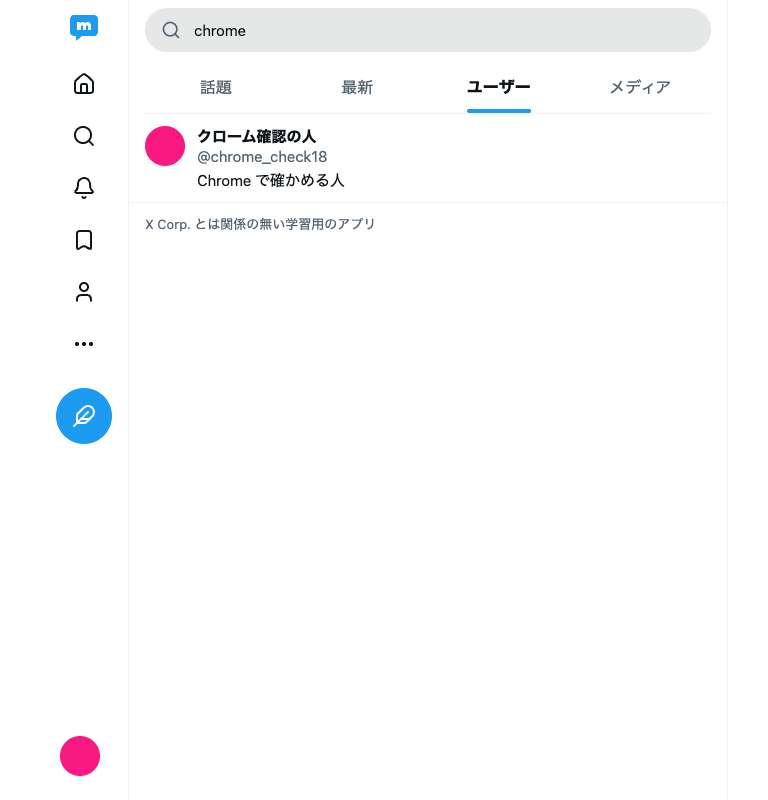
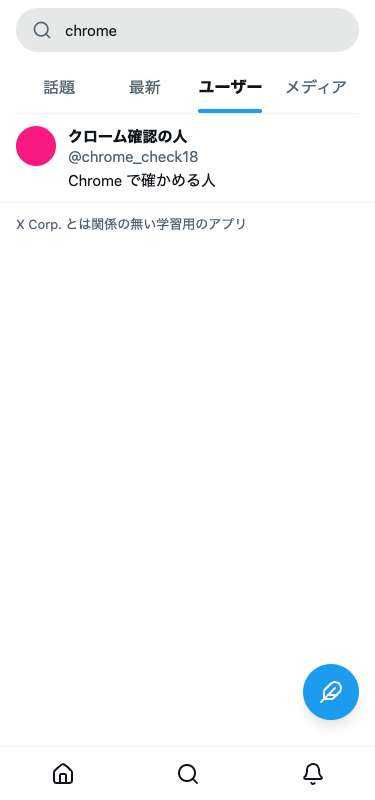

# 試験レポート: 本文・ユーザー・ハッシュタグで検索でき、トレンドとおすすめのユーザーが出る

## 対象

- issue: [#27](https://github.com/ohta-rh/x-modoki-v2/issues/27)
- commit: `53b0589`、`fd25b9a`、`d489fbd`（ブランチ `m1/local-app`、PR #40）
- CI: https://github.com/ohta-rh/x-modoki-v2/actions/runs/44332157567 （`d489fbd`。1 回目は WebKit の画像のビューアのテストの揺らぎで赤、再実行で緑。揺らぎは #56 で直した）
- 日付: 2026-11-19

## 環境

- macOS 26.2、Node.js 26.12.0（`.nvmrc` は 24。CI の実行を本当の結果とする）、Docker Compose の PostgreSQL 18（`pg_trgm`）、Playwright 1.65.0
- 動かし方: `pnpm build && pnpm start -p 3300`、Chrome の確認用のテストの人（`chrome_check18`）。手元の WebKit のため `caffeinate -d` でディスプレイを起こした

## 判定

合格 — 受け入れ条件 7 件のうち 7 件を満たした（トレンドとおすすめの「`'use cache'` で数分持つ」は ADR-0048 で「要求ごとに読む」に置き換えた）。

## 受け入れ条件ごとの結果

| # | 条件 | 確かめ方 | 結果 | エビデンス |
|---|---|---|---|---|
| 1 | 右サイドバーと `/explore` の検索の欄から `/search?q=…` へ。空の検索は進まない | Playwright（`/explore` から、右サイドバーから、空と空白だけ）、`search-box.test.tsx`、本物の Chrome | 合格 | `sidebar-search-1400.jpg` |
| 2 | 話題（いいねの多い順）・最新・ユーザー・メディア、20 件ずつ（日本語 3 文字以上・英語・大文字小文字） | `search-posts.test.ts`、`search-users.test.ts`、`search.test.ts`（Route Handler）、Playwright（タブ） | 合格 | `search-*.jpg`、`users-*.jpg` |
| 3 | `#` で始まる語はハッシュタグの完全一致。ハッシュタグのリンクは `/search?q=%23…` | `search-posts.test.ts` › # で始まる語は…、Playwright（リンクから検索へ） | 合格 | — |
| 4 | 本文とユーザーの検索が `gin_trgm_ops` の索引を使う | `search-posts.test.ts`・`search-users.test.ts` › …を使える（EXPLAIN、本物の条件で）。条件をずらすと `Seq Scan` で落ちることを確かめた | 合格 | — |
| 5 | トレンドは直近 24 時間の上位 10 件と数、おすすめはフォローしていない人をフォロワーの多い順に 3 人、フォローのボタンつき（要求ごとに読む: ADR-0048） | `get-trends.test.ts`、`get-suggestions.test.ts`（上位のほとんどをフォローしていても 3 人）、`trends.test.tsx`、`who-to-follow.test.tsx` | 合格 | `explore-*.jpg` |
| 6 | 1024px 以上で、右サイドバーに検索の欄・トレンド・おすすめのユーザー・フッター | Playwright（1100px）、`main-layout.test.tsx` | 合格 | `sidebar-search-1400.jpg` |
| 7 | `q` は 100 文字まで。`%` と `_` は文字 | `search.test.ts`、`load-search-page.test.ts`、`like-pattern.test.ts`、`search-posts.test.ts` | 合格 | — |

## 自動のテスト

`pnpm verify`（7 つの確認）が 0 で終わった。

```
 Test Files  147 passed (147)
      Tests  754 passed (754)
Branches     : 100% ( 1462/1462 )
  189 passed (1.3m)
VERIFY_RC=0
```

（文・関数・行も 100%。Playwright は Chromium・Firefox・WebKit で 63 本ずつ）

### TDD の記録

| # | 振る舞い | 先に書いたテスト | 赤（落ちた理由） | 緑にした実装 |
|---|---|---|---|---|
| 1 | 本文の語で検索するとその投稿が出る（受け入れのテスト） | `e2e/search.spec.ts` › 本文の語で検索すると… | 検索の欄が無く `locator.fill` が 30 秒で止まった | 下の 2〜12 のあと |
| 2 | 投稿の検索（話題・最新・メディア・英語・% と _・ハッシュタグ・20 件ずつ） | `search-posts.test.ts` | `expected [] to deeply equal [ 'りんごの話 2', … ]` ほか 5 本 | `entities/post/api/search-posts.ts`（話題のカーソルはいいねの数と ID） |
| 3 | いいね 0 件のカーソル | 同じ › 20 件ずつ… | `Error: BAD_CURSOR`（`parseId('0')` が null） | いいねの数を 0 以上の整数として読む |
| 4 | `%`・`_`・`\` を文字として扱う | `like-pattern.test.ts` | `expected '' to be '%猫%'` | `shared/lib/text/like-pattern.ts` |
| 5 | ユーザーの検索 | `search-users.test.ts` | `expected [] to deeply equal [ 'hanako_x', 'jiro_y' ]` | `entities/user/api/search-users.ts` |
| 6 | 索引を使う（EXPLAIN） | 同じ（初めは手で書いた SQL） | 索引を消したトランザクションで `Seq Scan`（テストは通っていたので、消して確かめた） | — |
| 7 | トレンド・おすすめ | `get-trends.test.ts`、`get-suggestions.test.ts` | `expected [] to have a length of 10`、`expected [] to deeply equal [ 'a_sg', … ]` | `entities/hashtag`、`get-suggestions.ts` |
| 8 | `GET /api/search` | `search.test.ts` | `SyntaxError: Unexpected end of JSON input`、`expected 500 to be 400` | `_app/api-routes/search.ts`、`features/search-box/model` |
| 9 | 検索の欄・トレンド・おすすめ・右サイドバー | 各部品のテスト、`main-layout.test.tsx` | `Unable to find … "searchbox" and name "検索"` ほか | `features/search-box`、`widgets/trends`・`who-to-follow`、`right-sidebar` の中身の口 |
| 10 | 右サイドバーの読み込み | `load-sidebar.test.ts`（実装を先に書いてしまったので、空を返す形にして赤を見た） | `expected [] to deeply equal [ { tag: '猫', count: 1 } ]` | `load-sidebar.ts` |
| 11 | ユーザーの結果・検索と探すの画面・読み込み | `user-results.test.tsx`、`search-page.test.tsx`、`explore-page.test.tsx`、`load-*.test.ts` | `Unable to find … "link" and name /名前 aa/`、`Error: todo` ほか | `widgets/search-results`、`_pages/search`・`explore`、ルート 2 つ |
| 12 | 同じ名前のパラメーターが並ぶ | `load-search-page.test.ts` | `TypeError: (q ?? "").trim is not a function` | 読み込みで最初の値を使う（ルートは値を渡すだけ） |
| 13 | 本物の条件で EXPLAIN・大きすぎるカーソル・おすすめを SQL で（レビュー 1） | 各テスト | 条件をずらすと `expected 'Seq Scan on posts …' to contain 'posts_text_trgm_idx'`、`value "9999999999" is out of range for type integer`、`expected [ 'top_19', 'top_18' ] to deeply equal [ …, 'low_0' ]` | `postTextMatch`・`userSearchMatch` を切り出した、範囲の確認、`notExists` |
| 14 | おすすめユーザーの画面のテスト（レビュー 1） | `e2e/search.spec.ts` › 1024px 以上で… | `WhoToFollow` を外したビルドで `element(s) not found` | 既にあった（確かめる行を足した） |
| 15 | 見出しの id が重ならない（レビュー 2） | `trends.test.tsx` › 2 つ並べても… | `expected 1 to be 2` | `useId()` |

- 変えたテスト: 準備中の画面のテストから /explore を外した（作ったので）

## コードレビュー

- 判定: APPROVE（2 回目）　範囲: `53b0589~1..fd25b9a`　レビューした sub agent: code-reviewer（opus）

| # | 回 | 重さ | 指摘 | 確かめた結果 | 対応 |
|---|---|---|---|---|---|
| 1 | 1（CHANGES_REQUESTED） | major | 右サイドバーの画面のテストがおすすめユーザーを確かめていない | その通り | 直した `fd25b9a` |
| 2 | 同じ | major | 索引の EXPLAIN のテストが手で書いた SQL で、本物の問い合わせの条件がずれても落ちない | その通り | 直した `fd25b9a`（条件を関数にし、その条件で EXPLAIN。ずらすと落ちることを確かめた） |
| 3 | 同じ | minor | ユーザーの検索のカーソルの数が大きすぎると 500 | 再現した（`value "9999999999" is out of range for type integer`） | 直した `fd25b9a` |
| 4 | 同じ | minor | 上位 20 人のほとんどをフォローしていると、おすすめが 3 人に足りない | 再現した（2 人） | 直した `fd25b9a`（SQL で除いて 3 人） |
| 5 | 2（APPROVE） | minor | `/explore` でトレンドの見出しの id が 2 つになる | その通り | 直した `d489fbd`（`useId`） |

## ブラウザでの確認

| URL | 幅 | テーマ | した操作 | 見えた結果 | 画面の写真 |
|---|---|---|---|---|---|
| `/home?tab=following` | 1400 | ライト | 右サイドバーの検索の欄で、空のまま Enter（失敗の経路）、「Chrome」で Enter | 空では進まない。`/search?q=Chrome` の話題のタブに 12 件（`@chrome_check18` の投稿も、大文字小文字を区別しない） | `sidebar-search-1400.jpg` |
| `/explore` | 1280 / 768 / 375 | ライト | 開いた | 検索の欄とトレンド | `explore-*.jpg` |
| `/search?q=Chrome` | 1280 / 768 / 375 | ライト | 開いた | 話題のタブ | `search-*.jpg` |
| `/search?q=chrome&f=user` | 1280 / 768 / 375 | ライト | 開いた | ユーザーのタブに自分（`@chrome_check18`）が 1 人。自分の行にはフォローのボタンが出ない | `users-*.jpg` |

- コンソール: エラー 0、警告 0　通信: 失敗 0（`chrome-evidence.mjs` の 9 回の読み込み）












## 見つけた問題

1. **`'use cache'` で Chromium のページが通信の途切れた状態にならない**（`app-shell.spec.ts` › /home を開くと… が Chromium だけで毎回 30 秒で止まった）。初めの 4 つの仮説（トレンドのリンクの先読み、`next/form` の先読み、本文のハッシュタグのリンクの先読み、おすすめのユーザー）は 1 つずつ外しても直らず、ルールのとおりやり方を変えて組み合わせで切り分けた。`'use cache'` の読み取りをレイアウトと `/explore` の両方で使うと起き、要求ごとに読むと起きない。Next.js の中で何が通信を続けるかは確かめていない。トレンドとおすすめのユーザーを要求ごとに読むことにし、ADR-0048 で ADR-0010 の該当の部分を置き換えた。issue の本文の受け入れ条件も直した
2. 切り分けの途中で試した変更（トレンドのリンクの `prefetch={false}`、検索の欄の `prefetch={false}`、本文のリンクの `prefetch={false}`）は、原因でなかったのでどれも戻した
3. **私の誤り:** `loadSidebar` をテストより先に書いた。テストを書いてから、空を返す形にして赤を見た
4. **CI の 1 回目が赤:** WebKit の画像のビューアのテスト（#25 のもの）がたまたま落ちた。#27 の前のコミットでも落ちる揺らぎで、バグの PBI #56 を立てて直した（[#56 の試験レポート](issue-0056-photo-viewer-test-scroll.md)）
