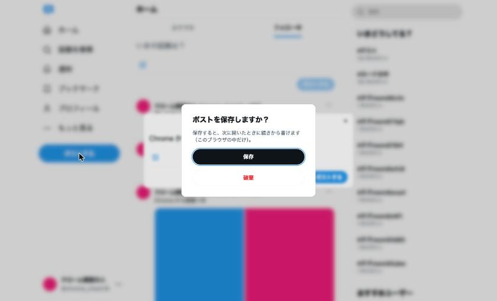
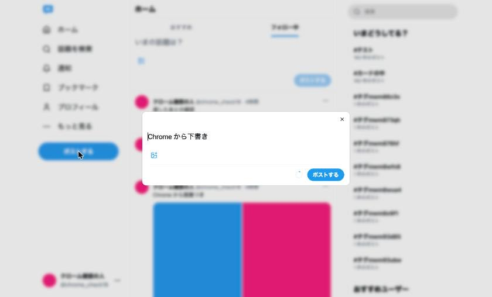
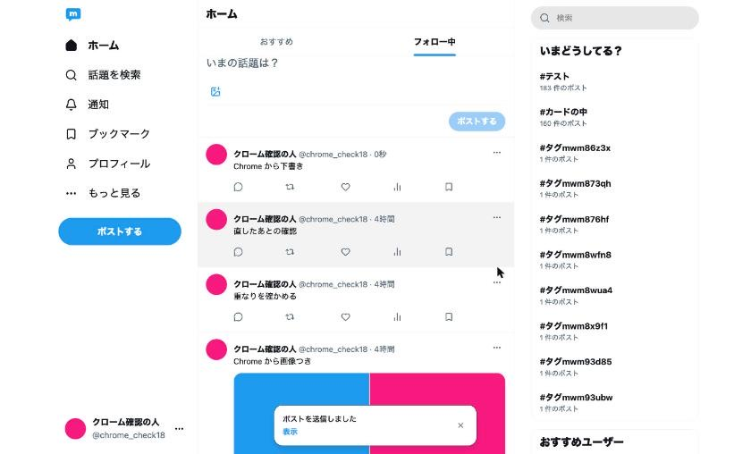
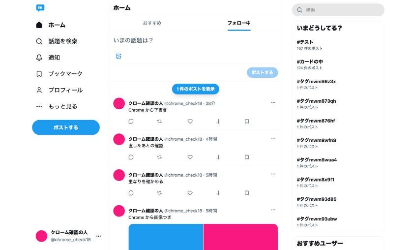
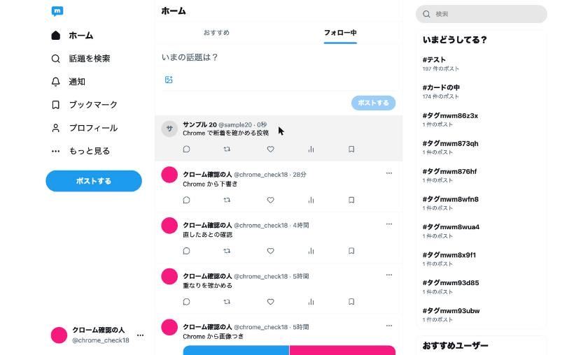
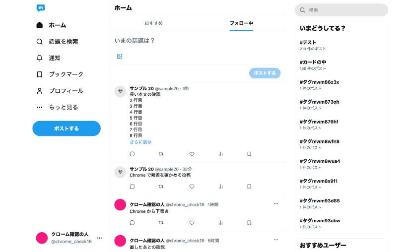
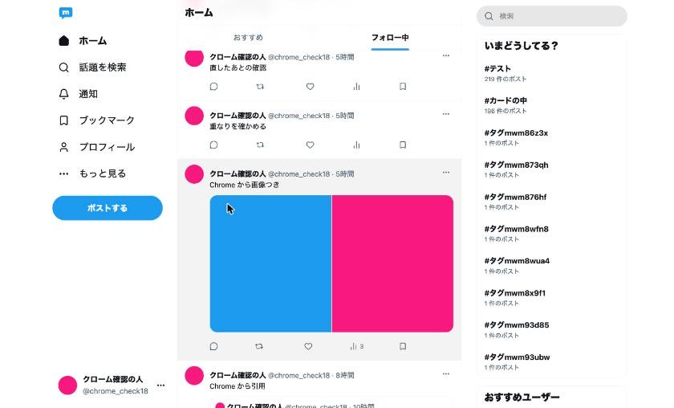
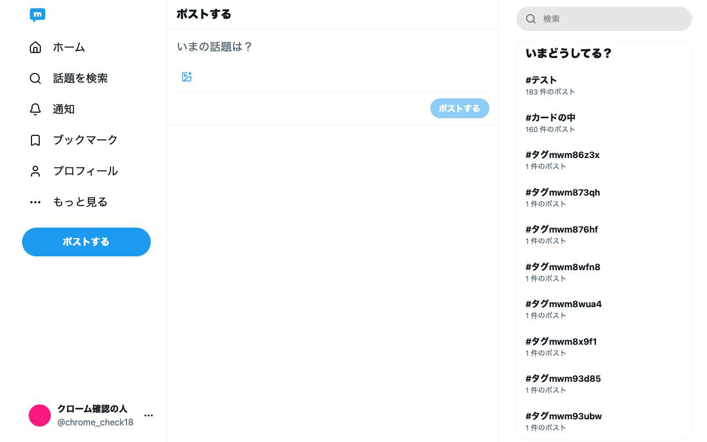
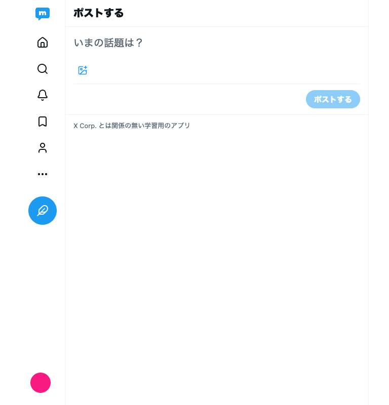
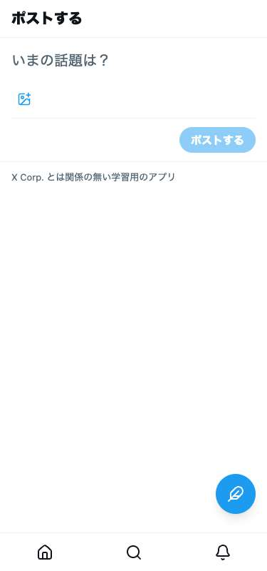

# 試験レポート: 入力欄がモーダルで開き、下書きが残り、新しい投稿が「N 件のポストを表示」で知らされる

## 対象

- issue: [#28](https://github.com/ohta-rh/x-modoki-v2/issues/28)
- commit:
  - 1 つめ（モーダル・下書き・トースト）: `80f9342`、`7c0350d`
  - 2 つめ（新しい投稿の知らせ・引っ張って更新）: `15fe72f`、`93b282e`、`001ef99`、`3c76758`、`1a4bf1e`
  - 3 つめ（戻ったときの位置・さらに表示）: `6c382f4`
  - ブランチ `m1/local-app`、PR #40
- CI: https://github.com/ohta-rh/x-modoki-v2/actions/runs/44357485549 （`43e914c`、#28 の全部の commit を含む。緑）
- 日付: 2026-11-19

## 環境

- macOS 26.2、Node.js 26.12.0（`.nvmrc` は 24。CI の実行を本当の結果とする）、Docker Compose の PostgreSQL 18、Playwright 1.65.0
- 動かし方: `pnpm build && pnpm start -p 3300`、Chrome の確認用のテストの人（`chrome_check18`）。新しい投稿の確認には、フォローした `sample20` の投稿をデータベースに足した（ローカルの試験用のデータ）

## 判定

合格 — 受け入れ条件 7 件のうち 7 件を満たした。

## 受け入れ条件ごとの結果

| # | 条件 | 確かめ方 | 結果 | エビデンス |
|---|---|---|---|---|
| 1 | 投稿ボタン（左ナビ・右下）で `/compose/post` がモーダルで開く。直接開くとページ。フォーカスは中に閉じ、閉じると元の要素へ戻る | `e2e/composer-modal.spec.ts`（3 本）、`composer.test.tsx` › フォーカスの戻し先、本物の Chrome | 合格 | `compose-*.jpg` |
| 2 | 中身があるときに閉じると「破棄 / 保存」を聞く。保存した下書きは次に開いたときに戻る（その端末の中だけ） | `e2e/composer-modal.spec.ts`、`composer.test.tsx`、`draft.test.ts`、本物の Chrome | 合格 | `ask-save-1400.jpg`、`draft-restored-1400.jpg` |
| 3 | 送ったあと、下の中央に「ポストを送信しました」と「表示」 | `e2e/composer-modal.spec.ts`（中央にあることも）、本物の Chrome | 合格 | `posted-toast-1400.jpg` |
| 4 | フォロー中で、ほかの人の新しい投稿は 30 秒以内に「N 件のポストを表示」。押すまで一覧は動かない。押すと先頭に足され上へ。タブが見えていない間は確かめない | `e2e/timeline-new-posts.spec.ts`（時計を進める。一覧の位置が変わらないことも）、`new-posts-button.test.tsx`、`timeline-feed.test.tsx`、`count-new-posts.test.ts`、`timeline.test.ts`（Route Handler）、本物の Chrome | 合格 | `new-posts-pill-1400.jpg`、`new-posts-shown-1400.jpg` |
| 5 | 一覧から詳細へ進んで戻ると、スクロールの位置と読み込んだ続きが元のまま | `e2e/timeline-restore.spec.ts`、本物の Chrome（700px → 詳細 → 戻る → 700px） | 合格 | `back-restored-1400.jpg` |
| 6 | 640px 未満で、一覧を引っ張ると新しい投稿を読み込む | `e2e/timeline-new-posts.spec.ts` › 640px 未満（タッチの操作）、`pull-to-refresh.test.tsx` | 合格 | — |
| 7 | 長い本文は一覧では切り詰めて「さらに表示」 | `post-card.test.tsx`、`truncate-lines.test.ts`、本物の Chrome | 合格 | `show-more-1400.jpg` |

## 自動のテスト

`pnpm verify`（7 つの確認）が 0 で終わった（`6c382f4` のとき）。

```
 Test Files  155 passed (155)
      Tests  796 passed (796)
Branches     : 100% ( 1525/1525 )
  219 passed (1.2m)
VERIFY_RC=0
```

### TDD の記録

| # | 振る舞い | 先に書いたテスト | 赤（落ちた理由） | 緑にした実装 |
|---|---|---|---|---|
| 1 | モーダル・ページ・下書き・トースト（受け入れのテスト） | `e2e/composer-modal.spec.ts`（5 本） | 5 本とも `getByRole('dialog', { name: 'ポストする' })…` が `element(s) not found` | 下の 2〜8 のあと |
| 2 | 下書きの読み書き（使えない localStorage でも投げない） | `draft.test.ts` | `TypeError: readDraft is not a function` | `features/post-compose/lib/draft.ts` |
| 3 | action が新しい投稿の ID を返す | `actions.test.ts` | `- "id": "116566014354736262"`（ID が無い） | `createPostAction` ほか |
| 4 | 入力欄が下書きを入れて開き、変化を知らせ、ID を渡す | `compose-box.test.tsx` | `expect(element).toHaveValue(書きかけ)` | `ComposeBox` の `initialText`・`onTextChange`・`onPosted(id)` |
| 5 | モーダルの保存・破棄・送信・トースト | `composer.test.tsx`（5 本） | `Unable to find role="dialog" and name "ポストする"` ほか | `widgets/composer-modal` |
| 6 | 読み込み・モーダルとページ | `load-compose.test.ts`、`compose-page.test.tsx` | `Error: todo`、`Unable to find role="dialog"` | `_pages/compose`、ルート 2 つ |
| 7 | 確認で Esc を押すと書きかけのまま残る | `composer.test.tsx` | 確認の閉じ方を壊したビルドで `expected "vi.fn()" to not be called at all` | `onOpenChangeComplete` |
| 8 | Next.js が取っておいた画面を開き直すと、下書きを読み直す／フォーカスを戻す | `compose-page.test.tsx`（`Activity`）、`composer.test.tsx` | `expect(element).toHaveValue(新しい下書き)`、`expect(element).toHaveFocus()` | `useSyncExternalStore` と下書きを key にする、フォーカスを戻す |
| 9 | サーバーでは入力欄を出さない | `composer.test.tsx` | `getServerSnapshot` を `''` にしたビルドで `not to contain '<textarea'` | `useSyncExternalStore(…, () => null)` |
| 10 | 送っている間は閉じない・画像だけなら破棄だけ・ほかのタブの変更で消さない（レビュー 1） | `composer.test.tsx`、`draft.test.ts` | `expected <div data-open …> to be null`、`Unable to find role="alertdialog" and name "ポストを破棄しますか？"`、`expected … to be called 2 times, but got 3 times` | `sending` の ref、確認の出し分け、`storage` を聞かない |
| 11 | 新しい投稿の知らせ・引っ張って更新（受け入れのテスト） | `e2e/timeline-new-posts.spec.ts` | `getByRole('button', { name: '2 件のポストを表示' })` が見つからない、引っ張っても `article` が無い | 下の 12〜16 のあと |
| 12 | 先頭より新しい、フォローしている人の投稿の数 | `count-new-posts.test.ts`、`timeline.test.ts` | `expected null to deeply equal { ok: true, count: 2 }`、`expected 200 to be 400` | `countNewPosts`、`GET /api/timeline/following/new-count` |
| 13 | 30 秒ごとに聞く・見えない間は聞かない・空なら聞かない | `new-posts-button.test.tsx` | 未実装で `Unable to find … "2 件のポストを表示"`。見えない間・空のときは、規則を外したビルドで `expected 4 to be 1` | `NewPostsButton` |
| 14 | 引っ張って更新（640px 未満、上から 80px） | `pull-to-refresh.test.tsx` | `expected "vi.fn()" to be called 1 times, but got 0 times` | `PullToRefresh` |
| 15 | 先頭の行そのものの ID から数える・空の一覧でも聞く（レビュー 1） | `get-timeline.test.ts`、`timeline-feed.test.tsx` | `expected undefined to be '116327259832320000'`、`expected "vi.fn()" to be called with … since=9` | `PostPage.newestId` |
| 16 | タブに戻っても読み直さない・押したら消える（レビュー 2）／一覧の上に浮かぶ（レビュー 3）／途中で取り消された引っ張り・ブラウザの引っ張り更新（分けたレビュー） | `timeline-feed.test.tsx`、`new-posts-button.test.tsx`、`e2e`、`pull-to-refresh.test.tsx` | `expected "vi.fn()" to not be called with '/api/timeline/following?cursor='`、`expected <button> to be null`、`Expected: 281 Received: 325`、`Expected: "contain" Received: "auto"` | `refetchOnWindowFocus: false`、`setQueriesData`、`h-0`、`onTouchCancel`、`overscroll-behavior-y` |
| 17 | 戻ったときの位置と続き | `e2e/timeline-restore.spec.ts` | 一覧を開くたびに上へ戻すビルドで `toBeVisible` が落ちた（アプリのコードは変えずに満たしていた） | 変更なし（Next.js が画面を取っておく） |
| 18 | 9 行以上を 8 行に切り詰めて「さらに表示」 | `truncate-lines.test.ts`、`post-card.test.tsx` | `expected { …(2) } to deeply equal { …(2) }`、`not.toHaveTextContent()` | `truncateLines`、`PostCard` |

## コードレビュー

- 判定: 3 つとも APPROVE　レビューした sub agent: code-reviewer（opus）
  - 1 つめ: APPROVE（1 回目）　範囲: `80f9342~1..80f9342`
  - 2 つめ: 3 回 CHANGES_REQUESTED のあと、ルールのとおり受け入れ条件ごとに分けて、知らせ・引っ張って更新ともに APPROVE　範囲: `15fe72f~1..3c76758`（ファイルで分けた）
  - 3 つめ: APPROVE（1 回目）　範囲: `6c382f4~1..6c382f4`

| # | 回 | 重さ | 指摘 | 確かめた結果 | 対応 |
|---|---|---|---|---|---|
| 1 | 1 つめ（APPROVE） | minor | 送っている途中に答えると 2 回戻る | その通り | 直した `7c0350d` |
| 2 | 同じ | minor | 画像だけでも保存を出すが本文しか残らない | その通り | 直した `7c0350d`（破棄だけを聞く。UI/UX 仕様に書いた） |
| 3 | 同じ | minor | ほかのタブの変更で書きかけが消える | その通り | 直した `7c0350d` |
| 4 | 2 つめ 1 回目 | blocker | 先頭がリポストだと元の投稿の ID から数え、画面にある投稿を数えて知らせが消えない | その通り | 直した `93b282e`（`newestId`） |
| 5 | 同じ | minor | 空の一覧では知らせが出ない | その通り | 直した `93b282e` |
| 6 | 2 つめ 2 回目 | major | タブに戻る・つながり直すと一覧が勝手に動く | その通り | 直した `001ef99` |
| 7 | 同じ | minor | 押したあと古い数が一瞬出る | その通り | 直した `001ef99` |
| 8 | 2 つめ 3 回目 | major | 知らせの箱が高さを取り、一覧が 44px 動く | その通り（281 → 325） | 直した `3c76758` |
| 9 | 引っ張って更新（分けたレビュー） | minor | `touchcancel` で印が残る・ブラウザの引っ張り更新で全部読み直す | その通り | 直した `1a4bf1e` |

## ブラウザでの確認

| URL | 幅 | テーマ | した操作 | 見えた結果 | 画面の写真 |
|---|---|---|---|---|---|
| `/home?tab=following` | 1400 | ライト | 左ナビの投稿ボタンで開き、書いて Esc | 「ポストを保存しますか？」 | `ask-save-1400.jpg` |
| 同じ | 1400 | ライト | 保存 → 開き直す | 下書きが戻った。閉じたあとフォーカスは投稿ボタン | `draft-restored-1400.jpg` |
| 同じ | 1400 | ライト | 送った | 下の中央に「ポストを送信しました」と「表示」。先頭に出た | `posted-toast-1400.jpg` |
| 同じ | 1400 | ライト | フォローした人の投稿を足して 35 秒待った | 「1 件のポストを表示」。一覧は動かない | `new-posts-pill-1400.jpg` |
| 同じ | 1400 | ライト | 押した | 先頭に足され、上へ戻った。ボタンは消えた | `new-posts-shown-1400.jpg` |
| 同じ | 1400 | ライト | 10 行の投稿 | 8 行と「さらに表示」。押すと詳細で 10 行全部 | `show-more-1400.jpg` |
| 同じ | 1400 | ライト | 700px まで送って詳細へ進み、戻る | 700px のまま | `back-restored-1400.jpg` |
| `/compose/post`（直接） | 1280 / 768 / 375 | ライト | 開いた | 「ポストする」の見出しと入力欄。横にはみ出さない | `compose-*.jpg` |

- コンソール: エラー 0、警告 0　通信: 失敗 0












## 見つけた問題

1. **Next.js が画面を取っておく（React Activity）:** 開き直したモーダルが前の状態のままで、破棄した下書きが残った。下書きを `useSyncExternalStore` で読み、下書きを key にして入力欄を作り直した。ほかのテストでも、取っておかれた画面の要素（相手のプロフィールの空の一覧）に当たったので、見えている要素に絞った
2. **閉じるボタンの名前が英語:** バグの PBI [#57](https://github.com/ohta-rh/x-modoki-v2/issues/57) で直した（[試験レポート](issue-0057-close-labels.md)）
3. **右サイドバーの下に届かない:** バグの PBI [#58](https://github.com/ohta-rh/x-modoki-v2/issues/58) で直した（[試験レポート](issue-0058-right-sidebar-scroll.md)）
4. **ホイールのスクロールで揺れるテスト:** 戻ったときの位置のテストが、重いときにホイールのスクロールがあとから続いて古い位置を覚えた（#56 と同じ種類）。2 回目なので仕組みにした: `e2e/` で `mouse.wheel` を ESLint で禁じた（ADR-0049、`4ed34e1`）
5. **要求が返らない（#55）:** 手元の `pnpm verify` で、WebKit の登録の要求が 1 回返らなかった。証拠を #55 に足した（根本原因はまだ言えない）
6. **私の誤り:** `6c382f4` に、まだコミットしていない試験レポートへのリンクを含む `docs/log.md` を入れ、その CI の文書の確認が落ちた。`43e914c` でレポートを入れて直した。確認のあとに自分のサーバーを止め忘れ、`pnpm verify` が 3300 番でぶつかったことも 1 回あった
7. **作らなかったもの:** UI/UX 仕様の `n` キーでモーダルを開くことは、#28 の受け入れ条件に無いので作っていない
