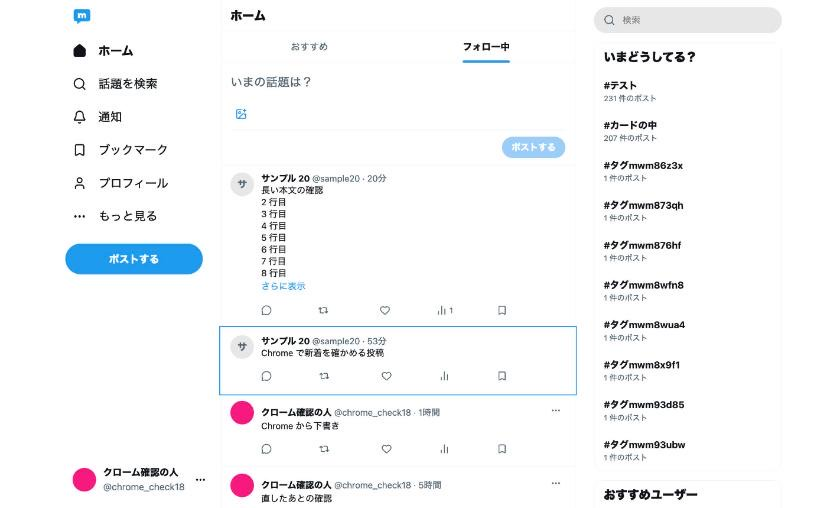
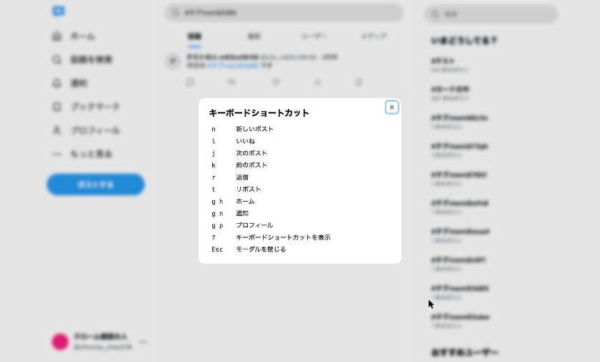
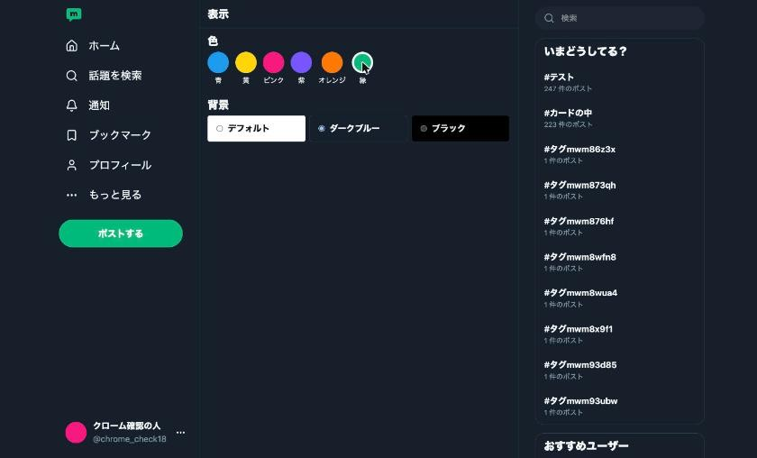
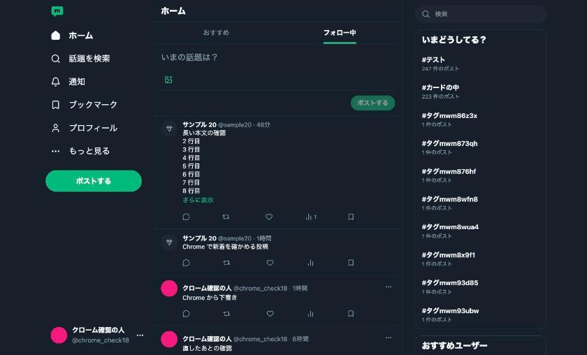
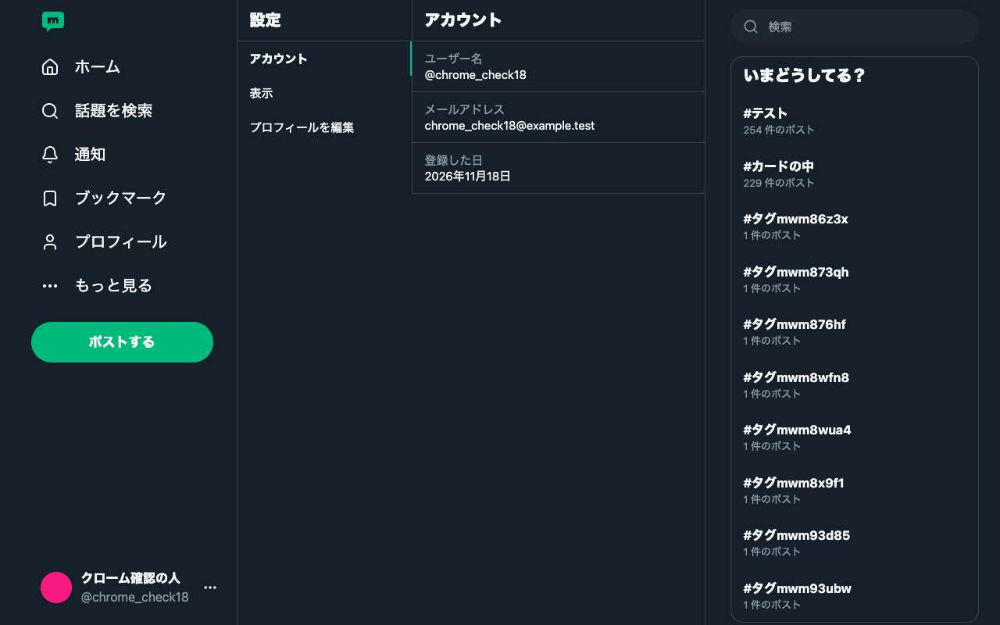
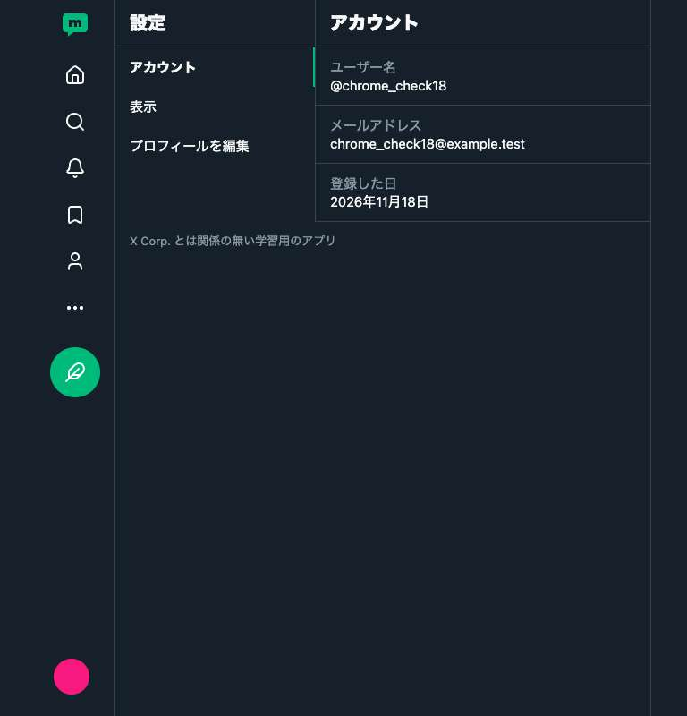
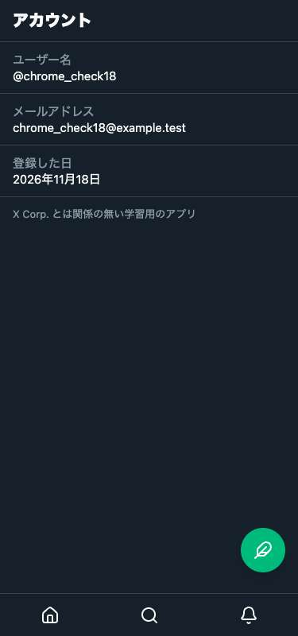
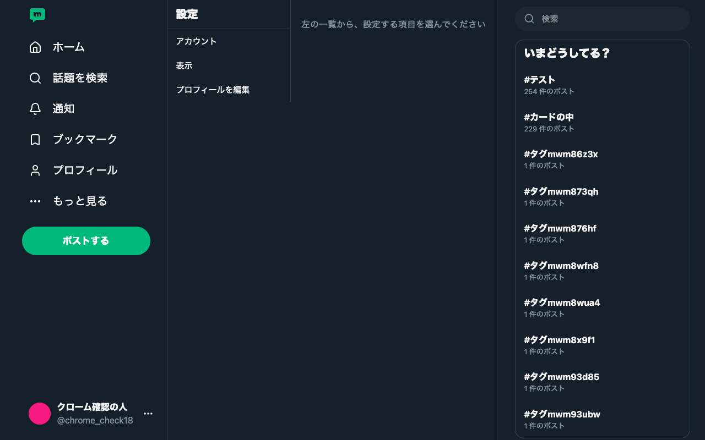
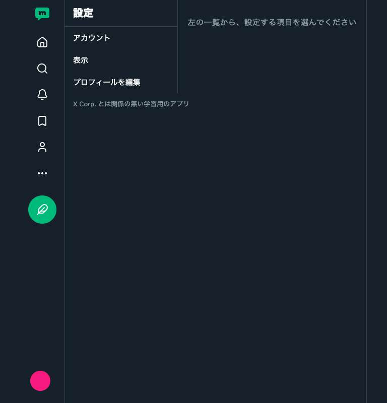
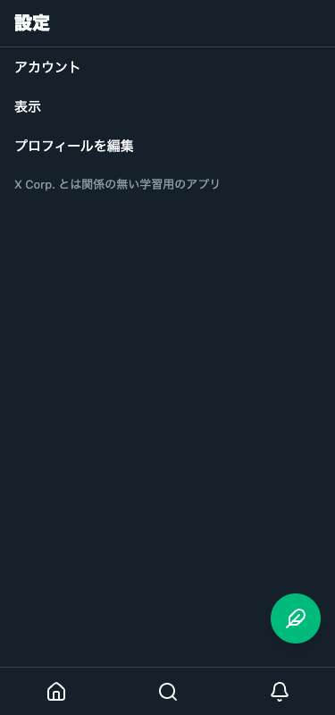

# 試験レポート: キーボードで操作でき、設定でテーマとアクセントの色を変えられる

## 対象

- issue: [#29](https://github.com/ohta-rh/x-modoki-v2/issues/29)
- commit:
  - 1 つめ（キー）: `8ef3ec8`、`8589823`、`ca5c93f`、`0c782a2`
  - 2 つめ（表示）: `2cada67`、`a1f607d`、`6682ad5`
  - 3 つめ（設定の 2 ペイン・アカウント・ボタンの名前）: `56bace8`
  - ブランチ `m1/local-app`、PR #40
- CI: https://github.com/ohta-rh/x-modoki-v2/actions/runs/44368342233 （`56bace8`、#29 の全部の commit を含む。緑）
- 日付: 2026-11-19

## 環境

- macOS 26.2、Node.js 26.12.0（`.nvmrc` は 24。CI の実行を本当の結果とする）、Docker Compose の PostgreSQL 18、Playwright 1.65.0
- 動かし方: `pnpm build && pnpm start -p 3300`、Chrome の確認用のテストの人（`chrome_check18`）。手元の画面のテストは、画面が眠らないよう `caffeinate -u` を 25 秒ごとに付けて流した

## 判定

合格 — 受け入れ条件 6 件のうち 6 件を満たした（テーマの付け方は ADR-0051 で実装方針を置き換えた）。

## 受け入れ条件ごとの結果

| # | 条件 | 確かめ方 | 結果 | エビデンス |
|---|---|---|---|---|
| 1 | ui-ux.md の 10 節のキー（`n`・`l`・`j` / `k`・`r`・`t`・`g` のあと `h` / `n` / `p`・`?`・`Esc`）。入力欄の中では動かない | `e2e/keyboard-settings.spec.ts`（キーごと）、`keyboard-shortcuts.test.ts`（振り分ける関数）、`keyboard-shortcuts.test.tsx` | 合格 | `shortcuts-help-1400.jpg` |
| 2 | `j` / `k` で選んだ投稿にフォーカスの輪、画面の中へ | `e2e`（下へも、上の見出しの下からも出る）、本物の Chrome | 合格 | `j-selects-1400.jpg` |
| 3 | `?` でキーの一覧 | `e2e`、単体のテスト、本物の Chrome | 合格 | `shortcuts-help-1400.jpg` |
| 4 | `/settings/display` で 3 つのテーマと 6 つの色。すぐ変わり、`users` に残り、次も同じ。最初の描画でちらつかない | `e2e`（読み直したときに `dim` 以外が一度も見えない）、`actions.test.ts`、`display.test.ts`、`display-settings.test.tsx`、`display-sync.test.tsx`、本物の Chrome | 合格 | `display-dim-green-1400.jpg`、`home-dim-green-1400.jpg` |
| 5 | `/settings` は 2 ペイン（640px 未満は 1 ペインずつ）。`/settings/account` にユーザー名・メールアドレス・登録した日 | `e2e`（1280px と 375px）、`settings-layout.test.tsx`、`load-account.test.ts`、`account-page.test.tsx` | 合格 | `account-*.jpg`、`settings-*.jpg` |
| 6 | アイコンだけのボタンの全部に名前 | `accessible-names.test.tsx`（外枠・ナビ・投稿の欄・タイムラインの操作・投稿のモーダルで、名前の無いボタン 0 個） | 合格 | — |

## 自動のテスト

`pnpm verify`（7 つの確認）が 0 で終わった（`56bace8` のとき）。

```
 Test Files  169 passed (169)
      Tests  839 passed (839)
Branches     : 100% ( 1617/1617 )
  240 passed (1.2m)
VERIFY_RC=0
```

### TDD の記録

| # | 振る舞い | 先に書いたテスト | 赤（落ちた理由） | 緑にした実装 |
|---|---|---|---|---|
| 1 | キーの受け入れのテスト | `e2e/keyboard-settings.spec.ts`（5 本） | `toBeFocused() failed`、`Received string: ""`、`aria-pressed "false"` ほか | 下の 2〜4 のあと |
| 2 | キーを振り分ける（`g` のあとを待つ、Ctrl などは無視） | `keyboard-shortcuts.test.ts` | `expected null to deeply equal { action: 'compose', … }` | `shared/config/keyboard-shortcuts.ts`（1 つの表） |
| 3 | 画面全体のキー（選ぶ・押す・移る・一覧） | `keyboard-shortcuts.test.tsx` | `expected last "vi.fn()" call to have been called with [ '/compose/post' ]` ほか | `widgets/keyboard-shortcuts` |
| 4 | 返信の欄があとから出ても待ち、出なければあきらめる | 同じ | あきらめる条件を外したビルドで `expect(element).not.toHaveFocus()` | `requestAnimationFrame` で待つ |
| 5 | ログインしている画面だけに置く | `main-layout.test.tsx` | `Unable to find role="dialog" and name "キーボードショートカット"` | `MainLayout` |
| 6 | 引用のカードを選ばない／詳細の本体で `r`（レビュー 1） | `keyboard-shortcuts.test.tsx` | `expected '引用した投稿' to contain '投稿 B'`、`toHaveFocus()` | 一番外の article だけ、`data-post="main"` |
| 7 | 上の見出しの下に隠さない（レビュー 2） | `e2e` | `Expected: true Received: false` | `main article { scroll-margin-top: 120px }` |
| 8 | ダイアログの間は動かない・開く投稿のときだけ返信を待つ（レビュー 3） | `keyboard-shortcuts.test.tsx` | `expected "vi.fn()" to not be called at all, but actually been called 2 times`、`not.toHaveFocus()` | `checkVisibility` で見える dialog を確かめる、`data-post="card"` |
| 9 | テーマと色の値・head のスクリプト | `display.test.ts` | `expected [] to deeply equal [ 'light', 'dim', 'dark' ]`、`expected undefined to be 'dim'` | `shared/config/display.ts` |
| 10 | 保存の Server Action（`users` と cookie） | `actions.test.ts` | `expected null to deeply equal { ok: true }` | `features/display-settings/api` |
| 11 | 選ぶ画面・読み込み・ページ | `display-settings.test.tsx`、`load-display.test.ts`、`display-page.test.tsx` | `Unable to find … radio "デフォルト"`、`Error: todo` | `DisplaySettings`、`loadDisplay`、`DisplayPage` |
| 12 | 最初の描画から（受け入れのテスト）・head に置く | `e2e`、`display-script.test.tsx` | `Expected: "#f91880" Received: "#1d9bf0"`、`expected '' to be '<script>…'` | `[data-accent]` の CSS、`DisplayScript` |
| 13 | 描画前の選択・通信の失敗・アカウントとのずれ（レビュー 1） | `display-settings.test.tsx`、`display-sync.test.tsx`、`load-viewer.test.ts` | `expected "vi.fn()" to be called with …`、`expected 'dark' to be 'light'`、`expected 'light' to be 'dim'`、`{…(3)} to deeply equal {…(5)}` | 取り込み、失敗を保存できないと同じに、`DisplaySync` |
| 14 | 表示の画面では戻さない・前の失敗で後を消さない（レビュー 2） | 同じ | `expected 'blue' to be 'pink'`、`expected 'light' to be 'dim'` | パスで外す、いちばん新しい選択だけを戻す |
| 15 | 2 ペインとアカウント（受け入れのテスト） | `e2e` | `getByRole('navigation', { name: '設定' })…` が見つからない | 下の 16 のあと |
| 16 | 日付・レイアウト・読み込み・画面 | `format.test.ts`、`settings-layout.test.tsx`、`load-account.test.ts`、`account-page.test.tsx`、`settings-home.test.tsx` | `calendarDate is not a function`、`Unable to find … navigation "設定"`、`Error: todo` ほか | `calendarDate`、`SettingsLayout`、`loadAccount`、`AccountPage`、`SettingsHome` |
| 17 | 名前の無いボタンが 0 個 | `accessible-names.test.tsx` | 最初から 0 個だったので、アイコンだけの「もっと見る」の `aria-label` を外したビルドで `expected [ Array(1) ] to deeply equal []` | 変更なし（いまの部品は全部名前がある） |

## コードレビュー

- 判定: 3 つとも APPROVE　レビューした sub agent: code-reviewer（opus）
  - 1 つめ: 3 回目で APPROVE（`8ef3ec8`〜`ca5c93f`）。minor 2 つを `0c782a2` で直した
  - 2 つめ: 2 回目で APPROVE（`2cada67`〜`a1f607d`）。minor 2 つを `6682ad5` で直した
  - 3 つめ: 1 回目で APPROVE（`56bace8`）

| # | 回 | 重さ | 指摘 | 確かめた結果 | 対応 |
|---|---|---|---|---|---|
| 1 | キー 1 回目 | major | 引用のカード（入れ子の article）で `j` / `k` が止まる | その通り | 直した `8589823` |
| 2 | 同じ | major | 詳細の本体で `r` が何もせず、印が残る | その通り | 直した `8589823` |
| 3 | キー 2 回目 | major | `k` で上の見出しの下に隠れる | その通り | 直した `ca5c93f` |
| 4 | キー 3 回目 | minor | ダイアログが開いていてもキーが動く | その通り | 直した `0c782a2` |
| 5 | 同じ | minor | 開かない article（通知の行）で `r` の印が残る | その通り | 直した `0c782a2` |
| 6 | 表示 1 回目 | major | 描画前に選んだラジオを取り込まない（ADR-0044） | その通り（レビュアーの再現の通り） | 直した `a1f607d` |
| 7 | 同じ | major | cookie だけで決まり、アカウントの値とずれる | その通り | 直した `a1f607d`（`DisplaySync`） |
| 8 | 同じ | minor | 保存の通信の失敗で戻らない | その通り | 直した `a1f607d` |
| 9 | 表示 2 回目 | minor | 表示の画面で、保存前の新しい選択を `DisplaySync` が戻す | その通り | 直した `6682ad5` |
| 10 | 同じ | minor | 前の保存の失敗が、後の選択を戻す | その通り | 直した `6682ad5` |

## ブラウザでの確認

| URL | 幅 | テーマ | した操作 | 見えた結果 | 画面の写真 |
|---|---|---|---|---|---|
| `/home?tab=following` | 1400 | ライト | フォーカスを外して `j` を 2 回 | 2 つめの投稿に青い輪 | `j-selects-1400.jpg` |
| 同じ | 1400 | ライト | `?` | キーの一覧（11 行） | `shortcuts-help-1400.jpg` |
| `/settings/display` | 1400 | ダークブルー・緑 | ダークブルーと緑を選んだ | その場で変わった | `display-dim-green-1400.jpg` |
| `/home?tab=following` | 1400 | 同じ | 開き直した | 最初からダークブルーと緑 | `home-dim-green-1400.jpg` |
| `/settings/account` | 1280 / 768 / 375 | 同じ | 開いた | 1280 で一覧とアカウントの 2 ペイン。375 は中身だけ | `account-*.jpg` |
| `/settings` | 1280 / 768 / 375 | 同じ | 開いた | 375 は一覧だけ | `settings-*.jpg` |

- コンソール: エラー 0、警告 0　通信: 失敗 0












## 見つけた問題

1. **ルートのレイアウトで cookie を読めない:** 試すと、Cache Components の prerender が全部のページで止まった。head のスクリプトで付けることにし、ADR-0051 を書いて issue の実装方針を直した
2. **データベースの接続の上限（#59）:** #55 を調べていて見つけ、バグの PBI で直した（ADR-0050、[試験レポート](issue-0059-db-connections.md)）
3. **要求が返らない（#55）:** 手元の `pnpm verify` で 3 回目を記録し、証拠と仮説を #55 に足した（まだ調べている）
4. **画面が眠ると手元の画面のテストが落ちる:** `CVDisplayLinkCreateWithCGDisplay failed` のとき、`caffeinate -u` を 25 秒ごとに付けて流した
5. **私の誤り:** ADR の番号の順を逆にしかけ、入れ替えた。stash を戻すときに `docs/log.md` と ADR の一覧がぶつかり、両方の行を残して解いた（作業は失っていない）
6. **作らなかったもの:** `/settings/display` の「文字の大きさ」は受け入れ条件に無いので作っていない。`ComingSoonPage` は `/settings` で使わなくなったが、ほかの項目で使う見込みがあるので残した
