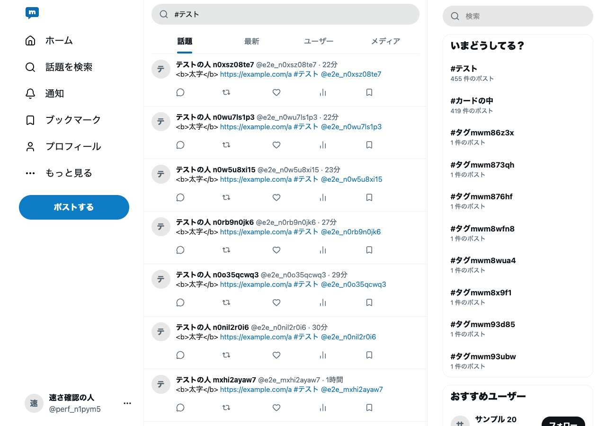

# 試験レポート: 主な画面が、速さの予算を満たしている

## 対象

- issue: [#32](https://github.com/ohta-rh/x-modoki-v2/issues/32)
- commit: `ffb6c62`・`81679bb`・`e7cb7c5`・`1e10f09`・`c1119f9`・`e6f8134`・`e0c6980`（ブランチ `m1/local-app`、PR #40）
- CI: https://github.com/ohta-rh/x-modoki-v2/actions/runs/44463856061 （`e0c6980`。7 つの commit を含む。緑。`e6f8134` の実行 44462798903 は赤で、見つけた問題の 6 で直した）
- 日付: 2026-11-19

## 環境

- macOS 26.2、Google Chrome（Claude in Chrome）と Playwright 1.65.0 の Chromium、Node.js 26.12.0（`.nvmrc` は 24。CI の実行を本当の結果とする）
- OrbStack の Docker Compose の PostgreSQL 18 と Garage、`pnpm build && pnpm start -p 3300`
- Lighthouse 13.6.0（モバイルの設定、回線と CPU の条件を実際にかける。[ADR-0058](../adr/0058-measure-speed-with-applied-throttling.md)）

## 判定

合格 — 受け入れ条件 5 件のうち 5 件を満たした。

## 受け入れ条件ごとの結果

| # | 条件 | 確かめ方 | 結果 | エビデンス |
|---|---|---|---|---|
| 1 | 5 つの画面が LCP 2.5 秒・CLS 0.1・TBT 200ms 以下 | `node scripts/perf.mjs`（3 回の中央の値） | 合格。LCP 1296〜2032ms、CLS 0、TBT 30〜38ms | 下の出力、[調べの記録](../research/performance-m1.md) |
| 2 | ホームの最初の描画の問い合わせが 6 回以下で、20 件と 40 件で同じ | `test/home-render-queries.test.ts`（レイアウトとページ、本物のセッション） | 合格。どちらも 6 回（直す前は 10 回） | TDD の記録の 15、調べの記録の 3 節 |
| 3 | `/home` の最初の JavaScript が gzip で 200KB 以下 | `e2e/performance.spec.ts`（Next.js 16 の `next build` は量を出さないので、HTML の `<script>` を数える。[ADR-0059](../adr/0059-load-popups-and-parsers-on-first-use.md)） | 合格。329KB → 194KB | 下の出力 |
| 4 | 投稿 10 万件で「フォロー中」の 1 ページが 50ms 以下で索引を使う | `EXPLAIN ANALYZE`、`get-timeline.test.ts` | 合格。0.13〜2.4ms、`posts_pkey` を新しい順に読む | 調べの記録の 5 節 |
| 5 | 測った値が `docs/research/performance-m1.md` にあり、超えた項目は直した値が載る | `node scripts/check-docs.mjs` | 合格 | 調べの記録 |

## 自動のテスト

`pnpm verify`（7 つの確認、`e0c6980` の作業の木）:

```
 Test Files  178 passed (178)
      Tests  965 passed (965)
Statements   : 100% ( 2729/2729 )
Branches     : 100% ( 1760/1760 )
Functions    : 100% ( 705/705 )
Lines        : 100% ( 2356/2356 )
  291 passed (1.9m)
VERIFY_RC=0
```
 Test Files  178 passed (178)
      Tests  964 passed (964)
Statements   : 100% ( 2728/2728 )
Branches     : 100% ( 1760/1760 )
Functions    : 100% ( 704/704 )
Lines        : 100% ( 2356/2356 )
  291 passed (1.9m)
VERIFY_RC=0
```
 Test Files  177 passed (177)
      Tests  957 passed (957)
Statements   : 100% ( 2713/2713 )
Branches     : 100% ( 1752/1752 )
Functions    : 100% ( 702/702 )
Lines        : 100% ( 2344/2344 )
  291 passed (2.2m)
VERIFY_RC=0
```

Playwright のブラウザごとの通った数: Chromium 98、Firefox 95（axe の 3 本を除く。ADR-0055）、WebKit 98。

`node scripts/perf.mjs --base http://localhost:3300 --cookie … /home /{username} /{username}/status/{id} /search?q=Chrome /notifications`:

```
/home                                    lcp=1296ms cls=0 tbt=30ms  ok
/chrome_check18                          lcp=1664ms cls=0 tbt=32ms  ok
/chrome_check18/status/116424183563203789 lcp=1349ms cls=0 tbt=38ms  ok
/search?q=Chrome                         lcp=2032ms cls=0 tbt=38ms  ok
/notifications                           lcp=1329ms cls=0 tbt=33ms  ok
```

ログインした画面の最初の JavaScript（gzip）: `/home` 194KB、`/{username}` 196KB、`/search` 195KB、`/notifications` 174KB。

### TDD の記録

| # | 振る舞い | 先に書いたテスト | 赤（落ちた理由） | 緑にした実装 |
|---|---|---|---|---|
| 1 | ホームの問い合わせは 6 回以下で、件数に比例しない | `load-home-page.test.ts` › ホームの最初の 1 ページの問い合わせは 6 回以下で… | 今の作りはもう満たしていた（4 回）。投稿ごとに 1 回増やす作りで `expected 24 to be less than or equal to 6` を見た | `test/db.ts` › `countQueries` |
| 2 | 予算と、Lighthouse の結果からの読み出し | `scripts/perf.test.mjs` › 予算は… ほか 2 本 | 空のスタブで `expected {} to deeply equal { lcp: 2500, cls: 0.1, tbt: 200 }` | `scripts/lib/perf.mjs` |
| 3 | 画面ごとに測り、超えたら 1 を返す。本物の Chromium で測る | 同 › 画面ごとに測り… ほか 2 本 | 何もしない `main` で `expected [] to deeply equal [ [ …(2) ], [ …(2) ] ]`・`expected +0 to be 1` | `main`・`measure` |
| 4 | 3 回の中央の値で判定する | 同 › 中央の値… | 空のスタブで `expected {} to deeply equal { lcp: 2000, cls: 0.1, tbt: 30 }` | `median`、`RUNS = 3`、`throttlingMethod: 'devtools'` |
| 5 | 一覧の上の画像はすぐ高い優先度で読む | `post-media.test.tsx` › eager なら…、`post-feed.test.tsx` › 上から 2 行の画像は… | `getAttribute("loading") === "eager"` が偽、`[ 'lazy', 'lazy', 'lazy' ]` | `PostMedia` の `eager`、`PostFeed` の上 2 行 |
| 6 | 最初の JavaScript が 200KB 以下 | `e2e/performance.spec.ts` | `Expected: <= 200  Received: 406`（`noModule` を数えていた私のテストの誤りを直して 329） | 7〜12 を合わせて 194KB |
| 7 | 本文のリンクはサーバーで見つけて `links` で返す | `hydrate.test.ts` › 本文の URL・#タグ・@名前の位置と… | `expected undefined to deeply equal [ { type: 'hashtag', …(3) }, …(2) ]` | `findLinks`、`toPost` |
| 8 | `PostText` は渡された `links` だけで切る。一覧で切った後ろのリンクは出さない | `post-card.test.tsx` › 渡された links の所だけを…、› 一覧で本文を 8 行に… | `expected <a …(2)></a> to be null`、`links is not iterable` | `splitText`、`ListText` |
| 9 | 文字数の数えは入力欄に触れたとき（または本文があるとき）に読む | `compose-box-lazy.test.tsx` の 2 本 | `expected "vi.fn()" to be called 1 times, but got 0 times`。読み込みの 1 行を消すとそれぞれ落ちることも見た | `startLoading` |
| 10 | トーストは手が空いたときか最初の知らせで読み、置き場を前もって出す | `toast.test.tsx` の 4 本 | スタブで `Unable to find an element with the text: 保存できませんでした`。置き場の直しの前に `Unable to find role="region" and name "お知らせ"` | `src/shared/ui/toast` |
| 11 | メニューは押すまで読まず、先読みではボタンを入れ替えない | `dropdown-menu.test.tsx` の 6 本 | スタブで `Unable to find … "もっと見る"`。先読みで入れ替える作りでフォーカスの 1 本が落ちた | `src/shared/ui/dropdown-menu` |
| 12 | ダイアログは初めて開くときに読む | `dialog.test.tsx` の 3 本 | スタブで `Unable to find role="dialog"`。閉じたまま読む作りで `expected "vi.fn()" to not be called at all` | `src/shared/ui/dialog` |
| 13 | ホバーカードはかざすまでただのリンク | `user-hover-card-lazy.test.tsx` の 3 本 | `expected "vi.fn()" to be called 1 times, but got 0 times`。最初から読む作りと、離れても止めない作りで、それぞれ落ちた | `user-hover-card.tsx` と `user-hover-card-live.tsx` |
| 15 | /home の最初の描画全体（レイアウトを含む）の問い合わせは 6 回以下 | `home-render-queries.test.ts` › ログインした /home の最初の描画の問い合わせは… | `expected 10 to be less than or equal to 6`（レビューの指摘 1） | 見た目をセッションのユーザーの行から読む（`user.additionalFields`、`input: false`）、リポストの元と引用は無ければ送らない、画像は 1 ページの問い合わせの中で読む |
| 16 | 見た目は登録のときに外から決められない | `auth.test.ts` › 見た目（theme・accent）は、登録のときに外から決められない | `theme`・`accent` をそれぞれ `input: true` にした作りで `promise resolved … instead of rejecting` | `input: false` |
| 17 | カードの部品が届く前に離れたら、カードは出ない | `user-hover-card-lazy.test.tsx` › 0.5 秒たったあと、カードの部品が届く前に離れても… | `expected <div data-open …(7)>…(3)</div> to be null`（レビューの指摘 2） | かざしている間かを ref で持つ |
| 18 | ページにリポストと引用があっても描画全体は 6 回以下 | `home-render-queries.test.ts`（材料の先頭にリポストと引用を 1 つずつ） | `expected 8 to be less than or equal to 6`（2 回目のレビューの指摘） | 引用は `postColumns` の JSON で、リポストの元はタイムラインの 1 つの問い合わせの中で（別名 `shown` と `reposter`） |
| 19 | プロフィールの一覧は、元が消されたリポストを出さない | `get-user-posts.test.ts` › ポスト: 元が消されたリポストは出さない… | 振る舞いはもとからあった。消された元の行を残す作りで `expected [ '残る元', '' ] to deeply equal [ '残る元' ]` | なし（タイムラインが別の道を通るようになり、この枝を覆うテストが無くなっていた） |
| 20 | キーボードのフォーカスでもカードを出し、フォーカスは本物のリンクに残る | `user-hover-card-lazy.test.tsx` › キーボードでフォーカスしても…、› 0.5 秒より早くフォーカスが離れたら… | `Unable to find role="dialog"`（3 回目のレビューの指摘）。フォーカスを戻す 1 行を消す作りで `expect(element).toHaveFocus()` が落ちた | `onFocus`・`onBlur`、`focusOnMount` |
| 21 | 数える仕組みが届く前に打って押しても投稿できる | `compose-box-lazy.test.tsx` › 数える仕組みが届く前に打って押しても… | 仕組みを 2 秒遅らせて `Number of calls: 0`（CI の赤の再現） | 届く前は空でない本文を送れる（`unmeasured`）。上限はサーバーが確かめる。あわせて「最初から本文がある」のテストを、数（-2）が出ることで読み込みを確かめる形に強め、読み込みの 1 行を消すと落ちることを見た |
| 14 | 投稿 10 万件の「フォロー中」は索引で 50ms 以下 | `get-timeline.test.ts` › 投稿が 10 万件あり… | 今の作りはもう満たしていた。並べ順を索引の無い `created_at` にした作りで `expected true to be false`（Seq Scan） | なし（確かめのテスト） |

- **私の誤り:** 16 の最初のテストは、登録が拒まれると行が 0 件になり、`every` が空で真になって何も確かめていなかった。片方だけを入力可にしても通ったので気づき、項目ごとに拒まれることを確かめる形に直した
- **私の誤り:** 6 の最初の数え方は、古いブラウザだけが読む `noModule` の polyfill を 2 回数えていた。4 の最初のテストは、中央の値の期待を 900 と書いていた（正しくは 1000）。テストの側を直した
- 9・10・12 の「読み込まない」の確かめは、最初は読み込みが終わる前に見ていたので、早く読む作りでも通っていた。50ms 待ってから確かめる形にし、落ちることを確かめた

## コードレビュー

- 判定: APPROVE（4 回目）　範囲: `origin/m1/local-app...HEAD`（`ffb6c62`〜`e6f8134`）　レビューした sub agent: code-reviewer（opus）。毎回新しい sub agent に、issue の番号と差分の範囲だけを渡した

| # | 回 | 重さ | 指摘 | 確かめた結果 | 対応 |
|---|---|---|---|---|---|
| 1 | 1 | major | 受け入れ条件は「/home の最初の描画」の問い合わせなのに、ページのローダーだけを、セッションをまねて数えている。レイアウトの分を足すと 9 回以上 | 再現した。本物のセッションでレイアウトとページを数えると 10 回 | 直した（`81679bb`）。テスト: `test/home-render-queries.test.ts`。見た目をセッションのユーザーの行から読み、画像を 1 ページの問い合わせの中で読み、リポストの元と引用は無ければ送らない |
| 2 | 1 | minor | 0.5 秒たったあと、カードの部品が届く前に離れても、カードが開く | 再現した（読み込みを遅らせたテスト） | 直した（`81679bb`）。テスト: `user-hover-card-lazy.test.tsx` › …届く前に離れても… |
| 3 | 2 | major | ページにリポストと引用があると 8 回になる。数えるテストの材料にそれらが無い | 再現した（材料に足すと 8 回） | 直した（`e7cb7c5`）。引用は `postColumns` の JSON で、リポストの元はタイムラインの 1 つの問い合わせで読む |
| 4 | 3 | minor | 代わりのリンクはポインタにしか応じず、キーボードのフォーカスでカードが開かなくなった（Base UI のトリガーは `useFocus` で開く） | その通り（`PreviewCardTrigger.js:71`） | 提案どおり `onFocus`・`onBlur` を足し、入れ替えたあと本物のリンクにフォーカスを戻す作りも足した（`c1119f9`）。提案を超えた分があったので、4 回目のレビューに出した |
| 5 | 4 | minor | メニューの代わりのボタンは、呼び出し側の `onClick` などを上書きし、最初の 1 回だけ呼ばない | 今の呼び出し側は渡していないが、その通り | 直した（`e6f8134`）。`onKeyDown`・`onFocus`・`onPointerEnter` は代わりのボタンでも呼ぶ。`onClick` は、提案（代わりのボタンでも呼ぶ）のままだと、入れ替えたあとの本物のボタンの押しと合わせて 2 回になるので、本物のボタンの 1 回にした。テスト: `dropdown-menu.test.tsx` › …呼び出し側のイベント… |

- 5 回目: CI の赤を直した `e0c6980` を、範囲 `e6f8134...HEAD` で新しい sub agent に見せた。APPROVE、指摘なし
- 4 回目の「確かめていない」とされた点（入れ替えたあとのカードが、ポインタが離れると閉じるか）は、Chrome で確かめた（下の「ブラウザでの確認」）

## ブラウザでの確認

| URL | 幅 | テーマ | した操作 | 見えた結果 | 画面の写真 |
|---|---|---|---|---|---|
| `/home?tab=following` | 853（Chrome の窓。広げても 853 のままだった） | ライト | リポストのボタンを押す → Esc | 1 回で開き（リポスト / 引用）、Esc でフォーカスが同じ投稿のリポストのボタンに戻った | なし（操作の確認） |
| 同上 | 同上 | 同上 | 名前にかざす | 0.5 秒でプロフィールのカードが出た | なし |
| 同上 | 同上 | 同上 | 名前にかざしてカードを出したあと、ポインタを外へ（4 回目のレビューの後） | カードは閉じた | なし |
| 同上 | 同上 | 同上 | 開き直したページで、名前のリンクにキーボードのフォーカス | 0.5 秒でカードが出て、フォーカスは同じ投稿の名前のリンクに残った | なし |
| 同上 | 同上 | 同上 | ⋯ → 削除 → キャンセル | 確認のダイアログが出て、フォーカスがその中に入った。キャンセルで閉じ、何も消していない | なし |
| 同上 | 同上 | 同上 | 本文に 141 文字 | 残り -2、赤い輪、ポストするが押せない | なし |
| `/home?tab=following` | 1280 / 768 / 375 | ライト | 新しいテストの人で開いた | 投稿欄と「まだポストがありません」 | `home-*.jpg` |
| `/search?q=#テスト` | 1280 / 768 / 375 | ライト | 開いた | 本文の URL・#タグ・@名前がリンク、`<b>` は文字のまま | `search-*.jpg` |
| `/notifications` | 1280 / 768 / 375 | ライト | 開いた（隣の画面） | 通知の画面 | `notifications-*.jpg` |
| `/home`（ログインなし） | 1280 / 768 / 375 | ライト | 開いた（失敗の経路） | ログインの画面へ送られた | `signed-out-*.jpg` |

- コンソール: エラー 0、警告 0　通信: 失敗 0（`scripts/chrome-evidence.mjs`、12 枚とも）
- 写真は作り物のテストの人だけで撮った。ほかの人が 3001 番から投稿した画像は写していない




## 見つけた問題

1. **トーストの置き場が、最初の知らせまで無かった**（`pnpm verify` の e2e `close-buttons.spec.ts` で見つけた）
   - 根本原因: トーストの部品を最初の知らせで読む作りにしたため、読み上げのライブリージョンが知らせと同時に現れていた。ライブリージョンは知らせより前に DOM に無いと読み上げられないことがある
   - 直し: 描いたあと手が空いたとき（`requestIdleCallback`）か最初の知らせのときに読む。テスト: `toast.test.tsx` › 知らせが無くても、手が空いたら…
2. **遅らせたメニューを閉じると、フォーカスが別の所へ行った**（e2e `keyboard-settings.spec.ts` で見つけた）
   - 根本原因: 代わりのボタンから入れ替えたメニューを `defaultOpen` で開いていたので、Base UI はボタンから開いたことを知らず、Esc で閉じたときにフォーカスを同じ投稿のアバターのリンクへ戻した
   - 直し: 入れ替えたあと本物のボタンにフォーカスを置き、そのボタンを押して開く。jsdom では再現しなかったので、落ちた e2e を赤として直した
3. **先読みでボタンを入れ替えていた**（自分で書いている途中で見つけた）
   - 根本原因: かざす・フォーカスでの先読みのときにも本物へ入れ替えていたので、キーボードでフォーカスした人のフォーカスが消えた
   - 直し: 先読みは部品を取ってくるだけにした。テスト: `dropdown-menu.test.tsx` › …フォーカスはボタンに残る
4. Lighthouse の決まりの見積もりは、流して差し込む画面の LCP を JavaScript の分まで遅く見積もっていた。測り方を ADR-0058 にした（調べの記録の 2 節）
5. **私の誤り:** Lighthouse で測っている途中で、誤って `pnpm build` を一度流した（約 80 秒、同じコード、配る塊の名前は同じだった）。値が悪い方に揺れた可能性はあるが、どれも予算の内だった
6. **push のあとの CI が赤になった**（[実行 44462798903](https://github.com/ohta-rh/x-modoki-v2/actions/runs/44462798903)、`e6f8134`）
   - 何が落ちたか: `post-feed.test.tsx` › 引用で、入れ子のカード付きの入力欄が開き…（`Number of calls: 0`）
   - 根本原因: 文字数を数える仕組みを入力欄に触れたときに読む作りにしたので、届くまで「ポストする」が押せなかった。手元より遅い CI で、打ってすぐ押す操作が空振りした。遅い回線では人にも同じことが起きる
   - 直し（`e0c6980`）: 届く前は空でない本文を送れるようにした。サーバーは同じ仕組みで重さを確かめ、超えた投稿はその文言で断る。テストは TDD の記録の 21
7. 調べた: 全部の単体のテストを流したとき、画像の保存のテスト（`update-profile.test.ts`）が 1 回だけ 5 秒で時間切れになった。ひとりで流すと 81ms で、そのあとの `pnpm verify` 3 回では出ていない。再現できず、根本原因はまだ分かっていない
