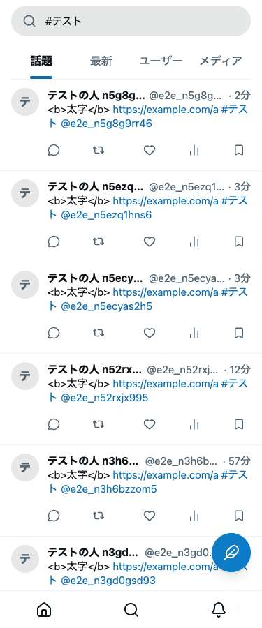
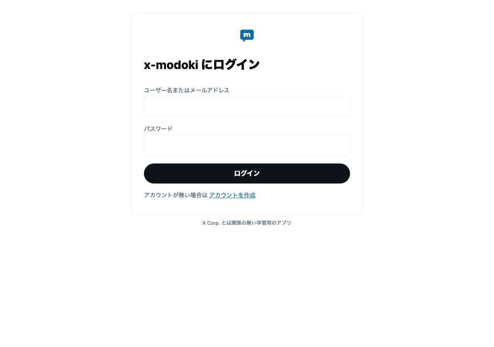

# 試験レポート: 脅威の文書の全部の対策が、通っているテストで確かめられている

## 対象

- issue: [#33](https://github.com/ohta-rh/x-modoki-v2/issues/33)
- commit: `f1ffd9d`・`77decea`（ブランチ `m1/local-app`、PR #40）
- CI: https://github.com/ohta-rh/x-modoki-v2/actions/runs/44471497537 （`77decea`。2 つの commit を含む。緑）
- 日付: 2026-11-19

## 環境

- macOS 26.2、Google Chrome（Claude in Chrome）と Playwright 1.65.0 の Chrome、Node.js 26.12.0（`.nvmrc` は 24。CI の実行を本当の結果とする）
- OrbStack の Docker Compose の PostgreSQL 18 と Garage、`pnpm build && pnpm start -p 3300`

## 判定

合格 — 受け入れ条件 6 件のうち 6 件を満たした。

## 受け入れ条件ごとの結果

| # | 条件 | 確かめ方 | 結果 | エビデンス |
|---|---|---|---|---|
| 1 | 脅威の文書の全部の行の「確かめるテスト」に、実際のテストのファイルと名前 | `node scripts/check-authz.mjs` が、全部の行の `` `パス` › 名前 `` を探す（名前で grep するのと同じことを毎回の lint で行う） | 合格。T-01〜T-19・T-21 が実際のテストを指し、T-20 は受け入れた脅威で `—` | [脅威の洗い出し](../architecture/threat-model.md) |
| 2 | 全部の Server Action とログインが要る Route Handler に「ログイン無しは拒む」、全部の変更の関数に「他人は FORBIDDEN」 | `node scripts/check-authz.mjs` の出力 | 合格。`authz check passed: 34 entries, 14 public`。ログインの要らない 14 は脅威の文書の 6 節に理由つき。自分の分しか変えられない関数は `SELF`（ADR-0060） | 下の出力 |
| 3 | `pnpm audit --prod` に高と重大が無い | `pnpm audit --prod --audit-level high; echo rc=$?` | 合格。`No known vulnerabilities found`、rc=0。CI にも入れた | 下の出力 |
| 4 | 4 つのヘッダーが付き、CSP は画像のドメインと自分のサイトだけを許す | `e2e/security-headers.spec.ts`（3 つのブラウザ） | 合格。`/`・`/i/flow/login`・`/api/timeline/following` の応答に付く。CSP の考え方は ADR-0061 | 下の出力 |
| 5 | リポジトリに秘密の値が無い | 履歴の全部の追加行から、秘密の名前に長い値を代入した行を探した | 合格。見つかったのはテストの作り物の値（`wrong-password`）と、Garage の設定の雛形の置き換えの印（`__RPC_SECRET__`）だけ。追跡されている `.env.example` は、ユーザーの指示で中を開いていない（履歴の検索には含まれ、該当は無かった） | 下の出力 |
| 6 | 見つかった抜けは、全部このループの中で直してある | `gh issue list --label bug --state open` | 合格。抜け 5 つ（下の「見つけた問題」の 1〜5）をこの PBI の中で直した。開いたバグの issue は 0 件 | 下の出力 |

## 自動のテスト

`pnpm verify`（7 つの確認、`77decea` の作業の木）:

```
docs check passed: 141 file(s)
traceability check passed
authz check passed: 34 entries, 14 public
 Test Files  181 passed (181)
      Tests  1001 passed (1001)
Statements   : 100% ( 2872/2872 )
Branches     : 100% ( 1841/1841 )
Functions    : 100% ( 729/729 )
Lines        : 100% ( 2471/2471 )
  294 passed (2.1m)
VERIFY_RC=0
```
docs check passed: 141 file(s)
traceability check passed
authz check passed: 34 entries, 14 public
 Test Files  181 passed (181)
      Tests  999 passed (999)
Statements   : 100% ( 2864/2864 )
Branches     : 100% ( 1832/1832 )
Functions    : 100% ( 728/728 )
Lines        : 100% ( 2466/2466 )
  294 passed (2.4m)
VERIFY_RC=0
```

Playwright のブラウザごとの通った数: Chromium 99、Firefox 96（axe の 3 本を除く。ADR-0055）、WebKit 99。

手元の確かめ（`pnpm start -p 3300`）:

```
anon /api/search -> 401
anon /api/notifications/unread-count -> 401
signed-in, Origin https://evil.test, POST /api/uploads/presign -> 403
signed-in, same Origin, POST /api/uploads/presign -> 200
signed-in /api/search -> 200
Content-Security-Policy: default-src 'self'; script-src 'self' 'unsafe-inline'; style-src 'self' 'unsafe-inline'; img-src 'self' blob: data: http://xmodoki-media.web.garage.localhost:3902; …
X-Content-Type-Options: nosniff
X-Frame-Options: DENY
Referrer-Policy: strict-origin-when-cross-origin
pnpm audit --prod --audit-level high: No known vulnerabilities found (rc=0)
```

### TDD の記録

| # | 振る舞い | 先に書いたテスト | 赤（落ちた理由） | 緑にした実装 |
|---|---|---|---|---|
| 1 | 「他人は FORBIDDEN」のテストが無い変更の関数を指摘する（issue が名を挙げたテスト） | `scripts/check-authz.test.mjs` の 7 本 | 空のスタブで `expected [] to deeply equal [ Array(1) ]` ほか | `scripts/lib/check-authz.mjs` |
| 2 | 印を重ねて書ける | 同 › 印を重ねて書けば… | `expected [ Array(1) ] to deeply equal []` | 続く印を飛ばしてテストを探す |
| 3 | 脅威の表の行が実際のテストを指す | 同 › 脅威の表の「確かめるテスト」は… | `expected [] to deeply equal [ …(3) ]` | `threatErrors` |
| 4 | この repo の全部の入口と脅威の行 | 同 › このリポジトリでは… | `authz check failed: 65 problem(s)`、のちに脅威の行で 20 | 印・テスト・6 節・脅威の表 |
| 5 | 検索はログイン無しを拒む（バグ 1） | `search-posts.test.ts`・`search-users.test.ts` › ログインしていなければ UNAUTHORIZED…、`search.test.ts` › …401、`load-search-page.test.ts` › …ログインへ送る | `expected { ok: true, page: … } to deeply equal { ok: false, error: 'UNAUTHORIZED' }`、`expected 400 to be 401`、`promise resolved … instead of rejecting` | DAL・Route Handler・ローダー |
| 6 | 未読の数はログイン無しで 401（バグ 2） | `notifications.test.ts` › ログインしていなければ 401、`count-unread.test.ts` | `expected 200 to be 401`、`expected +0 to be null` | `countUnread` が null、Route Handler が 401 |
| 7 | 別のサイトの Origin の署名を拒む（バグ 3） | `uploads.test.ts` › 別のサイトの Origin や… | `expected 200 to be 403` | `postUploadPresign` の Origin の比べ |
| 8 | 返信・引用・固定・全ブックマーク削除・画像の署名のログイン無し | 各 `actions.test.ts`・`request-upload.test.ts` | もとの作りで通った。固定の Server Action を「ログイン無しでも ok」に壊すと `expected { ok: true } to deeply equal { ok: false, …(2) }` | なし（確かめのテスト） |
| 9 | いいね・ブックマーク・リポストの行はセッションの利用者のもの（SELF） | 各 › …行はセッションの利用者のもの… | もとの作りで通った。いいねを作者の分として書く作りで `expected [ 'user-1x1' ] to deeply equal [ 'user-1x2' ]` | なし |
| 10 | ログインのたびに新しいトークン（T-04） | `auth.test.ts` › ログインのたびに… | Better Auth の振る舞いで、もとから通った。壊して赤を見る方法が無かった | なし |
| 11 | 期限切れの署名つき URL は通らない（T-08） | `storage.test.ts` › 期限（60 秒）を… | 期限の内に署名する作りで `expected true to be false`。最初は 403 を決めつけていたが、Garage は 400 で断る（テストの誤り） | なし |
| 12 | ヘッダーと CSP | `e2e/security-headers.spec.ts`、`security-headers.test.ts` の 4 本 | `Expected: "nosniff" Received: undefined`、スタブで `expected undefined to be 'nosniff'` | `securityHeaders`・`uploadOrigin`・`next.config.ts` |
| 14 | Origin は要求の届いたホストと比べる（レビューの指摘 1） | `uploads.test.ts` › Origin は要求が届いたホストと比べる… | `expected 403 to be 200`（127.0.0.1 で開いた正当な送信） | `fromThisSite`（`X-Forwarded-Host` か `Host`） |
| 15 | 未読のバッジは 401 で隠す（レビューの指摘 2） | `unread-badge.test.tsx` › 確かめたときにログインが切れていれば… | `Expected … 通知 / Received … 通知 未読 2 件`（古い数が残った） | 応答が ok でなければ 0 |
| 13 | CI が依存を監査し、lint が突き合わせを流す | `quality-gates.test.ts` の 2 本 | `expected '# CI is mandatory…' to match /…pnpm audit…/`、lint の文字列の違い | `ci.yml`・`package.json` |

## コードレビュー

- 判定: APPROVE（2 回目）　範囲: `origin/m1/local-app...HEAD`（`f1ffd9d`・`77decea`）　レビューした sub agent: code-reviewer（opus）。毎回新しい sub agent に、issue の番号と差分の範囲だけを渡した

| # | 回 | 重さ | 指摘 | 確かめた結果 | 対応 |
|---|---|---|---|---|---|
| 1 | 1 | major | Origin を `request.url` と比べるので、`next start` の待ち受けの名前と違うホストで開くと、正当な送信が 403 になる | 再現した（Host・Origin が 127.0.0.1:3300 → 403） | 直した（`77decea`）。比べる相手は、レビューの案（`BETTER_AUTH_URL`）ではなく `X-Forwarded-Host` か `Host`。設定の URL と違うポートで開くと通らなくなるため。テスト: `uploads.test.ts` › Origin は要求が届いたホストと比べる… |
| 2 | 1 | major | 未読の数が 401 を返すようになったのに、バッジが `.count` を読む | 再現した。見えたのは空のバッジではなく、古い数が残ること | 直した（`77decea`）。テスト: `unread-badge.test.tsx` › 確かめたときにログインが切れていれば… |
| 3 | 1 | minor | ルールの「状態を変える Route Handler は Origin を確かめる」が、`postView` と合わない | その通り（`postView` は公開の入口で、乗っ取るセッションが無い） | ルールと脅威の表の文を「セッションの利用者として状態を変える Route Handler」に絞った（`77decea`） |

- 2 回目は指摘なし。レビューが見られなかった「Firefox と WebKit も同じサイトの POST に Origin を付けるか」は、手元の `pnpm verify` の 3 つのブラウザの e2e（画像の投稿を含む）が通ったことで確かめた

## ブラウザでの確認

| URL | 幅 | テーマ | した操作 | 見えた結果 | 画面の写真 |
|---|---|---|---|---|---|
| `/compose/post` | Chrome の窓 | ダークブルー | 画像を選び、下見を見て、投稿 | 下見（`blob:`）が出て、ストレージへの PUT が通り、投稿の画像が画像の配信元から読めた。トースト「ポストを送信しました」。CSP の違反 0 件、コンソールのエラー 0 | なし（操作の確認） |
| `/search?q=#テスト` | 1280 / 768 / 375 | ライト | テストの人で開いた | 結果が出た（ログインした人の検索） | `search-*.jpg` |
| `/notifications` | 1280 / 768 / 375 | ライト | 開いた（隣の画面） | 通知の画面 | `notifications-*.jpg` |
| `/search?q=a`（ログインなし） | 1280 / 768 / 375 | ライト | 開いた（失敗の経路） | ログインの画面へ送られた | `signed-out-search-*.jpg` |

- コンソール: エラー 0、警告 0　通信: 失敗 0（`scripts/chrome-evidence.mjs`、9 枚とも）
- 写真は作り物のテストの人だけで撮った




## 見つけた問題

1. **検索の API が、ログイン無しでも結果を返していた**（認可を突き合わせる途中で、`curl` で再現: `GET /api/search?q=…` → 200）
   - 根本原因: `searchPosts`・`searchUsers` がセッションを「あれば使う」扱いにし、無くても `viewerId = null` で続けていた。ルーティングの表は `/search` をログインが要る画面とし、ADR-0010 はデータアクセス層でも確かめると決めている
   - 直し: DAL が `UNAUTHORIZED` を返し、Route Handler は 401、ページのローダーはログインへ送る。TDD の記録の 5
2. **未読の数の API が、ログイン無しで 200（0 件）を返していた**
   - 根本原因: `countUnread` がログイン無しを 0 として扱っていた
   - 直し: null を返し、Route Handler が 401。TDD の記録の 6
3. **画像の署名の API が、別のサイトの Origin の POST に署名していた**（`curl -H 'Origin: https://evil.test'` → 200）
   - 根本原因: 脅威の文書の T-11 は「状態を変える Route Handler は Origin を確かめる」としていたが、`postUploadPresign` はその比べをしていなかった。cookie は `SameSite=Lax` なので普通のブラウザの別のサイトからの POST には cookie が付かず、すぐに悪用できる穴ではなかった
   - 直し: Origin が自分のオリジンと違うか無ければ 403。TDD の記録の 7
4. **画像の署名を、127.0.0.1 で開いた正当な送信まで拒んでいた**（独立したレビューの 1 回目。`curl` で再現: Host・Origin が 127.0.0.1:3300 → 403）
   - 根本原因: 3 の直しで、Origin を `request.url` と比べていた。`next start` は `request.url` を待ち受けの名前（localhost）から作るので、別の名前で開いたページの Origin と合わなかった
   - 直し: Next.js の Server Action と同じく、`X-Forwarded-Host` か `Host` と比べる。レビューの案（`BETTER_AUTH_URL` と比べる）は、3300 番・3001 番で開いたときに通らなくなるので採らなかった
5. **ログアウトしたあとも、未読のバッジに古い数が残った**（独立したレビューの 1 回目）
   - 根本原因: 2 の直しで未読の数が 401 を返すようになったが、バッジはそれを数として読み、TanStack Query は `undefined` を誤りとして前の数を残した（レビューは空のバッジを予想したが、見えたのは古い数）
   - 直し: 応答が ok でなければ 0
6. **私の誤り:** zsh で、変数に入れたコマンドを 1 語として呼んで失敗した（`.claude/rules` にある罠）。関数にして直した
7. **私の誤り:** 1 回目の `pnpm verify` を、ESLint の決まり（テストからの `@/shared/db` の読み込み）に反したまま流した
