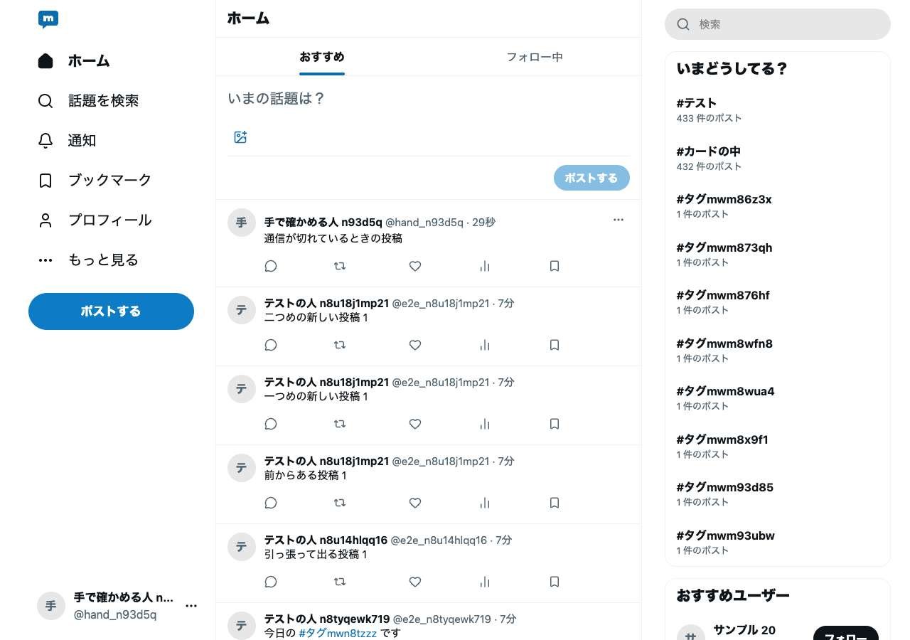
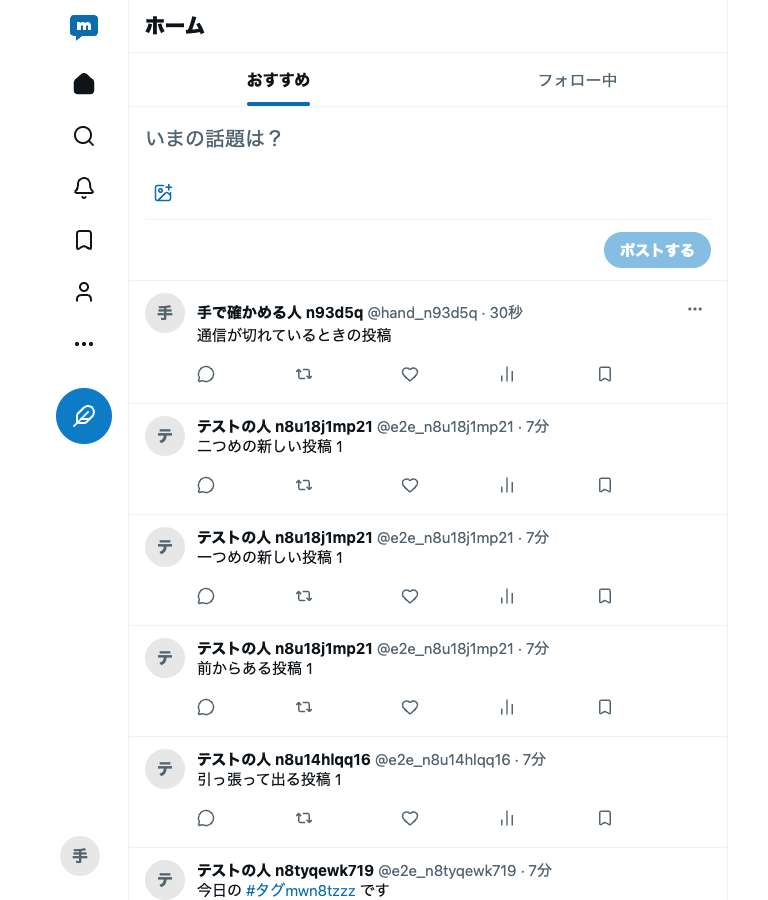
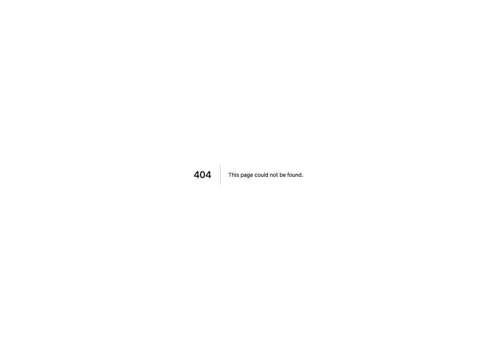
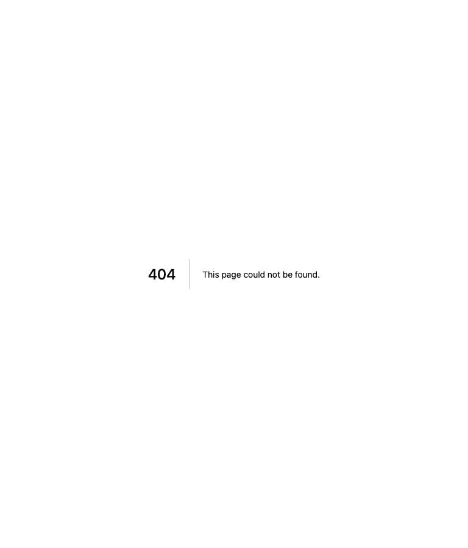
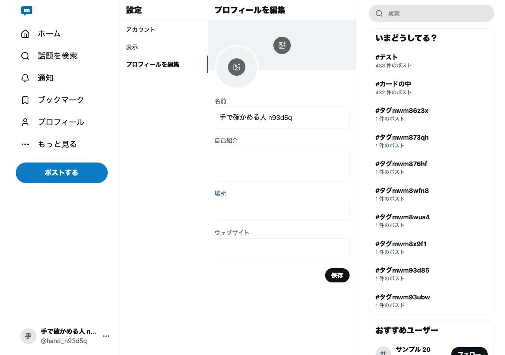
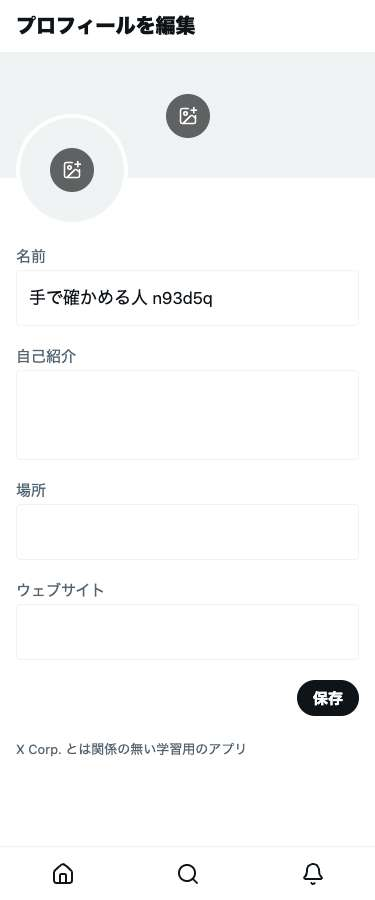
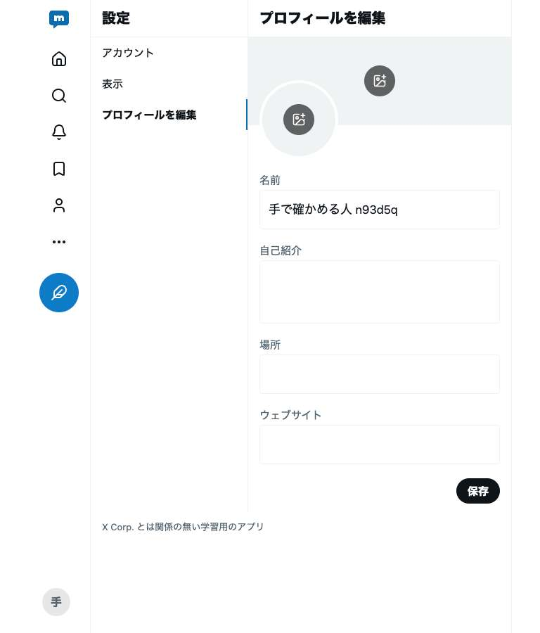

# 試験レポート: M1 の探索的テストをして、見つけた不具合を全部直す

## 対象

- issue: [#34](https://github.com/ohta-rh/x-modoki-v2/issues/34)
- commit: 9 巡目の対象 `3ebfa2e`、記録の文書を足した commit（ブランチ `m1/local-app`、PR #40）
- CI: [実行 44537584475](https://github.com/ohta-rh/x-modoki-v2/actions/runs/44537584475)（成功）
- 日付: 2026-11-19

## 環境

- macOS 26.2、Google Chrome（Playwright 1.65.0 の `channel: 'chrome'` と拡張から操作）、Chromium・Firefox・WebKit（Playwright）、Node.js 26.12.0（`.nvmrc` は 24。CI の実行を本当の結果とする）、Docker Compose の PostgreSQL と Garage
- 動かし方: `pnpm build && pnpm start`。試す人ごとに別のデータベース（`xmodoki_explore_a`〜`c`）とポート（3401〜3403）。架空の人だけを登録した

## 判定

合格 — 受け入れ条件 5 件のうち 5 件を満たした（バグの PBI は PR #40 のマージで閉じる。ADR-0029）。

## 受け入れ条件ごとの結果

| # | 条件 | 確かめ方 | 結果 | エビデンス |
|---|---|---|---|---|
| 1 | 動いているローカルのアプリに対して、6 つの見方で探す | 記録の文書の 1〜11 節（9 巡、どの巡も 6 つの見方） | 合格 | [探索的テストの記録](../research/exploratory-m1.md) |
| 2 | 記録が `docs/research/exploratory-m1.md`（`type: Research`）にあり、見方ごとに試したこと・起きたこと・再現の手順 | `node scripts/check-docs.mjs` が通る。各巡の結果の表と、不具合ごとの再現の手順はバグの PBI | 合格 | 同 |
| 3 | 見つかった不具合の全部に、根本原因を書いたバグの PBI（`bug`・`pbi`） | `gh issue list --label bug --state all`: #65〜#90 の 26 件。どれも「根本原因」の節がある | 合格 | 下の表 |
| 4 | 不具合は重さによらず全部直してあり、再現して落ちるテスト・直した commit・試験レポートがある | 26 件とも試験レポートに「TDD の記録」と commit。完了の定義に印を付けてコメントし、PR #40 の本文に `Closes` で並べた（PR モードなので、マージで閉じる） | 合格 | 下の表 |
| 5 | 直したあとにもう 1 巡し、出なくなるまで繰り返す | 2〜9 巡目の節。8 巡目まで毎回出て、9 巡目で 0 件 | 合格 | 記録の 4〜11 節 |

| issue | 見つけた巡 | 題 | 記録 |
|---|---|---|---|
| [#65](https://github.com/ohta-rh/x-modoki-v2/issues/65) | 1 | 狭い画面と低い画面で、浮かぶ投稿ボタンが「保存」と「ポストする」に重なって押せない | [試験レポート](issue-0065-floating-button-overlap.md) |
| [#66](https://github.com/ohta-rh/x-modoki-v2/issues/66) | 1 | NFD の文字で検索すると、NFC で保存した投稿が見つからない（入力の正規化がそろっていない） | [試験レポート](issue-0066-nfc-normalize-input.md) |
| [#67](https://github.com/ohta-rh/x-modoki-v2/issues/67) | 1 | 投稿の本文の前後の空白と改行が、そのまま保存されて出る | [試験レポート](issue-0067-trim-post-body.md) |
| [#68](https://github.com/ohta-rh/x-modoki-v2/issues/68) | 1 | 詳細の画面で投稿を削除してから戻ると、消した投稿がまた出る | [試験レポート](issue-0068-back-after-delete.md) |
| [#69](https://github.com/ohta-rh/x-modoki-v2/issues/69) | 1 | 詳細の画面で返信してから戻ると、ホームのカードの返信と表示の数が古いまま | [試験レポート](issue-0069-counts-after-back.md) |
| [#70](https://github.com/ohta-rh/x-modoki-v2/issues/70) | 1 | 通信が切れていると、投稿で画面全体が英語の誤りに変わり、フォローは黙って失敗する（Server Action の失敗を受け止めていない） | [試験レポート](issue-0070-offline-server-actions.md) |
| [#71](https://github.com/ohta-rh/x-modoki-v2/issues/71) | 1 | 予期しない誤りで、画面が英語の「This page couldn't load」になる（日本語の誤りの画面が無い） | [試験レポート](issue-0071-japanese-error-screen.md) |
| [#72](https://github.com/ohta-rh/x-modoki-v2/issues/72) | 1 | 通信が切れたまま一覧を下まで送ると、スピナーが回り続け、知らせもやり直しの方法も無い | [試験レポート](issue-0072-offline-next-page.md) |
| [#73](https://github.com/ohta-rh/x-modoki-v2/issues/73) | 1 | 解読できない % を含む URL で、素の「Internal Server Error」（500）が出る | [試験レポート](issue-0073-malformed-url-404.md) |
| [#74](https://github.com/ohta-rh/x-modoki-v2/issues/74) | 2 | 長い名前・自己紹介・URL が、プロフィールと一覧とホバーカードから横にはみ出す | [試験レポート](issue-0074-long-text-overflow.md) |
| [#75](https://github.com/ohta-rh/x-modoki-v2/issues/75) | 2 | 画面より高い確認のダイアログの上と下が切れて、ボタンに届かない | [試験レポート](issue-0075-tall-dialog-scrolls.md) |
| [#76](https://github.com/ohta-rh/x-modoki-v2/issues/76) | 2 | 投稿の応答が届かずにやり直すと、同じ投稿が 2 つできる | [試験レポート](issue-0076-retried-post-once.md) |
| [#77](https://github.com/ohta-rh/x-modoki-v2/issues/77) | 2 | プロフィールの保存の途中で押したリンクが捨てられ、保存のあとプロフィールへ移る | [試験レポート](issue-0077-save-keeps-chosen-page.md) |
| [#78](https://github.com/ohta-rh/x-modoki-v2/issues/78) | 2 | 返信を詳細の画面で消して戻ると、親の投稿の返信の数が減っていない | [試験レポート](issue-0078-reply-delete-parent-count.md) |
| [#79](https://github.com/ohta-rh/x-modoki-v2/issues/79) | 2 | 保存した投稿の下書きが、同じブラウザで次にログインした別の人に出る | [試験レポート](issue-0079-draft-per-person.md) |
| [#80](https://github.com/ohta-rh/x-modoki-v2/issues/80) | 3 | 長い場所・ハッシュタグ・名前が、プロフィールの場所と話題と通知から横にはみ出す | [試験レポート](issue-0080-long-text-everywhere.md) |
| [#81](https://github.com/ohta-rh/x-modoki-v2/issues/81) | 3 | 別のタブで下書きを保存すると、開いている投稿の欄の書きかけが消える | [試験レポート](issue-0081-open-composer-keeps-text.md) |
| [#82](https://github.com/ohta-rh/x-modoki-v2/issues/82) | 3 | 通信が切れていると、ログインと登録で画面が誤りの画面に変わり、ログアウトは黙って失敗する | [試験レポート](issue-0082-offline-auth-and-lint.md) |
| [#83](https://github.com/ohta-rh/x-modoki-v2/issues/83) | 4 | 低い画面（200% の拡大・横向きのスマートフォン）で、左の列の下のアカウントのメニューに届かず、ログアウトできない | [試験レポート](issue-0083-left-column-scrolls.md) |
| [#84](https://github.com/ohta-rh/x-modoki-v2/issues/84) | 4 | 削除の応答が届かずにやり直すと「この投稿は見つかりません」で止まり、消えた投稿が画面に残る | [試験レポート](issue-0084-delete-retry-succeeds.md) |
| [#85](https://github.com/ohta-rh/x-modoki-v2/issues/85) | 5 | 640px より狭い画面で、ログアウトも、自分のプロフィール・ブックマーク・設定へも行けない | [試験レポート](issue-0085-mobile-account-drawer.md) |
| [#86](https://github.com/ohta-rh/x-modoki-v2/issues/86) | 5 | 狭く低い画面で、Tab で動いたフォーカスが下のタブバーや丸い投稿ボタンの下に隠れる | [試験レポート](issue-0086-focus-not-obscured.md) |
| [#87](https://github.com/ohta-rh/x-modoki-v2/issues/87) | 6 | アカウントの引き出しを開いたまま画面を 640px より広げると、引き出しが残り、閉じてもフォーカスの行き場が無い | [試験レポート](issue-0087-drawer-closes-when-wide.md) |
| [#88](https://github.com/ohta-rh/x-modoki-v2/issues/88) | 6 | プロフィールの画像の保存の応答が届かずにやり直すと「画像を保存できませんでした」になる | [試験レポート](issue-0088-profile-image-retry.md) |
| [#89](https://github.com/ohta-rh/x-modoki-v2/issues/89) | 8 | U+0000（NUL）を含む検索・投稿・返信・自己紹介・名前で、誤りの画面か「通信できませんでした」になる | [試験レポート](issue-0089-nul-in-typed-text.md) |
| [#90](https://github.com/ohta-rh/x-modoki-v2/issues/90) | 8 | 画像の送信に失敗した画像を外しても、「画像を送れませんでした」が残る | [試験レポート](issue-0090-failed-image-message.md) |

## 自動のテスト

この PBI 自身はアプリのコードを変えていない。直したコードの自動のテストは、それぞれのバグの PBI の試験レポートにある。最後の `PORT=3300 pnpm verify` は 0 で終わった（`3ebfa2e`）: 単体のテスト 187 ファイル 1105 本、カバレッジ 4 つとも 100%、画面のテスト 387 本（Chromium・Firefox・WebKit）。

- 手元で 3 つのブラウザを並べて流すときだけ、WebKit が時々遅くなる（登録が 5 秒を超える、画像のビューアが出ない）。WebKit のコンテナのゾンビ（#84 の途中で `init: true` で直した）とは別で、原因は分からない。単独で流すと通り、CI では起きていない

### TDD の記録

コードの変更なし（この PBI 自身は記録の文書だけ。不具合を直した振る舞いごとの赤と緑は、それぞれのバグの PBI の試験レポートの「TDD の記録」にある）。

## コードレビュー

コードの変更なし（直したコードは、バグの PBI ごとに独立した code-reviewer が `APPROVE` を返している。各試験レポートの「コードレビュー」）。

## ブラウザでの確認

| URL | 幅 | テーマ | した操作 | 見えた結果 | 画面の写真 |
|---|---|---|---|---|---|
| `/home` | 1280 | ライト | 開いた（ログインした架空の人） | 崩れない、横にはみ出さない | `home-1280.jpg` |
| `/home` | 375 | ライト | 開いた（ログインした架空の人） | 崩れない、横にはみ出さない | `home-375.jpg` |
| `/home` | 768 | ライト | 開いた（ログインした架空の人） | 崩れない、横にはみ出さない | `home-768.jpg` |
| `/%ZZ` | 1280 | ライト | 壊れた URL を開いた（失敗の経路） | 404 の画面（#73） | `malformed-1280.jpg` |
| `/%ZZ` | 375 | ライト | 壊れた URL を開いた（失敗の経路） | 404 の画面（#73） | `malformed-375.jpg` |
| `/%ZZ` | 768 | ライト | 壊れた URL を開いた（失敗の経路） | 404 の画面（#73） | `malformed-768.jpg` |
| `/settings/profile` | 1280 | ライト | 開いた | 崩れない、横にはみ出さない | `settings-1280.jpg` |
| `/settings/profile` | 375 | ライト | 開いた | 崩れない、横にはみ出さない | `settings-375.jpg` |
| `/settings/profile` | 768 | ライト | 開いた | 崩れない、横にはみ出さない | `settings-768.jpg` |

- コンソール: エラー 0、警告 0　通信: 失敗 0（`chrome-evidence.mjs`。壊れた URL の 404 は除く）
- 各巡の打鍵そのものは、試す人が Playwright で 3 つのブラウザを動かし、記録の文書に数字で残した

## 見つけた問題

1. アプリの不具合 26 件（上の表）。どれもこの PBI のループの中で直した
2. 私の手順の誤り: 7 巡目に、試す人が動いている間に `.next` を作り直し、試す人のサーバーを一度壊した（記録の 9.1）。8・9 巡目では作り直していない
3. 繰り返した種類は仕組みにした（記録の 12 節）: `local/settle-server-actions`（ADR-0065）、`cleanText` のルール、320px の見回りのテスト、ADR-0064・ADR-0067
