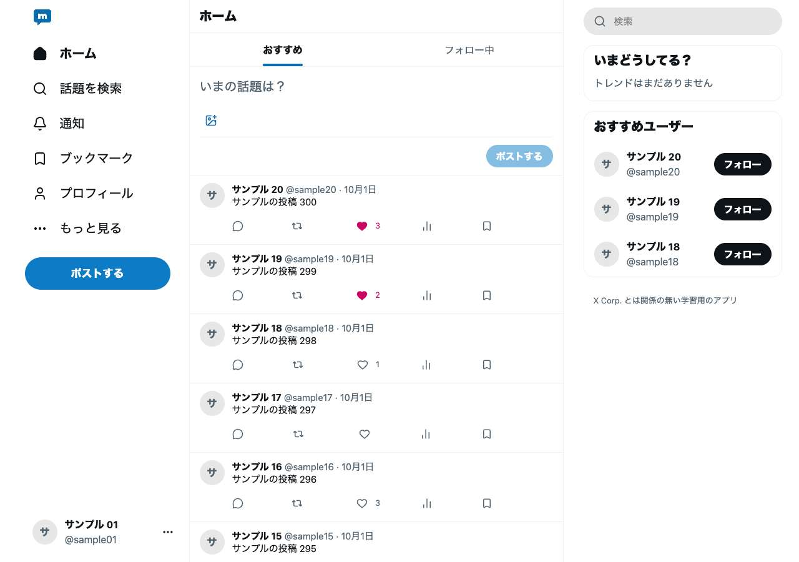
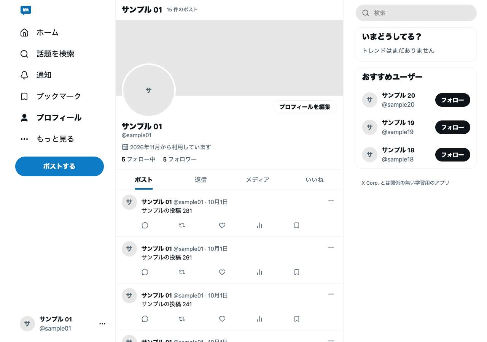

# 試験レポート: README と手順書だけで、まっさらな clone からアプリが動く

## 対象

- issue: [#35](https://github.com/ohta-rh/x-modoki-v2/issues/35)
- commit: `0af9c5b`（ブランチ `m1/local-app`、PR #40）
- CI: [実行 44547515703](https://github.com/ohta-rh/x-modoki-v2/actions/runs/44547515703)（成功。`verify (7 gates)` と `fresh clone (the local guide)` の 2 つ）
- 日付: 2026-11-20

## 環境

- macOS 26.2、Google Chrome（Playwright 1.65.0 の `channel: 'chrome'`）、Node.js 26.12.0（`.nvmrc` は 24。CI の実行を本当の結果とする）、Docker Compose の PostgreSQL と Garage
- 手元の確かめ: 動いている PostgreSQL に別のデータベース（`xmodoki_readme`）を作って `pnpm db:migrate` と `pnpm db:seed` を流し、`next start -p 3302` で立ち上げた（共有のコンテナとポートを壊さないため。終わったあと、サーバーを止めてデータベースを消した）
- まっさらな clone の確かめ: CI の `fresh-clone` のジョブ（GitHub Actions の ubuntu-latest。毎回まっさらな機械に clone する。ADR-0069）

## 判定

合格 — 受け入れ条件 5 件のうち 5 件を満たした。

## 受け入れ条件ごとの結果

| # | 条件 | 確かめ方 | 結果 | エビデンス |
|---|---|---|---|---|
| 1 | ルートの `README.md` に、何か（X Corp. と関係が無い学習用）・画面の写真 1 枚・要るもの・最短の手順・文書への入口があり、詳細は手順書へリンクする | 読んだ。GitHub で描かれた README を Chrome で開いて、写真とリンクが出ることを見た | 合格 | [README.md](../../README.md) |
| 2 | `docs/guides/local-development.md`（`type: Guide`）に、最初の準備・毎日の起動・テスト・データベースの作り直し・シード・よくある失敗がある | `node scripts/check-docs.mjs` が通る（180 ファイル）。0〜6 節 | 合格 | [ローカルで動かす](../guides/local-development.md) |
| 3 | まっさらな clone で手順書のコマンドを上から流すと、`/home` が開き、シードの人で入れる | CI の `fresh-clone`: 手順書の 1 節と 2 節を `scripts/guide-commands.mjs` で読み出してそのまま流し、ログインの画面から `sample01` / `sample-password` で入り、`/home` に「サンプル 01」が出た。手元でも 3302 番で同じ流れ（下の写真） | 合格 | CI の実行、`home-*.jpg` |
| 4 | 環境と配備の文書の「コードが入る前の設計」の注が外れ、コマンドの表が `package.json` と一致する | 注を外した。`scripts` の 14 個と表を 1 行ずつ突き合わせた（足りなかった `pnpm start`・`pnpm format` を足し、`docs:check`・`lint` の中身を今に合わせた） | 合格 | [環境と配備](../architecture/environments.md) |
| 5 | `LICENSE` がある（MIT） | `ls LICENSE` | 合格 | [LICENSE](../../LICENSE) |

## 自動のテスト

`PORT=3300 pnpm verify` が 0 で終わった（`0af9c5b`）: 単体のテスト 188 ファイル 1112 本、カバレッジ 4 つとも 100%、画面のテスト 387 本（Chromium・Firefox・WebKit）。CI でも同じ 7 つと、新しい `fresh-clone` のジョブが通った。

CI の `fresh-clone` のジョブの記録（実行 44547515703 から抜粋）:

```
The guide's 1. 最初の準備   pnpm install
The guide's 1. 最初の準備   setup-local: containers up, bucket xmodoki-media ready, .env.local filled
The guide's 1. 最初の準備   migrations applied successfully!seed: 20 users, 300 posts, 100 follows, 450 likes
Sign in as sample01 ...     signed in as sample01 and /home shows サンプル 01
```

### TDD の記録

| # | 振る舞い | 先に書いたテスト | 赤（落ちた理由） | 緑にした実装 |
|---|---|---|---|---|
| 1 | シードの人は公開した開発用のパスワードで入れる | `scripts/seed.test.ts` › どの人も、公開した開発用のパスワードでログインできる… | `expected [] to have a length of 20 but got +0`（`accounts` の行が無い） | `scripts/seed.ts`（`credential` のアカウント、`hashPassword`、`SEED_PASSWORD`） |
| 2 | 手順書の節の最初の `sh` の塊を読み出す | `scripts/guide-commands.test.mjs` › 見出しの節の、最初の sh の… / 見出しか、その節の sh の塊が無ければ null | `expected undefined to be 'pnpm install\nsh scripts/setup-local.…'`、`expected undefined to be null`（何もしない仮の関数） | `scripts/lib/guide-commands.mjs` |
| 3 | コマンドとして書き出し、無ければ 1 で止める | 同 › ファイルと見出しを受けて… / 引数が足りない… | `expected "vi.fn()" to be called with arguments: [ 'pnpm dev\n' ]`、`expected +0 to be 1` | `scripts/lib/guide-commands.mjs` の `main`、`scripts/guide-commands.mjs` |
| 4 | CI がまっさらなランナーで手順書を流し、シードの人で入る | `scripts/quality-gates.test.ts` › CI は、まっさらなランナーで手順書の「最初の準備」を… | `ENOENT: no such file or directory, open 'docs/guides/local-development.md'` | 手順書、`.github/workflows/ci.yml` の `fresh-clone` |

- 2 の「節に `sh` の塊が無い」のテストは、最初の入力が見出しから始まっていて「見出しが無い」の道を通っていた（カバレッジの分岐で気づいた。テストの誤り）。見出しの前に行を置いて直した
- CI のログインは、最初に Better Auth の `/api/auth/sign-in/username` を curl で呼ぶ形で書いたが、手元で 404 だった。その道は外から呼べないように閉じてある（T-09・T-10、`src/_app/api-routes/auth.test.ts`）ので、Playwright のイメージの中でログインの画面を操作する形にした

## コードレビュー

- 判定: APPROVE（1 回目）　範囲: `origin/m1/local-app...0af9c5b`　レビューした sub agent: code-reviewer（opus）

| # | 重さ | 指摘 | 確かめた結果 | 対応 |
|---|---|---|---|---|
| — | — | 指摘なし（`fresh-clone` のジョブは push の前で動かせず、緑の CI を見てから閉じるようにとの注記。CI で緑を見た） | — | — |

## ブラウザでの確認

| URL | 幅 | テーマ | した操作 | 見えた結果 | 画面の写真 |
|---|---|---|---|---|---|
| `/i/flow/login` | 1280 | ライト | `sample01` と間違ったパスワードでログイン（失敗の経路） | 「ユーザー名・メールアドレスかパスワードが正しくありません」、ログインの画面のまま | `login-wrong-1280.jpg` |
| `/home` | 1280 | ライト | `sample01` / `sample-password` で入った | 左下に「サンプル 01」、シードの投稿といいね、おすすめユーザー | `home-1280.jpg` |
| `/home` | 768 | ライト | 同じ | 崩れない、横にはみ出さない | `home-768.jpg` |
| `/home` | 375 | ライト | 同じ | 崩れない、横にはみ出さない | `home-375.jpg` |
| `/sample01` | 1280 | ライト | 自分のプロフィール（変えていない隣の画面） | 15 件のポスト、5 フォロー中・5 フォロワー | `profile-1280.jpg` |
| `/sample01` | 768 | ライト | 同じ | 崩れない | `profile-768.jpg` |
| `/sample01` | 375 | ライト | 同じ | 崩れない | `profile-375.jpg` |

- コンソール: エラー 0、警告 0　通信: 失敗 0（`chrome-evidence.mjs` と、ログインの操作の間）
- README（`home-1280.jpg` を使う）は GitHub で描かれたものを Chrome で開いて確かめた








## 見つけた問題

1. シードの人に Better Auth のパスワードの行が無く、シードの人では入れなかった（受け入れ条件 3 を満たせない）。シードを直した（ADR-0068）
2. 環境と配備の文書のコマンドの表に `pnpm start`・`pnpm format` が無く、`docs:check`・`lint` の中身が古かった。直した
