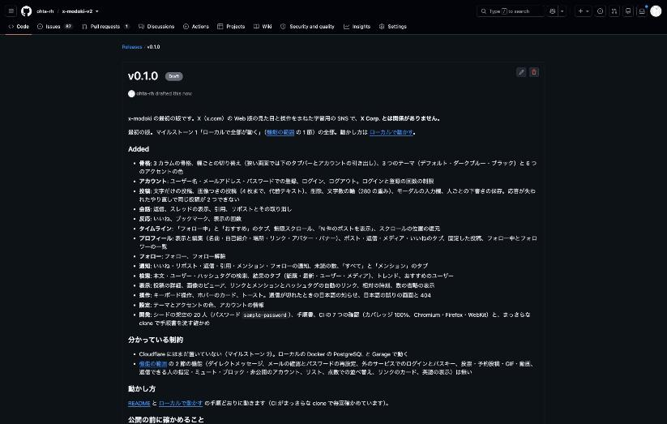
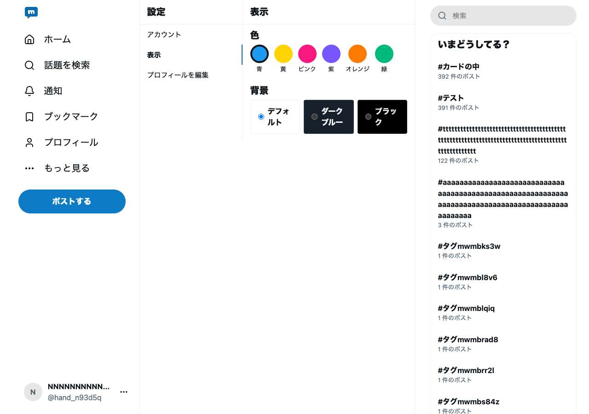
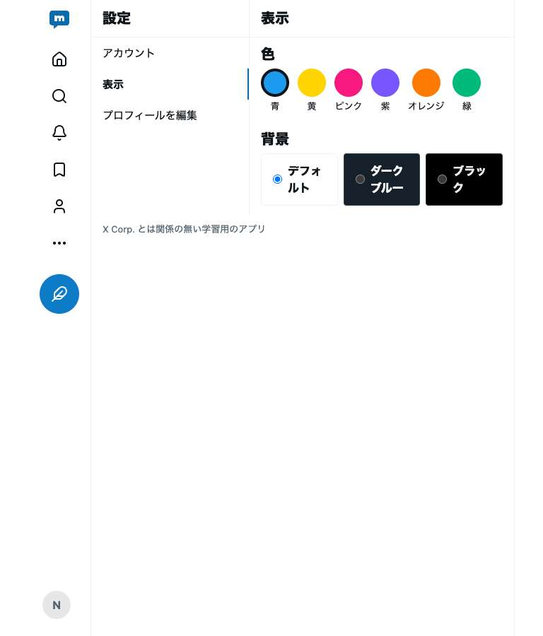
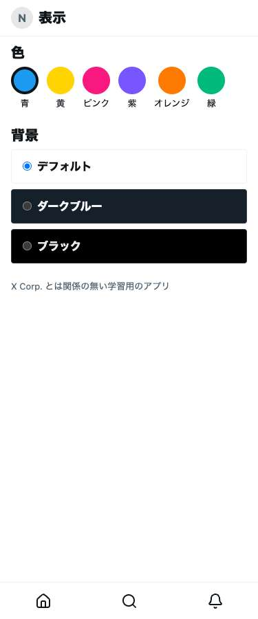
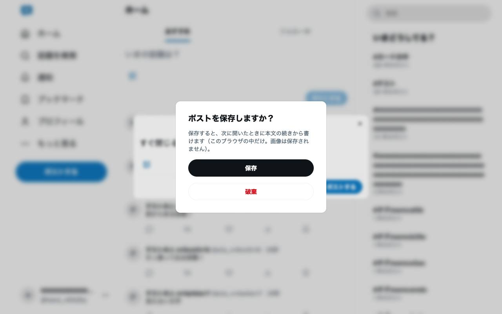
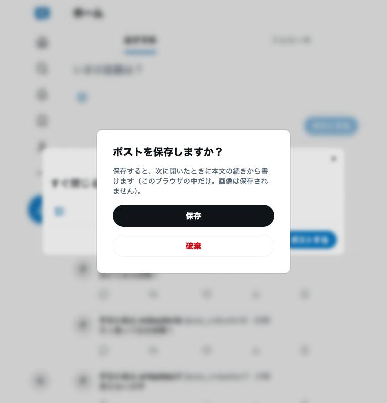
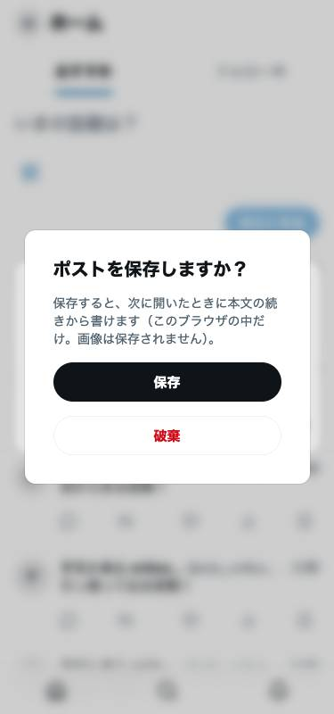

# 試験レポート: v0.1.0 のタグと GitHub のリリースがあり、何が入っているかが分かる

## 対象

- issue: [#36](https://github.com/ohta-rh/x-modoki-v2/issues/36)
- commit: `55f3e19`、レビューで直した `3ac32f7`、CI で見つけたテストの誤りを直した `e142bc0`・`f9bc8b7`、CI で見つけた不具合を直した `33a8fce`（ブランチ `m1/local-app`、PR #40）
- CI: [実行 44566411561](https://github.com/ohta-rh/x-modoki-v2/actions/runs/44566411561)（成功）
- 日付: 2026-11-20

## 環境

- macOS 26.2、Google Chrome（拡張から操作と、Playwright 1.65.0 の `channel: 'chrome'`）、WebKit（`docker compose` の `webkit`、ADR-0052）、Node.js 26.12.0（`.nvmrc` は 24。CI の実行を本当の結果とする）
- 動かし方: `pnpm build && pnpm start -p 3001`。確かめるために登録した架空の人（`hand_n93d5q`）

## 判定

合格 — 受け入れ条件 5 件のうち、PR モード（ADR-0029）で今できる 3 件を満たし、残りの 2 件（タグの push とリリースの公開、マージ前の issue が全部閉じていること）は、ADR-0029 の決めたとおり PR #40 のマージのあとにユーザーが行う。

## 受け入れ条件ごとの結果

| # | 条件 | 確かめ方 | 結果 | エビデンス |
|---|---|---|---|---|
| 1 | `package.json` の `version` が `0.1.0` | `node -p "require('./package.json').version"` → `0.1.0` | 合格 | — |
| 2 | `CHANGELOG.md` に Keep a Changelog の形で `0.1.0` の節があり、機能の範囲の 1 節の領域ごとにできることがある | 読んだ。13 の領域と「開発」。レビューで、2 節の無い機能の列挙の漏れ（パスキー・返信できる人の指定・非公開のアカウント）を足した。テーマと色の数は設定の画面で確かめた | 合格 | [CHANGELOG.md](../../CHANGELOG.md)、`settings-*.jpg` |
| 3 | リリースより前の M1 の issue が全部閉じていて、`main` の CI が緑 | ADR-0029: issue は PR #40 のマージで閉じる。全部の PBI に完了の印と根拠のコメントを付け、PR の本文に `Closes` で並べた。PR の CI は緑 | マージのあと | PR #40 |
| 4 | その commit に `v0.1.0` の注釈つきのタグがあり、push されている | ADR-0029: マージ前の commit にタグを打たない。`git ls-remote --tags origin v0.1.0` は空（打っていないことを確かめた） | マージのあと | — |
| 5 | GitHub のリリース `v0.1.0` に、できること・動かし方へのリンク・分かっている制約があり、開いている不具合は 0 件 | `gh release view v0.1.0`: 下書き（`isDraft: true`、target `main`）。本文は CHANGELOG の 0.1.0 の節、README と手順書へのリンク、制約、公開の前に確かめること。開いているバグの issue は PR #40 のマージで閉じる | 下書きを用意した。公開はマージのあと | `release-draft.jpg` |

## 自動のテスト

`PORT=3300 pnpm verify` が 0 で終わった（`33a8fce`）: 単体のテスト 188 ファイル 1113 本、カバレッジ 4 つとも 100%、画面のテスト 387 本（Chromium・Firefox・WebKit）。CI でも 7 つの確認と `fresh-clone` が通った。

### TDD の記録

版の番号・変更の履歴・下書きのリリースは、コードの変更なし。CI で見つけた不具合（下の「見つけた問題」の 2）は、テストを先に書いて直した。

| # | 振る舞い | 先に書いたテスト | 赤（落ちた理由） | 緑にした実装 |
|---|---|---|---|---|
| 1 | 書いてすぐ Esc を押しても、保存するかを聞く | `src/widgets/composer-modal/ui/composer.test.tsx` › 書いてすぐ Esc を押しても（effect が走る前でも）、保存するかを聞く | `expected "vi.fn()" to not be called at all, but actually been called 1 times`（聞かずに `onClose`）。入力と Esc の間にマイクロタスクだけを進める形では jsdom が effect まで流して緑のままだったので、間を空けずに送る形にした | `composer.tsx`（入力の処理の中で親へ伝え、閉じるときは最新の文字を ref で読む） |

#86 のテストの読み方の直しは、アプリのコードを変えていない。直す前の読み方が WebKit で誤った値を拾うことは、手元の WebKit で測って確かめた（`focus()` の直後に下端 −285px、2 フレーム後に 207px。Chrome はその場で 207px）。

## コードレビュー

- 判定: APPROVE（4 回とも 1 回目）　範囲: `origin/m1/local-app...55f3e19`、`...e142bc0`、`...33a8fce`　レビューした sub agent: code-reviewer（opus）

| # | 重さ | 指摘 | 確かめた結果 | 対応 |
|---|---|---|---|---|
| 1 | minor | CHANGELOG の「2 節の機能が無い」の列挙に、パスキー・返信できる人の指定・非公開のアカウントが無い（`CHANGELOG.md:30`） | そのとおり（`scope.md` の 2 節と突き合わせた） | 直した（`3ac32f7`）。リリースの本文も同じ |
| — | — | `33a8fce`: 指摘なし（残った `useEffect` が古い文字を一瞬書いても、文字があるまま閉じることは無いことを確かめた、との注記） | — | — |
| 2 | minor | 足したルールは「`expect.poll` で読み、1 回で読まない」なのに、360×300 の読み方は 2 フレーム待って 1 回読むだけ（`e2e/narrow.spec.ts:483-492`） | そのとおり | 直した（`f9bc8b7`）。提案どおり `expect(…).toPass()` で包んだ |

## ブラウザでの確認

| URL | 幅 | テーマ | した操作 | 見えた結果 | 画面の写真 |
|---|---|---|---|---|---|
| GitHub の下書きのリリース `v0.1.0` | 1372 | GitHub のダーク | 開いて読んだ | Draft の印、Added の 14 の領域、分かっている制約、動かし方、公開の前に確かめること。リンクが出る | `release-draft.jpg` |
| `/settings/display` | 1280 | ライト | 開いた（CHANGELOG の「3 つのテーマと 6 つのアクセントの色」の確かめ、変えていない画面） | 色 6 つ、背景 3 つ | `settings-1280.jpg` |
| `/settings/display` | 768 | ライト | 同じ | 崩れない | `settings-768.jpg` |
| `/settings/display` | 375 | ライト | 同じ | 崩れない、横にはみ出さない | `settings-375.jpg` |

| `/home` → 投稿のモーダル | 1280 | ライト | 書いた直後に、描き直しを待たずに Esc（不具合の道） | 「ポストを保存しますか？」が出る。「破棄」で /home へ | `esc-asks-1280.jpg` |
| 同じ | 768 | ライト | 同じ | 同じ | `esc-asks-768.jpg` |
| 同じ | 375 | ライト | 同じ | 同じ | `esc-asks-375.jpg` |

- コンソール: エラー 0、警告 0　通信: 失敗 0（`chrome-evidence.mjs` と、モーダルの操作）

## 見つけた問題

1. `3ac32f7` の CI で、WebKit の #86 のテスト（Shift+Tab で戻ったフォーカスが見出しの下に隠れない）が 1 回落ちた（実行 44555176296、`Expected: > 53` `Received: 20.5625`）。根本原因: WebKit は、フォーカスを移したあとのスクロールを次の描画のときに行い（Chrome はその場で行う）、テストはキーを押した直後に位置を 1 回だけ読んでいた。失敗の時の画面の写真では、フォーカスは隠れていない（アプリは正しい）。3 か所の読み方を、描画を待って読み直す形（`expect.poll`・`toPass`）にし（`e142bc0`・`f9bc8b7`）、3 つのブラウザで 5 回ずつ 8 並列で 30 回通した。同じ読み方はほかの e2e に無い。`.claude/rules/quality-gates.md` に「フォーカスを動かしたあとの位置は `expect.poll` で読む」を足した
2. `f9bc8b7` の CI で、WebKit の #81 のテスト（別のタブで下書きを保存しても、開いている欄の書きかけは消えない）が、保存のダイアログを待って止まった（実行 44560454792）。CI の記録のスナップショットと画面のコマで、Esc の直後に欄が空になって閉じていたことを見た。手元で WebKit を 16 並列にすると 60 回中 5 回同じ形で落ち、文字の出入りを記録する仕掛けで、Esc の瞬間も欄に文字があるのに聞かずに閉じたことを確かめた（32 回中 1 回）。根本原因: 投稿の欄は、書いた文字をモーダルへ `useEffect` で伝えていたので、ページが詰まって effect が走る前に Esc が届くと、モーダルは書きかけ無しとして閉じ、書いた文字が消えた（人でも起きる）。入力の処理の中で伝え、閉じるときは最新の文字を読む形にした（`33a8fce`）。直したあと、同じ条件で 64 回中 0 回、e2e は 60 回中 60 回通った。同じ作りはほかに無い
