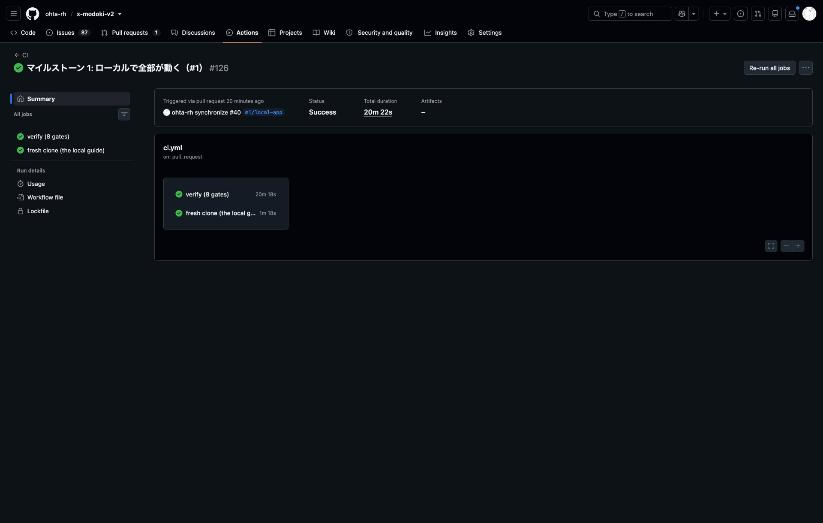
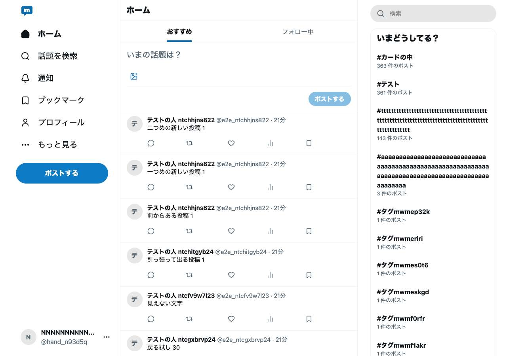
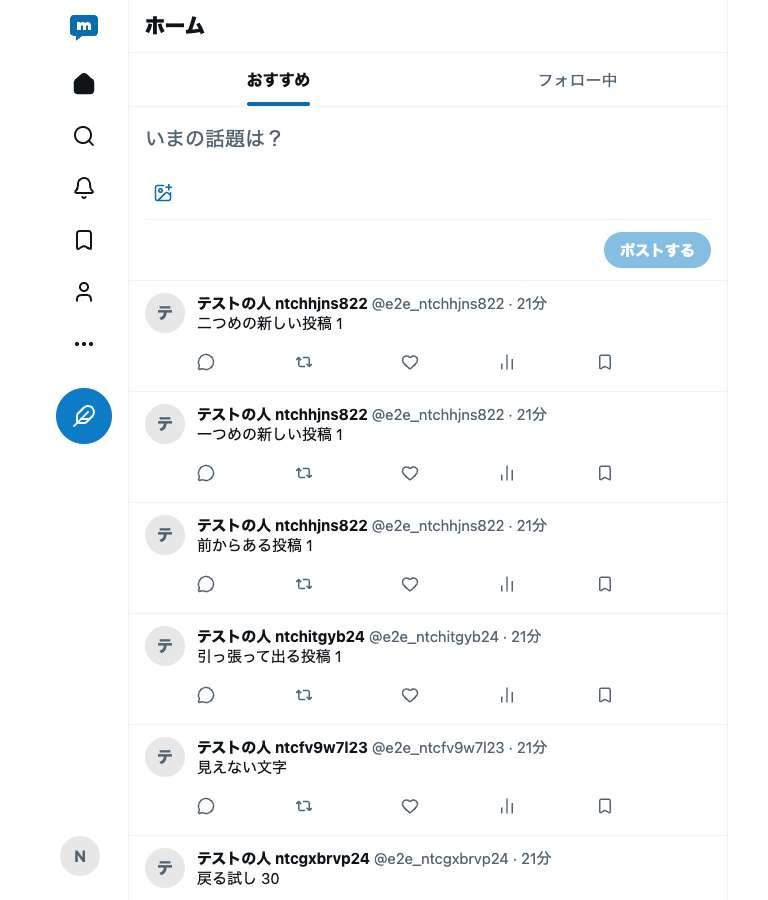

# 試験レポート: 依存の更新の PR が自動で作られ、脆弱な依存で CI が落ちる

## 対象

- issue: [#37](https://github.com/ohta-rh/x-modoki-v2/issues/37)
- commit: `7942838`、レビューで直した `92a7b89`・`8a7c4dd`・`25d7abe`（ブランチ `m1/local-app`、PR #40）
- CI: [実行 44575646672](https://github.com/ohta-rh/x-modoki-v2/actions/runs/44575646672)（成功。`verify (8 gates)` と `fresh clone (the local guide)`）
- 日付: 2026-11-20

## 環境

- macOS 26.2、Google Chrome（拡張から操作と、Playwright 1.65.0 の `channel: 'chrome'`）、Node.js 26.12.0（`.nvmrc` は 24。CI の実行を本当の結果とする）
- 動かし方: `pnpm build && pnpm start -p 3001`。確かめるために登録した架空の人（`hand_n93d5q`）

## 判定

合格 — 受け入れ条件 5 件のうち 5 件を満たした（1 件目の「Dependency graph に出る」は、Dependabot が既定のブランチの設定だけを読むので、PR #40 のマージのあとに出る）。

## 受け入れ条件ごとの結果

| # | 条件 | 確かめ方 | 結果 | エビデンス |
|---|---|---|---|---|
| 1 | `.github/dependabot.yml` が npm と GitHub Actions を週に 1 回調べ、パッチとマイナーは 1 つの PR、メジャーは 1 つずつ | ファイルを読んだ。`scripts/quality-gates.test.ts` › Dependabot が npm と GitHub Actions を週に 1 回調べ…（生態系ごとのグループが 2 つあることも） | 合格（Dependency graph はマージのあと） | — |
| 2 | ADR が系列を固定したもの（TypeScript 6.0・Drizzle 0.45・Next.js 16）は更新の PR にしない設定で、注に ADR の番号 | 同じテスト。レビューで、ADR-0004 が固定する Next.js 16.4 と React 19.3（と型）のマイナーも止め、Playwright（版がイメージの名前でもある、ADR-0046・ADR-0047）は全部の更新を止めた | 合格 | — |
| 3 | CI に `pnpm audit --prod --audit-level high` が 8 つ目の確認としてある | CI のログ: 段「8. Dependency audit」で `No known vulnerabilities found`。テスト › 依存の監査は 8 つ目の確認で、ほかの 7 つより先に動く。作業用の場所で脆弱な lodash 4.17.15 を入れると、高 3 件で rc=1 になることを見た | 合格 | `ci-run.jpg` |
| 4 | 更新の PR の扱いが品質のルールにある | `.claude/rules/quality-gates.md` の 1 節を読んだ（パッチとマイナーは CI が緑なら取り込む、メジャーは ADR のあと、固定した系列は置き換えの ADR で、監査は依存を上げて直す） | 合格 | — |
| 5 | ADR-0020 の 7 つを 8 つにする変更が新しい ADR にある | ADR-0070（ADR-0020 を置き換え）。`node scripts/check-docs.mjs` が通る | 合格 | — |

## 自動のテスト

`PORT=3300 pnpm verify` が 0 で終わった（`25d7abe`）: 単体のテスト 188 ファイル 1115 本、カバレッジ 4 つとも 100%、画面のテスト 387 本（Chromium・Firefox・WebKit）。CI でも 8 つの確認と `fresh-clone` が通った。`pnpm audit --prod --audit-level high` は手元でも `No known vulnerabilities found`。

### TDD の記録

| # | 振る舞い | 先に書いたテスト | 赤（落ちた理由） | 緑にした実装 |
|---|---|---|---|---|
| 1 | Dependabot が週に 1 回、まとめて PR を作り、固定した系列は上げない | `scripts/quality-gates.test.ts` › Dependabot が npm と GitHub Actions を週に 1 回調べ… | `ENOENT: no such file or directory, open '.github/dependabot.yml'` | `.github/dependabot.yml` |
| 2 | 監査が 8 つ目の確認 | 同 › 依存の監査は 8 つ目の確認で… | `expected '# CI is mandatory (ADR-0020). A chang…' to match /- name: 8\. Dependency audit…/` | `ci.yml` の段の名前 |
| 3 | Next.js 16.4・React 19.3 のマイナーも止める（レビュー 1） | 1 のテストの表に足した | `next: expected '# Dependency updates (#37, ADR-0071).…' to contain '- dependency-name: next\n        upda…'` | `dependabot.yml` |
| 4 | 監査が 1 より先、グループが 2 つ（レビュー 1） | 1・2 のテストに足した見張り | 設定をわざと壊して: `expected [ 'update-types: [minor, patch]' ] to have a length of 2 but got 1`、`expected 6660 to be less than 1916` | 変更なし（戻すと通る） |
| 5 | Playwright は Dependabot で上げない（レビュー 2） | 1 のテストの表に足した | `@playwright/test: expected … to contain '- dependency-name: \'@playwright/test…'`。止めていない形にわざと変えて `playwright: expected … not to contain …` | `dependabot.yml` |
| 6 | NFR-MAINT-02 のテストが 8 つの順を確かめる（レビュー 3） | › CI は push と PR のたびに、依存の監査と 7 つの確認の 8 つを順に流す | 監査をわざと最後に動かして `expected [ 1994, 2051, … ] to deeply equal [ 6733, 1994, … ]` | 変更なし（戻すと通る） |

## コードレビュー

- 判定: APPROVE（3 回目）　範囲: `origin/m1/local-app...HEAD`（`7942838`→`92a7b89`→`8a7c4dd`）　レビューした sub agent: code-reviewer（opus）

| # | 重さ | 指摘 | 確かめた結果 | 対応 |
|---|---|---|---|---|
| 1 | major | ADR-0004 は Next.js 16.4 系と React 19.3 系を固定しているのに、`next` はメジャーだけ、`react`・`react-dom` は止めていない（`dependabot.yml:13-15`） | そのとおり（ADR-0004 の 24〜25 行） | 直した（`92a7b89`）。型も止めた。テスト: 表に足した |
| 2 | minor | 「先に動く」のテストが順を確かめていない | そのとおり | 直した（`92a7b89`） |
| 3 | minor | `update-types: [minor, patch]` を 1 回しか確かめていない | そのとおり | 直した（`92a7b89`）。2 回 |
| 4 | major | npm のグループが Playwright を上げても、CI のイメージ `v1.65.0-noble` は動かず、ブラウザが立ち上がらずに赤になり、同じ PR の Next.js のパッチまで止まる | そのとおり（ADR-0046・ADR-0047） | 直した（`8a7c4dd`）。全部の更新を止めた |
| 5 | minor | NFR-MAINT-02 が「7 つ」のまま。全体像・技術の一覧・環境と配備が置き換えた ADR-0020 を指す | そのとおり | 直した（`8a7c4dd`） |
| 6 | minor | ADR-0071 の「セキュリティの更新は別の仕組みで日をまたがず来る」は、このリポジトリでは誤り（警告もセキュリティの更新も無効） | `gh api` で `{"enabled":false}` と 404 を確かめた | 直した（`25d7abe`）。事実を書いた。有効にするかはユーザーが決めること |
| 7 | minor | NFR-MAINT-02 を追うテストが 7 つしか確かめていない | そのとおり | 直した（`25d7abe`）。提案どおり監査を順に足し、名前を 8 つにした |

## ブラウザでの確認

| URL | 幅 | テーマ | した操作 | 見えた結果 | 画面の写真 |
|---|---|---|---|---|---|
| GitHub の CI の実行 44575646672 | 1372 | GitHub のダーク | 開いた | `verify (8 gates)` と `fresh clone (the local guide)` が緑 | `ci-run.jpg` |
| `/home` | 1280 | ライト | 開いた（設定の変更のあとも、アプリが読み込まれること） | いつもどおり | `home-1280.jpg` |
| `/home` | 768 | ライト | 同じ | 崩れない | `home-768.jpg` |
| `/home` | 375 | ライト | 同じ | 崩れない、横にはみ出さない | `home-375.jpg` |

- コンソール: エラー 0、警告 0　通信: 失敗 0（`chrome-evidence.mjs`）

## 見つけた問題

1. 依存の監査の段は #33 で CI に入っていたが、決めた ADR もルールも無かった。ADR-0070 で決めた
2. このリポジトリでは、Dependabot の警告とセキュリティの更新が有効になっていない（レビュー 6）。リポジトリの設定はユーザーが決めることなので変えず、ADR-0071 に書き、最後の報告で伝える
