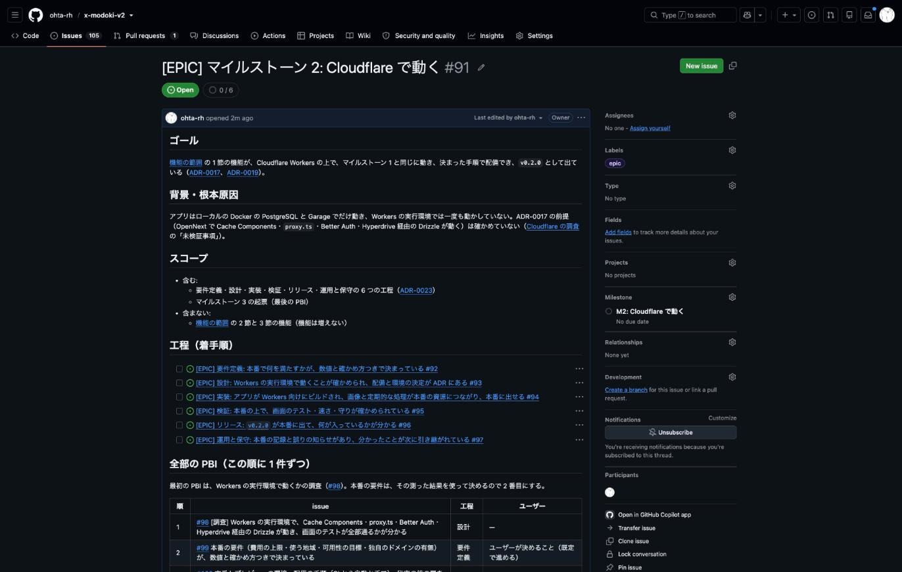
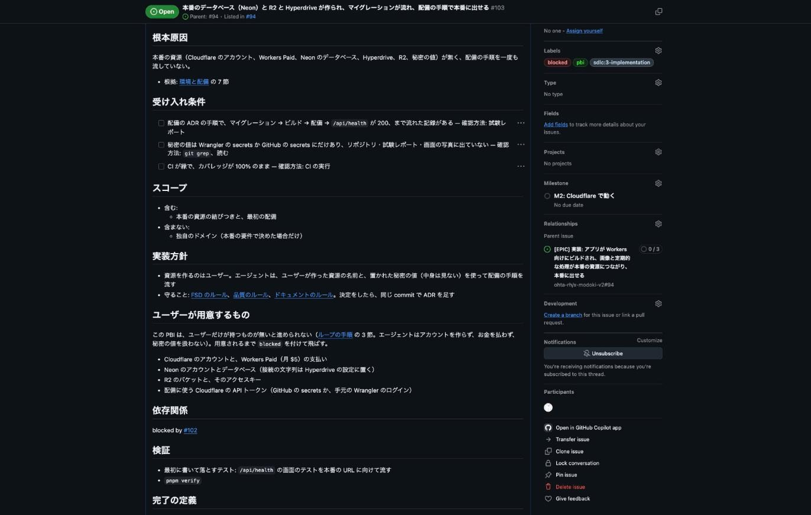

# 試験レポート: この作業で分かったことがルールに入り、マイルストーン 2 の EPIC が起票されている

## 対象

- issue: [#39](https://github.com/ohta-rh/x-modoki-v2/issues/39)
- commit: `ca97f03`、レビューで直した `971ade5`（ブランチ `m1/local-app`、PR #40）
- CI: [実行 44590691360](https://github.com/ohta-rh/x-modoki-v2/actions/runs/44590691360)（成功）
- 日付: 2026-11-20

## 環境

- macOS 26.2、Google Chrome（拡張から操作）、Node.js 26.12.0（`.nvmrc` は 24。CI の実行を本当の結果とする）
- 振り返りの材料集めは、読むだけの独立した sub agent（opus）が、issue 88 件・ADR・試験レポート・CI の実行 128 回を読んで行い、項目の判断と文書は私が書いた

## 判定

合格 — 受け入れ条件 6 件のうち 5 件を満たした。6 件目（マイルストーン 1 を閉じる）は、ADR-0029 により PR #40 のマージのあとに行う（マージの前に閉じると、マージで閉じる issue が残ったまま閉じることになる）。

## 受け入れ条件ごとの結果

| # | 条件 | 確かめ方 | 結果 | エビデンス |
|---|---|---|---|---|
| 1 | 閉じた issue と途中の ADR を全部読み、3 つに分けた一覧が `docs/research/retrospective-m1.md`（`type: Research`）にある | `node scripts/check-docs.mjs` が通る。前提が崩れた 11・ルールがあいまいだった 9・やり直した 11 | 合格 | [振り返り](../research/retrospective-m1.md) |
| 2 | 項目ごとに、ルールか ADR の変更、または変えない理由がある | 「ルールを変えた」の全部を差分と突き合わせた（レビューでも突き合わせた）: R1・R2・R3・P4・W3・W5d・W5f・W5g・W6・W7・W8・W9 | 合格 | 同 |
| 3 | 繰り返した間違いのうち機械で防げるものが、確認になっている | W1・W2 → commit の前のフック（ADR-0072、`scripts/check-staged.mjs`）。W9 → `check-docs.mjs` の ADR の番号の確かめ。機械にしなかった 6 つは理由を書いた（4 節） | 合格 | 下の TDD の記録 |
| 4 | マイルストーン 2 と EPIC があり、最初の PBI が Workers の確かめ。全部の PBI が issue のルールを満たす | `gh issue list --milestone "M2: Cloudflare で動く"`: EPIC #91、工程の EPIC #92〜#97、PBI #98〜#108。#98 が最初。全部に根本原因・受け入れ条件・完了の定義 | 合格 | `m2-epic.jpg` |
| 5 | アカウント・料金・秘密の値が要る PBI に、その旨と用意するもの | #103・#104 は `blocked` で「ユーザーが用意するもの」。レビューの指摘で #105・#107 にも足した。#99 は「ユーザーが決めること」（費用の上限・ドメイン、決まるまでの既定つき） | 合格 | `m2-pbi-blocked.jpg` |
| 6 | マイルストーン 1 が閉じられている | ADR-0029: PR #40 のマージのあと | マージのあと | — |

## 自動のテスト

`PORT=3300 pnpm verify` が 0 で終わった（`ca97f03`）: 単体のテスト 189 ファイル 1123 本、カバレッジ 4 つとも 100%、画面のテスト 387 本（Chromium・Firefox・WebKit）。CI でも 8 つの確認と `fresh-clone` が通った。commit の前のフックは `ca97f03` と `971ade5` の commit で実際に動いた（`docs check passed` と `traceability check passed`）。

### TDD の記録

| # | 振る舞い | 先に書いたテスト | 赤（落ちた理由） | 緑にした実装 |
|---|---|---|---|---|
| 1 | 引いている ADR の番号が無ければ落とす | `scripts/check-docs.test.mjs` › code, tests, configs and the harness cite only ADRs that exist | `expected exit 1, got 0` | `scripts/lib/check-docs.mjs`（`checkAdrCitations`）。カバレッジで、届かない `node_modules` の分岐を見つけて消した |
| 2 | 書き出すのはステージした中身 | `scripts/check-staged.test.mjs` › 書き出すのはステージした中身で… | `ENOENT … check-staged-out-…/a.md`（何もしない仮の関数） | `scripts/lib/check-staged.mjs`（`git checkout-index --all`） |
| 3 | 2 つの確認を動かし、片方でも落ちたら 1 | 同 › ステージした木で、ドキュメントと要件の結びつきの 2 つを確かめ… / 既定では… | `expected "vi.fn()" to be called 1 times, but got 0 times`、`… called with arguments: [ StringMatching /^docs check passed/ ]` | 同（`main`） |
| 4 | 書き出した木を消す | 同 › 書き出した木は、確かめたあと消す | 仮の関数ではたまたま通ったので、実装のあと消す処理を外して `expected [Function] to throw an error` を見た | 同（`finally` の `rmSync`） |
| 5 | commit の前のフックがあり、setup-local.sh が有効にする | `scripts/quality-gates.test.ts` › commit の前に、ステージした木でドキュメントの確認が動き… | `ENOENT: no such file or directory, open '.githooks/pre-commit'` | `.githooks/pre-commit`、`scripts/setup-local.sh` |

## コードレビュー

- 判定: APPROVE（2 回目）　範囲: `origin/m1/local-app...HEAD`（`ca97f03`→`971ade5`）　レビューした sub agent: code-reviewer（opus）

| # | 重さ | 指摘 | 確かめた結果 | 対応 |
|---|---|---|---|---|
| 1 | major | 振り返りの文書が「マイルストーン 2 の EPIC と issue に書いた」と言うのに、マイルストーン 2 が GitHub に無い（受け入れ条件 4・5 が満たされていない） | そのとおり（起票はこのあとの予定だったが、文書が先に「書いた」と言っていた） | 直した: マイルストーン・EPIC・PBI を起票し、文書に番号（#91・#98・#104）を書いた（`971ade5`） |
| 2 | minor | #105 と #107 が、本番の環境と API トークンが要ることを書いていない | そのとおり | 直した: 2 つの issue に「ユーザーが用意するもの」を足した（提案どおり） |

## ブラウザでの確認

| URL | 幅 | テーマ | した操作 | 見えた結果 | 画面の写真 |
|---|---|---|---|---|---|
| GitHub の issue #91（マイルストーン 2 の EPIC） | 1372 | GitHub のダーク | 開いて読んだ | 子の工程の EPIC 6 つ（題は 1 回だけ）、PBI の表、マイルストーン、リンク | `m2-epic.jpg` |
| GitHub の issue #103（`blocked` の PBI） | 1372 | GitHub のダーク | 開いて読んだ | 親の EPIC #94、`blocked`・`pbi`・`sdlc:3-implementation`、「ユーザーが用意するもの」、依存関係 #102 | `m2-pbi-blocked.jpg` |

- issue を起票した PBI なので、GitHub で描かれたものを見た（`.claude/rules/definition-of-done.md`）。#91 で ADR-0023 のリンクのファイル名を誤っていたのを見つけ、直した

## 見つけた問題

1. 起票の直後に読み直して、#98 の崩れた書き方（「#検証」）、#102 の誤った ADR のリンク（ADR-0011 → 定期的な処理を決めた ADR-0017）とファイルの道、#91 の ADR-0023 のリンクを見つけ、直した
2. フックの導入で、このリポジトリの git の設定（`core.hooksPath`）を `setup-local.sh` と同じ 1 行で変えた
