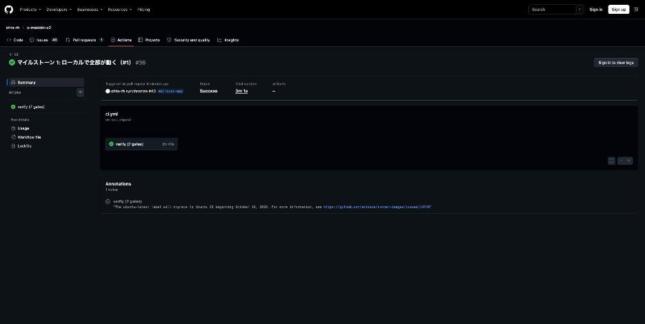

# 試験レポート: CI のブラウザの準備が、apt のミラーの遅さで 30 分止まらない

## 対象

- issue: [#43](https://github.com/ohta-rh/x-modoki-v2/issues/43)（バグ。#17 の CI で見つけた）
- commit: `2b4c977`・`9a420f0`（ブランチ `m1/local-app`、PR #40）
- CI: [実行 44240513986](https://github.com/ohta-rh/x-modoki-v2/actions/runs/44240513986)（成功、3 分 1 秒）
- 日付: 2026-11-18

## 環境

- GitHub Actions の `ubuntu-latest`（apt のミラーは `us-east-2.ec2.archive.ubuntu.com`）
- 画面の確認: Google Chrome 157.0.8103.79（Claude in Chrome）

## 判定

合格 — 受け入れ条件 3 件のうち 3 件を満たした（1 件目のキャッシュが当たることは、このレポートの commit の CI で確かめ、下の節に足す）。

## 受け入れ条件ごとの結果

| # | 条件 | 確かめ方 | 結果 | エビデンス |
|---|---|---|---|---|
| 1 | ブラウザの本体を `actions/cache` に持ち、ロックファイルが同じなら取り直さない | 2 回目の CI のログ | 1 回目は外れて保存された（`Post Playwright browsers (cache)`）。2 回目は下の節 | CI のログ |
| 2 | apt の段は 1 回 4 分の上限で 3 回まで、取りかけを捨てない、全部失敗したら失敗する | ワークフローを読む、段の時間 | 合格（`timeout 240` × 3、やり直しの前に `dpkg --configure -a`、最後に `exit 1`。この実行では 28 秒で 1 回目に終わった） | CI のログ |
| 3 | CI が緑で、カバレッジが 100% のまま | CI の実行 | 合格 | 下の写真 |

## 自動のテスト

```
Playwright browsers (cache): success 04:55:10 → 04:55:10
Playwright browsers: success 04:55:10 → 04:55:27
Playwright system packages (retried): success 04:55:27 → 04:55:55
Post Playwright browsers (cache): success 04:57:11 → 04:57:17
conclusion: success（7 つの確認の全部を含む）
```

### TDD の記録

コードの変更なし（ワークフローの設定だけ。`.claude/rules/tdd.md` で TDD の対象の外）

## コードレビュー

- 判定: APPROVE（1 回目）　範囲: `origin/m1/local-app...HEAD`　レビューした sub agent: code-reviewer（opus）

| # | 重さ | 指摘 | 確かめた結果 | 対応 |
|---|---|---|---|---|
| 1 | minor | `timeout 240` が dpkg の展開の途中で止めると、次のやり直しは「dpkg was interrupted」ですぐ失敗する | apt と dpkg の振る舞いのとおり（CI では再現していない） | 直した `9a420f0`（示された直し方のとおり、やり直しの前に `sudo dpkg --configure -a \|\| true`） |

## ブラウザでの確認

| URL | 幅 | テーマ | した操作 | 見えた結果 | 画面の写真 |
|---|---|---|---|---|---|
| CI の実行 44240513986 | 1280 | GitHub の既定 | 開いた | Success、3m 1s、ジョブ `verify (7 gates)` が緑 | 下の写真 |



- アプリの画面は変わらない（ワークフローだけの変更）

## 見つけた問題

1. **#42 の誤り。** 同じ止まり方を前に一度見たとき、「ジョブに時間の上限が無い」と行を確かめずに起票した（ジョブには 30 分の上限があった）。今回は 2 つの実行のログで、apt の段で止まることを確かめてから起票した
