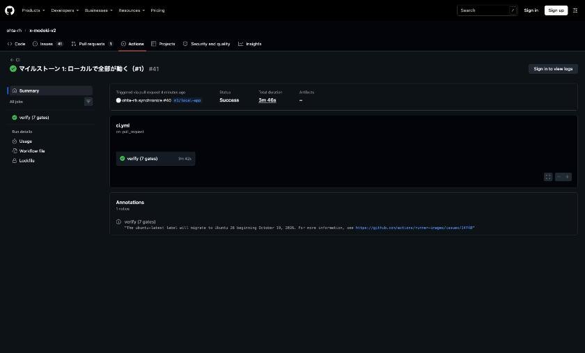

# 試験レポート: CI の apt のやり直しが、root の apt-get を止められずに効かない

## 対象

- issue: [#44](https://github.com/ohta-rh/x-modoki-v2/issues/44)（バグ。#43 の直しが効いていなかった。#18 の CI で見つけた）
- commit: `f06903f`（ブランチ `m1/local-app`、PR #40）
- CI: [実行 44247617093](https://github.com/ohta-rh/x-modoki-v2/actions/runs/44247617093)（成功、3 分 46 秒）
- 日付: 2026-11-18

## 環境

- GitHub Actions の `ubuntu-latest`、Playwright 1.65.0
- 画面の確認: Google Chrome 157.0.8103.79（Claude in Chrome）

## 判定

合格 — 受け入れ条件 3 件のうち 3 件を満たした。

## 受け入れ条件ごとの結果

| # | 条件 | 確かめ方 | 結果 | エビデンス |
|---|---|---|---|---|
| 1 | 1 回の試みが、root として動く `timeout` で止められる | ワークフローを読む。Playwright 1.65.0 の `installDependenciesLinux` と `transformCommandsForRoot` を読む（root なら `sudo` を使わず、`detached` でない子として apt-get を動かす） | 合格（`sudo --preserve-env=PATH timeout -k 15 200 …`） | — |
| 2 | 3 回の試みと片付けが、段の上限の中に収まる | ワークフローを読む | 合格（最悪 3 × (200 + 15) = 645 秒と片付けで、上限 900 秒） | — |
| 3 | CI が緑で、カバレッジが 100% のまま | CI の実行 | 合格（apt の段は 23 秒、root の `timeout` の下で動いた） | 下の写真 |

## 自動のテスト

```
Database migrations: success 05:56:09→05:56:10
Playwright browsers (cache): success 05:56:10→05:56:10
Playwright browsers: success 05:56:10→05:56:25
Playwright system packages (retried): success 05:56:25→05:56:48
7. Browser tests (Chromium, Firefox, WebKit): success 05:57:49→05:59:14
conclusion: success
```

### TDD の記録

コードの変更なし（ワークフローの設定だけ。`.claude/rules/tdd.md` で TDD の対象の外）

## コードレビュー

- 判定: APPROVE（1 回目）　範囲: `origin/m1/local-app...HEAD`　レビューした sub agent: code-reviewer（opus）

| # | 重さ | 指摘 | 確かめた結果 | 対応 |
|---|---|---|---|---|
| — | — | 指摘なし（`sudo --preserve-env=PATH` が PATH を保つかは CI で確かめる、と書かれた） | CI で段が成功した | — |

## ブラウザでの確認

| URL | 幅 | テーマ | した操作 | 見えた結果 | 画面の写真 |
|---|---|---|---|---|---|
| CI の実行 44247617093 | 1280 | GitHub の既定 | 開いた | Success、3m 46s、ジョブが緑 | 下の写真 |



## 見つけた問題

1. **#43 の直しが効いていなかった。** 根本原因: `timeout` は一般の利用者として動き、Playwright が `sudo` で動かす root の apt-get に信号を送れなかった。#43 では、レビューも私も、やり直しが実際に動くところを CI で見ていなかった（その日の実行は全部 1 回目で終わっていた）。直したあとの CI でも、ミラーが速かったので、止めてやり直す道は通っていない。通るのは、次にミラーが遅い日
