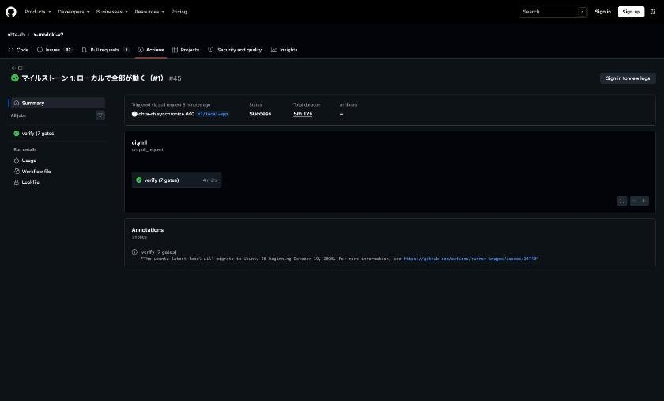

# 試験レポート: CI のブラウザの準備が、apt のミラーが遅い日にやり直しても終わらない

## 対象

- issue: [#45](https://github.com/ohta-rh/x-modoki-v2/issues/45)（バグ。#19 の試験レポートの CI で見つけた）
- commit: `220a841`・`0bb97be`（ブランチ `m1/local-app`、PR #40）
- CI: [実行 44255409876](https://github.com/ohta-rh/x-modoki-v2/actions/runs/44255409876)（成功、5 分 12 秒。キャッシュを作った 1 回目）
- 日付: 2026-11-18

## 環境

- GitHub Actions の `ubuntu-latest`（イメージ `ubuntu-26.04`）、Playwright 1.65.0
- 画面の確認: Google Chrome 157.0.8103.79（Claude in Chrome）

## 判定

合格 — 受け入れ条件 3 件のうち 3 件を満たした（1 件目のキャッシュが当たることは、このレポートの commit の CI で確かめ、下の節に足す）。

## 受け入れ条件ごとの結果

| # | 条件 | 確かめ方 | 結果 | エビデンス |
|---|---|---|---|---|
| 1 | 一度入れた `.deb` をキャッシュに持ち、次の実行はミラーにつながらずに `dpkg -i` で入れる | 2 回目の CI のログ | 下の「再試験」の節 | CI のログ |
| 2 | キャッシュが無いときは #44 のやり直しの道で入れ、入れた `.deb` をキャッシュに残す。キーは実行機のイメージごと | 1 回目の CI のログ、ワークフローを読む | 合格（ミラーの道で 64 秒、`Post Playwright system packages (cache)` で保存） | CI のログ |
| 3 | CI が緑で、カバレッジが 100% のまま | CI の実行 | 合格 | 下の写真 |

## 自動のテスト

```
Playwright browsers (cache): success 07:00:39→07:00:47
Playwright browsers: skipped
Playwright system packages (cache): success 07:00:47→07:00:47（外れた）
Playwright system packages: success 07:00:47→07:01:51
7. Browser tests (Chromium, Firefox, WebKit): success 07:02:53→07:04:37
Post Playwright system packages (cache): success 07:04:37→07:04:41（保存）
```

### TDD の記録

コードの変更なし（ワークフローの設定だけ。`.claude/rules/tdd.md` で TDD の対象の外）

## コードレビュー

- 判定: APPROVE（2 回目）　範囲: `origin/m1/local-app...HEAD`　レビューした sub agent: code-reviewer（opus）

| # | 回 | 重さ | 指摘 | 確かめた結果 | 対応 |
|---|---|---|---|---|---|
| 1 | 1 | major | キャッシュが当たって `dpkg -i` が失敗したとき、やり直しで入れた新しい `.deb` が保存されない（キーが当たると `actions/cache` は保存しない）。イメージが変わると、ロックファイルが変わるまで毎回ミラーに戻る | その通り（キーにイメージが入っていなかった） | 直した `0bb97be`。キーに `ImageOS-ImageVersion` を入れた。あわせて、`.deb` が無いときに `cp` が落ちないよう `find … -exec cp` にした |
| — | 2 | — | 指摘なし | — | — |

## ブラウザでの確認

| URL | 幅 | テーマ | した操作 | 見えた結果 | 画面の写真 |
|---|---|---|---|---|---|
| CI の実行 44255409876 | 1280 | GitHub の既定 | 開いた | Success、5m 12s、ジョブが緑 | 下の写真 |



## 見つけた問題

1. **#44 のやり直しは動いたが、ミラーが遅すぎた。** 実行 44253569082 では 200 秒の試みが 3 回とも止まった。やり直しではミラーの遅さは変わらないので、ミラーにつながらない道（キャッシュ）を足した
