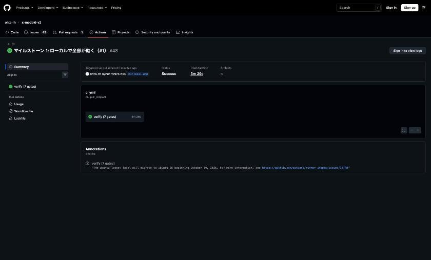

# 試験レポート: 登録とログインの回数の制限のテストが、分の境目でたまに落ちる

## 対象

- issue: [#46](https://github.com/ohta-rh/x-modoki-v2/issues/46)（バグ。#20 の `pnpm verify` で見つけた）
- commit: `146e507`（ブランチ `m1/local-app`、PR #40）
- CI: [実行 44261251313](https://github.com/ohta-rh/x-modoki-v2/actions/runs/44261251313)（成功、3 分 29 秒）
- 日付: 2026-11-18

## 環境

- macOS 26.2、Node.js 26（`.nvmrc` は 24。CI の実行を本当の結果とする）、Docker Compose の PostgreSQL
- CI: GitHub Actions の `ubuntu-latest`
- 画面の確認: Google Chrome（Claude in Chrome）

## 判定

合格 — 受け入れ条件 3 件のうち 3 件を満たした。

## 受け入れ条件ごとの結果

| # | 条件 | 確かめ方 | 結果 | エビデンス |
|---|---|---|---|---|
| 1 | `src/features/account-access/api/` の 2 つのテストのファイルは、`Date` を分の真ん中に止めて動く | ファイルを読む。`pnpm test src/features/account-access` を 3 回流す | 合格（3 回とも 0 で終わった） | — |
| 2 | 回数の制限を数える全てのテストが、本物の時計に頼っていない | `grep -rln RATE_LIMITED src --include='*.test.ts' \| xargs grep -L useFakeTimers` | 合格（出力が空） | — |
| 3 | CI が緑で、カバレッジが 100% のまま | CI の実行 | 合格 | 下の写真 |

## 自動のテスト

```
run 1 rc=0
run 2 rc=0
run 3 rc=0
Unit tests with coverage (100%): success
conclusion: success
```

### TDD の記録

| # | 振る舞い | 先に書いたテスト | 赤（落ちた理由） | 緑にした実装 |
|---|---|---|---|---|
| 1 | 11 回目の登録とログインは、分の境目をまたいでも RATE_LIMITED | 既にある `actions.test.ts` › 回数の制限を超えたら、待つように言う、`auth-flows.test.ts` › 11 回目は RATE_LIMITED（#20 の `pnpm verify` で、分の境目で落ちた） | `expected { ok: true } to deeply equal { ok: false, error: 'RATE_LIMITED' }`、`expected undefined to be '試行が多すぎます…'` | 2 つのテストのファイルの `beforeEach` で時計を止めた（テストだけの変更） |

## コードレビュー

- 判定: APPROVE（1 回目）　範囲: `029f3a3..146e507`　レビューした sub agent: code-reviewer（opus）

| # | 重さ | 指摘 | 確かめた結果 | 対応 |
|---|---|---|---|---|
| — | — | 指摘なし | — | — |

## ブラウザでの確認

| URL | 幅 | テーマ | した操作 | 見えた結果 | 画面の写真 |
|---|---|---|---|---|---|
| CI の実行 44261251313 | 1400 | GitHub の既定 | 開いた | Success、3m 29s、ジョブが緑 | 下の写真 |

- コンソール: 対象外（GitHub の画面）　通信: 失敗 0



## 見つけた問題

1. **根本原因:** `hitRateLimit` は分ちょうどにそろった 1 分で数える。11 回のパスワードのハッシュに数秒かかるので、ループの中で分の境目をまたぐと、11 回目が新しい区切りの 1 回目になって通った。#19 では投稿の同じテストを直していたが、登録とログインのテストが残っていた
