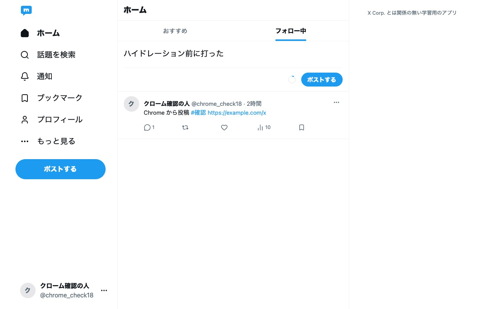

# 試験レポート: ページを開いてすぐ打った文字が、見えているのに投稿できない

## 対象

- issue: [#47](https://github.com/ohta-rh/x-modoki-v2/issues/47)（バグ。#22 の WebKit の画面のテストで見つけた。#20 の Chrome でも見えていた）
- commit: `b046ec5`（ブランチ `m1/local-app`、PR #40）
- CI: [実行 44273783309](https://github.com/ohta-rh/x-modoki-v2/actions/runs/44273783309)（成功）
- 日付: 2026-11-18

## 環境

- macOS 26.2、Node.js 26.12.0（`.nvmrc` は 24。CI の実行を本当の結果とする）、Docker Compose の PostgreSQL、Playwright 1.65.0
- 画面の確認: インストールした Google Chrome を Playwright で動かし、`/_next/static/chunks/**` を 3 秒遅らせて、ハイドレーションの前に打つ状態を作った

## 判定

合格 — 受け入れ条件 3 件のうち 3 件を満たした。

## 受け入れ条件ごとの結果

| # | 条件 | 確かめ方 | 結果 | エビデンス |
|---|---|---|---|---|
| 1 | ハイドレーションの前に入力欄に入っていた文字が状態に入り、「ポストする」が押せて、その文字が投稿される | `compose-box.test.tsx` › ハイドレーションの前に打った文字も…（`renderToString` の HTML の入力欄に文字を入れてから `hydrateRoot`） | 合格 | 下の写真 |
| 2 | 画面のテストが 3 つのブラウザで、読み込みの直後に打っても通る | CI（`goto` の直後に `fill` するテストが 3 つのブラウザで通った） | 合格 | CI の実行 |
| 3 | CI が緑で、カバレッジが 100% のまま | CI の実行 | 合格 | CI の実行 |

## 自動のテスト

```
 Test Files  87 passed (87)
      Tests  522 passed (522)
Statements   : 100% ( 1183/1183 )
Branches     : 100% ( 795/795 )
Functions    : 100% ( 282/282 )
Lines        : 100% ( 1031/1031 )
  126 passed (28.7s)
VERIFY_RC=0
```

### TDD の記録

| # | 振る舞い | 先に書いたテスト | 赤（落ちた理由） | 緑にした実装 |
|---|---|---|---|---|
| 1 | ハイドレーションの前に打った文字も投稿できる | `compose-box.test.tsx` › ハイドレーションの前に打った文字も、状態に入り、投稿できる | `Error: expect(element).toBeEnabled()`（「ポストする」が無効のまま） | `compose-box.tsx` の `useEffect`（マウントのときに DOM の値を状態に入れる） |

## コードレビュー

- 判定: APPROVE（1 回目）　範囲: `HEAD~1..HEAD`（`b046ec5`）　レビューした sub agent: code-reviewer（opus）

| # | 重さ | 指摘 | 確かめた結果 | 対応 |
|---|---|---|---|---|
| — | — | 指摘なし | — | — |

## ブラウザでの確認

| URL | 幅 | テーマ | した操作 | 見えた結果 | 画面の写真 |
|---|---|---|---|---|---|
| `/home?tab=following` | 1280 | ライト | スクリプトを 3 秒遅らせ、入力欄が出たらすぐ「ハイドレーション前に打った」と打った | ハイドレーションのあとも文字が残り、「ポストする」が押せる | 下の写真 |

- コンソール: エラー 0、警告 0



## 見つけた問題

1. **根本原因:** `ComposeBox` の入力欄は `useState('')` で制御されていて、ハイドレーションの前に打った文字は DOM に残るが状態に入らなかった。#20 の Chrome で一度見ていたが、「人の速さでは起きない」と判断して不具合にしなかった。それは誤りで、遅い回線では人でも起きる。見えているものと状態が違う症状は、速さに関わらず不具合として扱う
