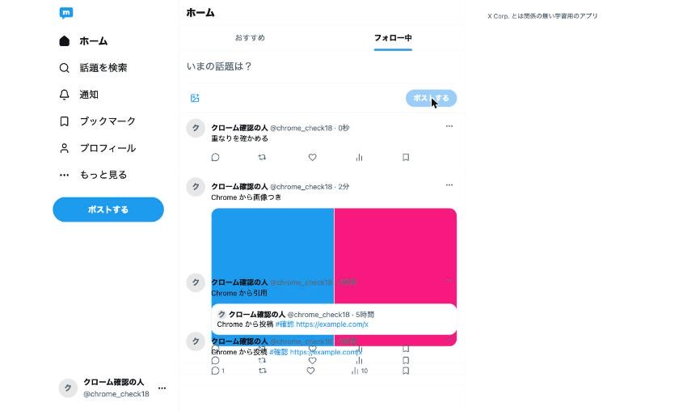
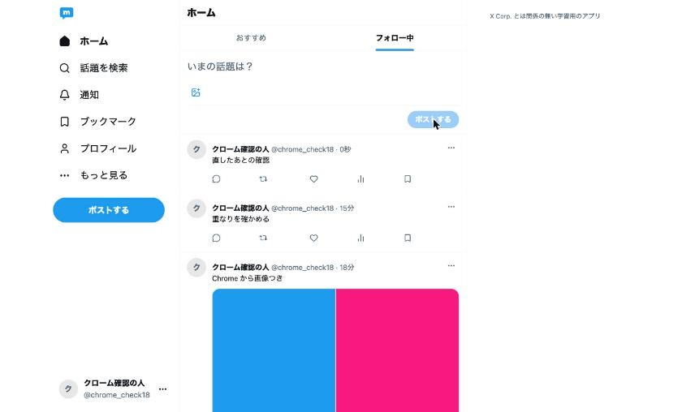
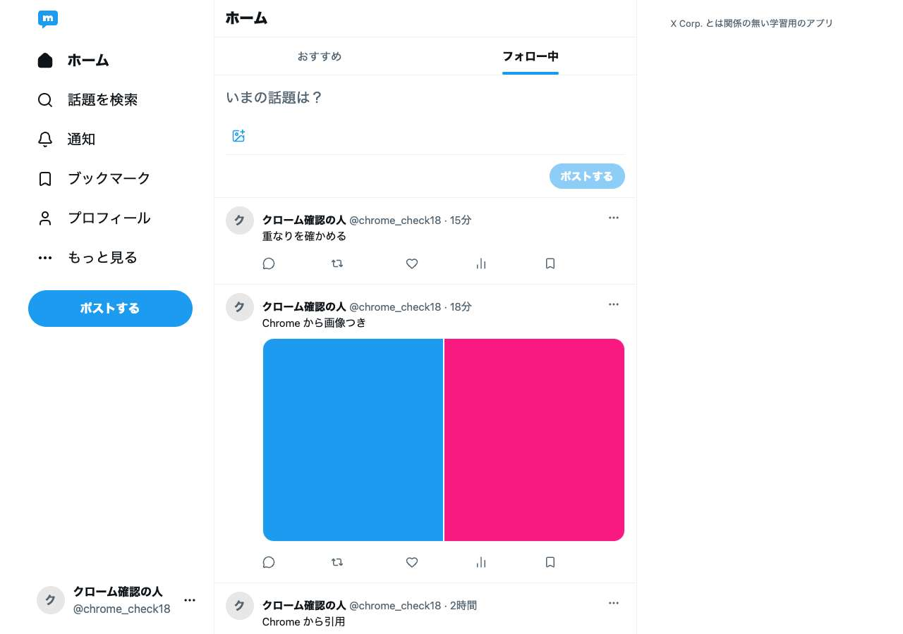
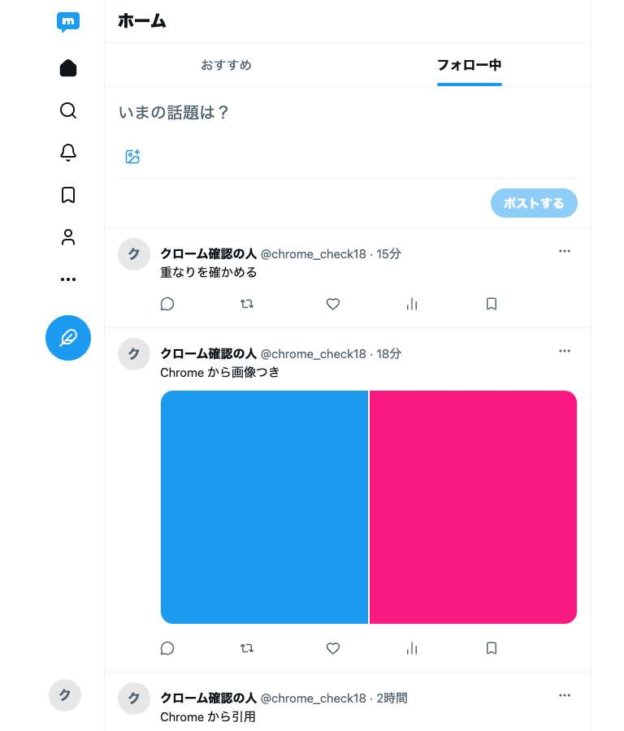
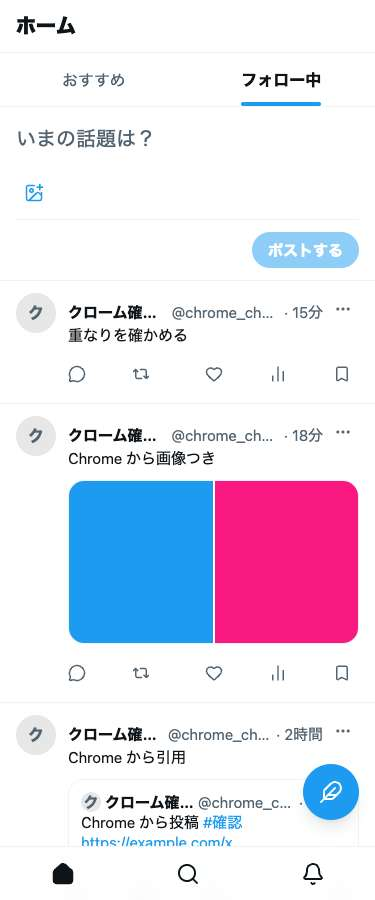

# 試験レポート: 投稿したあと、タイムラインのカードが重なる

## 対象

- issue: [#48](https://github.com/ohta-rh/x-modoki-v2/issues/48)（バグ。#25 の Chrome での確認で見つけた）
- commit: `93f83a7`（ブランチ `m1/local-app`、PR #40）
- CI: [実行 44297345716](https://github.com/ohta-rh/x-modoki-v2/actions/runs/44297345716)（成功）
- 日付: 2026-11-18

## 環境

- macOS 26.2、Node.js 26.12.0（`.nvmrc` は 24。CI の実行を本当の結果とする）、Docker Compose の PostgreSQL、Playwright 1.65.0
- 動かし方: `pnpm build && pnpm start -p 3300`、Chrome の確認用のテストの人（`chrome_check18`）
- 画面の確認: Google Chrome（Claude in Chrome）と `scripts/chrome-evidence.mjs`

## 判定

合格 — 受け入れ条件 3 件のうち 3 件を満たした。

## 受け入れ条件ごとの結果

| # | 条件 | 確かめ方 | 結果 | エビデンス |
|---|---|---|---|---|
| 1 | 仮想スクロールが、行の高さを投稿（とリポストした人）ごとに覚える | `post-feed.test.tsx` › 行の高さを、番号ではなく投稿（とリポストした人）ごとに覚える | 合格 | — |
| 2 | 高さの違うカードがあるタイムラインで投稿しても、カードが重ならない | Playwright（`home-timeline.spec.ts` › 投稿したあとも、高さの違うカードどうしが重ならない）、本物の Chrome で投稿して各行の位置を読んだ | 合格 | `after-post.jpg` |
| 3 | CI が緑で、カバレッジが 100% のまま | CI の実行 | 合格 | CI の実行 |

## 自動のテスト

```
 Test Files  118 passed (118)
      Tests  631 passed (631)
Statements   : 100% ( 1687/1687 )
Branches     : 100% ( 1143/1143 )
Functions    : 100% ( 412/412 )
Lines        : 100% ( 1475/1475 )
  153 passed (38.4s)
VERIFY_RC=0
```

Playwright は Chromium・Firefox・WebKit で 51 本ずつ、合わせて 153 本が通った。この `pnpm verify` は、まだ commit していない #25 の作業が入った作業ツリーで流した。commit だけの状態は CI の実行で確かめた。

### TDD の記録

| # | 振る舞い | 先に書いたテスト | 赤（落ちた理由） | 緑にした実装 |
|---|---|---|---|---|
| 1 | 行の高さを投稿ごとに覚える | `post-feed.test.tsx` › 行の高さを、番号ではなく投稿（とリポストした人）ごとに覚える（本物の仮想スクロールを `vi.mock` で包み、渡された設定を読む） | `AssertionError: expected [ undefined, undefined ] to deeply equal [ '1:jiro', '1:' ]` | `post-feed.tsx` の `getItemKey` |
| 2 | 投稿したあともカードが重ならない（受け入れのテスト） | `home-timeline.spec.ts` › 投稿したあとも、高さの違うカードどうしが重ならない | `expect(received).toBeGreaterThanOrEqual(expected)` — `Expected: >= 560`、`Received: 483` | 同じ |

画面のテストは、最初の 2 つの形（短い投稿を 3 つ、引用を足したもの）では落ちなかった。最初の行の高さはサーバーの最初のページから測られるので、引用を作ったあとに読み直してから投稿する形にして、Chrome で見た状態を再現した。

## コードレビュー

- 判定: APPROVE（1 回目）　範囲: `93f83a7~1..93f83a7`　レビューした sub agent: code-reviewer（opus）

| # | 重さ | 指摘 | 確かめた結果 | 対応 |
|---|---|---|---|---|
| — | — | 指摘なし（画面のテストの `waitForTimeout(500)` は少し脆いが、落ちられないテストにはしていない、と添えられた） | — | — |

## ブラウザでの確認

| URL | 幅 | テーマ | した操作 | 見えた結果 | 画面の写真 |
|---|---|---|---|---|---|
| `/home?tab=following` | 1400 | ライト | 直す前に「重なりを確かめる」を投稿した | 行の位置が 0 / 123 / 323 / 446 で、高さ 424 の画像つきのカードに、下の 2 枚が重なった | `before-overlap.jpg` |
| 同じ | 1400 | ライト | 直したあとに「直したあとの確認」を投稿した | 行の位置が 0 / 123 / 246 / 670 / 870 で、高さの合計と一致。重ならない | `after-post.jpg` |
| 同じ | 1280 / 768 / 375 | ライト | 開いた | カードが重ならず、横へのはみ出しも無い | `home-*.jpg` |

- コンソール: エラー 0、警告 0　通信: 失敗 0（`chrome-evidence.mjs` の 3 回の読み込み）
- 失敗の経路: 空の入力欄では「ポストする」が押せないまま（写真の右上）







## 見つけた問題

1. **根本原因:** `PostFeed` の `useWindowVirtualizer` に `getItemKey` が無く、測った高さを行の番号で覚えていたので、先頭に投稿が入ると各行が 1 つ前の行の高さで並べられて重なった。React の `key` と同じ「投稿の ID とリポストした人」で覚えるようにした
2. この PBI の `pnpm verify` の画面のテストで、PostgreSQL の接続の数の上限に当たった。#49 として起票し、先に直した（[#49 の試験レポート](issue-0049-postgres-connections.md)）
3. 私は、`pnpm verify` が 1 で終わったのに、そのあとの `git commit` がつながっていたので、`93f83a7` を作ってしまった。push はしていない。#49 を直して `pnpm verify` が 0 になってから push した
