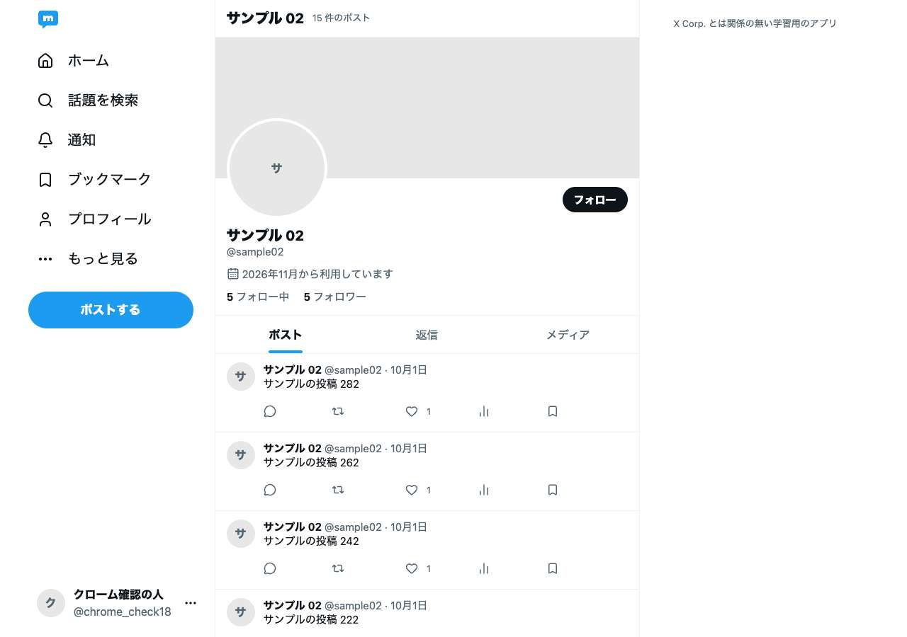
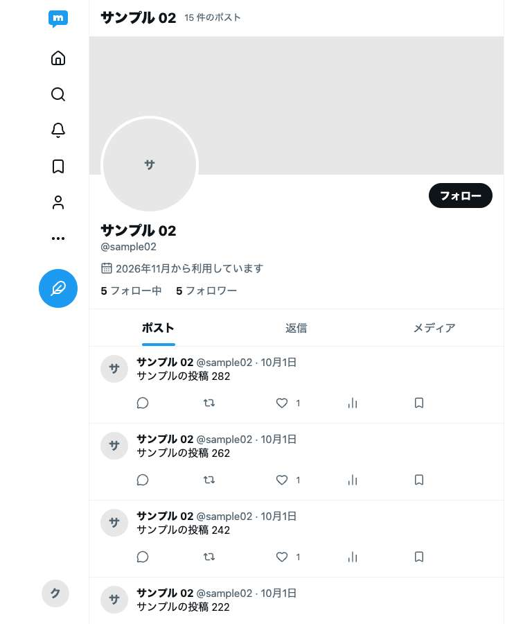
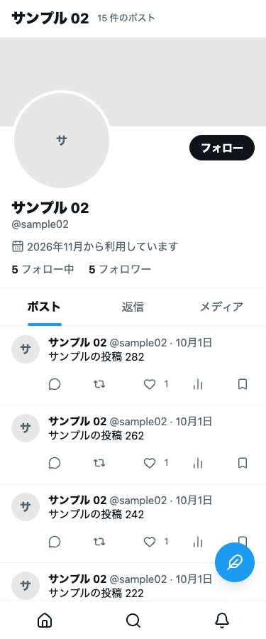
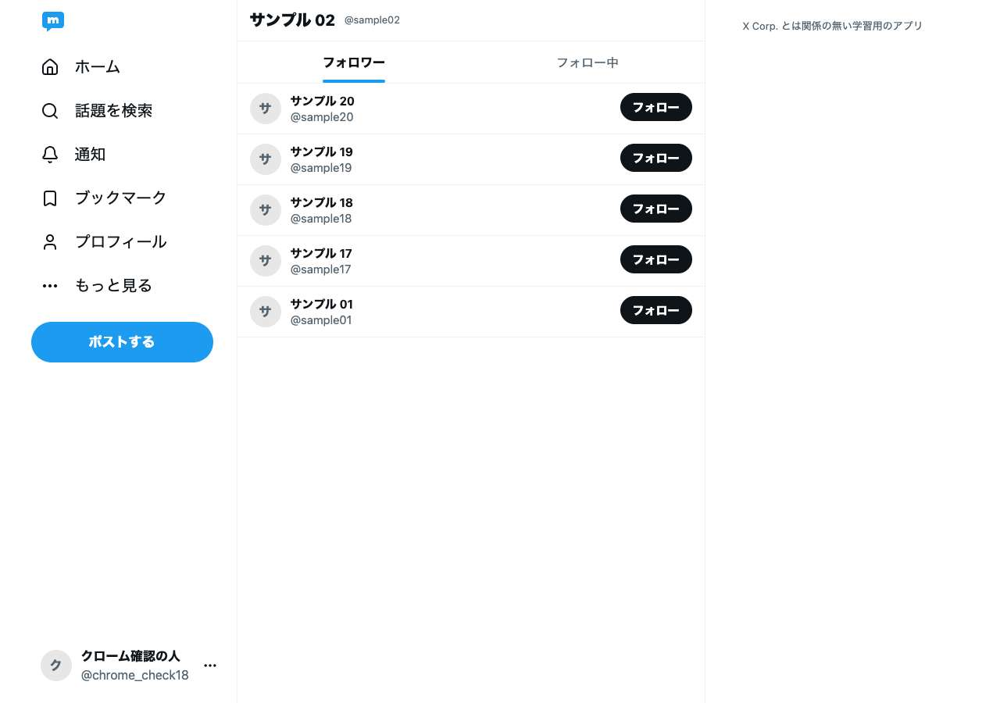
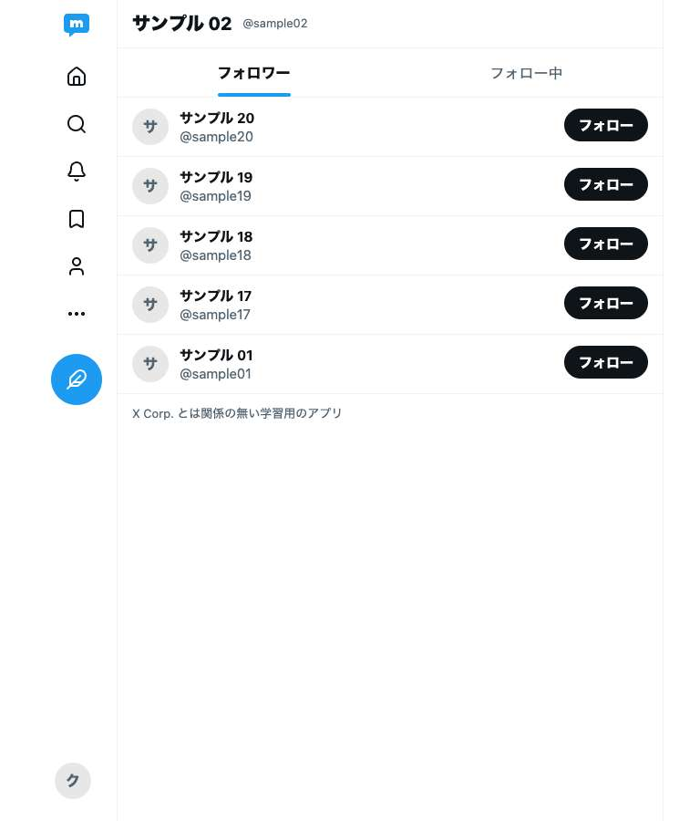
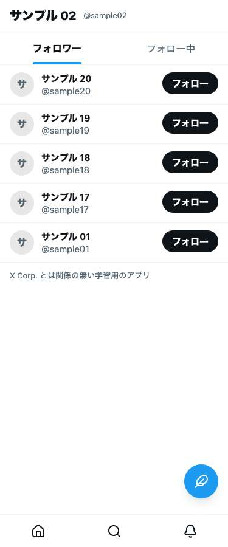

# 試験レポート: フォローの画面のテストが、WebKit で読み直しと移動が重なってたまに落ちる

## 対象

- issue: [#50](https://github.com/ohta-rh/x-modoki-v2/issues/50)（バグ。#49 の `pnpm verify` の WebKit で見つけた）
- commit: `6eb8ec1`、`3fb1f61`、`dbe4490`（ブランチ `m1/local-app`、PR #40）
- CI: [実行 44297345716](https://github.com/ohta-rh/x-modoki-v2/actions/runs/44297345716)（成功）
- 日付: 2026-11-18

## 環境

- macOS 26.2、Node.js 26.12.0（`.nvmrc` は 24。CI の実行を本当の結果とする）、Docker Compose の PostgreSQL、Playwright 1.65.0
- 動かし方: `pnpm build && pnpm start -p 3300`

## 判定

合格 — 受け入れ条件 3 件のうち 3 件を満たした。

## 受け入れ条件ごとの結果

| # | 条件 | 確かめ方 | 結果 | エビデンス |
|---|---|---|---|---|
| 1 | テストは、読み直しが終わって画面が落ち着いてから移る | テストのコードを読んだ（`follow.spec.ts`: 読み直しの RSC の応答の本文を `finished()` で待ち、ホームのリンクとフォロー中のタブで移る） | 合格 | — |
| 2 | `follow.spec.ts` を WebKit で 5 回続けて流して通る | `playwright test e2e/follow.spec.ts --repeat-each=5`（3 つのブラウザ） | 合格（30 本が通った） | 下の出力 |
| 3 | CI が緑 | CI の実行 | 合格 | CI の実行 |

実装方針は issue の本文（`networkidle` を待つ）から変えた。理由は issue の本文の先頭と、下の「コードレビュー」に書いた。

## 自動のテスト

```
$ playwright test e2e/follow.spec.ts --repeat-each=5
  30 passed (16.5s)
```

`pnpm verify` は 0 で終わった（単体のテスト 631 本、カバレッジ 4 つとも 100%、画面のテスト 153 本）。

### TDD の記録

| # | 振る舞い | 先に書いたテスト | 赤（落ちた理由） | 緑にした実装 |
|---|---|---|---|---|
| 1 | フォローのあと、読み直しが終わってから移る | 直す前の `follow.spec.ts` を WebKit で `--repeat-each=5` | 5 回のうち 1 回: `Error: page.goto: Navigation to "http://localhost:3300/home?tab=following" is interrupted by another navigation to "http://localhost:3300/e2e_m1ngmu78h1"` | `follow.spec.ts`（テストだけの変更） |

## コードレビュー

- 判定: APPROVE（3 回目）　範囲: `6eb8ec1~1..HEAD -- e2e/follow.spec.ts`　レビューした sub agent: code-reviewer（opus）

| # | 回 | 重さ | 指摘 | 確かめた結果 | 対応 |
|---|---|---|---|---|---|
| 1 | 1（CHANGES_REQUESTED） | major | `waitForLoadState('networkidle')` は、プロフィールの文書で一度出ていると何もせずに返るので、`router.refresh()` の取得の途中で `page.goto` が始まりうる | その通り（Playwright は同じ文書の中の要求で `networkidle` を取り消さない） | 直した `3fb1f61`（読み直しの RSC の応答を待つ） |
| 2 | 2（CHANGES_REQUESTED） | major | `waitForResponse` はヘッダーが届いた時点で返る。そのあと本文を読み、状態を確定し、`history.replaceState` を書くので、隙間は狭くなっただけで残る | その通り | 直した `dbe4490`（本文の終わりを `finished()` で待ち、ブラウザの移動ではなくアプリのリンクで移る） |
| — | 3（APPROVE） | — | 指摘なし | — | — |

## ブラウザでの確認

| URL | 幅 | テーマ | した操作 | 見えた結果 | 画面の写真 |
|---|---|---|---|---|---|
| `/sample02` | 1280 / 768 / 375 | ライト | ログインして開いた | プロフィールとフォローのボタンがいつも通り出る | `profile-*.jpg` |
| `/sample02/followers` | 1280 / 768 / 375 | ライト | 開いた | フォロワーの一覧がいつも通り出る | `followers-*.jpg` |

- コンソール: エラー 0、警告 0　通信: 失敗 0（`chrome-evidence.mjs` の 6 回の読み込み）
- アプリのコードは変えていない（テストだけ）








## 見つけた問題

1. **根本原因:** テストはフォローの Server Action の応答を待ったあとすぐ `page.goto` で移っていたが、プロフィールはその応答のあとで `router.refresh()` を始めるので、WebKit では読み直しと移動が重なり、移動が「割り込まれた」で落ちた。利用者には影響しない（アプリの中の移動はルーターが順に扱う）
2. 繰り返しの途中で一度、別の形の失敗を見た（WebKit で、最初の投稿が 5 秒のうちにタイムラインに出なかった）。20 回の繰り返しと、そのあとの 30 回・`pnpm verify`・CI では再び起きていない。その回のトレースは次の実行で消えてしまい、原因は分かっていない。再び起きたら、トレースを残して調べる
