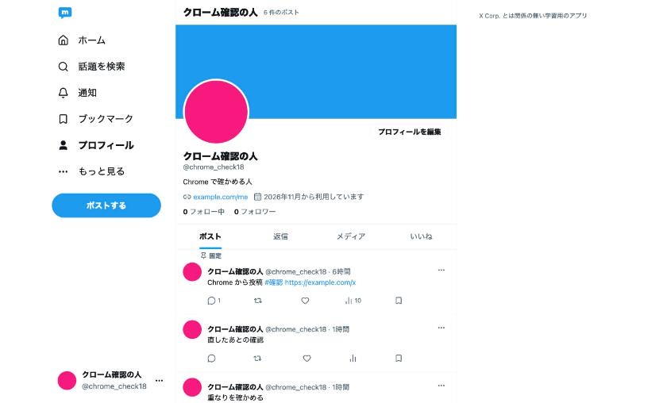
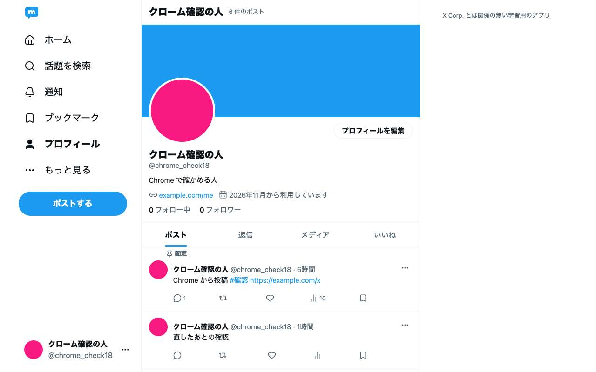
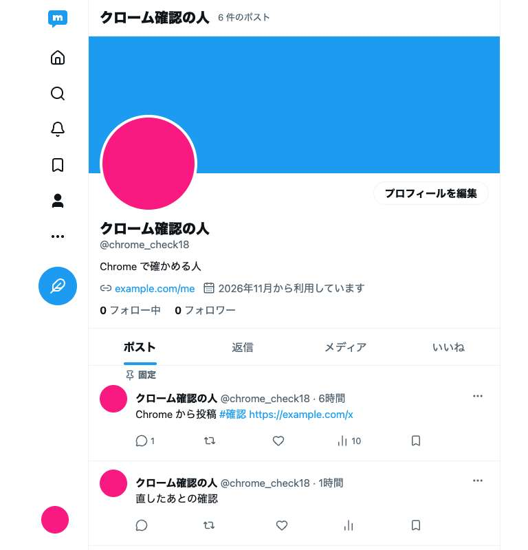
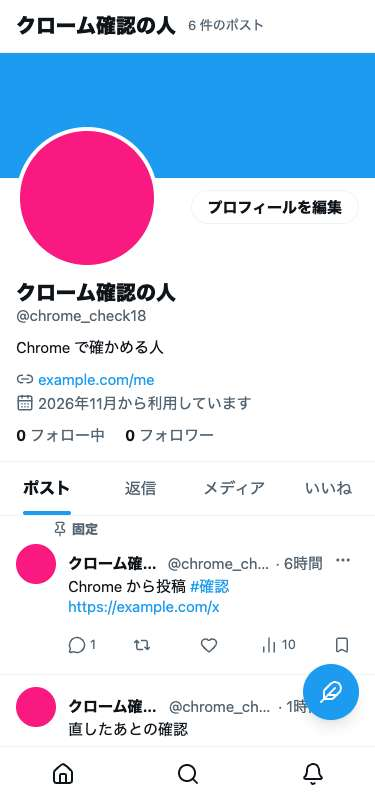
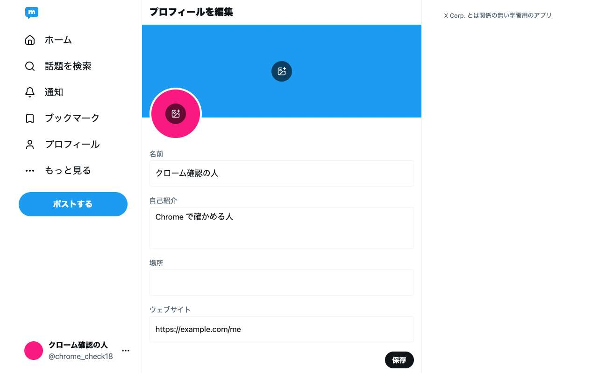
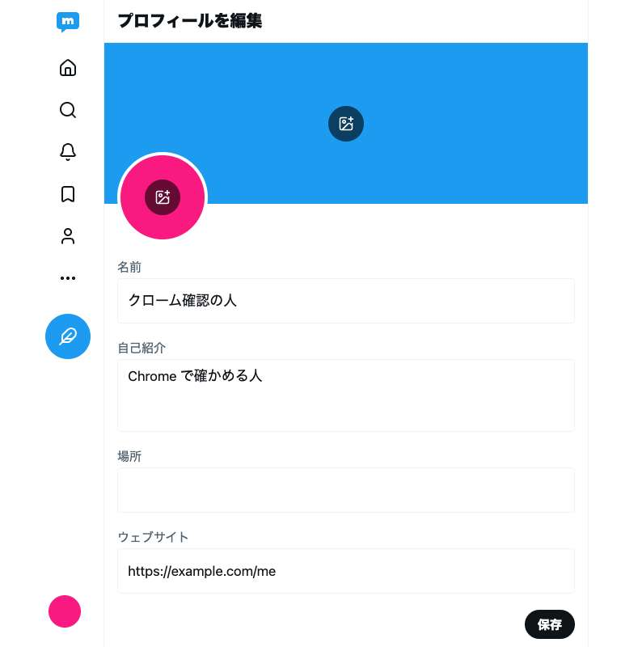
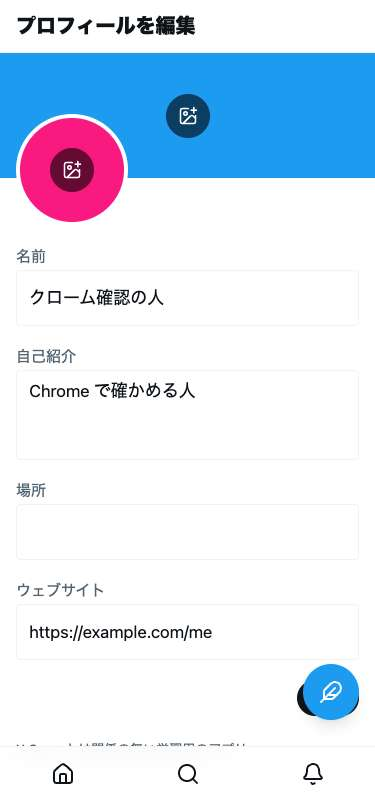

# 試験レポート: Better Auth の使っていない書き込みの道から、プロフィールや画像を検証なしに変えられる

## 対象

- issue: [#51](https://github.com/ohta-rh/x-modoki-v2/issues/51)（バグ。#25 のコードレビューで見つけた）
- commit: `d608641`、`66b41f8`（ブランチ `m1/local-app`、PR #40）
- CI: [実行 44307921645](https://github.com/ohta-rh/x-modoki-v2/actions/runs/44307921645)
- 日付: 2026-11-18

## 環境

- macOS 26.2、Node.js 26.12.0（`.nvmrc` は 24。CI の実行を本当の結果とする）、Docker Compose の PostgreSQL、Better Auth 1.7.20
- 動かし方: `pnpm build && pnpm start -p 3300`、Chrome の確認用のテストの人（`chrome_check18`）でログインした Chrome

## 判定

合格 — 受け入れ条件 4 件のうち 4 件を満たした。

## 受け入れ条件ごとの結果

| # | 条件 | 確かめ方 | 結果 | エビデンス |
|---|---|---|---|---|
| 1 | 4 つの道は 404 で、`users` は変わらない | `auth.test.ts` › T-21（#51）: 使わない書き込みの道は、ログインしていても 404…（ログインした cookie で呼び、名前・画像・メールを確かめる）。Chrome からも呼んだ | 合格 | `profile-unchanged-1400.jpg` |
| 2 | ログイン・登録・ログアウト・プロフィールの編集は今まで通り | 既存の画面のテスト（165 本が通った） | 合格 | `edit-*.jpg` |
| 3 | 方針が ADR と脅威の文書にある | ADR-0045、脅威の文書の T-21 | 合格 | — |
| 4 | CI が緑、カバレッジ 100% のまま | CI の実行、`pnpm verify` | 合格 | CI の実行 |

## 自動のテスト

```
 Test Files  122 passed (122)
      Tests  680 passed (680)
Statements   : 100% ( 1838/1838 )
Branches     : 100% ( 1235/1235 )
Functions    : 100% ( 454/454 )
Lines        : 100% ( 1602/1602 )
  165 passed (44.6s)
VERIFY_RC=0
```

### TDD の記録

| # | 振る舞い | 先に書いたテスト | 赤（落ちた理由） | 緑にした実装 |
|---|---|---|---|---|
| 1 | 4 つの道は外から呼べない | `auth.test.ts` › T-09（#51）: %s は外から呼べない | `AssertionError: expected 401 to be 404`（道は開いていて、ログインが無いので断られていただけ） | `src/shared/auth/auth.ts` の `disabledPaths` |
| 2 | ログインしていても 404 で、行が変わらない（レビュー 1） | `auth.test.ts` › T-21（#51）: …ログインしていても 404… | `/update-user` を開け直して `AssertionError: /update-user: expected 200 to be 404` を見てから戻した | 同じ（テストを強めた） |

## コードレビュー

- 判定: APPROVE（1 回目）　範囲: `d608641~1..d608641`　レビューした sub agent: code-reviewer（opus）

| # | 重さ | 指摘 | 確かめた結果 | 対応 |
|---|---|---|---|---|
| 1 | minor | 脅威の文書の新しい行が T-16 で、既にある「秘密の値の漏れ」の T-16 と重なる | その通り（T-20 も 2 回出るが、2 つ目は受け入れたリスクの表からの参照で重なりではない） | 直した `66b41f8`（T-21 にし、ADR と log もそろえた） |
| 2 | minor | テストが 404 だけを見ていて、「`users` は変わらない」とログインした呼び出しを確かめていない | その通り | 直した `66b41f8`（レビュアーの直し方どおり） |

レビュアーは、ほかの Better Auth の道（`update-session`・`unlink-account`・`revoke-*`）が `users` を書かないこと、アプリのどこからも 4 つの道を呼んでいないことも確かめた。

## ブラウザでの確認

| URL | 幅 | テーマ | した操作 | 見えた結果 | 画面の写真 |
|---|---|---|---|---|---|
| `/chrome_check18` | 1400 | ライト | ログインした Chrome から `get-session` と 4 つの道を POST（`update-user` には 51 文字の名前と他人のキー） | `[200, 404, 404, 404, 404]`。読み直したプロフィールの名前とアバターは元のまま | `profile-unchanged-1400.jpg` |
| `/chrome_check18` | 1280 / 768 / 375 | ライト | 開いた | いつも通り | `profile-*.jpg` |
| `/settings/profile` | 1280 / 768 / 375 | ライト | 開いた（隣の画面） | 編集はいつも通り開く | `edit-*.jpg` |

- コンソール: エラー 0、警告 0　通信: 失敗 0（`chrome-evidence.mjs` の 6 回の読み込み。404 は狙って呼んだ 4 つだけ）









## 見つけた問題

1. **根本原因:** `app/api/auth/[...all]` は Better Auth のすべての HTTP の道を通し、閉じていたのは登録とログインの 3 つだけだった。`update-user` は本文の `name`・`image` をそのまま書くので、プロフィールの編集の検証と、画像の持ち主の確認（#25）を素通りできた。#25 の中では、置き換えた画像を自分の行だけ消すようにして、他人の画像が消える道を先に塞いだ
