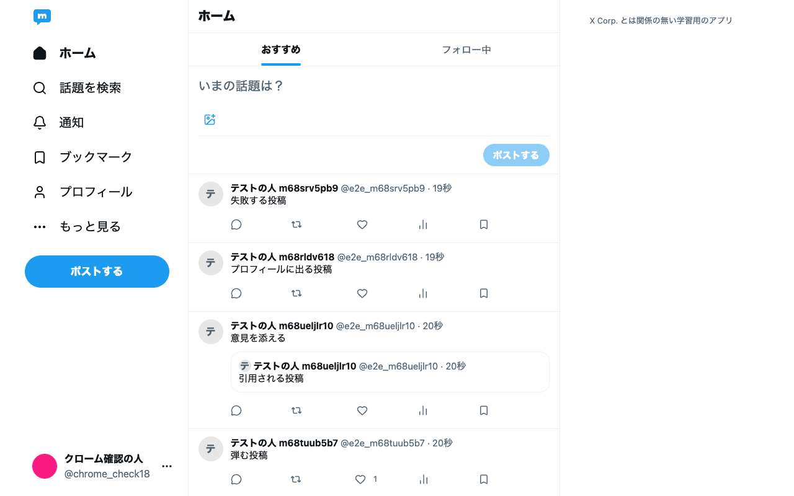
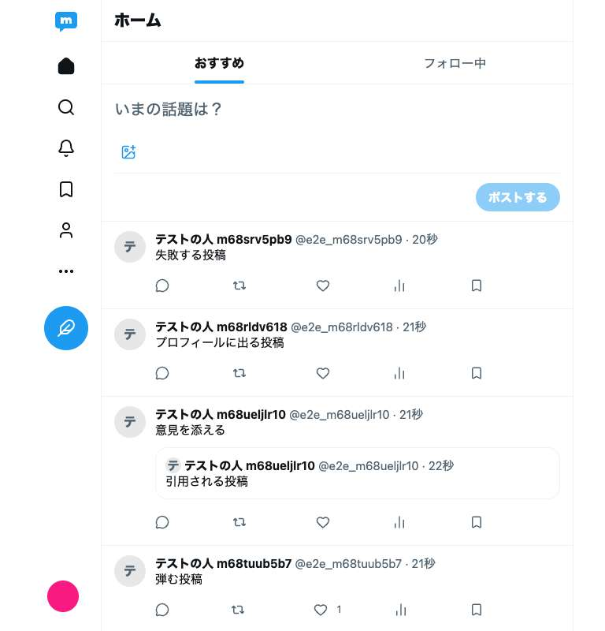

# 試験レポート: CI の画面のテストが、apt のミラーに左右されずに公式の Playwright のイメージで動く

## 対象

- issue: [#52](https://github.com/ohta-rh/x-modoki-v2/issues/52)（ユーザーの指示: 「CI は Playwright のイメージを使えばいいのでは」）
- commit: `1e40b92`、`8795030`、`413225f`、`5d31d1e`、`b163a84`（ブランチ `m1/local-app`、PR #40）
- CI: [実行 44314784180](https://github.com/ohta-rh/x-modoki-v2/actions/runs/44314784180)（成功）。その前の [44313785881](https://github.com/ohta-rh/x-modoki-v2/actions/runs/44313785881) は 5 番目の確認で落ちた（下の「見つけた問題」）
- 日付: 2026-11-18

## 環境

- GitHub Actions の `ubuntu-latest`、イメージ `mcr.microsoft.com/playwright:v1.65.0-noble`（Ubuntu 24.04、ブラウザは chromium 1254・firefox 1572・webkit 2388）
- 手元: macOS 26.2、Docker Desktop（イメージを pull して中身を確かめた）

## 判定

合格 — 受け入れ条件 5 件のうち 5 件を満たした。

## 受け入れ条件ごとの結果

| # | 条件 | 確かめ方 | 結果 | エビデンス |
|---|---|---|---|---|
| 1 | 画面のテストがイメージの中で 3 つのブラウザで動く | CI の実行 44314784180 のログ | 合格（`165 passed (4.3m)`） | 下の出力 |
| 2 | apt・ブラウザのキャッシュ・`playwright install` のステップが無い | `ci.yml` を読んだ。ログに `apt-get`・`install-deps` が 0 回 | 合格 | 下のステップの表 |
| 3 | Node.js は `.nvmrc` の版（イメージの 26 ではない） | CI のログの `node -v` | 合格（5 番目と 7 番目とも `v24.22.2`） | 下の出力 |
| 4 | 決定が ADR と環境の文書にある | ADR-0046・ADR-0047、`environments.md` の CI の表の 5 と 7 | 合格 | — |
| 5 | CI が緑 | CI の実行 | 合格 | CI の実行 |

```
Run actions/setup-node@v7 | node: v24.22.2
5. Tests and coverage (100%) | v24.22.2
7. Browser tests (Chromium, Firefox, WebKit) | v24.22.2
7. Browser tests (Chromium, Firefox, WebKit) |   165 passed (4.3m)
```

| ステップ | 時間 |
|---|---|
| Playwright image（`docker pull`） | 16 秒 |
| 5. Tests and coverage（イメージの中） | 94 秒 |
| 7. Browser tests（イメージの中） | 261 秒 |

前は、ブラウザのキャッシュが外れた日や apt のミラーが遅い日に、準備だけで何分も止まった（#43・#44・#45）。

## 自動のテスト

CI の設定と文書だけの変更（`.claude/rules/tdd.md` の「CI YAML」は対象の外）。確かめたのは CI の実行そのもの。

### TDD の記録

コードの変更なし（`.github/workflows/ci.yml` と文書・ルールだけ）。

## コードレビュー

- 判定: APPROVE（3 回目）　範囲: `1e40b92~1..5d31d1e`　レビューした sub agent: code-reviewer（opus）

| # | 回 | 重さ | 指摘 | 確かめた結果 | 対応 |
|---|---|---|---|---|---|
| 1 | 1（CHANGES_REQUESTED） | blocker | コンテナが root で動き、`HOME` はランナー（uid 1001）のもの。Firefox は持ち主の違う `$HOME` では立ち上がらない | 再現した（イメージの中で root では「Running Nightly as root in a regular user's session is not supported」、uid 1001 では写真まで撮れた） | 直した `8795030`（`--user "$(id -u):$(id -g)"`） |
| — | 2（APPROVE） | — | 指摘なし | — | — |
| — | 3（APPROVE、5 番目もイメージへ移したあと） | — | 指摘なし | — | — |

## ブラウザでの確認

| URL | 幅 | テーマ | した操作 | 見えた結果 | 画面の写真 |
|---|---|---|---|---|---|
| `/home` | 1280 / 768 / 375 | ライト | CI の変更のあとのビルドで開いた | いつも通り出る | `home-*.jpg` |

- コンソール: エラー 0、警告 0　通信: 失敗 0（`chrome-evidence.mjs`）
- CI の実行のページは、ログインした個人のアカウントが写るので写真にしない。上のログの抜き出しを証拠にする





## 見つけた問題

1. **5 番目の確認もブラウザを立ち上げる**（最初の CI の実行 44313785881 で見つけた）。`scripts/chrome-evidence.test.mjs` が本物の Chromium を使うので、7 番目だけをイメージに入れると 5 番目が `Executable doesn't exist` で落ちた。ブラウザを立ち上げる確認はどれもイメージの中で動かすことにした（ADR-0047。ADR-0046 の「7 番目だけ」を置き換え）
2. **私が `;` でつないだので、文書の確認が落ちたあともコミットが進んだ**（`413225f`、push の前に `5d31d1e` で直した）。同じことが #48 でもあったので、`.claude/rules/quality-gates.md` に「確認とそのあとのコミットは `&&` でつなぐ」を足した（`b163a84`）
3. **手元の WebKit の画面のテストが、全部登録の画面で止まった**（#26 を進めている途中）。push 済みの状態でも同じだったので、変更ではなく環境の原因。最後の入力から 21 分たってディスプレイが眠っていた。`caffeinate -u` で起こすと通った。CI（Linux のイメージ）には関係しない
