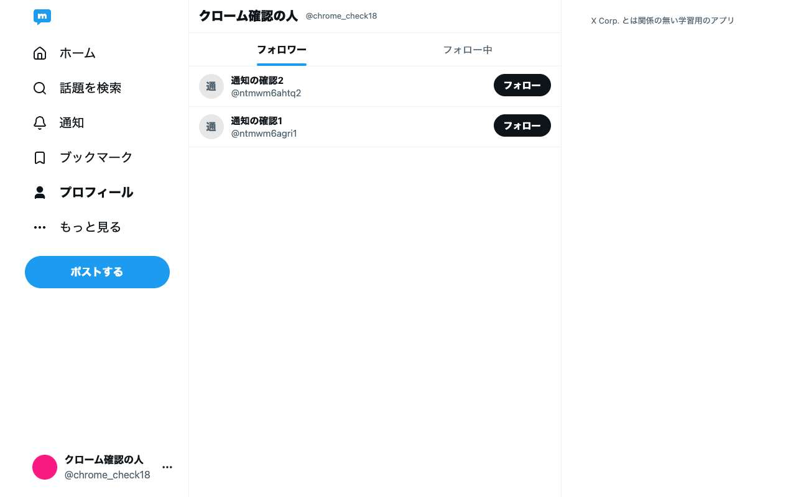
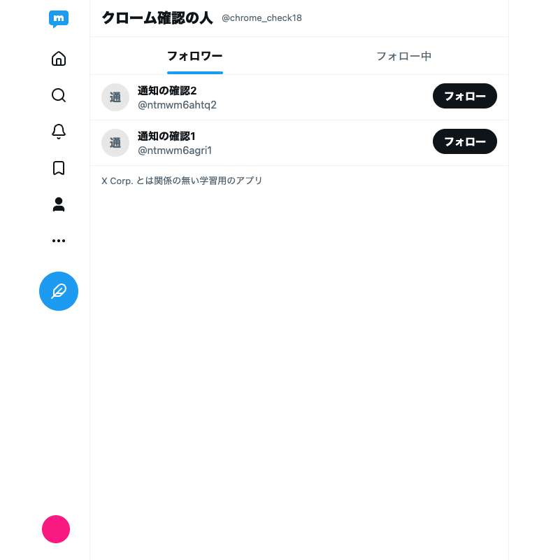
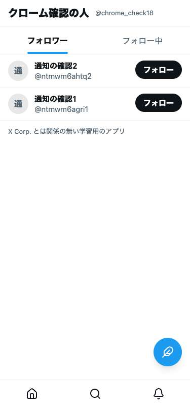

# 試験レポート: フォロワーとフォロー中の一覧が、41 人目から先を読まない

## 対象

- issue: [#53](https://github.com/ohta-rh/x-modoki-v2/issues/53)（バグ。#26 の通知の一覧を作っているときに、同じ書き方から見つけた）
- commit: `802a9ba`（ブランチ `m1/local-app`、PR #40）
- CI: [実行 44316634582](https://github.com/ohta-rh/x-modoki-v2/actions/runs/44316634582)（成功）
- 日付: 2026-11-18

## 環境

- macOS 26.2、Node.js 26.12.0（`.nvmrc` は 24。CI の実行を本当の結果とする）、Docker Compose の PostgreSQL、Playwright 1.65.0
- 動かし方: `pnpm build && pnpm start -p 3300`、Chrome の確認用のテストの人（`chrome_check18`）

## 判定

合格 — 受け入れ条件 2 件のうち 2 件を満たした。

## 受け入れ条件ごとの結果

| # | 条件 | 確かめ方 | 結果 | エビデンス |
|---|---|---|---|---|
| 1 | 3 ページ以上ある一覧を最後まで読む | `follow-list-page.test.tsx` › 3 ページ目以降も続けて読む（#53） | 合格 | — |
| 2 | CI が緑、カバレッジ 100% のまま | CI の実行 | 合格 | CI の実行 |

## 自動のテスト

`pnpm verify` が 0 で終わった（単体のテスト 713 本、カバレッジ 4 つとも 100%、画面のテスト 174 本）。

### TDD の記録

| # | 振る舞い | 先に書いたテスト | 赤（落ちた理由） | 緑にした実装 |
|---|---|---|---|---|
| 1 | 3 ページ目以降も続けて読む | `follow-list-page.test.tsx` › 3 ページ目以降も続けて読む（#53） | `Unable to find an element with the text: @cc`（`fetch` は 1 回だけ） | `follow-list.tsx`（読み込んだページの数を効果の依存に足した） |

## コードレビュー

- 判定: APPROVE（1 回目）　範囲: `802a9ba~1..802a9ba`　レビューした sub agent: code-reviewer（opus）

| # | 重さ | 指摘 | 確かめた結果 | 対応 |
|---|---|---|---|---|
| — | — | 指摘なし（失敗したページを取り直し続けないこと、同じページを 2 回読まないことも確かめた） | — | — |

## ブラウザでの確認

| URL | 幅 | テーマ | した操作 | 見えた結果 | 画面の写真 |
|---|---|---|---|---|---|
| `/chrome_check18/followers` | 1280 / 768 / 375 | ライト | 開いた | フォロワーの一覧がいつも通り出る | `followers-*.jpg` |

- コンソール: エラー 0、警告 0　通信: 失敗 0（`chrome-evidence.mjs` の 3 回の読み込み）
- 手元のデータに 41 人以上の一覧が無いので、続きを読むことは単体のテストで確かめた。画面では一覧が崩れないことを確かめた

## 見つけた問題

1. **根本原因:** 続きを読む `useEffect` は `hasNextPage`・`isFetchingNextPage`・`isFetchNextPageError` だけを見ていた。2 ページ目を読む間に `isFetchingNextPage` が true から false に戻っても、その途中が描かれないと値が前と同じに見え、効果がもう動かなかった。#26 の通知の一覧で、効果が 1 回しか動かないことをログで確かめて見つけた。同じ書き方は `post-feed.tsx` にもあるが、そちらは画面の端が見えたときに読む別の形で、ページを読むたびに描き直されるので止まらない（ホームの画面のテストで 60 件を読んでいる）
