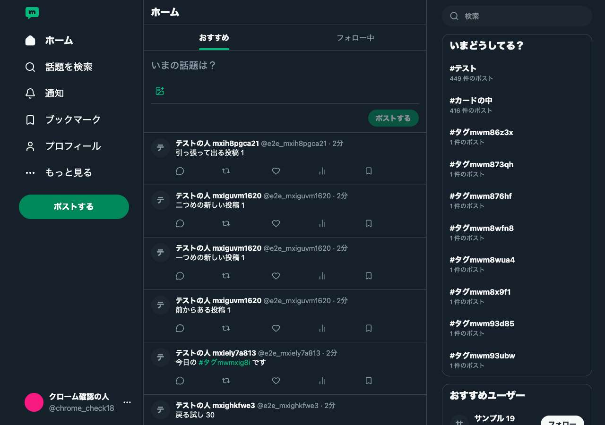
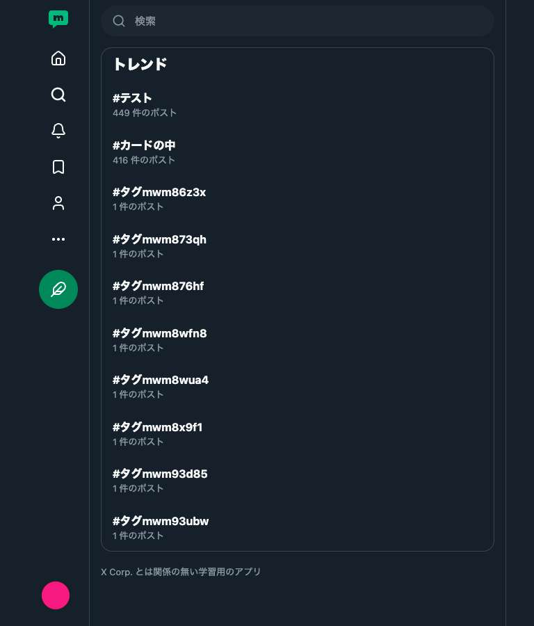

# 試験レポート: 負荷の下で、投稿したあとのタイムラインの取り直しが 5 秒以上返らない原因を突き止める

## 対象

- issue: [#55](https://github.com/ohta-rh/x-modoki-v2/issues/55)
- commit: `75b457d`・`08825b3`・`80cdcee`（ブランチ `m1/local-app`、PR #40）
- CI: https://github.com/ohta-rh/x-modoki-v2/actions/runs/44444613429 （`80cdcee`。3 つの commit を含む。緑）
- 日付: 2026-11-19

## 環境

- macOS 26.2、Node.js 26.12.0（`.nvmrc` は 24。CI の実行を本当の結果とする）、OrbStack の Docker Compose の PostgreSQL 18（`127.0.0.1:54320`）
- 調べのための使い捨てのコード（アプリのコードは変えていない）
  - 中継（3300 → 3310）: 要求ごとの時間を記録した
  - アプリの中の見張り（`NODE_OPTIONS=--require`）: イベントループ・スレッドプール・`pg` の問い合わせとプールの待ちを記録した
  - `pg_stat_activity` を 1 秒ごとに記録した

## 判定

合格 — 受け入れ条件 2 件のうち 2 件を満たした（受け入れ条件 2 は、ADR-0056 に従い「直す PBI を起こす」を「この PBI の中で直す」に変えた。issue の本文の頭に注記）。

## 受け入れ条件ごとの結果

| # | 条件 | 確かめ方 | 結果 | エビデンス |
|---|---|---|---|---|
| 1 | 根本原因を 1 文で、証拠とともに書く | issue のコメント、[調べの記録](../research/db-connect-stalls.md) | 合格 | 下の出力 |
| 2 | 直す（ADR-0056 で、この PBI の中で） | `src/shared/db/client.test.ts` の 3 本、直したあとの全部の e2e の 6 回 | 合格（ADR-0057） | 下の出力 |

## 自動のテスト

`pnpm verify`（7 つの確認、`08825b3` の作業の木）:

```
 Test Files  171 passed (171)
      Tests  923 passed (923)
Statements   : 100% ( 2533/2533 )
Branches     : 100% ( 1695/1695 )
Functions    : 100% ( 644/644 )
Lines        : 100% ( 2202/2202 )
  288 passed (2.5m)
VERIFY_RC=0
```

捕まえた止まり（直す前、全部の実行 26 回のうち 3 回）と、見張りの記録:

```
OPEN>5s / CUT  GET /api/timeline/following?cursor=   7030ms（ブラウザが切った）
APP 77438ms finished=false  GET /{username}/with_replies
POOL-WAIT>1s total=1 idle=0 waiting=0 held: idle-or-connecting   → APP 29561ms finished=false
同じ時刻: 1 秒を超えた問い合わせ 0、イベントループ・スレッドプールの 0.3 秒を超えた遅れ 0
```

アプリなしの接続の試し:

```
TCP だけ 4000 本（50 本ずつ）              max 13ms
ログインまで 3000 本（50 本ずつ）           max 1010ms  p99 215ms
ログインまで 3000 本（150 本ずつ）          max 1016ms  p99 1007ms
```

直したあと、全部の e2e を見張りつきで 6 回:

```
run 27..32: 288 passed ×6（1.9〜2.4 分）　止まった要求 0　つなぎ直し 1（POOL-WAIT>1s が 1 回、通った）
```

### TDD の記録

| # | 振る舞い | 先に書いたテスト | 赤（落ちた理由） | 緑にした実装 |
|---|---|---|---|---|
| 1 | 黙る相手には、待ち続けずに 1 回だけつなぎ直し、それでも駄目ならエラーにする | `client.test.ts` › つながらないまま黙る相手には… | 今の作りのまま `newPool` を切り出して `Error: Test timed out in 15000ms.`（待ち続けた） | `StallSafePool`（`connectionTimeoutMillis: 1500`、時間切れのときだけ 1 回つなぎ直す） |
| 2 | トランザクションが使う `connect()` でも同じ | 同 › トランザクションが使う connect() でも… | プロミスの形のつなぎ直しを外した作りで `expected [ …(1) ] to have a length of 2 but got 1` | 1 と同じ |
| 3 | 時間切れでないエラーはつなぎ直さない | 同 › 時間切れでないエラー（つないですぐ切られる）は… | どのエラーでもつなぎ直す作りで `expected [ …(4) ] to have a length of 2 but got 4` | 時間切れの見分け |
| 4 | WebKit が描画の合図を出さないときも、先にスクロールするテストが進む | `server-render.spec.ts` › スクリプトが動く前にスクロールした位置は… | 8 並び × 20 回で 4 回 `element(s) not found`（React の差し込みが待ったまま） | React が予定した差し込みを、テストから同じ関数で流す |

- **私の誤り:** 2 と 3 の壊した作りは、最初の試しでは落ちなかった。`-t` に渡したテストの名前の「connect()」の括弧が正規表現として読まれ、7 本とも飛ばされていた（`7 skipped`）。さらに、3 のテストはもとは拒まれる口を使っていた。それでは、何度つないでもすぐ拒まれるので、つなぎ直しの有無を見分けられなかった。名前で選び直し、すぐ切る相手に替えて、落ちるのを確かめた

## コードレビュー

- 判定: APPROVE（2 回目）　範囲: `75b457d`・`08825b3`　レビューした sub agent: code-reviewer（opus）

| # | 重さ | 指摘 | 確かめた結果 | 対応 |
|---|---|---|---|---|
| 1 | major（1 回目、`75b457d`） | WebKit のテストの直しは #55 と別のバグなので、別のバグの PBI を起こし、根本原因を記録すべき | ADR-0056（ユーザーの決定: 作業の中で見つけたバグはその中で直し、issue は探索的テストの分だけ）の前の決まり。レビューの人の決まりの文書（`code-reviewer.md` の 7）が、スコープの外の変更を指摘させたままだった | 退けた。`code-reviewer.md` を ADR-0056 に合わせて直した（`08825b3`）。根本原因は、この試験レポートの「見つけた問題」に書いた |
| 2 | minor（2 回目） | 1.5 秒の上限は、プールが埋まって空きを待つ時間にも効く。ADR とコメントに書いていない | その通り（pg-pool 3.14.0 の待ち行列の時間切れ） | 提案どおり、ADR-0057 の「結果」と `StallSafePool` のコメントに書いた（`80cdcee`） |
| 3 | minor（2 回目） | 調べの記録の要約が「口の手前」で、本文の「口の奥」と逆 | その通り | 直した（`80cdcee`） |

## ブラウザでの確認

| URL | 幅 | テーマ | した操作 | 見えた結果 | 画面の写真 |
|---|---|---|---|---|---|
| `/home` | 1280 / 768 / 375 | ダークブルー・緑 | 直した作りで開いた | 今まで通り出た | `home-*.jpg` |
| `/explore` | 1280 / 768 / 375 | 同上 | 開いた（隣の画面） | トレンドが出た | `explore-*.jpg` |

- コンソール: エラー 0、警告 0　通信: 失敗 0
- 失敗の経路（つながらない接続）は、画面からは作れないので、単体のテスト（黙る相手・すぐ切る相手）で確かめた




## 見つけた問題

1. **WebKit の描画が止まる揺れ**（`75b457d`）
   - 根本原因: アプリのスクリプトを全部止めたまま WebKit のページを同時に開くと、混んだ機械では `requestAnimationFrame` が来ない。React の、流した一覧の差し込み（`$RV`）が待ったままになる（#61 の調べと同じ現象）
   - 直し: テストが待っている差し込みを、React と同じ関数で流す。差し込みはテストの対象ではないため。8 並び × 20 回で、4 回の失敗が 0 になった
2. **私の誤り（中継）:** 最初の中継は Node 26 で来なくなった `aborted` の合図を待っていた。そのため、途中で切られた要求が全部「開いたまま」に見えた。`close` で、終わったのか切られたのかを分けて直した
3. 仮説として試して外れたもの: パスワードの scrypt によるスレッドプールの詰まり（32 件で 0.4 秒待つことは確かめたが、止まった時刻には起きていない）、macOS の接続の待ち行列の溢れ（0）、接続を 1 秒持つ作りに戻すこと（その作りでも止まりが起きた）
4. アプリの写真を撮るとき、テストの人のプロフィールに、私が作っていない画像つきの投稿があった（3001 番を見ていたユーザーの投稿と思われる）。その画面は証拠に使わず、写真を消した
