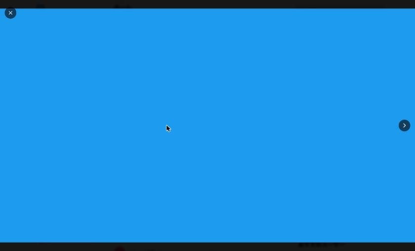
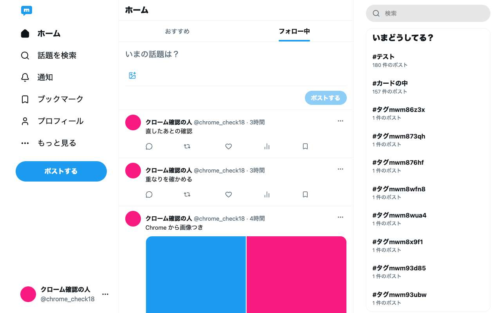
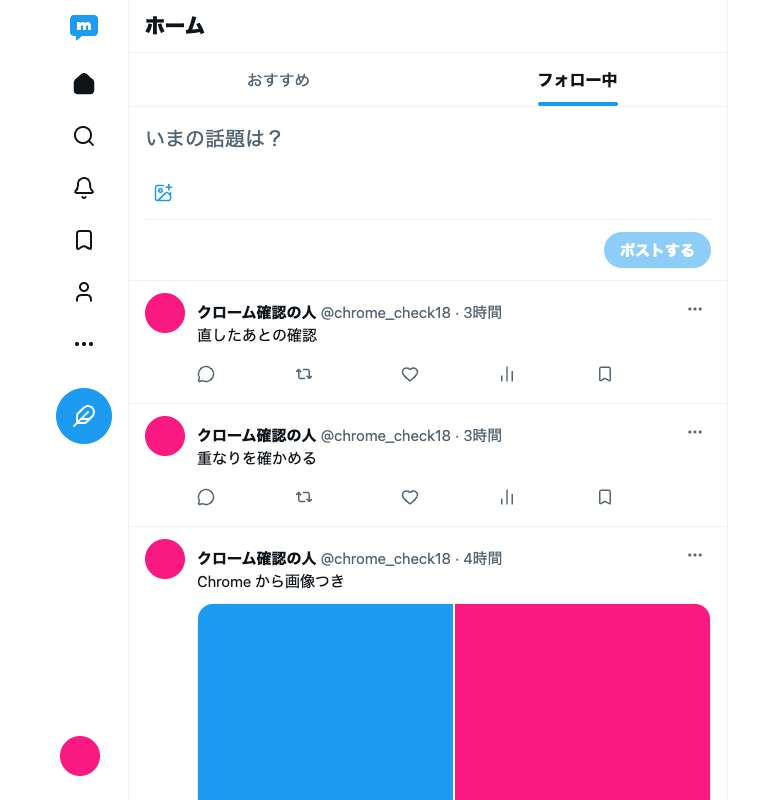
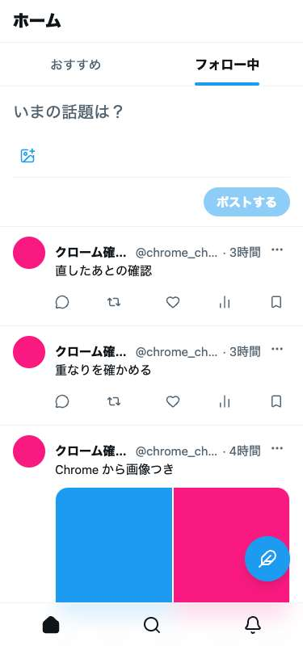

# 試験レポート: 画像のビューアの画面のテストが、CI の WebKit でたまに落ちる

## 対象

- issue: [#56](https://github.com/ohta-rh/x-modoki-v2/issues/56)
- commit: `5f5c1d7`（ブランチ `m1/local-app`、PR #40）
- CI: https://github.com/ohta-rh/x-modoki-v2/actions/runs/44336154712 （`5f5c1d7`、緑）
- 日付: 2026-11-19

## 環境

- macOS 26.2、Node.js 26.12.0（`.nvmrc` は 24。CI の実行を本当の結果とする）、Docker Compose の PostgreSQL 18、Playwright 1.65.0
- CI と同じ Linux の WebKit: `mcr.microsoft.com/playwright:v1.65.0-noble` の中で `playwright run-server` を動かし、`PW_TEST_CONNECT_WS_ENDPOINT` と `PW_TEST_CONNECT_EXPOSE_NETWORK='<loopback>'` で手元のアプリにつないだ（手元の macOS の WebKit では 10 回とも再現しなかった）

## 判定

合格 — 受け入れ条件 4 件のうち 4 件を満たした。

## 受け入れ条件ごとの結果

| # | 条件 | 確かめ方 | 結果 | エビデンス |
|---|---|---|---|---|
| 1 | ビューアを開く前に、止まった位置（80px）を待ってからクリックする | `e2e/photo-viewer.spec.ts` を読んだ（`window.scrollTo(0, 80)` と `expect.poll(scrollY).toBe(80)`） | 合格 | — |
| 2 | CI と同じイメージの WebKit で 20 回続けて通る | `--repeat-each=40 --workers=10` を 2 回、80 回とも通った | 合格 | 下の出力 |
| 3 | Esc で閉じたあと、開く前の位置（1px 以内）に戻ることは今まで通り確かめている | 同じテストの最後の `expect` は変えていない。本物の Chrome でも開いて閉じた | 合格 | `viewer-1400.jpg` |
| 4 | CI が緑、カバレッジ 100% のまま | `pnpm verify`、CI | 合格 | 下の出力 |

## 自動のテスト

`pnpm verify`（7 つの確認）が 0 で終わった。

```
 Test Files  147 passed (147)
      Tests  754 passed (754)
Branches     : 100% ( 1462/1462 )
  189 passed (1.3m)
VERIFY_RC=0
```

CI と同じイメージの WebKit（直したあと）:

```
  40 passed (23.9s)
  40 passed (24.0s)
```

### TDD の記録

| # | 振る舞い | 先に書いたテスト | 赤（落ちた理由） | 緑にした実装 |
|---|---|---|---|---|
| 1 | ビューアの後ろの画面は、開く前にスクロールしている（テストの前提） | 今の `e2e/photo-viewer.spec.ts` ›「画像を押すとビューアが重なり…」を、CI と同じイメージの WebKit で繰り返した | `expect(received).toBeGreaterThan(expected)` `Received: 0`（10 回のうち 5 回、#27 の前の `35d2dcd` で 10 回のうち 3 回、修正の直前に 40 回のうち 1 回） | テストのスクロールを `window.scrollTo(0, 80)` と「80 になる」の待ちに替えた |

- 原因の切り分け: スクロールと `style` の変化を記録すると、落ちた回は、ビューアがページのスクロールを止める約 0.35 秒前、クリックのところで `scrollY` が 80（または 439）から 0 に戻っていた。`scrollTo(0, 80)` で一度に動かすと、Playwright のクリックでも座標でのクリックでも、10 回とも 80 のままだった

## コードレビュー

- 判定: APPROVE（1 回目）　範囲: `5f5c1d7~1..5f5c1d7`　レビューした sub agent: code-reviewer（opus）

| # | 重さ | 指摘 | 確かめた結果 | 対応 |
|---|---|---|---|---|
| — | — | 指摘なし | — | — |

## ブラウザでの確認

| URL | 幅 | テーマ | した操作 | 見えた結果 | 画面の写真 |
|---|---|---|---|---|---|
| `/home?tab=following` | 1400 | ライト | 402px までスクロールし、画像を押してビューアを開き、Esc で閉じた | クリックがリンクを寄せて 317px になり、ビューアが重なった（後ろは 317px のまま）。Esc で `/home?tab=following` に戻り、位置は 317px のまま。直した原因と同じく、クリックそのものがスクロールを動かすのを見た | `viewer-1400.jpg` |
| `/home?tab=following` | 1280 / 768 / 375 | ライト | 開いた（ほかの画面が壊れていないか） | タイムラインと右サイドバー | `home-*.jpg` |

- コンソール: エラー 0、警告 0　通信: 失敗 0






## 見つけた問題

1. #27 の CI（`d489fbd`、https://github.com/ohta-rh/x-modoki-v2/actions/runs/44332157567 の 1 回目）がこのテストで赤になって見つけた。#25 からある揺らぎで、#27 の変更とは関係しない（#27 の前のコミットでも落ちる）。#27 の CI は再実行で緑になった
