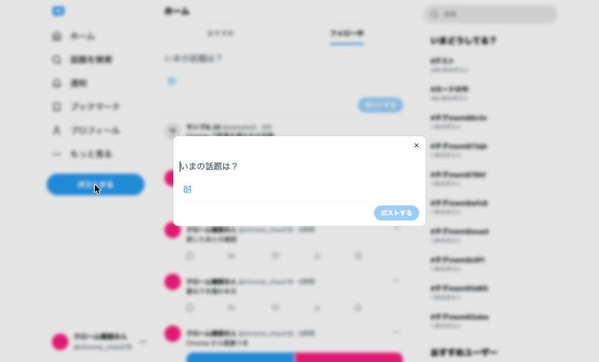
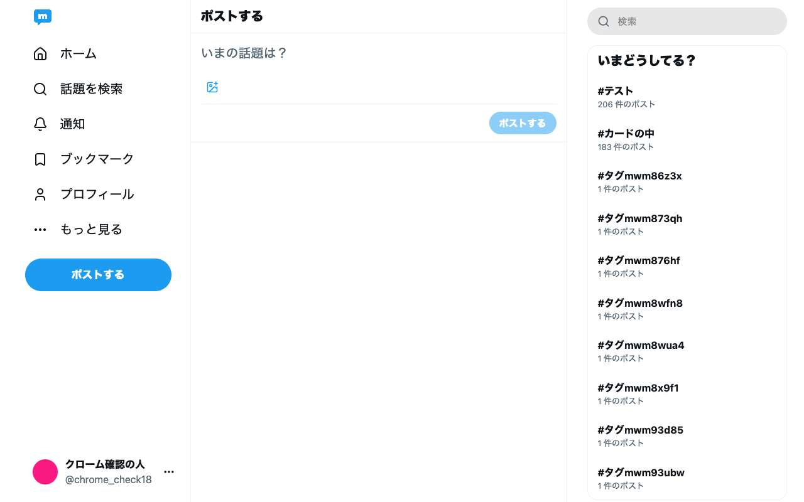
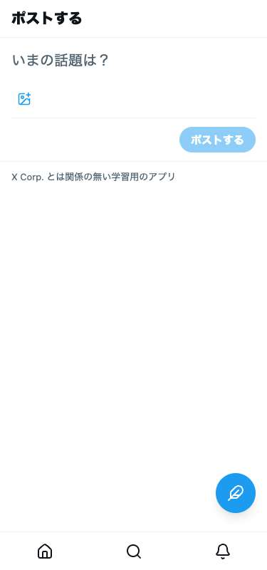

# 試験レポート: ダイアログとトーストの閉じるボタンが、英語の「Close」と読まれる

## 対象

- issue: [#57](https://github.com/ohta-rh/x-modoki-v2/issues/57)
- commit: `2e09dda`、`307c47a`（ブランチ `m1/local-app`、PR #40）
- CI: https://github.com/ohta-rh/x-modoki-v2/actions/runs/44346461918 （`7c0350d`、緑）
- 日付: 2026-11-19

## 環境

- macOS 26.2、Node.js 26.12.0（`.nvmrc` は 24。CI の実行を本当の結果とする）、Docker Compose の PostgreSQL 18、Playwright 1.65.0
- 動かし方: `pnpm build && pnpm start -p 3300`、Chrome の確認用のテストの人（`chrome_check18`）

## 判定

合格 — 受け入れ条件 4 件のうち 4 件を満たした。

## 受け入れ条件ごとの結果

| # | 条件 | 確かめ方 | 結果 | エビデンス |
|---|---|---|---|---|
| 1 | 投稿のモーダルの閉じるボタンの名前が「閉じる」 | `e2e/close-buttons.spec.ts`、本物の Chrome のアクセシビリティのツリー（`button "閉じる"`） | 合格 | `composer-close-1400.jpg` |
| 2 | トーストの閉じるボタンの名前が「閉じる」 | `e2e/close-buttons.spec.ts`（トーストにポインターを載せてから。Base UI はそれまでボタンを支援技術から隠す） | 合格 | — |
| 3 | kit に英語の画面の文言が残っていない | `grep -rnE ">[A-Za-z][A-Za-z ]*</\|sr-only\">[A-Za-z]\|aria-label=\"[A-Za-z]" src/shared/ui/kit` が 0 件（レビュー 1 で、ボタンの文字を拾えるように確かめ方を直した） | 合格 | — |
| 4 | CI が緑、カバレッジ 100% のまま | `pnpm verify`、CI | 合格 | 下の出力 |

## 自動のテスト

`pnpm verify`（7 つの確認）が 0 で終わった。

```
 Test Files  151 passed (151)
      Tests  774 passed (774)
Branches     : 100% ( 1492/1492 )
  204 passed (1.0m)
VERIFY_RC=0
```

### TDD の記録

| # | 振る舞い | 先に書いたテスト | 赤（落ちた理由） | 緑にした実装 |
|---|---|---|---|---|
| 1 | モーダルの閉じるボタンは「閉じる」 | `e2e/close-buttons.spec.ts` | `getByRole('dialog', { name: 'ポストする' }).getByRole('button', { name: '閉じる' })` が `element(s) not found` | `src/shared/ui/kit/dialog.tsx` の `sr-only` |
| 2 | トーストの閉じるボタンは「閉じる」 | 同じ（トーストにポインターを載せる形に直した） | トーストの文言だけ英語に戻したビルドで `getByRole('button', { name: '閉じる' })` が見つからない | `src/shared/ui/kit/toast.tsx` の `aria-label` |
| 3 | ダイアログのフッターの閉じるボタンも「閉じる」（レビュー 1） | 受け入れ条件 3 の `grep`（kit はテストを先に書く対象の外: ADR-0021） | 直した `grep` が `dialog.tsx:100` の `Close` を 1 件見つけた | `dialog.tsx` の `DialogFooter` |

## コードレビュー

- 判定: APPROVE（2 回目）　範囲: `2e09dda~1..307c47a`（kit と `e2e/close-buttons.spec.ts`）　レビューした sub agent: code-reviewer（opus）

| # | 回 | 重さ | 指摘 | 確かめた結果 | 対応 |
|---|---|---|---|---|---|
| 1 | 1（CHANGES_REQUESTED） | major | `DialogFooter` に目に見える `Close` が残り、受け入れ条件 3 を満たしていない（issue の `grep` がボタンの文字を拾わない） | その通り | 直した `307c47a`。issue の確かめ方も直した |
| — | 2（APPROVE） | — | 指摘なし | — | — |

## ブラウザでの確認

| URL | 幅 | テーマ | した操作 | 見えた結果 | 画面の写真 |
|---|---|---|---|---|---|
| `/home?tab=following` → `/compose/post` | 1400 | ライト | 左ナビの投稿ボタンでモーダルを開き、閉じるボタンの名前を読んだ | 右上の × の名前が「閉じる」（アクセシビリティのツリーで `button "閉じる"`） | `composer-close-1400.jpg` |
| `/compose/post`（直接） | 1280 / 768 / 375 | ライト | 開いた（ほかの画面が壊れていないか） | 「ポストする」の見出しと入力欄 | `compose-*.jpg` |

- コンソール: エラー 0、警告 0　通信: 失敗 0






## 見つけた問題

1. #28 の確認中に本物の Chrome のアクセシビリティのツリーで `button "Close"` を見て見つけた。根本原因と直し方は上の通り
