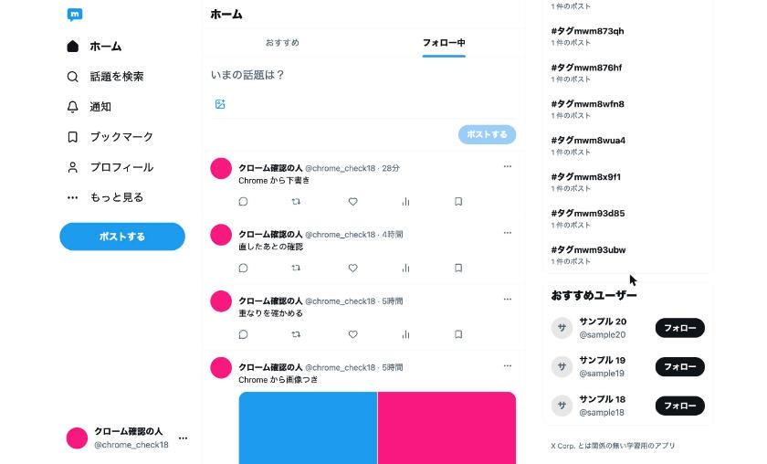
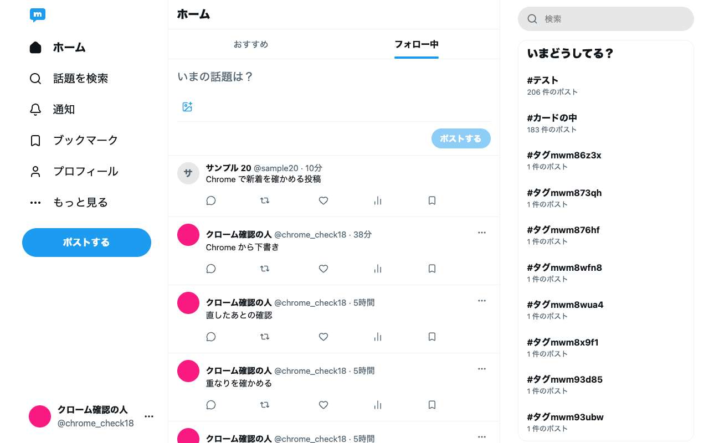
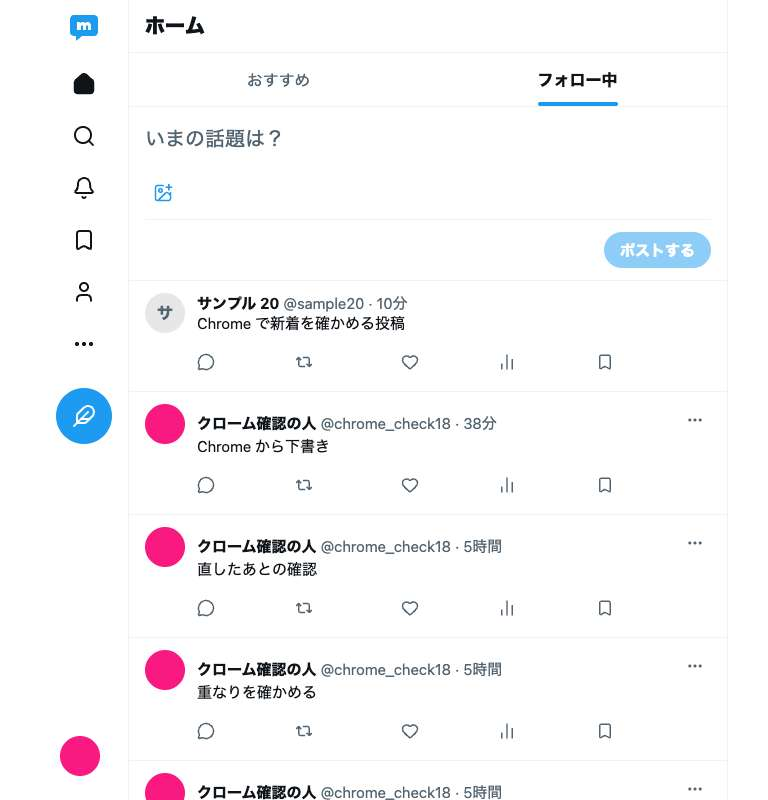
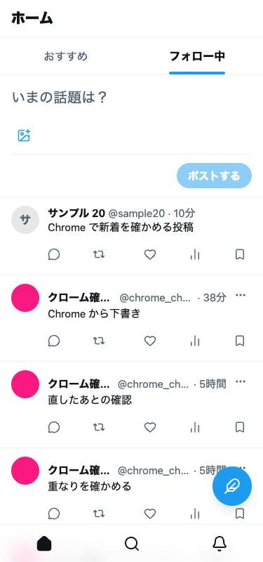

# 試験レポート: 画面の高さが低いと、右サイドバーのおすすめユーザーとフッターに届かない

## 対象

- issue: [#58](https://github.com/ohta-rh/x-modoki-v2/issues/58)
- commit: `8f25c5d`、`4aa2fd1`（ブランチ `m1/local-app`、PR #40）
- CI: この試験レポートの commit（`docs(test-report): #57 and #58`）の実行。URL は #58 を閉じるコメントに書いた（`8f25c5d` と `4aa2fd1` を含む `6c382f4` の実行は、#28 の commit の文書の確認で落ちた。#58 の変更とは関係しない）
- 日付: 2026-11-19

## 環境

- macOS 26.2、Node.js 26.12.0（`.nvmrc` は 24。CI の実行を本当の結果とする）、Docker Compose の PostgreSQL 18、Playwright 1.65.0
- 動かし方: `pnpm build && pnpm start -p 3300`、Chrome の確認用のテストの人（`chrome_check18`）

## 判定

合格 — 受け入れ条件 3 件のうち 3 件を満たした。

## 受け入れ条件ごとの結果

| # | 条件 | 確かめ方 | 結果 | エビデンス |
|---|---|---|---|---|
| 1 | 高さ 600px の画面でも、右サイドバーのフッターまでスクロールで画面に入る | `e2e/right-sidebar.spec.ts` › 高さの低い画面でも…（3 つのブラウザ）、本物の Chrome（高さ 859px でサイドバーの上でホイールを回した） | 合格 | `sidebar-scrolled-1400.jpg` |
| 2 | 中身が画面に収まるときは、今まで通り上に貼り付いたまま | `e2e/right-sidebar.spec.ts` › ページを送っても… | 合格 | `home-1280.jpg` |
| 3 | CI が緑、カバレッジ 100% のまま | `pnpm verify`、CI | 合格 | 下の出力 |

## 自動のテスト

`pnpm verify`（7 つの確認）が 0 で終わった（`4aa2fd1` のとき。1 回目は WebKit の登録の要求が返らずに別のテストが落ち、#55 に証拠を足して流し直した）。

```
 Test Files  154 passed (154)
      Tests  787 passed (787)
Branches     : 100% ( 1517/1517 )
  216 passed (1.2m)
VERIFY_RC=0
```

### TDD の記録

| # | 振る舞い | 先に書いたテスト | 赤（落ちた理由） | 緑にした実装 |
|---|---|---|---|---|
| 1 | 高さの低い画面でも、サイドバーのフッターまで届く | `e2e/right-sidebar.spec.ts` › 高さの低い画面でも… | `expect(received).toBeLessThanOrEqual(expected)` `Expected: <= 600` `Received: 1126.5` | `src/widgets/app-shell/ui/app-shell.tsx` の右サイドバーに `overflow-y-auto` |
| 2 | 同じテストが、データベースの投稿の数に左右されない（レビュー 1） | 同じテストに、自分の投稿 12 件と `/home?tab=following` を足した | 直す前のコードのビルドで `Received: 1126.5`（どのデータベースでも落ちることを確かめた） | テストだけの変更 |

- 試して戻したもの: 初めは `overscroll-contain` も付けた。中身が収まっているサイドバーの上でホイールを回してもページが動かなくなり、`ページを送っても…` のテストで見つけたので外した（issue の実装方針も直した）
- `ページを送っても…` は、サイドバーの上で回し続けたホイールは Firefox ではサイドバーに結びついたまま（ホイールのトランザクション）になるので、本文の上で回す形にした

## コードレビュー

- 判定: APPROVE（1 回目）　範囲: `8f25c5d~1..8f25c5d`　レビューした sub agent: code-reviewer（opus）

| # | 重さ | 指摘 | 確かめた結果 | 対応 |
|---|---|---|---|---|
| 1 | minor | フッターに届くかのテストが、データベースに投稿が少ないと直す前のコードでも通る | その通り（短いページでは、はみ出したサイドバーがページそのものを長くしていた） | 直した `4aa2fd1`（自分の投稿で長いページを作る）。直す前のコードで落ちることを確かめた |
| 2 | minor | issue の実装方針の `overscroll-contain` が入っていない | 入れると、中身が収まっているサイドバーの上でページが動かなくなる（`ページを送っても…` で再現した） | 退けた。理由を issue の実装方針に書いた |

## ブラウザでの確認

| URL | 幅 | テーマ | した操作 | 見えた結果 | 画面の写真 |
|---|---|---|---|---|---|
| `/home?tab=following` | 1400（高さ 859） | ライト | 直す前: ページを一番下まで送った（失敗の経路） | サイドバーの中身 1149px、最後の「フォロー」の上端 1022px で画面に入らない（数値で記録） | — |
| `/home?tab=following` | 1400（高さ 859） | ライト | 直したあと: サイドバーの上でホイールを回し、「サンプル 20」をフォローした | サイドバーだけがスクロールしてフッターの下端が 859px に入った。フォローできた | `sidebar-scrolled-1400.jpg` |
| `/home?tab=following` | 1280 / 768 / 375 | ライト | 開いた | 1280 でサイドバーが上に貼り付き、768・375 では出ない | `home-*.jpg` |

- コンソール: エラー 0、警告 0　通信: 失敗 0






## 見つけた問題

1. #28 の確認中に、おすすめユーザーをフォローしようとして見つけた（#27 でサイドバーの中身が増えた）。根本原因と直し方は上の通り
