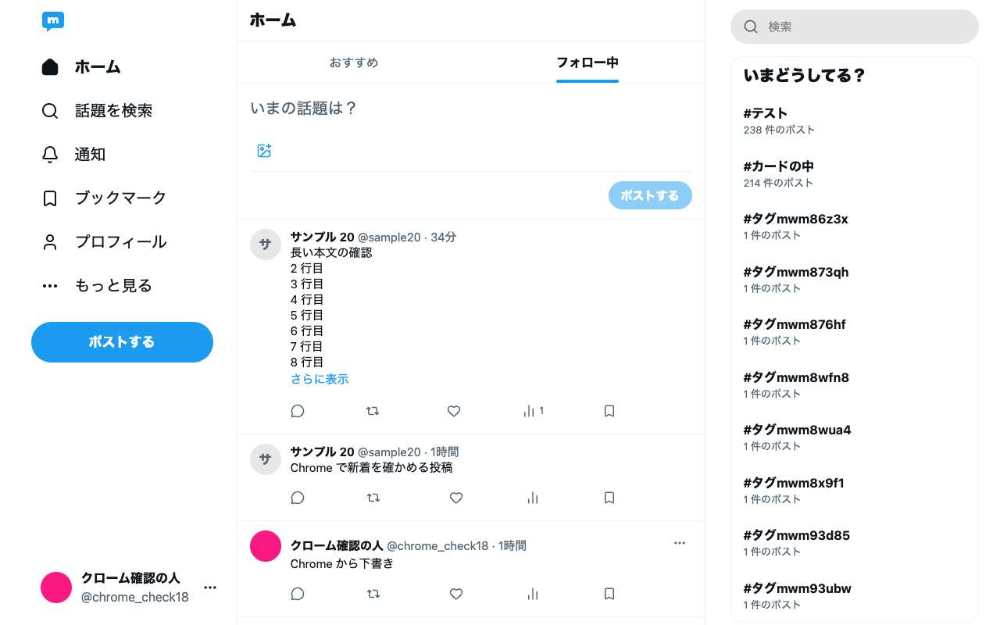
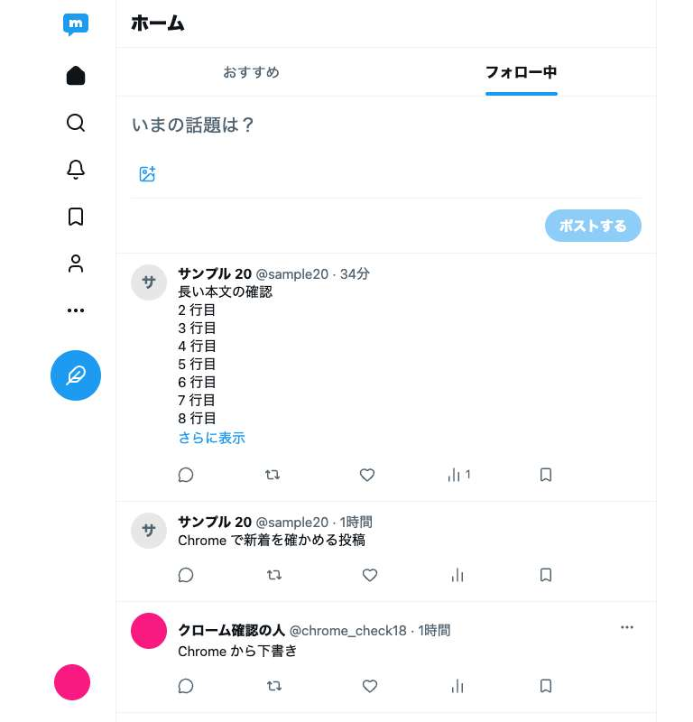

# 試験レポート: 同時の要求が多いと、データベースの接続が上限に達して 500 になる

## 対象

- issue: [#59](https://github.com/ohta-rh/x-modoki-v2/issues/59)
- commit: `ad5fc00`（ブランチ `m1/local-app`、PR #40）
- CI: https://github.com/ohta-rh/x-modoki-v2/actions/runs/44364560480 （`0c782a2`、`ad5fc00` を含む。緑）
- 日付: 2026-11-19

## 環境

- macOS 26.2、Node.js 26.12.0（`.nvmrc` は 24。CI の実行を本当の結果とする）、Docker Compose の PostgreSQL 18（`max_connections` 300）
- 動かし方: `pnpm build && pnpm start -p 3300`、Chrome の確認用のテストの人（`chrome_check18`）の cookie で負荷をかけた

## 判定

合格 — 受け入れ条件 3 件のうち 3 件を満たした。

## 受け入れ条件ごとの結果

| # | 条件 | 確かめ方 | 結果 | エビデンス |
|---|---|---|---|---|
| 1 | 問い合わせが終わって 300ms たてば、使っていない接続が閉じている | `src/shared/db/client.test.ts`（本物の PostgreSQL） | 合格 | 下の TDD の記録 |
| 2 | 再現の手順で 600 回とも 200 | 再現のスクリプト（下） | 合格（直す前は 107 回だけ） | 下の出力 |
| 3 | CI が緑、カバレッジ 100% のまま | `pnpm verify`、CI | 合格 | 下の出力 |

## 自動のテスト

`pnpm verify`（7 つの確認）が 0 で終わった。

```
 Test Files  157 passed (157)
      Tests  811 passed (811)
  234 passed (1.3m)
VERIFY_RC=0
```

再現のスクリプト（ログインした cookie で `GET /api/timeline/following?cursor=` を 600 回、60 本ずつ並べ、10 秒で返らなければ止まりとして数え、2 秒ごとに `pg_stat_activity` を数える）:

```
直す前（idleTimeoutMillis 1_000）: RESULT {"ok":107,"bad":493,"hung":0,"ms":1295} idle 279
  サーバーのログ: error: sorry, too many clients already ×493（Failed to get session ×429 を含む）
直したあと（100）:             RESULT {"ok":600,"bad":0,"hung":0,"ms":2392} idle 107、too many clients ×0
```

### TDD の記録

| # | 振る舞い | 先に書いたテスト | 赤（落ちた理由） | 緑にした実装 |
|---|---|---|---|---|
| 1 | 問い合わせのあと 300ms で、使っていない接続を閉じる | `client.test.ts` › 問い合わせのあと 300ms で… | `expected 1 to be +0`（1 秒持つので、300ms では接続が残る） | `idleTimeoutMillis: 100`（ADR-0050） |

## コードレビュー

- 判定: APPROVE（1 回目）　範囲: `ad5fc00~1..ad5fc00`　レビューした sub agent: code-reviewer（opus）

| # | 重さ | 指摘 | 確かめた結果 | 対応 |
|---|---|---|---|---|
| — | — | 指摘なし（issue の実装方針の ADR の番号が 0051 のままだった、という注記あり） | その通り | issue の本文を 0050 に直した |

## ブラウザでの確認

| URL | 幅 | テーマ | した操作 | 見えた結果 | 画面の写真 |
|---|---|---|---|---|---|
| `/home?tab=following` | 1280 / 768 / 375 | ライト | 負荷のあとに開いた | タイムラインがいつも通り出た | `home-*.jpg` |

- コンソール: エラー 0、警告 0　通信: 失敗 0





## 見つけた問題

1. #55（要求がたまに返らない）を調べていて見つけた。手元の `pnpm verify` で 3 回、1 つの要求に応答が来ないまま止まったのを記録していて、その原因を探すために負荷をかけたところ、止まりではなく接続の上限での失敗が再現した。#55 の止まりとこの失敗が同じ原因かは、まだ確かめていない（#55 は調べを続ける）
2. Route Handler の中では React の `cache()` が効かず、`getDb()` を呼ぶたびに pool ができる。このままでも 600 回とも通ったので、ここでは変えていない（ADR-0050 に書いた）
3. **私の誤り:** ADR の番号を、先にコミットする方より大きくしてしまい（0051 を 0050 より先に）、番号の確認で落ちた。まだコミットしていなかったテーマの ADR と番号を入れ替えた
