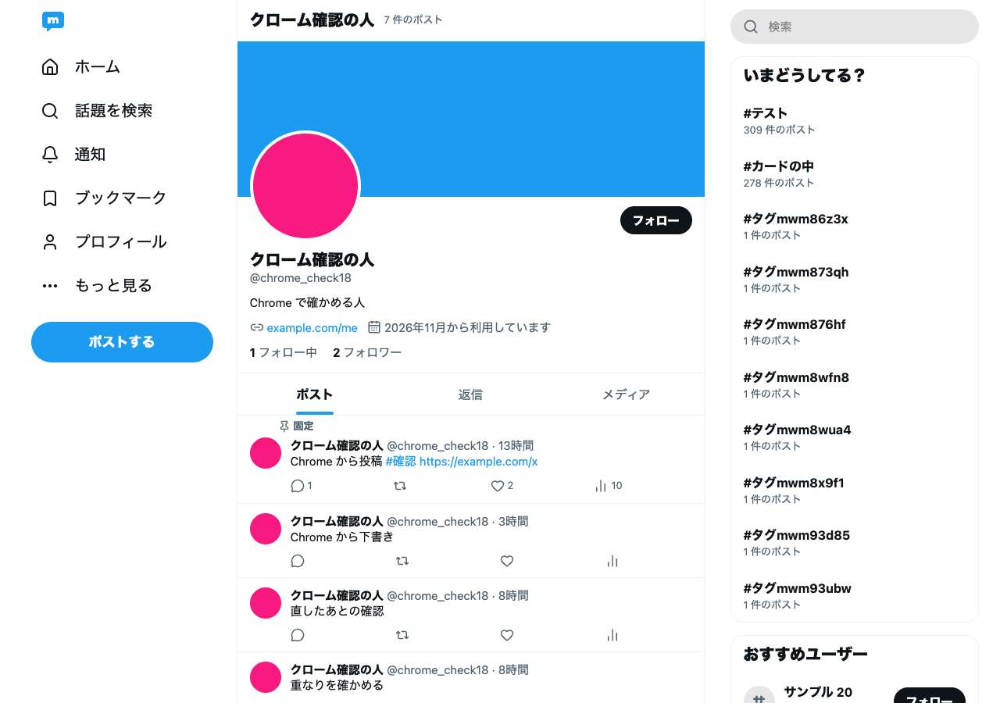
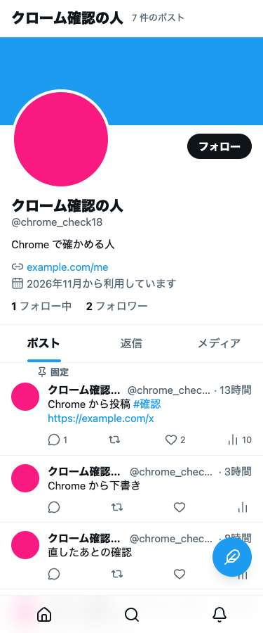
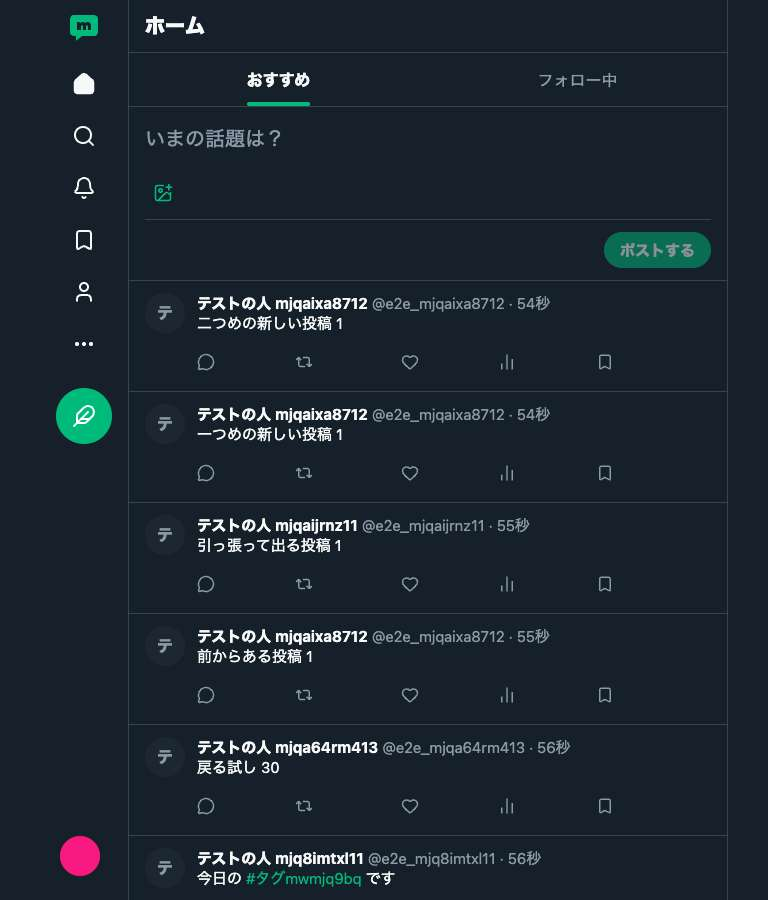
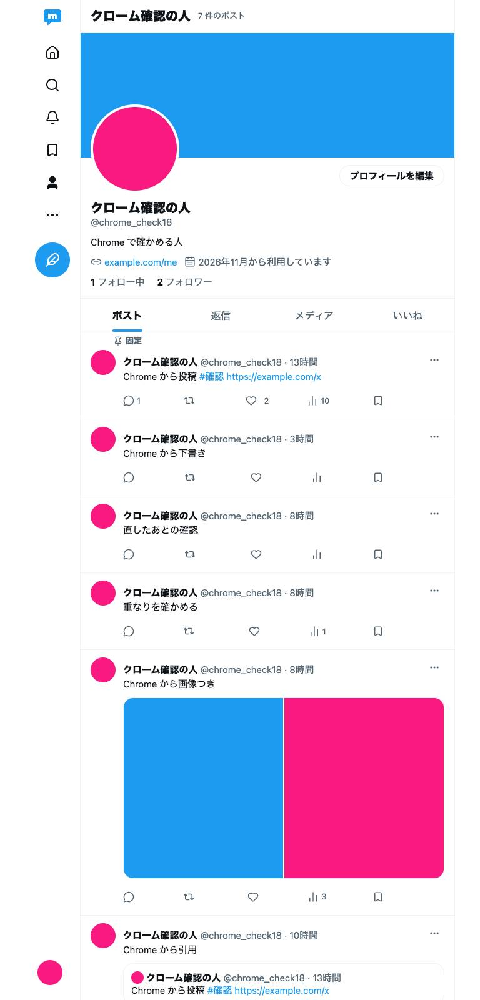

# 試験レポート: アプリの JavaScript が届くまで、投稿の一覧の本文が出ない

## 対象

- issue: [#60](https://github.com/ohta-rh/x-modoki-v2/issues/60)
- commit: `0988d12`・`5cbc95c`・`9016823`（ブランチ `m1/local-app`、PR #40）
- CI: https://github.com/ohta-rh/x-modoki-v2/actions/runs/44383847527 （`9016823`、緑）
- 日付: 2026-11-19

## 環境

- macOS 26.2、Node.js 26.12.0（`.nvmrc` は 24。CI の実行を本当の結果とする）、Docker Compose の PostgreSQL 18
- 動かし方: `pnpm build && pnpm start -p 3300`。Chrome（Playwright が動かす、インストール済みの Google Chrome）。スクリプトを止める確かめは `/_next/static/**/*.js` の取得を止めた

## 判定

合格 — 受け入れ条件 4 件のうち 4 件を満たした。

## 受け入れ条件ごとの結果

| # | 条件 | 確かめ方 | 結果 | エビデンス |
|---|---|---|---|---|
| 1 | サーバーで描いた一覧の HTML に、最初の何件かの本文が入る | `post-feed.test.tsx` › サーバーで描いた HTML に、最初の投稿の本文が入る…、`curl` | 合格（`/chrome_check18` の HTML の `<article>` が 0 → 7） | 下の TDD の記録 |
| 2 | アプリの JavaScript が届かなくても、本文が出る | `e2e/server-render.spec.ts` › アプリの JavaScript が届かなくても…（3 つのブラウザ。行が重ならず、フッターも最後の行の下） | 合格 | `profile-no-script-768.jpg` |
| 3 | 仮想スクロールと、重ならないことは今まで通り | `e2e/home-timeline.spec.ts`（画面の外のカードは DOM から外れる、#48 の重なり）。加えて、ハイドレーションの前のスクロールが保たれ、エラーが出ない | 合格 | 下の出力 |
| 4 | CI が緑、カバレッジ 100% のまま | `pnpm verify`、CI | 合格 | 上の CI |

## 自動のテスト

`pnpm verify`（7 つの確認、`9016823` の作業の木）:

```
 Test Files  171 passed (171)
      Tests  860 passed (860)
Statements   : 100% ( 2499/2499 )
Branches     : 100% ( 1658/1658 )
Functions    : 100% ( 636/636 )
Lines        : 100% ( 2175/2175 )
  252 passed (1.3m)
VERIFY_RC=0
```

スクリプトを止めた Chrome（768px）で、プロフィールの行の上下の位置。最後の行は 6 行目の中の引用カード:

```
[[532,671],[671,794],[794,917],[917,1040],[1040,1465],[1465,1666],[1541,1607]]
```

スクリプトを遅らせ、届く前に 400px スクロールしてから、0.3 秒ごとに `scrollY/高さ` を読んだ（直したあと。直す前は、スクリプトが動いた瞬間に 835 へ飛んだ）:

```
webkit   400/2964 … 400/2964（12 回とも 400）
chromium 400/2964 … 400/2964
firefox  400/2964 … 400/2964
```

### TDD の記録

| # | 振る舞い | 先に書いたテスト | 赤（落ちた理由） | 緑にした実装 |
|---|---|---|---|---|
| 1 | サーバーの HTML に、最初の投稿の本文が入る | `post-feed.test.tsx` › サーバーで描いた HTML に、最初の投稿の本文が入る… | `AssertionError: Target cannot be null or undefined.` — `<article` が 1 つも無い | `useWindowVirtualizer` の `initialRect`（1200px の見込み） |
| 2 | スクリプトが無くても、測る前の行どうしが重ならない | `server-render.spec.ts` › アプリの JavaScript が届かなくても… | `Expected: >= 854.4375 / Received: 740.4375`（3 つのブラウザ） | 行を絶対位置ではなく、上から積む |
| 3 | 取り付けたとき、先にスクロールしてあった位置を一番上へ戻さない | `post-feed.test.tsx` › スクリプトが動く前にスクロールしてあった位置を、一番上へ戻さない | `expected { top: 160, behavior: undefined } to match object { top: 400 }` | `observeElementOffset` で、取り付けの前に `scrollOffset` を本当の `scrollY` にする |
| 4 | 同じことを本物のブラウザで | `server-render.spec.ts` › スクリプトが動く前にスクロールした位置は… | 直しを外した作りで `Expected: 400 / Received: 412`（3 つのブラウザ） | 3 と同じ |
| 5 | 一覧のあとに続くもの（フッター）を覆わない | 2 のテストに足した確かめ | 前の形の作りで `Expected: >= 1299.4375 / Received: 992.4375` | 箱の高さを決めず、描かない行のぶんを `paddingTop` / `paddingBottom` にする |
| 6 | 先にスクロールしてあっても、サーバーと同じ行でハイドレーションする（レビュー 1） | `post-feed.test.tsx` › スクリプトが動く前にスクロールしてあっても、サーバーの HTML と同じ行で取り付く | `expected "vi.fn()" to not be called at all … Hydration failed because the server rendered HTML didn't match the client`。e2e は直しを外した作りで `Minified React error #418` | `initialOffset: 0` |
| 7 | 窓の高さが 0 で行が無くても落ちない（レビュー 2） | `post-feed.test.tsx` › 窓の高さが 0 で描く行が無くても、一覧は落ちない | `TypeError: Cannot read properties of undefined (reading 'start')` | 余白の計算で、行が無いときは 0 にする |

## コードレビュー

- 判定: APPROVE（2 回目）　範囲: `0988d12~1..9016823`　レビューした sub agent: code-reviewer（opus）

| # | 重さ | 指摘 | 確かめた結果 | 対応 |
|---|---|---|---|---|
| 1 | major | `useWindowVirtualizer` の `initialOffset` は既定で `window.scrollY` なので、ハイドレーションの前にスクロールしてあるとサーバーと違う行を描き、ハイドレーションが失敗する。コメント「最初の描画は 0」は誤り | 再現した（`@tanstack/react-virtual` の `dist/esm/index.js:141`。jsdom で `onRecoverableError`、Chrome で React #418） | 直した（`5cbc95c`）。テスト: TDD の記録の 6。e2e はコンソールのエラーと `pageerror` でも落ちるようにした |
| 2 | minor | 窓の高さが 0 だと行が無く、`rows[0].start` で一覧が落ちる（2 回目の指摘） | 再現した（TDD の記録の 7） | 提案どおりに直した（`9016823`） |

## ブラウザでの確認

| URL | 幅 | テーマ | した操作 | 見えた結果 | 画面の写真 |
|---|---|---|---|---|---|
| `/chrome_check18` | 1280 / 768 / 375 | ライト（ログイン無し） | 開いた | プロフィールと投稿が出た。横にはみ出さない | `profile-*.jpg` |
| `/home` | 1280 / 768 / 375 | ダーク（そのアカウントの設定） | 開いた | タイムラインが出た | `home-*.jpg` |
| `/chrome_check18`（スクリプトを止めた） | 768 | ライト | アプリの JavaScript を届かなくして開いた（失敗の経路） | 投稿が重ならずに並び、画像つきの投稿のあとも続く | `profile-no-script-768.jpg` |

- コンソール: エラー 0、警告 0　通信: 失敗 0（スクリプトを止めた確かめは除く）






## 見つけた問題

1. #30 の要件の突き合わせ（NFR-COMPAT-03）で見つけた。サーバーの HTML に投稿が 1 つも入っていなかった
2. 確かめの途中で、手元の macOS の WebKit だけが落ちる件を見つけた。原因は、同時に動かすと rAF が止まることで、#61 として直した（`3790b6a`）
3. **私の誤り（テストの弱さ）:** 最初の e2e は `toContainText` だけで確かめていた。そのため、記事が `<div hidden>` の中に残っていても通った。写真が真っ白だったので気づき、`toBeVisible` と、行の位置の確かめを足した
4. **私の誤り（測る対象）:** フッターの確かめで、最初は右サイドバーのフッターを測った。それは一覧とは別の列だった。1024px より狭い画面で、`main` の中のフッターを測る形に直した
5. 直しの途中で、ハイドレーションのときにスクロールの位置が 400 から 835 へ飛ぶのを見つけた。取り付けのときに本当の位置を取るようにして（TDD の記録の 3）、一緒に消えた

## 再試験 2026-11-19

- commit: `d58a8be`　CI: https://github.com/ohta-rh/x-modoki-v2/actions/runs/44391278921 （緑）
- 何が起きたか: `2d8286b` の CI（https://github.com/ohta-rh/x-modoki-v2/actions/runs/44386932410）の WebKit で、「スクリプトが動く前にスクロールした位置は…」が落ちた。集めたエラーが 5 つあり、どれも `Fetch API cannot load http://localhost:3000/…?_rsc=… due to access control checks.` だった
- 根本原因: サインアップのあとのページが先読みを出していて、`goto` で移ると WebKit がそれを打ち切り、コンソールのエラーとして出す。テストは、移る前からエラーを集めていた
- 手元の再現: CI と同じイメージの WebKit で、20 回中 2 回が同じエラーで落ちた
- 直し: エラーを集め始めるのを、スクリプトを放す直前にした。ハイドレーションの食い違いは放したあとにしか出ないので、拾えるものは変わらない。あわせて、放す前に React がまだ一覧に取り付いていないことを確かめるようにした
- 確かめ: 3 つのブラウザで、CI と同じ 2 並びで 10 回ずつ流し、60 本とも通った。`pnpm verify` は 0
- 残っていること: 同じテストを 8 並びで 20 回ずつ流すと、WebKit で 4 回、記事が見えないまま止まった。スクリプトを止めたページを同時にいくつも開くと、WebKit が描画（`requestAnimationFrame`）を止めるため（#61 の調べと同じ現象。Linux の WebKit でも、8 個同時に開いたうちの 1 個で起きた）。このテストを含むページは、全体の実行では各ブラウザで 1 つだけで、今日の全体の実行と CI では毎回通っている
- コードレビュー: APPROVE（1 回目、指摘なし）。範囲 `d58a8be~1..d58a8be`
