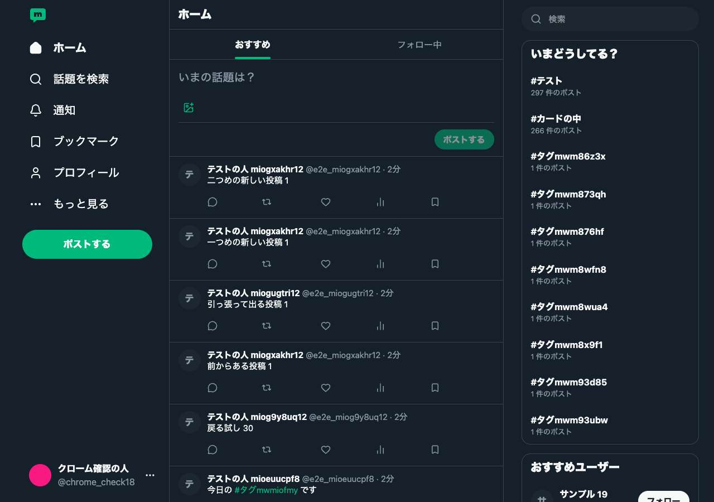
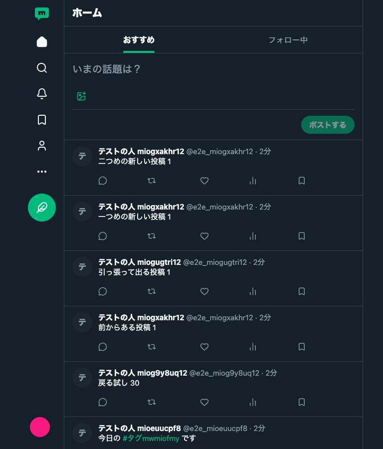

# 試験レポート: 手元の macOS で WebKit の画面のテストが落ちる（同時に動かすと rAF が止まる）

## 対象

- issue: [#61](https://github.com/ohta-rh/x-modoki-v2/issues/61)
- commit: `3790b6a`（ブランチ `m1/local-app`、PR #40）
- CI: https://github.com/ohta-rh/x-modoki-v2/actions/runs/44383847527 （`9016823`。`3790b6a` を含む。緑。`3790b6a` だけの実行は、次の push で取り消された）
- 日付: 2026-11-19

## 環境

- macOS 26.2、Node.js 26.12.0（`.nvmrc` は 24。CI の実行を本当の結果とする）、Docker Compose の PostgreSQL 18・Garage・`webkit`（`mcr.microsoft.com/playwright:v1.65.0-noble` の `run-server`）
- 動かし方: `docker compose up -d webkit` のあと `pnpm verify`。Chrome の確認は `pnpm build && pnpm start -p 3300`

## 判定

合格 — 受け入れ条件 5 件のうち 5 件を満たした。

## 受け入れ条件ごとの結果

| # | 条件 | 確かめ方 | 結果 | エビデンス |
|---|---|---|---|---|
| 1 | macOS では、WebKit が CI と同じイメージの中で動く | `scripts/quality-gates.test.ts` › macOS では、WebKit を CI と同じ Playwright のイメージで動かす（#61）、`pnpm verify` | 合格 | 下の TDD の記録と出力 |
| 2 | イメージの版が `@playwright/test` と CI と同じで、ずれると落ちる | 同じテスト（版を `package.json` から組み立て、CI と compose の両方を確かめる） | 合格 | 同上 |
| 3 | 手元の `pnpm verify` が続けて 2 回 0 | 実行の出力 | 合格（2 回とも e2e 252 本が通った） | 下の出力 |
| 4 | CI（Linux）は今まで通り | CI の実行。`connectOptions` は Linux では付かない（同じテストが確かめる） | 合格 | 上の CI |
| 5 | CI が緑、カバレッジ 100% のまま | `pnpm verify`、CI | 合格 | 下の出力 |

## 自動のテスト

直す前、#60 の作業中に、手元の `pnpm verify` が 5 回続けて WebKit のどれかで落ちた。落ちたのは `right-sidebar`・`server-render`・`timeline-restore`・`repost-quote`・引っ張って更新。直したあと、続けて 2 回:

```
 Test Files  171 passed (171)
      Tests  855 passed (855)
Statements   : 100% ( 2499/2499 )
Branches     : 100% ( 1654/1654 )
Functions    : 100% ( 636/636 )
Lines        : 100% ( 2175/2175 )
  252 passed (1.3m)
VERIFY_RC=0
  （2 回目も同じ。252 passed、VERIFY_RC=0）
```

原因の計測。`/home` をアプリのスクリプトを止めて開き、5 秒後に `requestAnimationFrame` が 1 秒以内に来るかを数えた（macOS、ヘッドレスの WebKit）:

```
同時に 1 個: 止まった 0　2 個: 0　4 個: 2　8 個: 8（画面に出す形でも 2）
止まったページ: articles 15 / hidden S:1 に 15 件 / $RB に 4 つ / $RT undefined
同じ 3 つの spec を 12 並び × 6 回、CI と同じイメージの WebKit: 30 passed
```

### TDD の記録

| # | 振る舞い | 先に書いたテスト | 赤（落ちた理由） | 緑にした実装 |
|---|---|---|---|---|
| 1 | macOS では、WebKit を CI と同じイメージの `run-server` につなぎ、その版は `@playwright/test` と CI と同じ | `quality-gates.test.ts` › macOS では、WebKit を CI と同じ Playwright のイメージで動かす（#61） | `expected '# Local and CI services (ADR-0019). R…' to match /webkit:\n…/playwright:v1\.65\.0-noble\n` — compose に `webkit` が無い | `docker-compose.yml` の `webkit`、`playwright.config.ts` の `connectOptions`、`scripts/setup-local.sh` |

## コードレビュー

- 判定: APPROVE（1 回目）　範囲: `e38eb79`（直したあとは `3790b6a`）　レビューした sub agent: code-reviewer（opus）

| # | 重さ | 指摘 | 確かめた結果 | 対応 |
|---|---|---|---|---|
| 1 | minor | `playwright.config.ts`・`docker-compose.yml`・`scripts/setup-local.sh` のコメントが ADR-0053 を指すが、決定は ADR-0052 | その通り（ADR の番号を入れ替えたときの直し忘れ） | 3 か所を ADR-0052 に直し、同じ commit に入れた（`3790b6a`）。提案どおりの直しなので、次の回は要らない |

## ブラウザでの確認

| URL | 幅 | テーマ | した操作 | 見えた結果 | 画面の写真 |
|---|---|---|---|---|---|
| `/home` | 1280 / 768 / 375 | ダーク（そのアカウントの設定） | 道具を変えたあとにアプリを開いた | いつも通り出た。横にはみ出さない | `home-*.jpg` |

- コンソール: エラー 0、警告 0　通信: 失敗 0
- CI の実行のページで、`verify (7 gates)` のジョブが緑なのを確かめた





## 見つけた問題

1. #60 の確かめの中で見つけた。手元の WebKit だけの落ち方が、#60 で投稿をサーバーで描くようにしてから目立った。React が隠した塊を差し込むのに `requestAnimationFrame` を待つようになったから
2. #55（負荷の下で、要求に応答が来ない）とは別の原因。#55 の記録は、応答の無い通信（status -1）で、rAF とは関係しない。#55 は調べを続ける
3. **私の誤り:** 確かめのあいだ、自分のサーバーを 3300 に残したまま `pnpm verify` を流し、ポートが使われていて 2 回落とした。プロセスの番号で止めてから流し直した
