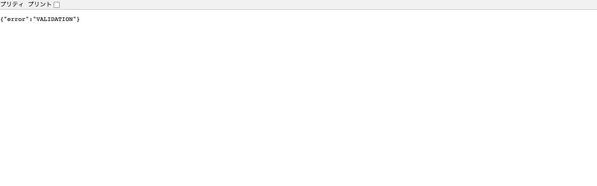
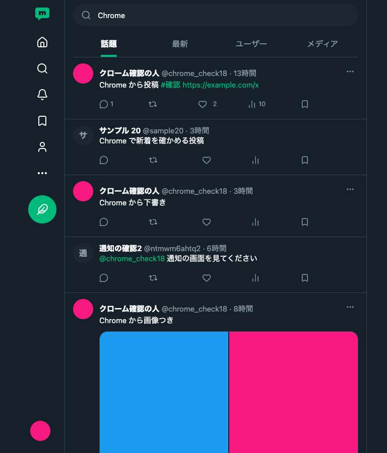

# 試験レポート: 検索と通知の API が、知らない f と tab を 400 にせず既定で返す

## 対象

- issue: [#62](https://github.com/ohta-rh/x-modoki-v2/issues/62)
- commit: `40696ce`・`ab1e7b1`（ブランチ `m1/local-app`、PR #40）
- CI: https://github.com/ohta-rh/x-modoki-v2/actions/runs/44391278921 （`d58a8be`。この commit を含む。緑）
- 日付: 2026-11-19

## 環境

- macOS 26.2、Node.js 26.12.0（`.nvmrc` は 24。CI の実行を本当の結果とする）、Docker Compose の PostgreSQL 18
- 動かし方: `pnpm build && pnpm start -p 3300`。Chrome（Playwright が動かす、インストール済みの Google Chrome）で、ログインしたテストの人の cookie を使った

## 判定

合格 — 受け入れ条件 4 件のうち 4 件を満たした。

## 受け入れ条件ごとの結果

| # | 条件 | 確かめ方 | 結果 | エビデンス |
|---|---|---|---|---|
| 1 | `/api/search` は `f` が無いか、4 つのどれかのときだけ受け、ほかは 400 `VALIDATION` | `search.test.ts` › 知らない f は 400 で、検索しない（#62）、Chrome | 合格 | `search-nope-1280.jpg`・`search-live-1280.jpg` |
| 2 | `/api/notifications` は `tab` が無いか `all` / `mentions` のときだけ受け、ほかは 400 | `notifications.test.ts` › 知らない tab は 400 で、一覧を読まない（#62）、Chrome | 合格 | `notifications-nope-1280.jpg`・`notifications-mentions-1280.jpg` |
| 3 | 検索の画面は、知らない `f` を「話題」として読む | `load-search-page.test.ts` › 画面の URL の知らない f は、拒まずに「話題」として読む（レビュー 1 で足した）、Chrome | 合格 | `search-*.jpg` |
| 4 | CI が緑、カバレッジ 100% のまま | `pnpm verify`、CI | 合格 | 下の出力 |

## 自動のテスト

`pnpm verify`（7 つの確認）:

```
 Test Files  171 passed (171)
      Tests  873 passed (873)
Statements   : 100% ( 2505/2505 )
Branches     : 100% ( 1664/1664 )
Functions    : 100% ( 636/636 )
Lines        : 100% ( 2179/2179 )
  258 passed (1.4m)
VERIFY_RC=0
```

Chrome で開いた API の応答:

```
/api/search?q=a&f=nope           400 {"error":"VALIDATION"}
/api/search?q=a&f=live           200 {"items":[…
/api/notifications?tab=nope      400 {"error":"VALIDATION"}
/api/notifications?tab=mentions  200 {"items":[{… "type":"mention" …
```

### TDD の記録

| # | 振る舞い | 先に書いたテスト | 赤（落ちた理由） | 緑にした実装 |
|---|---|---|---|---|
| 1 | 知らない `f` は 400 で、検索しない | `search.test.ts` › 知らない f は 400 で、検索しない（#62） | `AssertionError: expected 200 to be 400` | `search.ts` で `z.enum(['top','live','user','media']).default('top')` |
| 2 | 知らない `tab` は 400 で、一覧を読まない | `notifications.test.ts` › 知らない tab は 400 で、一覧を読まない（#62） | `AssertionError: expected 200 to be 400` | `notifications.ts` で `z.enum(['all','mentions']).default('all')` |
| 3 | 画面の知らない `f` は「話題」のまま（レビュー 1） | `load-search-page.test.ts` › 画面の URL の知らない f は、拒まずに「話題」として読む… | 今の作りでは通る。そのため、画面の読み取りを厳しくした作りで確かめた: `Error: VALIDATION` | 作りは変えない（テストで今の振る舞いを留めた） |

- 今あったテスト「タブとカーソルを渡し、ページを返す。タブが mentions でなければ全部」は、このバグの振る舞い（`tab=other` → 全部）を決めていた。要件（NFR-SEC-02）と食い違っていたので、「タブが無ければ全部」に直した

## コードレビュー

- 判定: APPROVE（2 回目）　範囲: `40696ce~1..ab1e7b1`　レビューした sub agent: code-reviewer（opus）

| # | 重さ | 指摘 | 確かめた結果 | 対応 |
|---|---|---|---|---|
| 1 | major | 受け入れ条件 3（画面の知らない `f` は「話題」）を留めるテストが無い。だれかが画面の読み取りを厳しくしても、全部のテストが通る | その通り（`f=nope` を画面へ送るテストが無かった） | 直した（`ab1e7b1`）。テスト: TDD の記録の 3 |

2 回目は指摘なし。通知の API では、`tab` の確かめがログインの確かめより先になった。だから、ログインしていなくて `tab` が違うと 400 になる。検索の API が `q` をログインより先に確かめるのと同じなので、そのままにした、という注記あり。

## ブラウザでの確認

| URL | 幅 | テーマ | した操作 | 見えた結果 | 画面の写真 |
|---|---|---|---|---|---|
| `/api/search?q=a&f=nope` | 1280 | — | ログインして開いた（失敗の経路） | `{"error":"VALIDATION"}`、400 | `search-nope-1280.jpg` |
| `/api/search?q=a&f=live` | 1280 | — | 同上 | 一覧の JSON、200 | `search-live-1280.jpg` |
| `/api/notifications?tab=nope` | 1280 | — | 同上（失敗の経路） | `{"error":"VALIDATION"}`、400 | `notifications-nope-1280.jpg` |
| `/api/notifications?tab=mentions` | 1280 | — | 同上 | メンションの JSON、200 | `notifications-mentions-1280.jpg` |
| `/search?q=Chrome&f=nope` | 1280 / 768 / 375 | ダーク | 開いた（隣の画面） | 「話題」のタブが選ばれ、結果が出た | `search-*.jpg` |

- コンソール: エラー 0、警告 0　通信: 失敗 0（API を直接開いた 400 は除く）




## 見つけた問題

1. #30 の要件の突き合わせ（NFR-SEC-02）で見つけた
2. 要件の文の「Zod で確かめ」のうち、ID とカーソルの読み取り（`parseId`、`BAD_CURSOR`）は Zod ではなく手で書いてある。どちらも形が違えば 400 になり、テストもある。そのため、振る舞いの要件は満たしている。ここでは書き換えていない
