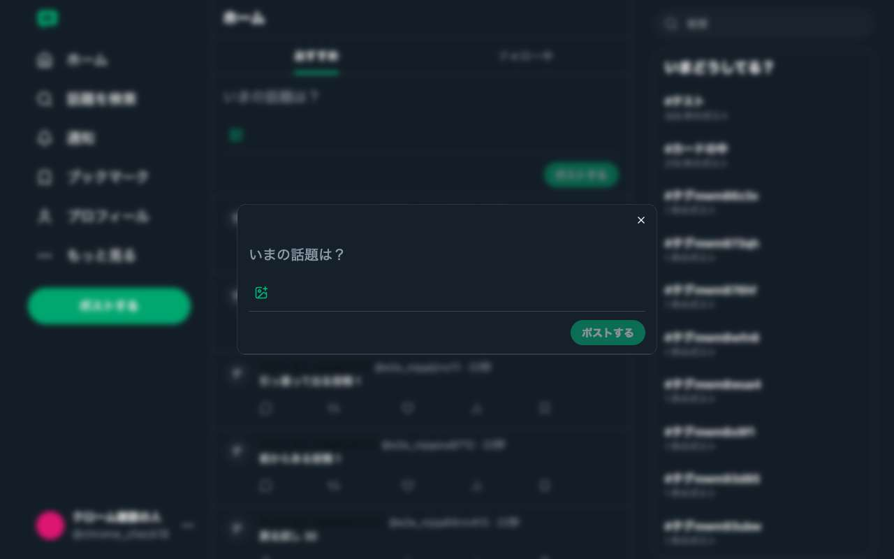

# 試験レポート: 動きを減らす設定にしても、ダイアログやトーストやスピナーが動く

## 対象

- issue: [#63](https://github.com/ohta-rh/x-modoki-v2/issues/63)
- commit: `ee47fd7`・`2d8286b`（ブランチ `m1/local-app`、PR #40）
- CI: https://github.com/ohta-rh/x-modoki-v2/actions/runs/44391278921 （`d58a8be`。この commit を含む。緑）
- 日付: 2026-11-19

## 環境

- macOS 26.2、Node.js 26.12.0（`.nvmrc` は 24。CI の実行を本当の結果とする）、Docker Compose の PostgreSQL 18
- 動かし方: `pnpm build && pnpm start -p 3300`。Chrome（Playwright が動かす、インストール済みの Google Chrome）の `reducedMotion` で設定を切り替えた

## 判定

合格 — 受け入れ条件 3 件のうち 3 件を満たした。

## 受け入れ条件ごとの結果

| # | 条件 | 確かめ方 | 結果 | エビデンス |
|---|---|---|---|---|
| 1 | 動きを減らす設定のとき、アニメーションも遷移も実質 0 秒 | `e2e/reduced-motion.spec.ts` › 動きを減らす設定のとき、モーダルの出入りもリンクの色の遷移も動かない（3 つのブラウザ。モーダル・リンク・スピナー） | 合格 | `composer-reduce-*.jpg` |
| 2 | 設定が無いときの動きは変わらない | `e2e/reduced-motion.spec.ts` › 設定が無いときは、モーダルとリンクは今まで通り動く（#63） | 合格（モーダル 0.1s、スピナー 1s で回り続ける） | `composer-no-preference-1280.jpg` |
| 3 | CI が緑、カバレッジ 100% のまま | `pnpm verify`、CI | 合格 | 下の出力 |

## 自動のテスト

`pnpm verify`（7 つの確認）:

```
 Test Files  171 passed (171)
      Tests  874 passed (874)
Statements   : 100% ( 2505/2505 )
Branches     : 100% ( 1664/1664 )
Functions    : 100% ( 636/636 )
Lines        : 100% ( 2179/2179 )
  264 passed (1.5m)
VERIFY_RC=0
```

Chrome で読んだ、投稿のモーダルの `animation-duration`:

```
reduce        1280 innerWidth 1280 dialog animation 1e-05s console 0
reduce         768 innerWidth  768 dialog animation 1e-05s console 0
reduce         375 innerWidth  375 dialog animation 1e-05s console 0
no-preference 1280 innerWidth 1280 dialog animation 0.1s   console 0
```

### TDD の記録

| # | 振る舞い | 先に書いたテスト | 赤（落ちた理由） | 緑にした実装 |
|---|---|---|---|---|
| 1 | 動きを減らす設定のとき、モーダルの出入りとリンクの色の遷移が動かない | `reduced-motion.spec.ts` › 動きを減らす設定のとき、モーダルの出入りもリンクの色の遷移も動かない | `Expected: < 0.001 / Received: 0.1`（ダイアログの `animation-duration`） | `global.css` の `@media (prefers-reduced-motion: reduce)` |
| 2 | スピナーは 1 回で止まる（レビュー 1） | 同じテストに、`animate-spin` の要素の確かめを足した | 決まりの `animation-iteration-count: 1` を外した作りで `Expected: "1" / Received: "infinite"` | 1 と同じ決まりの `animation-iteration-count: 1 !important` |

## コードレビュー

- 判定: APPROVE（2 回目）　範囲: `ee47fd7~1..2d8286b`　レビューした sub agent: code-reviewer（opus）

| # | 重さ | 指摘 | 確かめた結果 | 対応 |
|---|---|---|---|---|
| 1 | major | スピナーを確かめていないので、`animation-iteration-count: 1 !important` を消しても通る。issue の確かめ方はスピナーも名指ししている | その通り（消して流すと通った） | 直した（`2d8286b`）。テスト: TDD の記録の 2 |

2 回目は指摘なし（`animation-delay` は使われていないこと、`!important` の決まりが Tailwind の層の中のユーティリティに勝つことも確かめた、という注記あり）。

## ブラウザでの確認

| URL | 幅 | テーマ | した操作 | 見えた結果 | 画面の写真 |
|---|---|---|---|---|---|
| `/home` → 投稿する | 1280 / 768 / 375 | ダーク | 動きを減らす設定で、投稿のモーダルを開いた | 途中の姿を経ずに、すぐ全部が出た | `composer-reduce-*.jpg` |
| `/home` → 投稿する | 1280 | ダーク | 設定なしで開いた（比べるため） | 今まで通り 0.1 秒で開く | `composer-no-preference-1280.jpg` |

- コンソール: エラー 0、警告 0　通信: 失敗 0




## 見つけた問題

1. #30 の要件の突き合わせ（NFR-A11Y-07）で見つけた。設定に従っていたのは、いいねのハートだけだった
