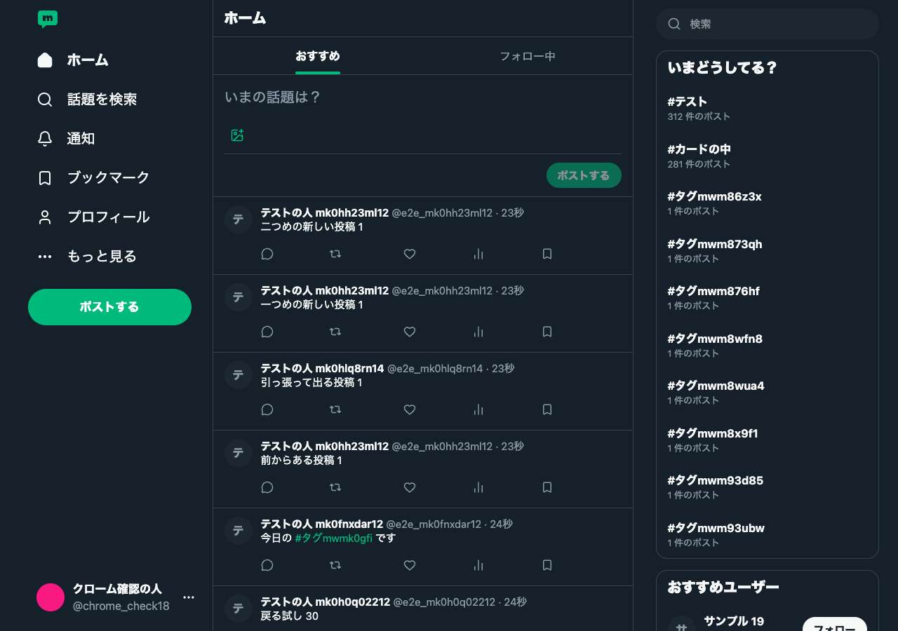

# 試験レポート: トーストの置き場が、どの画面でも英語の「Notifications」と読まれる

## 対象

- issue: [#64](https://github.com/ohta-rh/x-modoki-v2/issues/64)
- commit: `9cad502`（ブランチ `m1/local-app`、PR #40）
- CI: https://github.com/ohta-rh/x-modoki-v2/actions/runs/44391278921 （`d58a8be`。この commit を含む。緑）
- 日付: 2026-11-19

## 環境

- macOS 26.2、Node.js 26.12.0（`.nvmrc` は 24。CI の実行を本当の結果とする）、Docker Compose の PostgreSQL 18
- 動かし方: `pnpm build && pnpm start -p 3300`。Chrome（Playwright が動かす、インストール済みの Google Chrome）

## 判定

合格 — 受け入れ条件 2 件のうち 2 件を満たした。

## 受け入れ条件ごとの結果

| # | 条件 | 確かめ方 | 結果 | エビデンス |
|---|---|---|---|---|
| 1 | トーストの置き場は「お知らせ」という名前の region で、英語の名前が無い | `e2e/close-buttons.spec.ts` › トーストの置き場は「お知らせ」という名前で、英語の名前ではない（#64）（3 つのブラウザ）、Chrome。#30 の `e2e/language.spec.ts` も、主な 10 の画面に英語の UI の言葉が無いことを確かめる | 合格 | `home-*.jpg`、下の出力 |
| 2 | CI が緑、カバレッジ 100% のまま | `pnpm verify`、CI | 合格 | 下の出力 |

## 自動のテスト

`pnpm verify`（7 つの確認）:

```
 Test Files  171 passed (171)
      Tests  874 passed (874)
Branches     : 100% ( 1664/1664 )
  270 passed (1.7m)
VERIFY_RC=0
```

Chrome で `/home` を開き、置き場の名前と、`Notifications` を持つ要素を数えた:

```
[data-slot=toast-viewport] の aria-label: [ 'お知らせ' ]
Notifications を属性か文字に持つ要素: []
```

### TDD の記録

| # | 振る舞い | 先に書いたテスト | 赤（落ちた理由） | 緑にした実装 |
|---|---|---|---|---|
| 1 | トーストの置き場の名前は「お知らせ」 | `close-buttons.spec.ts` › トーストの置き場は「お知らせ」という名前で、英語の名前ではない（#64） | `Expected: "お知らせ" / Received: "Notifications"` | `src/shared/ui/kit/toast.tsx` の `ToastViewport` の既定の `aria-label` |

## コードレビュー

- 判定: APPROVE（1 回目）　範囲: `9cad502~1..9cad502`　レビューした sub agent: code-reviewer（opus）

| # | 重さ | 指摘 | 確かめた結果 | 対応 |
|---|---|---|---|---|
| — | — | 指摘なし。Base UI 1.9.0 の `ToastViewport.js` で、既定の `'aria-label': 'Notifications'` が要素の props より先に混ぜられるので、渡した名前が勝つことも確かめた、という注記あり | — | — |

## ブラウザでの確認

| URL | 幅 | テーマ | した操作 | 見えた結果 | 画面の写真 |
|---|---|---|---|---|---|
| `/home` | 1280 / 768 / 375 | ダーク | 開いて、置き場の名前を読んだ | 「お知らせ」。英語の名前は 0 個。画面は今まで通り | `home-*.jpg` |

- コンソール: エラー 0、警告 0　通信: 失敗 0
- 失敗の経路: トーストは送信の失敗のときにも同じ置き場に出る（#21 のいいねの失敗のテストが、この変更のあとも 3 つのブラウザで通った）




## 見つけた問題

1. #30 で足した、主な画面に英語の UI の言葉が無いことを確かめる画面のテスト（NFR-I18N-01）で見つけた。#57 で閉じるボタンの英語は直したが、置き場の名前は見落としていた
